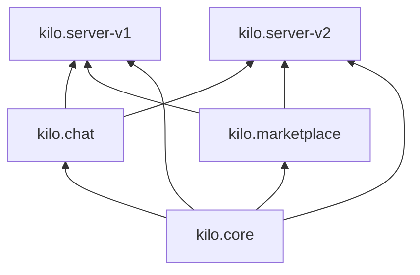

# ADR-003: Kilo server plugins (v1 and v2)

**Status:** Accepted (design; not built yet)

## Context

Kilo Desktop is moving from the Kilo v1 server (`kilo serve`, `@kilocode/sdk`)
to the Kilo Code v2 server (`kilo2`, `@kilocode/client`, published under the
npm dist-tag `kilo-v2` from Kilo-Org/kilocode `origin/v2`). Both must ship in
one build until cutover, chosen at run time, and the migration should happen
at plugin level without changing the plugins that don't talk to the server.

Today the Kilo-server code is spread across three plugins:

- **kilo.core** (main): `KiloServerManager`, CLI distribution, the config
  writers (`KiloConfigManager`, inline config, managed Kilo plugins, skills),
  and five per-area clients built from a `ServerConnection`
  (`AgentServerManager`, `KiloChatClient`, `KiloAccountClient`,
  `KiloModelsClient`, `KiloWorkStyleClient`). Only 6 files import the SDK; the
  rest of kilo.core is server-agnostic logic over those clients.
- **kilo.chat** (renderer): the transcript runtime built on a patched
  `@assistant-ui/react-opencode` (`useChatRuntime`, `createChatBackend`,
  `ChatServices`), plus UI that calls the server directly through
  `useChatConnection` (agents, commands, file read, usage, compaction,
  checkpoints, MCP apps). Its main half and contracts are server-agnostic.
- **kilo.marketplace** (main): raw HTTP to `/kilocode/marketplace*`, `/agent`,
  `/skill`, `/mcp*` behind an existing `MarketplaceDependencies` seam.

`kilo.core/server.connect()` hands `{baseUrl, username, password}` to
kilo.chat and kilo.marketplace (`SERVER_CLIENT_PLUGINS`), which is the main
leak. The kernel namespaces every id by plugin id and enforces ownership, so a
plugin `kilo.core.v2` cannot provide `kilo.core/*`; and nothing chooses a
plugin set before the kernel boots.

## Decision

kilo.core, kilo.chat and kilo.marketplace stay one server-agnostic plugin each,
with the same ids, contracts and domain objects. All Kilo-server code moves
into **per-version server plugins**, `kilo.server-v1` and `kilo.server-v2`,
which fill new **exclusive backend extension points** declared by those three
plugins. A `kernel/flag` chooses which server plugin runs.

### Design: Kilo server plugins

- **Owner:** two new feature-layer plugins, `kilo.server-v1` (today's code,
  moved) and `kilo.server-v2` (new). New plugins because each must ship and be
  removed without the other, and the kernel cannot let one plugin provide
  another's namespace.
- **Domain objects:** unchanged. kilo.core keeps `server`, `account`, `chats`,
  `generation`, `models`, `work-style`; kilo.chat and kilo.marketplace keep
  theirs. Their implementations delegate the server-specific parts to the
  active backend. The server plugins own no shared domain objects.
- **New extension points** (exclusive; contributed only by the server
  plugins, which are outside the owners, so they qualify):
  - `kilo.core/agent-backend` (main): server lifecycle and status, instance
    disposal, the user config file, and the per-area clients (chats with
    domain-level events instead of raw v1 event names, account, models,
    work-style), plus a config sink that receives the `ai-provider`,
    `mcp-server`, `agent-extension`, `server-env`, `chat-config` and
    `tool-approval` contributions and applies them in that server's own
    format.
  - `kilo.chat/chat-backend` (renderer): per-window services and the
    assistant-ui runtime for a chat (`useChatRuntime`), a server-agnostic
    thread-extras port (session, revert, questions, older history), the typed
    transcript part projection the tool renderers read (today the unwritten
    `metadata.custom.opencode` / `opencode-*` contract), and typed calls the UI
    makes today through `useChatConnection` (agents, commands, file read,
    usage, compaction, revert, MCP resource read and tool call).
  - `kilo.marketplace/marketplace-backend` (main): catalog list, install and
    remove; runtime items; MCP statuses and authentication.
- **Contributes to:** each server plugin contributes one implementation to
  each backend point, and nothing else that other plugins see.
- **Contract changes:** `KiloServer.connect()`, `ServerConnection` and
  `SERVER_CLIENT_PLUGINS` leave the public contract; connections become
  private to each server plugin. `restart`, `status`, `disposeInstance` and
  `userConfigFile` stay on `kilo.core/server`. Payload vocabulary that is v1
  today (tool names, permission names and flags, `desktop_` wire names,
  `providerID`/`modelID`) stays; `kilo.server-v2` maps v2 names onto it, or
  the gap is flagged (step 3 of the migration).
- **react-opencode:** forked from upstream 0.2.17 with our patch in source.
  The v1 copy lives in `kilo.server-v1`'s renderer half; `kilo.server-v2`
  holds its own copy translated to `@kilocode/client`. The v1 copy is deleted
  at cutover.
- **Flags:** `kernel/flag:kilo-server-v2`, default off. `kilo.server-v1`
  declares `when: { none: ["kernel/flag:kilo-server-v2"] }`, `kilo.server-v2`
  `when: { all: ["kernel/flag:kilo-server-v2"] }`. The kernel gains a run-time
  local override for flags and latches this flag's value at launch, so a late
  LaunchDarkly answer never swaps the server mid-session.
- **Services:** each server plugin owns its server `kernel/service` (v1 spawns
  `kilo serve`; v2 connects to, starts or installs the shared `kilo2` service)
  and its config-sync task.
- **Storage:** each server plugin owns its storage. `kilo.server-v1` keeps
  using the Kilo config and data locations v1 uses today and imports
  kilo.core's server-specific kv data once (decision 37). `kilo.server-v2`
  starts fresh.
- **Without it:** with no server plugin active, kilo.core reports the server
  as unavailable, chats and models are empty, kilo.chat's pane says the server
  is unavailable, and the marketplace lists nothing installable. Every other
  plugin keeps working. Removing kilo.chat or kilo.marketplace leaves their
  backend contributions as warnings (decision 29).
- **Extensibility map rows added:** the three backend points.

## Rejected alternative

**Whole-plugin variants with the same id** (a second `kilo.core`,
`kilo.chat` and `kilo.marketplace` package each). The kernel allows only one
plugin per id per process, so the host would have to pick a set before the
kernel boots and tell every window before `createRendererKernel`; plugin ids
may not appear in `apps/*/kernel`; and the server-agnostic code (account state
machine, flags, telemetry, tool gateway, composer, panes) would be duplicated
or extracted into shared packages.

Also rejected: the disabled-plugins list as the switch (no remote rollout),
and a live flag that swaps the server after startup.

## Consequences

- The work starts with refactors that leave v1 behaviour unchanged: fork
  react-opencode, declare the backend points, move v1 server code into
  `kilo.server-v1`, then remove the connection from the public contract.
- kilo.chat's tool renderers move from reading OpenCode message metadata to a
  typed transcript contract, which is the largest refactor.
- Plugins that contribute Kilo-shaped payloads (local-inference provider
  entries, notebook's Kilo server plugin and `server-env`, environments'
  permission rules and renderers) keep working on v1 and depend on
  `kilo.server-v2` translating them; gaps are flagged, not fixed in Kilo.
- e2e page objects that call `kilo.core/server.connect` need another way in.
