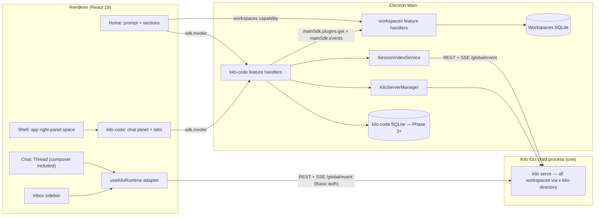
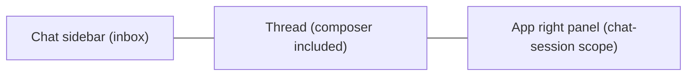

# Kilo Code Integration — Specification

Status: Draft (reference for phased implementation)
Owner: Desktop team
Last updated: 2026-08-06
Revisions: 2026-07-31 (rev 2) — workspaces split out as a shared platform feature (§3.5/§3.6/§4); Kilo CLI is bundled with the app, never user-installed (§3.2, §11, §14); sidebar: snooze capability removed, Needs You section added (§7)
2026-07-31 (rev 3) — single `kilo serve` for all workspaces with `directory` scoping + spawn-time auth (`KILO_SERVER_PASSWORD`), identity verification, `--port 0` + stdout handshake, no adoption of foreign servers (§3.2); one `/global/event` SSE per process (§3.3); reference folders auto-allowed with zero prompts via config rules + session rulesets (§3.7); storage tiers: SQLite vs electron-store vs `safeStorage` (§4.4); terminal prefers kilo's server PTY (§8, §14)
2026-07-31 (rev 4) — reference-folder grants moved from server-wide spawn config to **session-scoped rulesets** (§3.7): global rules were path-scoped but not workspace-scoped, silently granting every workspace's folders to every session. Verified: subagent sessions inherit `external_directory` rules; session rules auto-allow pre-ask for all tools incl. bash; folder removal = append-and-shadow (last-rule-wins); vendored adapter patched for create options
2026-08-03 (rev 5) — future Git/worktree compatibility made explicit without adding it to v1 (§2/§12); chat transcripts and session lists virtualized with bounded active runtimes (§6/§7); the shell exposes an app-wide right-panel space while each feature owns its panel UI/state (§8)
2026-08-03 (rev 6) — aligned with the implemented plugin-system slices: feature persistence uses `mainSdk.storageDir` under `${userData}/plugins/<id>/`; built-in versus plugin route/asset ownership is explicit (§3.5/§11); feature navigation uses `sdk.navigate`; proposed right-panel zones are identified as Phase 6 platform additions (§8); capability stubbing through `createFakeSdk` is confirmed (§13)
2026-08-03 (rev 7) — aligned with plugin-system Slice 6 (PR #56): kilo-code resolves workspaces directly through `mainSdk.plugins`, subscribes to workspace changes through `mainSdk.events`, and emits renderer updates over the implemented cross-process event bridge; the renderer relay, `workspace_folder_cache`, resolved-workspace channel inputs, and Phase 3 polling interim are removed (§3.1/§3.5/§3.6/§4/§10/§12)
2026-08-03 (rev 8) — split the former Foundations phase into Phase 1 Workspaces and Phase 2 Kilo Code; renumbered every later phase (§12)
2026-08-04 (rev 9) — Phase 2 narrowed to the packaged Kilo server foundation: stable CLI 7.4.20, OpenCode-style per-target npm staging, authenticated fetch/SSE validation, and no speculative settings, SQLite, SDK, or assistant-ui work. Session persistence, workspace reconciliation, `@kilocode/sdk`, and the assistant-ui adapter move to Phase 3. Future workspace-independent chats use an explicit unscoped chat scope backed by an app-owned directory.
2026-08-04 (rev 10) — aligned server startup with OpenCode Desktop: `kilo-code.mainRegister` starts the singleton during app initialization; connection calls coalesce with startup and retry after a failed or crashed process.
2026-08-04 (rev 11) — co-located CLI metadata, staging logic, tests, and generated resources under the kilo-code feature; installation now consumes injected resource roots. The root fetch wrapper, Forge resource entry, and loopback CSP allowance are documented as the only remaining host seams for plugin migration.
2026-08-06 (rev 12) — moved OpenCode SDK compat, react-opencode patch, CLI `fetch-cli`, packaged asset resolution, and home→chat redirect ownership into `plugins/kilo-code/`; remaining host seams are Forge `extraResource`, loopback CSP, optional Windows signing import from desktop config, and BUNDLED_PLUGINS registration.
2026-08-06 (rev 13) — split into `plugins/kilo-server` (CLI packaging + server lifecycle; exposes a main-process `connectionService` capability) and `plugins/kilo-ui` (chat UI + workspaces CRUD under `src/{web,contracts,main}/{chat,workspaces}/`). Unscoped chats use `{userData}/chats/<chatId>/`; the renderer calls kilo-ui's `chat.getConnection`, whose main handler resolves kilo-server lazily. The separate `plugins/workspaces` package is removed.

This document is the full-picture spec for integrating [Kilo Code](https://kilo.ai) into the Anaconda Agentic Desktop app. It is written to be built **phase by phase** (see [§12 Phased implementation plan](#12-phased-implementation-plan)); each phase should be implementable from this document alone.

Key references used while writing this spec:

- Kilo CLI + SDK: [kilo.ai/docs/code-with-ai/platforms/cli](https://kilo.ai/docs/code-with-ai/platforms/cli), [Kilo-Org/kilocode](https://github.com/Kilo-Org/kilocode), DeepWiki "SDK and API" / "JavaScript SDK" pages
- Kilo Marketplace: [kilo.ai/docs/customize/marketplace](https://kilo.ai/docs/customize/marketplace), [Kilo-Org/kilo-marketplace](https://github.com/Kilo-Org/kilo-marketplace)
- assistant-ui OpenCode adapter (the workhorse we vendor): `/Users/jlowe/Repositories/assistant-ui/packages/react-opencode` + companion UI in `/Users/jlowe/Repositories/assistant-ui/examples/with-opencode`
- t3code sidebar reference: `/Users/jlowe/Repositories/t3code` (`apps/web/src/components/SidebarV2.tsx`, `Sidebar.logic.ts`, `AppSidebarLayout.tsx`, `sidebarProjectGrouping.ts`)
- Repo conventions: [CONTEXT.md](../CONTEXT.md), [AGENTS.md](../AGENTS.md), [docs/TESTING.md](./TESTING.md), `.agents/skills/new-feature/SKILL.md`, `.agents/skills/write-vitest/SKILL.md`, `.agents/skills/write-e2e-test/SKILL.md`

---

## 1. Overview & goals

The app becomes a desktop command center for Kilo Code agents. A user points the app at one or more **workspaces** (project folders), starts **chat sessions** with a chosen **agent** and **model**, approves tool calls when asked, and tracks what their usage is costing. Multiple agent sessions run concurrently across workspaces; the UI makes it obvious which sessions need a human and which are done.

UX pillars:

1. **One prompt away** — the home page is a single composer. Pick a workspace, agent, and model; hit send; land in the chat.
2. **Inbox for agents** — the chat sidebar is a t3code-V2-style inbox: sessions needing attention float up, finished work settles away.
3. **Kilo does the heavy lifting** — agents, tools, permissions, MCPs, skills, providers, and cost accounting all come from the Kilo CLI runtime. We build the shell, the inbox, and the settings surface — not an agent loop.

Explicit non-goals (for now): cloud/remote sessions (`kilo cloud`, `/remote`), teams/orgs switching, ACP editor protocol, voice/dictation, sharing sessions, Git workflow UI, and worktree-backed session isolation. Git and worktrees are deferred rather than rejected; the v1 boundaries preserve the post-v1 direction described below.

---

## 2. Concepts & terminology

| Concept              | Definition                                                                                                                                                                                                                                                                  | Backed by                                                                                                                                                                                                                                                                                                                                                                                                                                                                                                             |
| -------------------- | --------------------------------------------------------------------------------------------------------------------------------------------------------------------------------------------------------------------------------------------------------------------------- | --------------------------------------------------------------------------------------------------------------------------------------------------------------------------------------------------------------------------------------------------------------------------------------------------------------------------------------------------------------------------------------------------------------------------------------------------------------------------------------------------------------------- |
| **Workspace**        | A named collection of folders. Exactly one folder is the **primary folder** — the default working directory agents use in v1. All other folders are **reference folders** the agent may read and write — allowed automatically, never via manual permission prompts (§3.7). | Owned by the shared **`workspaces` feature** (platform-level; consumed by kilo-code today, terminal/notebooks/git tomorrow — see §3.5). In v1 kilo-code maps a workspace to a kilo **`directory`** (the primary folder) on the single shared `kilo serve`; reference folders are auto-allowed via session-scoped `permission.external_directory` rules — zero prompts, and only within that workspace's sessions (§3.7). NB: kilo's `x-kilo-workspace` header is a different concept (remote routing) — do not use it |
| **Chat session**     | A single conversation with an agent. V1 sessions belong to a workspace; a later workspace-independent mode uses an explicit unscoped chat scope backed by an app-owned directory.                                                                                           | Kilo-owned (Kilo `Session` / `GlobalSession`); app-owned metadata (visited/settled) layered on top                                                                                                                                                                                                                                                                                                                                                                                                                    |
| **Agent**            | The persona/behavior running the session. Built-ins: `code`, `architect` (plan), `ask`, `debug`, `orchestrator`. Custom agents are markdown files.                                                                                                                          | Kilo config: project `.kilo/agents/<name>.md`, global `~/.config/kilo/agents/<name>.md`                                                                                                                                                                                                                                                                                                                                                                                                                               |
| **Provider**         | A model source: Kilo Gateway (OAuth), OpenAI, Anthropic, etc.                                                                                                                                                                                                               | Kilo auth store + `provider` config                                                                                                                                                                                                                                                                                                                                                                                                                                                                                   |
| **Model**            | A `providerID/modelID` pair, e.g. `anthropic/claude-sonnet-4-6`. Selectable per session.                                                                                                                                                                                    | Kilo server model catalog                                                                                                                                                                                                                                                                                                                                                                                                                                                                                             |
| **Skill**            | Task-specific instructions/resources the agent loads when relevant.                                                                                                                                                                                                         | `.kilo/skills/<name>/` (project), `~/.kilo/skills/<name>/` (global)                                                                                                                                                                                                                                                                                                                                                                                                                                                   |
| **MCP server**       | External tool source configured under the `mcp` config key.                                                                                                                                                                                                                 | `~/.config/kilo/kilo.json[c]` (global), `.kilo/kilo.json` (project)                                                                                                                                                                                                                                                                                                                                                                                                                                                   |
| **Marketplace item** | An installable agent, skill, or MCP server from the Kilo Marketplace.                                                                                                                                                                                                       | [Kilo-Org/kilo-marketplace](https://github.com/Kilo-Org/kilo-marketplace) catalog                                                                                                                                                                                                                                                                                                                                                                                                                                     |
| **Attention state**  | Derived per-session UI state: Working / Approval / Input / Plan Ready / Failed / Done(unread).                                                                                                                                                                              | Derived from Kilo session status + pending permissions/questions + our `lastVisitedAt`                                                                                                                                                                                                                                                                                                                                                                                                                                |

### 2.1 Future Git and worktree compatibility

A workspace is not a repository abstraction. Any folder in a workspace may be Git-controlled, multiple folders may belong to different repositories, and a folder may sit below a repository root. V1 does not perform Git mutations or create worktrees, but it must not bake in assumptions that a workspace has exactly one repository or that a session's working directory will forever equal the workspace's primary folder.

Post-v1, a shared **`git` feature** can discover repositories from workspace folders and own status/diff, branch, commit, fetch/pull/push, and pull-request workflows. Kilo-code, terminal, notebooks, and other features consume that capability rather than importing Git implementation code across feature boundaries.

Worktree-backed isolation builds on that shared Git capability. A future chat session may be associated with an isolated worktree and use its path as the session's **effective working directory**, while remaining associated with the original workspace and its reference folders. In v1 the effective working directory is always the primary folder. Session, terminal, panel, and future Changes-tab APIs should therefore pass or derive session context instead of assuming `workspace.primaryFolder` is the permanent execution directory. Kilo Agent Manager is the primary implementation reference for worktree lifecycle, multi-session routing, cleanup, and diff handling; Conductor is not a dependency or behavioral source.

Workspace-independent chats are represented explicitly rather than by a fake workspace or nullable path:

```typescript
type ChatScope = { type: "workspace"; workspaceId: string } | { type: "unscoped" };
```

Kilo still requires a directory for every instance-scoped request. Unscoped chats therefore use an app-owned directory below the kilo-code feature storage root (for example `${mainSdk.storageDir}/runtime/unscoped`) and receive no workspace-managed reference-folder grants. Phase 2 keeps `server.getConnection({ workspaceId })`; when unscoped chats are implemented, its input grows additively to also accept `{ scope: "unscoped" }`.

---

## 3. Runtime architecture

### 3.1 Shape



**Main-side decoupling note:** kilo-code never imports workspaces implementation code, but its main code can resolve the workspaces feature's process-local capability through `mainSdk.plugins.get("workspaces")` and subscribe to `workspaces.*` through `mainSdk.events`. Workspace-sensitive channels take only a `workspaceId`; kilo-code main reads the current folders at the point of use. Missing capabilities degrade to `null`, so handlers must fail gracefully rather than assuming activation order. See §3.6.

### 3.2 Kilo server lifecycle (main process)

**One `kilo serve` child process for the whole app** — never one per workspace. Kilo's server is natively multi-directory: every request resolves its target directory from `?directory=` / the `x-kilo-directory` header and lazily boots a per-directory instance in-process (`packages/opencode/src/server/routes/instance/httpapi/middleware/workspace-routing.ts` + `project/instance-store.ts` in Kilo-Org/kilocode); all sessions live in one global DB with cross-directory listing. This matches both reference implementations (the Kilo VS Code extension and the OpenCode desktop each spawn exactly one server). Workspaces map to kilo `directory` values (primary folder) per request — there is nothing to spawn per workspace.

Exactly one `KiloServerManager` is created when `kilo-code.mainRegister` runs. Its handlers share that instance and dispose it through `mainSdk.onDispose`; it is deliberately not a module-global/static singleton, so feature-system tests and future reloads cannot share leaked process state. The manager owns spawn, readiness/identity verification, an **in-memory only** connection registry (`{ baseUrl, username, password, pid, status }` — never persisted), crash detection, and teardown. Registration starts it immediately during app initialization, matching OpenCode Desktop's eager sidecar startup. Connection calls coalesce with an in-flight start; a startup failure is reported without aborting the app, and the next connection request retries. An unexpected exit clears the connection and reports `error`; the next connection request starts a fresh child rather than entering an automatic respawn loop.

Server stderr is drained so the child cannot block, but it is not persisted. Raw CLI diagnostics may contain user paths or prompt content, while the packaged logger writes to disk. If production crash diagnostics require stderr later, retain only a bounded in-memory tail, redact secrets, and emit it only for startup failures or unexpected exits rather than continuously logging the stream.

**Spawn recipe** (via **`execa`** of the vendored binary — we do NOT use `createKiloServer`, because it neither sets the auth password nor the CORS origins we need, and its readiness check does no identity verification):

**Process library: `execa` everywhere.** `execa` is the desktop app's existing process library (`apps/desktop/package.json` — v9, which itself moved off the unmaintained `cross-spawn`; also externalized in `vite.main.config.ts`). It gives us cross-platform `.cmd`/PATHEXT resolution on Windows, sane signal/cleanup semantics, and iterable stdout lines for the handshake parse. Do NOT add `cross-spawn` (or any second spawn lib) as a dependency — kilo's SDK and opencode's desktop use it internally, but we manage our own spawn and stay on the app's standard. The manager uses: merged `env` (recipe below), stdout line subscription for the `listening on` handshake, and explicit `subprocess.kill()` on `onDispose` (with `KILO_PARENT_PID` as the orphan backstop):

```bash
kilo serve --hostname=127.0.0.1 --port=0 --cors=<renderer-origin>
```

with env:

| Env var                     | Value                                                                                  | Why                                                                                                                                                                                                                                                        |
| --------------------------- | -------------------------------------------------------------------------------------- | ---------------------------------------------------------------------------------------------------------------------------------------------------------------------------------------------------------------------------------------------------------- |
| `KILO_SERVER_PASSWORD`      | `crypto.randomBytes(32).toString("hex")`, **generated per spawn, held in memory only** | Enables the server's HTTP Basic auth (username defaults to `kilo`). This is the auth AND the identity proof (below). Same pattern as the Kilo VS Code extension (`kilo-vscode/.../server-manager.ts`) and the OpenCode desktop (`randomUUID()` per launch) |
| `KILO_PARENT_PID`           | Electron main's PID                                                                    | Server self-terminates if orphaned (built-in parent watchdog, `kilocode/src/kilocode/parent-watchdog.ts`)                                                                                                                                                  |
| `KILO_TREE_SITTER_WASM_DIR` | The staged package's adjacent `bin/tree-sitter` directory                              | The current platform packages ship required WASM/resources beside the executable; packaging only the executable is insufficient.                                                                                                                           |
| `XDG_CONFIG_HOME`           | `${mainSdk.storageDir}/runtime/config`                                                 | Gives Desktop an app-owned Kilo config root without moving the shared data directory that contains provider credentials.                                                                                                                                   |

**Config is app-owned; provider data remains shared.** `XDG_CONFIG_HOME` points Kilo at Desktop's config root under plugin storage, while the child continues to inherit the host `XDG_DATA_HOME` and `XDG_CACHE_HOME`. Existing provider credentials and sessions therefore remain available from Kilo CLI / VS Code's shared data directory (typically `~/.local/share/kilo`), but global `~/.config/kilo` settings and MCPs are not loaded into Desktop. `KILO_CONFIG_DIR` is deliberately unset because Kilo 7.4.21 treats it as an additional config directory, not an isolated profile. `XDG_STATE_HOME` remains app-local unless the host explicitly provides one.

No permission rules go into spawn config — reference-folder access is granted per session (§3.7), never server-wide.

**Port allocation**: always `--port 0`; the actual bound port is learned by parsing the stdout line `kilo server listening on http://127.0.0.1:<port>` (regex `/on\s+(https?:\/\/[^\s]+)/`, same as the SDK's parser). Never compute or persist the port. Quirk to note: port `0` tries `4096` first, then falls back to an OS-assigned port (`server.ts` `startWithPortFallback`) — harmless, but don't assume randomness.

**Identity & health**: after the stdout handshake, verify with an **authenticated** `GET /global/health` before marking ready — a `200` with our unique `Authorization` header proves the responding process is the one we spawned (a foreign server on a recycled port returns `401`), and the returned `version` detects a stale/foreign build. There is no instance-id endpoint in kilo; the per-spawn password IS the identity proof — this is the established pattern in both reference apps. All health checks are authenticated; "something answers on the port" is never sufficient.

**External instances**: Desktop **never adopts** foreign `kilo serve` processes. If spawn or identity verification fails, we kill the child and surface an error — we never probe localhost for "someone else's" server, never attach to a server we didn't spawn, and never reuse a port/URL across restarts. Connection details are re-learned at every spawn; the renderer re-fetches them via `server.getConnection` each launch.

- **CLI provisioning (bundled — never rely on a user install)**: follow OpenCode Desktop's per-target staging pattern. Feature-owned `cli-distribution/stage.ts` installs one exact platform package into a temporary directory with scripts disabled, validates the package-lock integrity against `cli-distribution/artifacts.ts`, and copies the complete `bin` directory into generated `resources/kilo/<target>/` beside the feature. Plugin-owned `scripts/fetch-cli.ts` (`pnpm --filter @anaconda-agentic-desktop/plugin-kilo-server run fetch-cli`) stages into the plugin resource root and optionally loads the shell Windows signing callback from `apps/desktop/config/windows-sign.js` when Azure credentials are present. Desktop `prestart` / `premake` / `prepackage` / `prepublish` invoke that script inline. The current matrix maps macOS arm64 to `@kilocode/cli-darwin-arm64`, Windows x64 to `@kilocode/cli-windows-x64-baseline`, and Linux x64 to `@kilocode/cli-linux-x64-baseline`. Choosing baseline for x64 at package time favors CPU compatibility and removes runtime AVX selection. Forge ships the generated root as `resources/kilo`; `KILO_CODE_CLI_PATH` overrides the executable for local Kilo development. Binaries update only with app releases and are signed/notarized with the app (§14).
- **Version pinning**: Phase 2 pins the CLI packages to stable `7.4.20`. Phase 3 pins `@kilocode/sdk` to the matching `7.4.20` when the first real SDK/assistant-ui caller lands. The current stable line already exposes the required v2 client and directory routing; the older "1.x next line" assumption was incorrect.

### 3.3 Renderer ↔ server transport & auth

- The chat surface talks to `kilo serve` **directly over `http://127.0.0.1:<port>` (REST + SSE)** using a typed `@kilocode/sdk/v2/client` client created in the renderer. This is what the assistant-ui adapter is built for, and it keeps high-frequency token streaming off our IPC bridge.
- The renderer learns `{ baseUrl, username, password, directory }` via its kilo-code SDK instance's `sdk.invoke("server.getConnection", { workspaceId })` — the same shape as the OpenCode desktop's `awaitInitialization` IPC, plus the authoritative primary-folder directory resolved in main. The password is delivered over our IPC bridge (renderer is same-process trust), never written to disk anywhere.
- **Auth on every call**: REST clients and the generated SDK's fetch-based SSE client set `Authorization: Basic base64("kilo:" + password)`. The current SDK does not require native `EventSource` or a query-token workaround. Every request — including health checks and `/global/event` — is authenticated.
- **CORS/CSP**: spawn passes both exact renderer origins (`anaconda-agentic-desktop://app` and `anaconda-agentic-desktop-dev://app`) through repeated `--cors` arguments, while the shell CSP permits only `http://127.0.0.1:*` as the additional connect source. Phase 2 verifies authenticated `fetch` and streaming response headers from the packaged renderer. A custom-fetch IPC proxy remains a fallback only if direct transport fails on a supported packaged target.
- **One SSE stream per process** (not per chat, not per workspace): the server publishes every event on `GET /global/event`, wrapped in a `{ directory, project, workspace, payload }` envelope, with a 10s heartbeat. We run exactly two subscribers total:
  1. **Main**: `SessionIndexService` subscribes once, feeding the cross-workspace session index (§4.3).
  2. **Renderer**: one app-level `KiloEventBus` subscription, lifted above the router and shared by every chat surface; the vendored adapter consumes filtered per-session streams from it (§3.4). Delta coalescing (16ms frames) per the OpenCode app pattern.

  This replaces the earlier design (one stream per workspace-server in main + one per chat page in the renderer). Main keeps its own subscription because it owns the index and cold-start attention scans; routing renderer token deltas through main over IPC remains deliberately avoided.

- Main-process consumers (`SessionIndexService`, usage aggregator, settings service) share one Node `@kilocode/sdk` client, passing `directory` per call.

### 3.4 The `useKiloRuntime` adapter (renderer)

This entire adapter and its `@kilocode/sdk` dependency are **Phase 3 work**, shipped with the first chat UI that consumes them. Phase 2 validates the raw authenticated renderer transport only; it does not vendor unused assistant-ui source or design placeholder event/session seams.

We vendor an adapter modeled on `@assistant-ui/react-opencode` (local source: `/Users/jlowe/Repositories/assistant-ui/packages/react-opencode`, ~2.9k LOC of source plus tests) retargeted from `@opencode-ai/sdk/v2/client` to `@kilocode/sdk/v2/client`. It already implements everything the chat needs:

| Capability                                                                                               | Where it comes from in the reference adapter                                                                                                          |
| -------------------------------------------------------------------------------------------------------- | ----------------------------------------------------------------------------------------------------------------------------------------------------- |
| Thread runtime over a remote session                                                                     | `useOpenCodeRuntime` → `useRemoteThreadListRuntime` + per-session `OpenCodeThreadController` (`useOpenCodeRuntime.ts`, `OpenCodeThreadController.ts`) |
| SSE subscription with reconnect                                                                          | `OpenCodeEventSource.ts`                                                                                                                              |
| OpenCode/Kilo part → assistant-ui message projection (text, reasoning, tool, file, snapshot, step parts) | `openCodeMessageProjection.ts`                                                                                                                        |
| Tool-call approval                                                                                       | `onRespondToToolApproval` → `replyToPermission(id, "once" \| "always" \| "reject")` (`openCodePermissionApproval.ts`)                                 |
| Agent follow-up questions                                                                                | pending `questions` + `replyToQuestion` / `rejectQuestion` (`hooks.ts`, `types.ts`)                                                                   |
| Per-message agent/model selection                                                                        | `OpenCodeUserMessageOptions { model: { providerID, modelID }, agent }`                                                                                |
| Thread list CRUD (list/rename/archive/delete/create/summarize)                                           | `openCodeThreadListAdapter.ts`                                                                                                                        |
| Hooks for custom UI                                                                                      | `useOpenCodeSession`, `useOpenCodeThreadState`, `useOpenCodePermissions`, `useOpenCodeQuestions`, `useOpenCodeStreamingTiming` (`hooks.ts`)           |

Vendored location: `plugins/kilo-code/src/web/runtime/` (web-only code, no Node deps — it only needs `fetch`). Changes vs. the reference:

1. Swap the SDK import and types (`OpencodeClient` → `KiloClient`; the event union includes Kilo additions such as `EventPermissionAsked`/`EventPermissionReplied`).
2. Accept per-send **dynamic** `model`/`agent` getters (not just static `defaultModel`/`defaultAgent`) so the composer selectors apply per message. The reference applies defaults at send time in `onNew`; we extend `sendMessage` options to read from a selection ref.
3. **Shared event stream**: replace the per-runtime `EventSource` (`OpenCodeEventSource.ts`) with subscriptions to the app-level `KiloEventBus` (§3.3): unwrap the `/global/event` `{ directory, payload }` envelope, dispatch by `sessionID`, and keep reconnect/heartbeat logic in the bus (not per chat page). The adapter's public surface is unchanged.
4. Wire the generated client's Basic-auth option into both REST and fetch-based SSE calls (§3.3).
5. **Session create-options factory**: the reference thread-list adapter's `initialize` calls `session.create({})` with no injection point. Our vendored copy accepts a per-workspace create-options factory so every adapter-created session carries the §3.7 permission ruleset (in practice all session creation flows through our `sessions.create` channel, which attaches rules server-side — this patch is belt-and-braces so no code path can create a ruleset-less session).
6. Drop what we don't use (nothing else expected; keep the public surface otherwise identical so upstream fixes port cleanly).

Companion chat UI is ported from `/Users/jlowe/Repositories/assistant-ui/examples/with-opencode/components` into `apps/web/src/components/assistant-ui/`, restyled to the Anaconda theme:

- `tools/opencode-tools.tsx` (`FallbackTool`), `tools/tool-group.tsx` (`ToolGroup`), `tools/reasoning-ghost.tsx` (`ReasoningGroup`), `tools/tool-ui-bash.tsx`, `tools/tool-ui-apply-patch.tsx`, `tools/tool-ui-inline.tsx`, `tools/tool-ui-shared.tsx`, `tools/toolkit.tsx`
- `tools/opencode-permission-card.tsx`, `tools/opencode-question-card.tsx`, `tools/opencode-tool-interactions.tsx`
- `opencode-data-part.tsx` (fallback data-part renderer)

### 3.5 Feature shape (per repo conventions)

The integration ships as two bundled plugins: **kilo-server** and **kilo-ui**. kilo-server owns CLI packaging and the Kilo process lifecycle. kilo-ui owns the chat surface and workspace CRUD (formerly the separate `plugins/workspaces` package). kilo-ui never imports kilo-server implementation code or invokes its channels from the renderer: `chat.getConnection` resolves/creates the working directory in kilo-ui main, lazily obtains kilo-server's process-local `connectionService` capability, and returns the connection through kilo-ui's own channel.

**`workspaces` plugin** (platform-level):

| Layer        | Location                                      | Contents                                                                                                                                                                                             |
| ------------ | --------------------------------------------- | ---------------------------------------------------------------------------------------------------------------------------------------------------------------------------------------------------- |
| Contract     | `plugins/workspaces/src/contracts/schemas.ts` | workspace/folder Zod schemas + `defineContract({ list, get, create, update, remove })`                                                                                                               |
| Main         | `plugins/workspaces/src/main/`                | `index.ts` (`mainRegister`: handlers + `mainSdk.plugins.expose` + post-commit `mainSdk.events.emit`), `WorkspaceService.ts` (CRUD, path validation, primary-folder invariant), `schema.ts` (Drizzle) |
| Renderer     | `plugins/workspaces/src/web/`                 | manifest-mounted workspace selector and management dialogs, renderer capability exposure + event-driven query invalidation (§3.6)                                                                    |
| Persistence  | `${userData}/plugins/workspaces/data.db`      | own SQLite file at `path.join(mainSdk.storageDir, "data.db")` + own Drizzle migrations                                                                                                               |
| Registration | bundled plugin registries                     | `plugin.json` plus one `workspaces` entry in each `BUNDLED_PLUGINS` registry                                                                                                                         |

**`kilo-code` plugin** (this integration):

| Layer        | Location                                     | Contents                                                                                                                                                                                                                                                                                                    |
| ------------ | -------------------------------------------- | ----------------------------------------------------------------------------------------------------------------------------------------------------------------------------------------------------------------------------------------------------------------------------------------------------------- |
| Contract     | `plugins/kilo-code/src/contracts/schemas.ts` | Plugin-owned Zod schemas + `defineContract({ ... defineMethod(input, output) })`                                                                                                                                                                                                                            |
| Main         | `plugins/kilo-code/src/main/`                | Phase 2: lifecycle handlers, `KiloServerManager.ts`, installation resolution, and permission-rule helpers. Later phases add `SessionIndexService`, usage/settings/marketplace services, and persistence when first consumed.                                                                                |
| Renderer     | `plugins/kilo-code/src/web/`                 | Phase 2: browser-mode desktop-required registration only. Phase 3 adds `runtime/` (vendored adapter), views, hooks, selectors, and the shared event bus.                                                                                                                                                    |
| Registration | bundled plugin registries                    | `plugin.json` plus one `kilo-code` entry in each `BUNDLED_PLUGINS` registry                                                                                                                                                                                                                                 |
| Persistence  | `${userData}/plugins/kilo-code/`             | `runtime/` is the stable spawn cwd and contains Desktop's app-local XDG config root. Kilo data/cache remain on shared host paths so provider credentials and sessions carry over; state is app-local by default. Phase 3 introduces scope-aware session metadata; the usage phase introduces usage rollups. |
| Errors       | —                                            | `FeatureError` for expected failures (survives IPC); never plain `Error`                                                                                                                                                                                                                                    |

**Plugin boundary:** workspaces and kilo-code are separate bundled plugins. Kilo's contracts, CLI metadata, staging implementation, tests, generated resources, OpenCode SDK compat facade, react-opencode patch, `fetch-cli`, and packaged asset resolution (`createKiloCodeResolveAsset`) are co-located under `plugins/kilo-code/`. `installation.ts` knows only about injected resource roots, while `mainRegister` obtains the active layout through `mainSdk.resolvePluginAsset("resources/kilo")`. Moving the future dynamic `/chat/$sessionId` route into the plugin manifest will also require the plugin route layer to support the same parameterized route semantics; the currently implemented plugin page lookup is for resolved `/plugins/*` pages.

Host seams remain intentionally isolated rather than expanding the plugin platform:

1. `apps/desktop/forge.config.ts` includes the generated CLI directory in packaged resources.
2. `apps/desktop/src/main/platform/ElectronProtocol.ts` permits the dynamic loopback server in `connect-src`.
3. Plugin `fetch-cli` optionally imports Windows signing from `apps/desktop/config/windows-sign.js` when Azure credentials are present (no reverse package dependency).
4. Thin `BUNDLED_PLUGINS` registration entries in desktop/web (desktop passes Electron packaged-path facts into `createKiloCodeResolveAsset`).
5. Root/`plugin-kilo-ui` workspace dependency on `@opencode-ai/sdk` (the compat package under `plugins/kilo-ui/opencode-sdk-compat/`) so the hoisted linker can resolve the react-opencode override.

An external plugin will need a portable mechanism for packaged executable resources. Loopback access remains an application-level renderer policy, so `http://127.0.0.1:*` is always present in `connect-src` rather than being granted per plugin.

**Remaining shell capabilities:**

1. Phase 1: a native **directory-picker dialog** delegate (e.g. `sdk.shell.showOpenDialog`). `sdk.fs` is explicitly **not wired** today (calls reject, per `packages/feature-sdk/src/types/sdk.ts`) and no picker exists; the workspaces feature needs it for folder selection. Shell-owned, exposed through the SDK like the other delegates.
2. Phase 2 landed the **key/value settings delegate** the earlier revisions referenced: features open a typed store via `mainSdk.storage.kv({ defaults, namespace? })`, backed by `electron-store` (atomic writes, corrupt-file recovery, default backfill) scoped to the feature's Decision #20 storage dir. Kilo-owned settings such as the default model remain in Kilo config rather than being duplicated in electron-store.

The generic `feature:event` transport is already an SDK/shell primitive. `sdk.events` and `mainSdk.events` are symmetric and cross-process; kilo-code consumes that surface and adds no feature-owned IPC.

### 3.6 Cross-feature workspace capability

The workspaces feature exposes the same structural service in each process where it is needed. In Electron, the renderer capability delegates to the feature's typed channels while the main capability wraps `WorkspaceService` directly. Capabilities are process-local: the event bridge carries notifications across processes, not capability calls.

```typescript
// Exposed in the renderer via sdk.plugins.expose("workspaceService", ...)
// and in mainRegister via mainSdk.plugins.expose("workspaceService", ...).
interface WorkspaceCapabilities {
	workspaceService: {
		list(): Promise<Workspace[]>;
		get(id: string): Promise<Workspace | null>;
		create(input: CreateWorkspaceInput): Promise<Workspace>;
		update(input: UpdateWorkspaceInput): Promise<Workspace>;
		remove(id: string): Promise<{ deleted: boolean }>;
	};
}

// Consumed by kilo-code (and future features):
const caps = sdk.plugins.get<WorkspaceCapabilities>("workspaces"); // may be null — always handle
const workspaces = await caps?.workspaceService.list();

// Consumed independently by kilo-code main. Resolve lazily at the point of use;
// do not capture null during feature activation.
const mainCaps = mainSdk.plugins.get<WorkspaceCapabilities>("workspaces");
const workspace = await mainCaps?.workspaceService.get(workspaceId);
```

Rules for consumers:

- `sdk.plugins.get` and `mainSdk.plugins.get` returning `null` is the contract that keeps features independently loadable. Renderer call sites degrade gracefully (for example, "workspaces unavailable"); main handlers throw an expected `FeatureError` when a requested workspace cannot currently be resolved.
- The type parameter on `plugins.get<T>` is asserted, not runtime-validated. Capability changes stay additive, and capability round-trips are covered by tests (§13/§14).
- Workspace CRUD handlers emit `workspaces.workspace-created` / `workspaces.workspace-updated` / `workspaces.workspace-deleted` from main only, after the database mutation commits. The shell relays those events to renderer subscribers; renderer code must not emit a duplicate CRUD event. Update/delete payloads include a structured-cloneable `before`/`after` snapshot (with `null` on the absent side), giving permission reconciliation the removed paths as well as the current workspace.
- kilo-code main subscribes directly to `workspaces.workspace-updated` and `workspaces.workspace-deleted` through `mainSdk.events.on(...)` and applies the append-and-shadow session-rule updates from §3.7. Deletion shadows every workspace-managed reference-folder allow on the affected sessions. The renderer relay and `server.syncWorkspace` channel do not exist.
- SDK events are fire-and-forget, at-most-once, and have no replay. Kilo therefore resolves the live workspace capability whenever it creates a ruleset or answers a directory-scoped request, and runs an initial reconciliation of existing session rules when `SessionIndexService` first starts (retrying if the capability is not active yet). Events make updates prompt; they are not the source of truth.
- Event payloads must be structured-cloneable. The emitting SDK stamps its own feature ID, subscriptions use fully-qualified names, and throwing subscribers are isolated from sibling handlers. Main subscriptions are removed automatically when the feature is destroyed.
- The last-selected workspace id remains renderer-only observable state: `sdk.state.get<string>("workspaces.active-workspace")`.
- The **workspace management UI** (create/edit/delete dialog, folder picking) is owned solely by the workspaces feature. Other features open it by emitting `workspaces.open-manager` (e.g. the "Manage workspaces" entry in kilo-code's workspace selector).
- Future consumers use the same capability for workspace folder inventory — no kilo-code involvement. Session-scoped consumers such as Terminal and Changes additionally resolve the session's effective working directory (§2.1), which is the primary folder in v1 and may be a worktree later.

### 3.7 Reference folders: zero-prompt, workspace-scoped access

Two requirements, and they pull in opposite directions: the agent must read **and write** a workspace's reference folders without ever surfacing a manual permission prompt — **but only within that workspace's sessions**. A Workspace B session touching Workspace A's folders must NOT sail through silently; it hits the normal permission prompt. Kilo's tool layer asks an `external_directory` permission (payload globs of the form `<abs-dir>/*`) whenever a tool touches a path outside the session's directory — and **rules short-circuit the ask entirely**: when a matching `allow` rule exists in the evaluation ruleset, the server never emits `permission.asked`, never queues a pending request, and nothing reaches the UI (verified in `packages/opencode/src/permission/index.ts` — `Permission.ask` returns before the ask path).

**The mechanism: per-session rulesets, attached at session creation.** `POST /session` accepts `permission: Ruleset`, and session rules participate in ask evaluation exactly like config rules (verified: they are merged into the base ruleset in `kilocode/session/prompt.ts` before `Permission.ask` runs, and they cover the shell tool's path scan too — every tool shares the same `ctx.ask`). `sessions.create` takes a `workspaceId`; kilo-code main resolves the current workspace through `mainSdk.plugins` immediately before it builds the ruleset. Every session we create carries exactly that live workspace's folders:

```jsonc
// sessions.create({ workspaceId }) → main capability lookup → POST /session
{
	"permission": [
		// two rules per reference folder: the bare path covers the dir itself,
		// "<path>/*" covers children (kilo's Wildcard `*` crosses separators)
		{ "permission": "external_directory", "pattern": "/abs/ref-folder-a", "action": "allow" },
		{ "permission": "external_directory", "pattern": "/abs/ref-folder-a/*", "action": "allow" },
	],
}
```

Scoping falls out for free: a Workspace B session simply has no rule for Workspace A's folders, so access there asks (or is denied) normally — the per-workspace boundary the workspace model promises. This is why the rules live on the **session**, not in server/global config: global rules are path-scoped but NOT workspace-scoped and would silently grant every workspace's folders to every session (see rejected alternatives).

**Verified behaviors that make this watertight:**

- **Subagents inherit**: task-tool child sessions copy the parent's `external_directory` rules verbatim (the inheritance filter in `agent/subagent-permissions.ts` explicitly passes all `external_directory` rules and all denies), including on task resume. No separate handling needed for subagent sessions.
- **Zero-prompt covers every tool**: read, write, edit, apply_patch, grep, glob, lsp, and bash path scans all evaluate the same session ruleset pre-ask.
- **Folder edits are append-and-shadow**: `PATCH /session/:sessionID` is append-only (`Permission.merge` is concatenation; no remove endpoint), but evaluation is last-rule-wins. kilo-code's main-side `workspaces.workspace-updated` subscriber uses the event's `before`/`after` snapshots to PATCH **every** session of the edited workspace: new folders append `allow` rules; removed folders append a shadowing `{ pattern: <old>, action: "ask" }` (restores prompting) or `"deny"` rule. Rule lists stay tiny (two rules per folder, plus a shadow per removal); we dedupe exact triples on write.
- **Missed-event recovery**: because SDK events have no replay, first-start reconciliation in `SessionIndexService` reads all current workspaces through the live main capability, inspects the rules already attached to existing sessions, adds missing allows, and shadows stale allows (including every workspace-managed allow for a deleted workspace). It retries if the capability is not active yet. A missed or pre-activation workspace event can delay reconciliation but can never make a stale local workspace copy authoritative.
- **Session creation paths**: home composer, new-chat, and any future flow all go through `sessions.create`, which attaches the ruleset server-side. The vendored adapter's thread-list `initialize` currently sends `session.create({})` with no injection point — we patch our vendored copy to accept a create-options factory (adapter change §3.4 #6) so no code path can create a ruleset-less session.

**Rejected alternatives:**

- **Global/spawn config rules** (`KILO_CONFIG_CONTENT` or `PATCH /global/config`) — process-wide: path-scoped but NOT workspace-scoped, so Workspace B sessions would silently get Workspace A's folders. `PATCH /global/config` additionally persists to disk and disposes all instances. This was the rev-3 design; rejected for the scoping flaw.
- `PATCH /config` (instance scope) — writes `.kilo/kilo.jsonc` **into the user's project directory** and disposes the instance. Mutating user files is unacceptable.
- Auto-reply broker (`permission.asked` → reply) — the ask round-trips through main on every covered tool call ("always" replies also persist to the global config file on disk, re-introducing the cross-workspace bleed). Unnecessary now that subagent inheritance is confirmed.

**Two server behaviors to be aware of:**

- A user clicking **"Always allow"** on any permission card persists that rule to Desktop's Kilo config profile (server-side `config.updateGlobal(..., { dispose: false })`) — making it apply to all workspaces in Desktop, but not to Kilo CLI / VS Code.
- `external_directory` containment checks are lexical (`path.relative`-based); the read tool resolves symlinks before checking. Our `workspaces` feature realpaths folders at registration so session rules match the resolved paths the tools check.

---

## 4. Data model

### 4.1 Ownership split

- **Kilo-owned** (inside the single `kilo serve`, survives app restarts): sessions, messages, parts, costs, token counts, and session titles use shared Kilo data; agents/MCP/skill/provider configuration uses Desktop's app-owned XDG config root.
- **`workspaces`-feature-owned** (`${userData}/plugins/workspaces/data.db`): workspaces and their folders — the single source of truth for all features and the source used to construct permission rulesets.
- **`kilo-code`-feature-owned** (`${userData}/plugins/kilo-code/data.db`): session metadata (visited/settled) and usage rollups. Flat settings (`autoSettleDays`, default model) live in **electron-store** via `mainSdk.storage.kv` (§4.4), not here.

Hard rule (per CONTEXT.md): each feature owns its own SQLite file and tables are never shared or joined across features. kilo-code rows carry plain `workspaceId` strings — **no foreign keys into the workspaces feature's DB**; main-side folder resolution and renderer-side name resolution go through their process-local workspaces capabilities (§3.6). If a workspace is deleted, kilo-code rows keep their `workspaceId` and the UI renders them under an "Unknown workspace" bucket until `sessions.delete`/archive cleans them up; existing-session operations recover the Kilo directory from the `GlobalSession` record rather than a copied workspace row.

### 4.2 Tables

**`workspaces` plugin** (Drizzle, `plugins/workspaces/src/main/schema.ts`):

```typescript
// workspaces — a named project grouping
export const workspaces = sqliteTable("workspaces", {
	id: text("id").primaryKey(), // uuid
	name: text("name").notNull(),
	createdAt: integer("created_at").notNull(),
	updatedAt: integer("updated_at").notNull(),
});

// workspace_folders — ordered; exactly one primary per workspace
export const workspaceFolders = sqliteTable("workspace_folders", {
	id: text("id").primaryKey(),
	workspaceId: text("workspace_id")
		.notNull()
		.references(() => workspaces.id, { onDelete: "cascade" }),
	path: text("path").notNull(), // absolute path
	isPrimary: integer("is_primary", { mode: "boolean" }).notNull(),
	position: integer("position").notNull(),
});
```

**`kilo-code` feature persistence is deferred until it has consumers.** Phase 2 creates no feature SQLite database or migrations. Phase 3 introduces session metadata alongside `SessionIndexService`, using `ChatScope` rather than a required `workspaceId`; the usage phase introduces daily rollups with a scope-aware key. Deferring these schemas avoids immediately migrating tables that would otherwise encode the false invariant that every future chat must belong to a workspace.

### 4.3 Derived session summary (contract type, not a table)

The sidebar, attention section, and recent-chats list all consume one aggregated shape, produced by `SessionIndexService` (Kilo `GlobalSession` + live status + our metadata). It carries a `ChatScope`: workspace names are joined renderer-side for workspace scopes, while unscoped chats display as workspace-independent. Main services resolve folders directly through the main workspaces capability when needed. The UI subscribes to `workspaces.*` events, so renames propagate live without adding names or folders to the high-frequency session event payload.

```typescript
const sessionSummarySchema = z.object({
	sessionId: z.string(),
	scope: z.discriminatedUnion("type", [
		z.object({ type: z.literal("workspace"), workspaceId: z.string() }),
		z.object({ type: z.literal("unscoped") }),
	]),
	title: z.string(),
	status: z.enum(["working", "approval", "input", "plan-ready", "failed", "done", "idle"]),
	statusChangedAt: z.number(),
	lastActivityAt: z.number(),
	lastVisitedAt: z.number().nullable(),
	isUnread: z.boolean(), // lastActivityAt > lastVisitedAt
	settledAt: z.number().nullable(),
	pendingPermissions: z.number(),
	pendingQuestions: z.number(),
	agent: z.string().nullable(),
	model: z.object({ providerId: z.string(), modelId: z.string() }).nullable(),
	error: z.string().nullable(),
});
```

Status derivation (mirrors t3code `resolveSidebarV2Status`): pending plan-exit permission → `plan-ready`; else pending permissions → `approval`; else pending questions → `input`; else session busy/retry → `working`; else last run errored → `failed`; else unread completion → `done`; else `idle`.

### 4.4 Storage tiers (decision rule)

Three storage tiers, chosen per concern (mirrors the OpenCode desktop's split):

| Tier                                                       | Use for                                               | Examples here                                                                  |
| ---------------------------------------------------------- | ----------------------------------------------------- | ------------------------------------------------------------------------------ |
| **SQLite (per-feature)**                                   | Structured, queryable, relational, or aggregated data | `workspaces`/`workspace_folders`; later `session_metadata` and `usage_daily`   |
| **electron-store (shell-owned, via `mainSdk.storage.kv`)** | Flat, main-owned key/value settings                   | `autoSettleDays` once implemented; concrete onboarding flags if later designed |
| **localStorage (renderer)**                                | Ephemeral renderer-only layout prefs                  | sidebar/panel widths, last-selected workspace id (renderer copy)               |

Two hard rules on top:

- **Never persisted, anywhere**: server connection details (port, password) — re-learned at every spawn (§3.2).
- **Secrets**: provider API keys never enter our storage at all — `providers.setApiKey` proxies to the kilo server's auth store, which uses Kilo's shared global data dir (`~/.local/share/kilo/auth.json`, mode 0600; §3.2, §9). For any future **app-owned** secret (e.g. marketplace/cloud OAuth tokens), the convention is **electron-store + Electron `safeStorage`** (encrypt-at-rest, per-machine) — the same backing VS Code's SecretStorage uses. Never plaintext in SQLite, electron-store, or config files.

---

## 5. Home page

Route: `/` (existing `HomeView`, `apps/web/src/features/home/HomeView.tsx`). The stub `ChatModelAdapter` is removed; the composer gains selectors and section content appears below it.

### 5.1 Prompt composer

Centered hero composer (existing look kept) with three selectors rendered inside/under the composer input:

1. **Workspace selector** — lists workspaces via the `workspaces` capability (`sdk.plugins.get("workspaces")`, §3.6); defaults to the last-used workspace (persisted in renderer localStorage and mirrored into the `workspaces.active-workspace` state store so other features can observe it). A **Manage workspaces** entry emits `workspaces.open-manager`, opening the workspaces feature's management dialog (create/edit/delete, folder picking via the new shell directory-picker, §3.5). If no workspace exists, the selector funnels straight into that create flow.
2. **Agent selector** — `agents.list({ workspaceId })` for the selected workspace (built-ins first: Code, Architect/Plan, Ask, Debug, Orchestrator; then custom agents). Default: `code`.
3. **Model selector** — `models.list({ workspaceId })` grouped by provider; shows only providers that are connected (have credentials). Default: last-used model, else the provider-marked default. Unconnected providers show a disabled row linking to Settings → Providers.

On send: `sessions.create({ workspaceId })` → ``sdk.navigate(`/chat/${sessionId}`, { search: { prompt } })`` — kilo-code main resolves the workspace and attaches its current permission ruleset; feature code uses the SDK navigation delegate rather than importing TanStack Router. The chat page's composer is pre-filled and auto-submits the first message with the chosen `{ agent, model }` (avoids racing session creation against the SSE stream on the home page).

### 5.2 Sections (below the composer, in order)

1. **Needs attention** — cards/rows from `sessions.attention()`: **unsettled** sessions in `approval`, `input`, `plan-ready`, or `failed` status (the same filter as the sidebar's **Needs You** section, §7.2). Each row: status pill, title, workspace name, relative time; click → `/chat/$sessionId`. Empty state: a quiet "All caught up" line.
2. **Usage** — period switcher (Daily / 7 days / 30 days / 90 days) over `usage.summary`: total cost headline, token totals, per-model breakdown bar/list, and a small per-day sparkline. Data is local (pre-aggregated `usage_daily`), so period switching is instant.
3. **Recent chats** — `sessions.list({ sort: "lastActivityAt", limit: 10 })` excluding settled; row = title, workspace, relative time, status dot; click → chat.

---

## 6. Chat page

Route: `/chat/$sessionId` (new, `apps/web/src/routes/chat/$sessionId.tsx`). Also `/chat` index: redirects to the most recently active session, or renders a "start a new chat" empty state when none exist.

Layout (three regions):



(Actual proportions: sidebar 256px resizable 208–(viewport−640), center flexible, shell-owned app right panel hidden until a tab is opened for the active scope.)

- **Runtime**: the page reads the session's `workspaceId` from the aggregated index and calls `server.getConnection({ workspaceId })`. kilo-code main resolves the live workspace capability and returns `{ baseUrl, username, password, directory }` for the single shared server (§3.2/§3.3); the page mounts `useKiloRuntime({ baseUrl, auth, directory, initialSessionId })` inside `AssistantRuntimeProvider`. Session creation attaches the workspace's reference-folder ruleset (§3.7).
- **Thread (composer included)**: assistant-ui `Thread` (installed via the already-configured `@assistant-ui` shadcn registry) — the registry component already composes its own composer internally, so the chat page mounts **no separate `Composer` component**. We customize the composer action bar inside our installed copy of the registry `thread.tsx`: add the agent + model selectors and a read-only workspace chip (workspace is fixed for an existing session). Selections feed the per-message `{ agent, model }` send options (adapter extension, §3.4). Tool UI is ported per §3.4: `ToolFallback`, `ToolGroup`, `ReasoningGroup`, bash/apply-patch tool UIs, plus the permission card and question card rendered from `useKiloPermissions()` / `useKiloQuestions()`. The home page is the exception — it has no thread, so it keeps its own standalone composer (§5.1).
- **Approvals**: pending tool calls surface inline (permission card: Allow once / Always allow / Reject → `replyToPermission`) and via assistant-ui's `onRespondToToolApproval` on tool parts. Plan flow: when the agent is `architect`/plan and it proposes to build, a plan-exit permission surfaces as an **Approve plan & build** action (see §14 for the event-shape verification item).
- **New chat**: a new-chat button in the sidebar header (and `Cmd/Ctrl+Shift+O` — verify against existing bindings) creates a session in the current workspace (`sessions.create`) and opens it through `sdk.navigate`.
- **Cancel/revert/fork**: composer cancel → `runtime.thread().cancelRun()`; message actions expose revert/fork via the adapter extras where the ported Thread UI supports it.

### 6.1 Performance and chat-runtime lifecycle

The chat UI must remain responsive with hundreds of sessions and long transcripts. This is a Phase 3 foundation, not a later optimization:

- **Virtualized transcript**: the message viewport renders only the visible window plus a small overscan buffer. Initial load fetches the newest page; scrolling upward loads older pages while preserving the scroll anchor. Message projection and React elements outside the retained window are evicted or reduced to lightweight cached data rather than accumulating for the lifetime of the app.
- **One mounted chat runtime**: only the currently visible chat session owns a mounted assistant-ui thread controller and message-level subscriptions. Navigating away disposes that renderer runtime without cancelling server-side agent work. Background sessions continue in Kilo; the single app-level `KiloEventBus` and `SessionIndexService` retain only their small summaries and attention state.
- **Bounded restoration state**: drafts, scroll anchors, selected agent/model, and chat-owned right-panel state are stored as lightweight per-session state so returning to a chat restores its place. Recently visited message pages may use a bounded LRU/query cache, but previously opened chats must not remain mounted or retain unbounded message projections, observers, timers, or event listeners.
- **No per-session transport fan-out**: opening many chats in sequence never creates additional SSE connections or pollers. All active and background session updates continue through the two shared streams in §3.3.

Browser tests use large fixtures (hundreds of session summaries and a transcript with thousands of parts) and repeated navigation across sessions to assert a bounded number of mounted rows, chat runtimes, subscriptions, and projected messages. Performance timing thresholds may be added once representative packaged-app baselines exist; the structural bounds are required from the first implementation.

---

## 7. Chat sidebar (t3code V2 inbox-style)

The sidebar of all chats, living inside the `/chat` layout. It mirrors **t3code's SidebarV2** (`/Users/jlowe/Repositories/t3code/apps/web/src/components/SidebarV2.tsx`, logic in `Sidebar.logic.ts`) in behavior and layout, reskinned to the Anaconda design tokens (`@anaconda/shadcn-theme` CSS variables, shadcn `base-nova` primitives, `lucide-react` icons), with two deliberate deviations: **t3code's Snoozed section is dropped entirely** (no snooze capability anywhere in the app), and a top-level **Needs You** section is added above Active. This section is the build reference; follow t3code's structure closely apart from those deviations.

### 7.1 Data source

Not the assistant-ui thread list — the inbox is **cross-workspace**, so it is our own component fed by `sessions.list` + live `kilo-code.session-changed` push events (§3.5). Thread mutations (rename/archive/delete) go through `sessions.*` channels, which proxy to the single shared server with the session's `directory` (primary folder) and update our metadata; the `/global/event` stream confirms and re-broadcasts. The assistant-ui runtime on the chat page keeps its own directory-scoped thread list adapter internally; the two reconcile via the shared server of truth.

The cross-workspace list is cursor-paged and virtualized across section headers and rows; Active and Needs You must not render every matching session merely because they are expanded. The virtualizer consumes lightweight `sessionSummary` records only. It does not instantiate assistant-ui thread runtimes or load message histories for sidebar rows.

### 7.2 Structure (top to bottom)

1. **Fixed header** — search button (opens a session palette; shows kbd hint), **new-chat** icon button (SquarePen; when more than one workspace exists it opens a "New chat in…" chooser), **workspace scope filter** ("All workspaces" / one workspace, with per-workspace overflow menu → workspace settings), and **New workspace** (FolderPlus) shortcut.
2. **Section: Needs You** — pinned above Active (header "Needs You (N)"), rendered only when non-empty. Contains **unsettled sessions with an unresolved need**: status ∈ {`approval`, `input`, `plan-ready`, `failed`}. Same card row as Active (below) but always at full opacity, sorted by most recent status change. A row leaves the section when the need **resolves** (permission/question answered, failed run retried or dismissed) or when the user **settles** it — merely visiting the chat does not clear the need (the pending permission/question card inside the thread is what clears it). This is the same filter as the home page's Needs attention section (§5.2).
3. **Section: Active** — unsettled sessions with no pending need (working, idle, unread-done). Card rows (~78px, three lines):
   - Line 1: workspace icon + workspace name; right slot = **status label** at rest ("Working" sky + ticking duration, "Done" emerald) or relative time when idle; **on hover** the right slot swaps to a Settle (✓) icon button.
   - Line 2: session title (double-click → inline rename; Enter commits, Esc cancels).
   - Line 3: metadata — agent/model chip, error icon when `failed`.
4. **Section: Settled** — expanded tail of dimmed slim rows, sorted by when work ended, paged (first 10, "Show 25 more"), hover **un-settle** (Undo2). The open session is always pulled into view. Sending a message to a settled session un-settles it (sets `settledOverride: "active"`).

Section membership is a **partition** — a session appears in exactly one of Needs You / Active / Settled at any time (§7.3).

### 7.3 Behavior rules (copy t3code, minus snooze)

- **Section assignment** (pure, unit-tested in `sessionStatus.ts`): settled → **Settled**; else status ∈ {`approval`, `input`, `plan-ready`, `failed`} → **Needs You**; else → **Active**. Lifecycle transitions move a row between sections (card fades out/in via `@formkit/auto-animate`-style animation — evaluate adding that dependency or hand-rolling FLIP).
- **Static ordering**: within Active, newest-first by creation and **activity never reorders rows**; within Needs You, most-recent-status-change-first.
- **Recede rule**: in-flight **working** rows in Active render at 70% opacity; prominence is reserved for rows needing a human — Needs You rows and unread-Done rows render at full opacity.
- **Unread**: `lastActivityAt > lastVisitedAt` → Done status shows emerald + bold title; visiting a session calls `sessions.markVisited`.
- **Settle model**: manual settle parks a row into Settled (this is also how a user dismisses a Needs You row without resolving it); auto-settle after N days idle (default 7, configurable in Settings — Needs You rows are exempt: an unresolved need never auto-settles); new activity or a new need on a settled session un-sets it back to Active or Needs You; opening a settled session keeps it readable.
- **Keyboard**: `Cmd/Ctrl+1..9` jump to the Nth visible row (hint badges while ⌘ held); up/down traversal; Enter opens; `Cmd/Ctrl+B` collapses the chat sidebar (offcanvas — slides fully away; a thin rail re-opens on click). Bindings must not conflict with the shell sidebar — the chat sidebar owns bindings only while a `/chat` route is focused.
- **Resize**: drag the right edge; default 256px, min 208px, max viewport−640px; width persisted in localStorage (`kilo_chat_sidebar_width`).
- **Context menu**: right-click row → Open, Rename, Mark unread, Copy session id, Settle/Un-settle, Archive, Delete (destructive, confirm dialog). `Cmd/Ctrl`-click multi-select and `Shift`-click range select → bulk bar (Mark unread (N), Archive (N), Delete (N)).
- **Row tooltip**: title, workspace, agent, model, pending counts, last error.

### 7.4 Component inventory (new, `plugins/kilo-code/src/web/sidebar/`)

`ChatSidebar.tsx` (frame + sections), `ChatSidebarHeader.tsx`, `SessionCard.tsx` (shared card row for Needs You + Active), `SettledSessionRow.tsx`, `SessionStatusPill.tsx`, `sessionStatus.ts` (pure derivation, section assignment + sorting — unit tested), `useSessionList.ts` (query + push-event subscription), `useSidebarKeyboard.ts`. All interactive elements get stable `data-qa-id`s (`chat-sidebar`, `session-row`, `session-status-pill`, `new-chat-button`, …).

---

## 8. App-wide right-panel space

A right-side region owned by the app shell and mounted alongside the route outlet, so chat, workspace, settings, notebook, and future plugin pages can all use the same layout space. The shell deliberately does **not** define a universal panel header, tab model, instance registry, or persistence schema: different features may need tabs, a single inspector, a tree, contextual actions, or another interaction model entirely. Today the shell renders only the canonical SDK zones `sidebar`, `status-bar`, `dashboard`, `home-composer-leading-action`, `header-leading`, and `header-trailing`; `app-right-panel` and the nested `chat-right-panel-tab` below do not exist yet and are explicit Phase 6 platform work.

- **Shell responsibility** (`apps/web/src/components/layout/AppRightPanelSlot.tsx`): provide the right-side slot, resize boundary, collapse/show/hide controls, and a way for the active route or feature to supply one complete panel surface. The shell may persist layout-only preferences such as width, optionally keyed by surface id; it does not inspect or persist feature-owned panel content state.
- **Surface contribution**: Phase 6 adds `app-right-panel` to the canonical shell zones, renders its outlet, and defines route-aware surface arbitration. A feature/plugin can then contribute a complete panel component with `sdk.contribute("app-right-panel", { label, component, priority })`. The active route selects the applicable surface and provides its context. Only one surface occupies the space at a time; conflict resolution is deterministic by route selection then priority. A feature can reuse its surface on multiple routes, but the shell never merges its internal controls with another feature's panel UI.
- **Feature ownership**: each contributing feature owns its panel's header, tabs or other navigation, context keys, state, persistence, mounting strategy, tests, and resource lifecycle. It can expose a narrower feature-specific contribution zone when other features need to extend that panel. This keeps app-shell policy small and lets panels evolve independently.

### 8.1 Chat panel surface

Kilo-code contributes `ChatRightPanel.tsx` as the complete panel surface for `/chat/$sessionId`. It owns a tab strip because tabs fit chat workflows; that choice is not imposed on other app pages.

- **Chat-specific contribution model**: Phase 6 must also add contribution-outlet support for the feature-owned `chat-right-panel-tab` zone; registering an arbitrary string with `sdk.contribute` is not sufficient today because the shell does not render unknown zones and feature code cannot read the shell's contribution registry directly. Once that platform plumbing exists, Terminal, future Git/Changes, Notebooks, and Files features contribute tab types to the zone without importing kilo-code source. `ChatRightPanel` treats each contribution as a factory and supplies `sessionId` + `tabId` to the contributed component.
- **Session scoping**: ordered tab descriptors, active tab, sizes, and serializable type-owned state are keyed by `sessionId`. Navigating from Session A to Session B detaches A's panel surface and renders B's tab set; A's tabs cannot appear in B. Returning to A restores its tabs and active selection.
- **Multi-instance tabs**: a tab is an instance with its own stable `tabId`, contribution `type`, title, and type-owned state. Multiple tabs can be open, closable, and reorderable (drag), with no uniqueness constraint on `type`: two Terminal tabs are two independent instances.
- **Mounting and resource lifecycle**: inactive chat panel React trees are not kept mounted. A live resource belongs to `(sessionId, tabId)`. Switching sessions detaches its renderer view but does not implicitly destroy it, so returning can reattach. Closing the tab disposes its resource; deleting the session disposes all associated resources; app shutdown tears down everything. Persisted descriptors may restore after an app restart, but process-backed resources such as PTYs restart or render as terminated — they are never assumed to survive the parent process.
- **First tab type: Terminal** (separate `terminal` feature, Phase 6): each Terminal tab owns an independent PTY. **Prefer kilo's built-in server-side PTY** (the server ships PTY endpoints with one-time-ticket auth and `pty.*` bus events — no new native dependency in our process, cwd = the session's effective working directory: primary folder in v1, future worktree path later); xterm.js in the renderer. `node-pty` in main is the fallback if the server PTY API proves insufficient (see §14 for Windows notes). Channel surface and `(sessionId, tabId) → PTY` lifecycle stay inside the terminal feature's own contract.
- **Later chat tab types** (spec'd here for shape only): **Changes** (git diff of the session's effective working directory against its start point), **Notebooks** (anaconda-side notebook UI), **Files** (workspace tree).

---

## 9. Settings page

Route: `/settings` (new — **no settings page exists today**; `apps/web/src/routes/settings.tsx`). Layout: left section nav + content. Sections beyond "AI Agents" are out of scope here but the route must be built to grow through its own section registry. Settings may later contribute a complete settings-specific surface to the app right-panel space; its internal interaction model remains settings-owned.

### 9.1 AI Agents section (`plugins/kilo-code/src/web/settings/`)

Four sub-panels:

1. **Providers** (`providers.*` channels)
   - List available providers with connection state (connected providers from the Kilo server; `disabled_providers`/`enabled_providers` respected).
   - **Kilo Gateway**: OAuth connect — button starts the Kilo auth flow (main opens the auth URL via the shell `openExternal` delegate, polls/listens for completion, shows the Gateway profile on success). Disconnect clears stored auth.
   - **OpenAI / Anthropic / others**: API-key form → stored via the kilo server's auth store (`auth.set`), which uses the shared global data dir (`~/.local/share/kilo/auth.json`, §3.2). Secrets never touch our SQLite, electron-store, or localStorage (§4.4). Validate by listing models after save.
   - Default model picker (writes `model` to global config).
2. **Custom agents** — table of agents from both scopes (global `~/.config/kilo/agents/*.md`, per-workspace `.kilo/agents/*.md`): name, scope, source path. Create/edit in a markdown editor pane (frontmatter: description, model, permissions); save writes the file and triggers a server reload (verify the server's config-reload API in Phase 7 — `POST /global/dispose` forces lazy re-boot of directory instances as a coarse fallback; last resort is restarting the single server). Delete removes the file.
3. **Custom MCPs** — table of configured servers (`mcp` key): name, transport (stdio command / remote URL), scope, enabled toggle, status (from the server's MCP status). Add/edit form supports stdio (`command`, `args`, `env`) and remote (`url`, `headers`) with env-var indirection for secrets (`{env:VAR}` — only honored in trusted/global config, per Kilo docs; call this out in the UI copy). Writes merge into the scope's config without clobbering other keys.

   > **Note:** The `anaconda-remote` MCP entry is managed automatically by the `anaconda-mcp` feature (`apps/desktop/src/main/features/anaconda-mcp/`). It is persisted through the kilo-server plugin's `managedMcp` capability into Desktop's app-owned `kilo.jsonc`, with the `{env:ANACONDA_API_KEY}` header template. The raw key remains spawn environment only. Atomic JSONC updates preserve unknown entries and comments, and a source-aware ownership sidecar prevents Desktop from overwriting user-owned entries or one feature from mutating another feature's managed entry. The user opts out via the "Enable Anaconda MCP" toggle in the feature's settings panel, which persists to `${storageDir}/settings.json` and removes the managed entry on reconcile. If the Custom MCPs UI displays this entry, mark it as read-only or annotate it as "Managed by Anaconda Desktop".

4. **Custom skills** — table of skills (global `~/.kilo/skills/*/`, project `.kilo/skills/*/`): name, scope, description (from `SKILL.md` frontmatter). Create = scaffold a `SKILL.md` folder; edit = file editor; delete removes the folder.

### 9.2 Kilo Marketplace sub-panel

- Catalog from [Kilo-Org/kilo-marketplace](https://github.com/Kilo-Org/kilo-marketplace) (`marketplace.list`, cached 1h in main; offline → stale cache + warning).
- Item cards: type badge (Agent / Skill / MCP), name, description, author, source link; detail view shows prerequisites, requested parameters, and the MCP server's tool list before install (per Kilo's security guidance).
- **Install** → pick scope (Global / specific workspace) → writes to the destinations in §2 (agent md / skill dir / merged `mcp` config) → server reload. Installed items are tracked so **Remove** deletes exactly the marketplace-managed entry. Items requiring secrets prompt for env vars at install time and store references (`{env:VAR}`), never values, in project scope.

---

## 10. Contracts

Two contract files using `defineContract`/`defineMethod` (channel names unprefixed; scoped by `featureId` at registration).

**`plugins/workspaces/src/contracts/schemas.ts`** — the plugin-owned workspace surface. The renderer capability delegates to these channels; the structurally equivalent main capability calls `WorkspaceService` directly (§3.6):

```typescript
const workspaceFolderSchema = z.object({
	id: z.string(),
	path: z.string().min(1), // absolute
	isPrimary: z.boolean(),
	position: z.number().int(),
});
const workspaceSchema = z.object({
	id: z.string(),
	name: z.string().min(1),
	folders: z.array(workspaceFolderSchema).min(1), // exactly one isPrimary — enforced in the service
	createdAt: z.number(),
	updatedAt: z.number(),
});

export const workspacesContract = defineContract({
	list: defineMethod(z.undefined(), z.array(workspaceSchema)),
	get: defineMethod(z.object({ id: z.string() }), workspaceSchema.nullable()),
	create: defineMethod(createWorkspaceInput, workspaceSchema),
	update: defineMethod(updateWorkspaceInput, workspaceSchema),
	remove: defineMethod(z.object({ id: z.string() }), z.object({ deleted: z.boolean() })),
});
export type WorkspacesService = InferContract<typeof workspacesContract>;
```

**`plugins/kilo-code/src/contracts/schemas.ts`** — the integration surface (note: no workspace CRUD here — that lives in the workspaces feature; kilo-code channels take a `workspaceId` and resolve current folders in main where needed):

```typescript
const workspaceIdInput = z.object({ workspaceId: z.string() });

// In-memory credentials for the single shared server (§3.2/§3.3).
// Delivered per call, never persisted anywhere.
const connectionSchema = z.object({
	baseUrl: z.string().url(),
	username: z.string(), // "kilo"
	password: z.string(), // per-spawn random; header: Basic base64(`${username}:${password}`)
	version: z.string(), // from the authenticated /global/health check
});
const workspaceConnectionSchema = connectionSchema.extend({
	directory: z.string().min(1), // authoritative primary folder resolved in main
});

export const kiloCodeContract = defineContract({
	// ── Server lifecycle (single shared server; main resolves workspace → directory)
	// Awaits the initialized server (retrying a failed start when needed), resolves
	// the current workspace through mainSdk.plugins, and returns credentials + directory:
	"server.getConnection": defineMethod(workspaceIdInput, workspaceConnectionSchema),
	"server.restart": defineMethod(z.undefined(), connectionSchema), // crash recovery / manual restart; respawns with fresh credentials
	"server.status": defineMethod(z.undefined(), serverStatusSchema), // singleton: no workspaceId needed

	// ── Catalogs (proxied from the shared server, directory-scoped)
	// These ensure the server internally (retrying when needed) and resolve the
	// workspace capability at call time, so they work on first contact:
	"agents.list": defineMethod(workspaceIdInput, z.array(agentInfoSchema)),
	"models.list": defineMethod(workspaceIdInput, z.array(providerModelsSchema)),

	// ── Sessions (aggregated index + metadata)
	"sessions.list": defineMethod(sessionListInput, z.array(sessionSummarySchema)),
	// Resolves the live workspace in main, creates the session with directory =
	// primaryFolder, and attaches the reference-folder permission ruleset (§3.7):
	"sessions.create": defineMethod(workspaceIdInput, z.object({ sessionId: z.string() })),
	"sessions.rename": defineMethod(
		z.object({ sessionId: z.string(), title: z.string().min(1) }),
		okSchema,
	),
	"sessions.archive": defineMethod(z.object({ sessionId: z.string() }), okSchema),
	"sessions.delete": defineMethod(z.object({ sessionId: z.string() }), okSchema),
	"sessions.markVisited": defineMethod(
		z.object({ sessionId: z.string(), at: z.number() }),
		okSchema,
	),
	"sessions.settle": defineMethod(z.object({ sessionId: z.string() }), okSchema),
	"sessions.unsettle": defineMethod(z.object({ sessionId: z.string() }), okSchema),
	"sessions.attention": defineMethod(z.undefined(), z.array(sessionSummarySchema)),

	// ── Usage
	"usage.summary": defineMethod(
		z.object({ period: z.enum(["day", "7d", "30d", "90d"]) }),
		usageSummarySchema,
	),
	"usage.refresh": defineMethod(z.undefined(), okSchema),

	// ── Settings
	"providers.list": defineMethod(z.undefined(), z.array(providerInfoSchema)),
	"providers.connect": defineMethod(
		z.object({ providerId: z.string() }),
		z.object({ authUrl: z.string().optional() }),
	),
	"providers.setApiKey": defineMethod(
		z.object({ providerId: z.string(), apiKey: z.string().min(1) }),
		okSchema,
	),
	"providers.disconnect": defineMethod(z.object({ providerId: z.string() }), okSchema),
	"settings.getDefaultModel": defineMethod(z.undefined(), modelRefSchema.nullable()),
	"settings.setDefaultModel": defineMethod(modelRefSchema, okSchema),
	"agentFiles.list": defineMethod(z.undefined(), z.array(agentFileSchema)),
	"agentFiles.save": defineMethod(agentFileSaveInput, okSchema),
	"agentFiles.remove": defineMethod(agentFileRefInput, okSchema),
	"mcps.list": defineMethod(z.undefined(), z.array(mcpServerInfoSchema)),
	"mcps.save": defineMethod(mcpSaveInput, okSchema),
	"mcps.remove": defineMethod(mcpRefInput, okSchema),
	"mcps.setEnabled": defineMethod(
		z.object({ id: z.string(), scope: scopeSchema, enabled: z.boolean() }),
		okSchema,
	),
	"skills.list": defineMethod(z.undefined(), z.array(skillInfoSchema)),
	"skills.save": defineMethod(skillSaveInput, okSchema),
	"skills.remove": defineMethod(skillRefInput, okSchema),

	// ── Marketplace
	"marketplace.list": defineMethod(
		z.object({ type: marketplaceTypeSchema.optional() }),
		z.array(marketplaceItemSchema),
	),
	"marketplace.install": defineMethod(marketplaceInstallInput, okSchema),
	"marketplace.remove": defineMethod(marketplaceRemoveInput, okSchema),
});
export type KiloCodeService = InferContract<typeof kiloCodeContract>;
```

**Push events** are ordinary `mainSdk.events.emit(...)` calls, namespaced automatically as `kilo-code.*` and relayed by the implemented SDK bridge: `session-changed` (upsert/remove of a `sessionSummary`), `attention-changed` (full attention list), `usage-updated`, `server-status-changed` (`{ status }`; the server is a singleton), and `settings-changed` (providers/agents/MCPs/skills reload trigger). Payloads must be structured-cloneable. Delivery is fire-and-forget, at-most-once, and has no replay, so queries remain the snapshot/source-of-truth path and events trigger incremental updates or invalidation.

Validation and errors follow the SDK rules: `mainSdk.channels(kiloCodeContract).handleAll({...})` (exhaustive), inputs/outputs validated at the boundary, expected failures throw `FeatureError` (e.g. `new FeatureError("Workspace not found.", "NOT_FOUND")`; an unavailable workspaces capability is also an expected failure). Existing-session mutations recover their directory from Kilo's `GlobalSession`; they do not require a copied workspace row after a workspace is deleted.

---

## 11. Routing & shell changes

| Change                       | File                                                                                                              | Notes                                                                                                                                                                                 |
| ---------------------------- | ----------------------------------------------------------------------------------------------------------------- | ------------------------------------------------------------------------------------------------------------------------------------------------------------------------------------- |
| New route `/chat/$sessionId` | `apps/web/src/routes/chat/$sessionId.tsx`                                                                         | Chat page (§6); also `/chat` index redirect/empty state                                                                                                                               |
| New route `/settings`        | `apps/web/src/routes/settings.tsx`                                                                                | Settings shell with section registry (§9)                                                                                                                                             |
| Feature navigation           | `sdk.navigate` / `sdk.location`                                                                                   | Feature code never imports the shell's TanStack Router; direct route files remain shell-owned                                                                                         |
| Home page rework             | `apps/web/src/features/home/HomeView.tsx`                                                                         | Remove stub adapter; wire selectors + sections (§5)                                                                                                                                   |
| Workspace management dialog  | `plugins/workspaces/src/web/`                                                                                     | Manifest-mounted composer widget and dialogs; opened via `workspaces.open-manager` event (§3.6)                                                                                       |
| Shell nav                    | `apps/web/src/components/layout/AppSidebarLayout.tsx`                                                             | Add nav entries: Chats (`/chat`), Settings (`/settings`) with `data-qa-id="nav-chats"`, `"nav-settings"`                                                                              |
| App-wide right-panel space   | `packages/feature-sdk/src/types/zones.ts` + `apps/web/src/components/layout/AppRightPanelSlot.tsx` + root layout  | Add and render the canonical `app-right-panel` zone plus route-aware surface selection; add feature-owned nested-zone plumbing for `chat-right-panel-tab`; no shell tab state (§8)    |
| Directory-picker delegate    | shell platform + preload + `packages/feature-sdk`                                                                 | Native `showOpenDialog` exposed via `sdk.shell` (§3.5) — `sdk.fs` is not wired today                                                                                                  |
| Future settings k/v delegate | shell platform + `packages/feature-sdk` + `electron-store` dependency                                             | Landed as `mainSdk.storage.kv({ defaults, namespace? })` (§3.5, §4.4). anaconda-mcp's `SettingsStore` uses it directly; kilo-code will adopt it when a concrete app preference exists |
| Kilo CLI vendoring           | plugin-owned `cli-distribution/` + `resources/kilo/` + `fetch-cli`; Forge config; optional Windows signing import | Pinned, checksum-verified binaries packaged as extra resources (§3.2)                                                                                                                 |
| Registrations                | both `bundled-plugins.ts` registries                                                                              | `kilo-code` and `workspaces` load from their manifests through BUNDLED_PLUGINS                                                                                                        |

Browser mode: `workspaces` ships a `browserRegister` with an in-memory `WorkspaceService` and exposes the main capability there (it is Node-light — the only Electron-ism is the folder picker, which the dialog hides in browser mode). Browser `MainSdk` and renderer SDK instances share one router-owned event bus and capability registry, so renderer consumers can use that exposure directly; do not replace it with a second same-named renderer wrapper. `kilo-code` needs Node to spawn its server, so standalone-browser mode reports an `unavailable` lifecycle status and throws the expected "requires the desktop app" error for connection/restart calls.

---

## 12. Phased implementation plan

Each phase is independently shippable and tested. File paths are relative to the repo root.

### Phase 1 — Workspaces

- Build the **`workspaces`** capability as the self-contained `plugins/workspaces` package: plugin-owned contracts, `WorkspaceService` (CRUD, primary-folder invariant, path validation) + SQLite, management dialog with folder picking, renderer capability + `active-workspace` store, main capability exposure, post-commit main events, and bundled-plugin registrations (§3.6).
- Add the native directory-picker delegate via `sdk.shell`.
- Tests: unit (`WorkspaceService`), integration (workspaces SQLite round-trips), `createFakeSdk` browser test of the workspace dialog + renderer capability, `createFakeMainSdk`/`createLinkedFakeSdkPair` coverage of main capabilities and main→renderer events, `@smoke` e2e: create a workspace.

### Phase 2 — Kilo Code

- Scaffold the **`kilo-code`** feature with only the lifecycle contract (`server.getConnection`, `server.restart`, `server.status`), desktop/browser registrations, direct live workspace resolution, sanitized status events, and pure reference-folder permission helpers. Do not add session services, workspace-event reconciliation, SQLite, or `sdk.settings` yet.
- **Bundle Kilo CLI 7.4.20** using OpenCode Desktop's per-target npm staging pattern: exact package/integrity manifest, baseline packages for Windows/Linux x64, complete `bin` directory copying, generated ignored vendor output, Forge extra resources, and the existing signing/notarization pipeline.
- Create exactly one `KiloServerManager` inside `kilo-code.mainRegister`, start it immediately during app initialization, share it across lifecycle handlers, and dispose it with `mainSdk.onDispose` (no module-global singleton). Spawn via `execa` with `--port=0`, per-spawn password, parent PID, inherited (shared) XDG roots matching Kilo CLI/VS Code, tree-sitter resource path, exact CORS origins, authenticated `/global/health` identity/version verification, bounded startup/shutdown, lazy recovery after crashes, and `KILO_CODE_CLI_PATH` override support.
- Permit `http://127.0.0.1:*` in renderer `connect-src` and verify authenticated raw `fetch` access to `/global/health` and `/global/event` in a packaged `@smoke` test. Add no IPC fetch proxy unless this direct path fails on a supported target.
- Tests: target-manifest unit tests; server-manager spawn/readiness/auth/version/crash/teardown tests; direct workspaces-capability and browser-unavailable tests; permission-rule tests; CSP tests; packaged CLI health/SSE smoke.

### Phase 3 — Chat MVP

- Pin `@kilocode/sdk` to 7.4.20 and vendor the assistant-ui OpenCode adapter here, alongside its first production caller. Retarget it to Kilo, port its unit suite, require injected `sessions.create`, use dynamic agent/model getters, and consume the shared `KiloEventBus` rather than opening a stream per runtime.
- `/chat/$sessionId` route + layout (sidebar placeholder, thread).
- Port Thread (with its built-in composer) + tool UI from the `with-opencode` example; restyle to Anaconda tokens; add the agent/model selectors to the composer's action bar (§6).
- Home composer selectors (workspace/agent/model) + send → create session → navigate → auto-submit first message.
- Basic flat, cursor-paged, virtualized session list in the sidebar (no sections yet) + new-chat button.
- `sessions.*` channels + `SessionIndexService` v1: cross-directory listing on the single server; session create resolves the live workspace and attaches the §3.7 reference-folder ruleset; the single main `/global/event` subscription emits `kilo-code.session-changed` from day one. Queries provide the initial snapshot and push events update/invalidate it — no polling interim.
- Add scope-aware session metadata and workspace reconciliation here. Existing workspace sessions are patched when reference folders change; first-start reconciliation repairs missed events. Keep the schema ready for a later `{ type: "unscoped" }` scope rather than requiring a workspace foreign identifier.
- Renderer `KiloEventBus` goes live here as the one app-level `/global/event` subscription, and the adapter consumes its per-session streams instead of creating a stream per chat runtime.
- Chat transcript pagination/virtualization + §6.1 bounded runtime lifecycle: only the visible chat runtime is mounted; navigation preserves lightweight restoration state but disposes message-level subscriptions and projections.
- Tests: browser tests of chat view with fake sdk, including large transcript/session-list fixtures and repeated cross-session navigation with bounded-runtime assertions; adapter send/approval unit tests; `@smoke` e2e: send a prompt, see a streamed response (fake kilo server fixture, §13).

### Phase 4 — Approvals, attention, V2 sidebar fidelity

- Permission + question cards wired to `replyToPermission`/`replyToQuestion`; plan-exit approval action (pending §14 verification).
- Extend the Phase 3 push pipeline with `kilo-code.attention-changed` and the full permission/question/plan/failure status derivation; queries remain the replayable snapshot path.
- Full §7 sidebar: Needs You/Active/Settled sections, status pills + recede rule, settle model, keyboard (`Cmd+1..9`, traversal, `Cmd+B`), resize, context menu + multi-select bulk actions.
- Home **Needs attention** section + `sessions.attention` (shared Needs You filter).
- `sessions.markVisited` unread model.
- Tests: unit (`sessionStatus.ts` derivation + section-assignment matrix), browser (sidebar interactions with fake sdk), app-level (home attention section), `@smoke` e2e: tool approval flow + sidebar status transitions (working → Needs You → resolved).

### Phase 5 — Usage tracking

- `UsageService`: incremental aggregation from Kilo messages (cost/tokens per assistant message) into `usage_daily`; backfill on first run; validate totals against `kilo stats`.
- Home **Usage** section (period switcher, headline cost, per-model breakdown, per-day sparkline).
- `usage-updated` push event; `usage.summary`/`usage.refresh` channels.
- Tests: unit (bucketing math, period windows), integration (rollup against fixture messages), browser (usage section), `@smoke` e2e: usage renders after a session.

### Phase 6 — App right-panel space + chat panel + terminal

- Extend the SDK/shell contribution plumbing for the two new zones: add and render canonical `app-right-panel` with route-aware surface selection, and provide an outlet mechanism for the feature-owned `chat-right-panel-tab` zone. Then add shell-owned `AppRightPanelSlot.tsx` (layout/resize/collapse only); Kilo-code contributes `ChatRightPanel.tsx`, which owns its session-scoped, multi-instance tab system and consumes the narrower tab contributions.
- `terminal` feature (separate contract/registration): one independent PTY per `(sessionId, tabId)`; kilo server-side PTY first (one-time-ticket auth, `pty.*` events, §8), xterm.js renderer tab, cwd = the session's effective working directory; `node-pty` only if the server PTY falls short (§14 #9).
- Tests: unit (shell surface selection separately from chat tab state; per-session state and duplicate tab types), integration (two independent PTYs + detach/reattach), browser (swap whole panel surfaces across routes; open two terminals, switch sessions, verify chat isolation/restoration), `@smoke` e2e: open terminal tab, run a command.

### Phase 7 — Settings + marketplace

- `/settings` route + section registry; AI Agents section (providers incl. Kilo Gateway OAuth, custom agents editor, MCP manager, skills manager).
- `MarketplaceService` (catalog fetch/cache, install/remove at global/project scope) + marketplace UI.
- Server config reload strategy after settings writes (verify §9.1 reload item).
- Tests: unit (config merge writers — never clobber unrelated keys), integration (file writes to temp config dirs), browser (settings panels), `@smoke` e2e: set an API key, install a marketplace MCP (mocked catalog).

### Post-v1 direction — Git workflows and worktrees

- Add a shared `git` feature that discovers repositories independently for every workspace folder and exposes status/diff, branch, commit, fetch/pull/push, and pull-request capabilities through the SDK.
- Add Git-backed panel tab types such as Changes and pull-request views; like Terminal, they are instantiated and scoped per chat session.
- Add opt-in worktree-backed session isolation using Kilo Agent Manager as the primary reference. A worktree becomes the session's effective working directory without changing the workspace's stored primary/reference folders; its branch, setup, cleanup, and recovery lifecycle belongs to the Git feature.
- Keep these capabilities out of the first iteration, but cover the v1 assumption boundary in tests: workspace folders are not presumed to share one repository, and consumers resolve an effective session working directory rather than treating the primary folder as immutable architecture.

---

## 13. Testing strategy

Follows [docs/TESTING.md](./TESTING.md) tiers and `.agents/skills/write-vitest` / `.agents/skills/write-e2e-test`:

- **Unit (`*.test.ts`)**: `WorkspaceService` (primary-folder invariant, path validation, post-commit event payloads), main capability available/null degradation, workspace-update append-and-shadow plus missed-event startup reconciliation, `sessionStatus.ts` derivation + section assignment, usage bucketing, config merge writers, adapter message projection + permission mapping (ported from the react-opencode tests), server manager state machine (mocked spawn/HTTP). Use `createFakeMainSdk` and `createLinkedFakeSdkPair` for main capabilities and main↔renderer event delivery — never hand-roll SDK objects.
- **Integration (`*.integration.test.ts`)**: SQLite round-trips for both features (workspaces + folders; session metadata and usage rollups), direct workspaces-capability resolution from kilo-code main, `SessionIndexService` against a **fake Kilo server** (see below), settings file writes into temp dirs.
- **Browser (`*.browser.test.tsx`)**: all views with `createFakeSdk` from `@anaconda-agentic-desktop/testing` — never hand-rolled fakes. Sidebar sections, home sections, settings panels, chat composer selectors, workspace management dialog. kilo-code view tests stub the workspaces capability through `createFakeSdk({ plugins: { get: ... } })`, covering both the available capability and `null` degradation required by §3.6.
- **App-level (`*.app.test.tsx`)**: router + providers tree: home → send → lands on `/chat/$sessionId`; settings nav; workspace create → selector reflects the relayed main event and renderer capability. A main-registration test separately covers workspaces expose → kilo-code consume without renderer involvement.
- **E2E (`@smoke`, Playwright/Electron)**: one per feature area minimum — workspace creation, chat send/stream, tool approval, sidebar status + settle, usage section, terminal tab, settings provider key, marketplace install. Each bundled plugin owns its smoke suite under `plugins/<id>/e2e/`, including `plugins/kilo-code/e2e/`.
- **Fake Kilo server fixture** (new, `packages/testing` or `e2e/fixtures`): a small Node HTTP+SSE server implementing the subset of the Kilo v2 API we consume: Basic auth (`401` on wrong/missing credentials — exercises our identity check), `/global/health`, `/global/event` with the `{ directory, payload }` envelope, session CRUD (incl. `permission` rulesets), messages, `session.status`/part-delta/permission events, provider+agent lists, cost fields. Used by integration tests and chat e2e so CI never needs real model credentials. Scripted scenarios: instant reply, slow stream, permission-ask, question-ask, error, cost-bearing messages, and **auto-grant scoping** (a session asserts NO `permission.asked` for paths covered by its own §3.7 ruleset, and that an ask DOES surface for a folder registered to a different workspace).
- Coverage: repo gate is 90% lines/branches/functions/statements; the derivation/projection/aggregation modules should be at or near 100%.
- All interactive elements get stable `data-qa-id` attributes.

---

## 14. Risks & open questions

| #   | Item                                                                                                                                                                                                                                                        | Impact                                                     | Mitigation / decision needed                                                                                                                                                                                                                                                                                                                |
| --- | ----------------------------------------------------------------------------------------------------------------------------------------------------------------------------------------------------------------------------------------------------------- | ---------------------------------------------------------- | ------------------------------------------------------------------------------------------------------------------------------------------------------------------------------------------------------------------------------------------------------------------------------------------------------------------------------------------- |
| 1   | **SDK/CLI drift**: the stable Kilo line moves independently from the app                                                                                                                                                                                    | Packaged server and future renderer client can diverge     | Phase 2 pins CLI 7.4.20 with committed package integrities and authenticated version verification. Phase 3 pins the SDK to the matching 7.4.20; version bumps deliberately update both and rerun packaged transport/adapter tests.                                                                                                          |
| 2   | **API parity**: Kilo's v2 API vs `@opencode-ai/sdk@^1.18` (what the reference adapter imports) — endpoint shapes, event names (`EventPermissionAsked`, `EventMessagePartDelta`), `experimental.session.list({ roots })`, workspace headers                  | Vendored adapter may need per-endpoint adjustments         | Phase 3: diff the two OpenAPI specs (`packages/sdk/openapi.json` in both repos); keep the adapter's client surface isolated so deltas are one-file changes                                                                                                                                                                                  |
| 3   | **CORS**: renderer-origin `fetch`/SSE to `http://127.0.0.1:<port>` may be blocked                                                                                                                                                                           | All chat streaming depends on it                           | Largely resolved: spawn passes `--cors <renderer-origin>` (§3.3) — verified in Phase 2 against both dev and packaged origins; the custom-fetch IPC proxy remains the documented fallback                                                                                                                                                    |
| 4   | **Plan-approval representation**: exact Kilo event/permission shape when a plan-mode agent proposes to build (plan-exit permission? question? plain message?)                                                                                               | "Press build on a plan" UX + `plan-ready` status           | Phase 4 spike against a real session; if it is a permission of a known kind, map to the violet pill + Approve-and-build action                                                                                                                                                                                                              |
| 5   | **Marketplace catalog format**: `Kilo-Org/kilo-marketplace` repo structure may drift                                                                                                                                                                        | Marketplace browse/install                                 | Cache + schema-validate the catalog; degrade to "marketplace unavailable" rather than breaking settings                                                                                                                                                                                                                                     |
| 6   | **Cost granularity**: 90-day rollups need per-message cost fields on every provider (Kilo Gateway vs direct providers)                                                                                                                                      | Usage section accuracy                                     | Phase 5: verify cost presence per provider; fall back to token-only display with an estimate disclaimer for cost-less providers                                                                                                                                                                                                             |
| 7   | **Instance fan-in**: one server boots a lazy in-process instance per directory; many workspaces = many booted instances in a single process                                                                                                                 | Memory growth proportional to distinct directories touched | Bounded by one process; monitor via `server.status`; `POST /global/dispose` evicts instances (coarse — all at once); evaluate per-instance disposal in Phase 3                                                                                                                                                                              |
| 8   | **Secrets storage**: provider API keys must not land in our SQLite or plaintext project config                                                                                                                                                              | Security                                                   | Kilo server auth store is app-owned via the XDG override (§3.2); project scope uses `{env:VAR}` indirection only (Kilo's trusted-config rule); app-owned future secrets use electron-store + `safeStorage` (§4.4); document in settings UI copy                                                                                             |
| 9   | **Terminal transport** (Phase 6): kilo server-side PTY is the plan; `node-pty` (Windows/ConPTY) is the fallback                                                                                                                                             | Terminal tab portability                                   | Spike the server PTY endpoints (one-time-ticket auth, `pty.*` events) in Phase 6 before committing to node-pty; if node-pty is needed, evaluate its ConPTY support matrix then; the panel frame ships regardless                                                                                                                            |
| 10  | **assistant-ui version drift**: adapter peer `@assistant-ui/react ^0.15.0`; app has `^0.15.1`; upstream adapter moves fast                                                                                                                                  | Runtime breakage on upgrades                               | Pin `@assistant-ui/react`; re-vendor deliberately; keep adapter unit tests green as the upgrade gate                                                                                                                                                                                                                                        |
| 11  | **Shell folder-picker**: workspace creation needs a native directory dialog; `sdk.fs` is explicitly **not wired** today (calls reject) and no picker delegate exists                                                                                        | Workspace UX blocked without it                            | Phase 1 adds a shell-owned `showOpenDialog` delegate via `sdk.shell` (§3.5) — platform work, not a feature `LocalApi` method                                                                                                                                                                                                                |
| 12  | **Keyboard conflicts**: chat sidebar bindings (`Cmd+B`, `Cmd+1..9`, `Cmd+J`) vs shell/Electron defaults                                                                                                                                                     | UX papercuts                                               | Scope bindings to the `/chat` route focus tree; audit against `AppSidebarLayout` and the command palette in Phase 4                                                                                                                                                                                                                         |
| 13  | **Bundled binary signing**: the vendored `kilo` binary must be code-signed (Developer ID) and inside the app's notarization on macOS, and signed on Windows — unsigned binaries get Gatekeeper/SmartScreen-blocked                                          | App won't run the agent on user machines                   | Wire into the existing release pipeline ([docs/releases.md](./releases.md)); smoke-test the **packaged** app on a clean machine per platform; re-verify on every CLI pin bump                                                                                                                                                               |
| 14  | **Capability drift**: kilo-code (and future features) consume workspaces via `sdk.plugins.get` / `mainSdk.plugins.get`, whose type parameter is asserted, not validated — a breaking change in the workspaces capability fails at runtime, not compile time | Cross-feature breakage as features multiply                | Keep renderer and main capability shapes aligned and additive; version the capability object if a break is unavoidable; cover both process-local expose/consume round-trips in tests (§13)                                                                                                                                                  |
| 15  | **Auto-grant breadth** (§3.7): session rulesets allow-list a workspace's reference folders — a sloppy workspace definition (filesystem root or `$HOME` as a folder) silently grants broad read/write access to that workspace's sessions                    | Security footgun                                           | `WorkspaceService` validates + realpaths folders at registration and rejects dangerous roots (`/`, `$HOME`, drive roots); rules are exact-path globs only; grants are session-scoped, so a bad workspace never leaks into other workspaces; anything outside a session's own folders still asks normally                                    |
| 16  | **Ruleset retraction** (§3.7): `PATCH /session` is append-only — removing a reference folder can't delete the old allow rule                                                                                                                                | Stale access lingers on pre-existing sessions              | Last-rule-wins evaluation: the main-side workspace-event subscriber appends a shadowing `ask`/`deny` rule for removed folders to every session of the workspace; first-start reconciliation repairs missed non-replayed events; new sessions resolve current folders by construction; dedupe exact triples on write so rule lists stay tiny |

---

## Appendix A — Glossary of external APIs consumed

From `@kilocode/sdk` v2 (names per the OpenCode-fork API; verified against Kilo-Org/kilocode, July 2026):

- **Directory scoping**: every instance-scoped call takes `?directory=` / `x-kilo-directory` (lazy instance boot per directory). NB: `roots` in `experimental.session.list({ directory, directories, roots, archived, cursor })` is a **boolean** ("root sessions only" — hides subagent sessions), not a directory list.
- **Global surface**: `GET /global/health` (identity/version check), `GET /global/event` (all events, `{ directory, project, workspace, payload }` envelope, 10s heartbeat), `POST /global/dispose`, `PATCH /global/config` (persists to disk + disposes all instances — we avoid it).
- **Sessions**: `session.create` (accepts `permission: Ruleset`, §3.7) / `get` / `update` (PATCH merges rulesets) / `delete` / `summarize`, `experimental.session.list`, `session.messages`, prompt send (with `agent`, `model`, file parts).
- **Permissions/questions**: `POST /permission/:requestID/reply` (`"once" | "always" | "reject"` — "always" persists to the global config file on disk), `GET /permission` (pending), question reply/reject; events `permission.asked/replied` (`permission.v2.*` in kilo), `question.asked/replied/rejected`.
- **Catalogs/settings**: provider list + auth endpoints (`auth.set`), agent list, config endpoints.
- **Terminal**: server-side PTY endpoints (create/attach with one-time tickets, `pty.*` bus events) — Phase 6.
- **Env/config surface**: `KILO_SERVER_PASSWORD` (Basic auth for REST and fetch-based SSE), `KILO_PARENT_PID` (orphan watchdog), app-owned `XDG_CONFIG_HOME`, shared Kilo data/auth, `KILO_TREE_SITTER_WASM_DIR`, `--port 0` (prefers 4096, then OS-assigned), and `--cors`. Inherited `KILO_CONFIG_CONTENT` is removed so Desktop's config file remains authoritative; permission rules are still session-scoped (§3.7).

From assistant-ui: `AssistantRuntimeProvider`, `useRemoteThreadListRuntime`, `useExternalStoreRuntime`, `Thread`/`Composer` primitives + registry components, `useAui`/`useAuiState`, `makeAssistantToolUI` patterns (only for the ported tool UIs).
