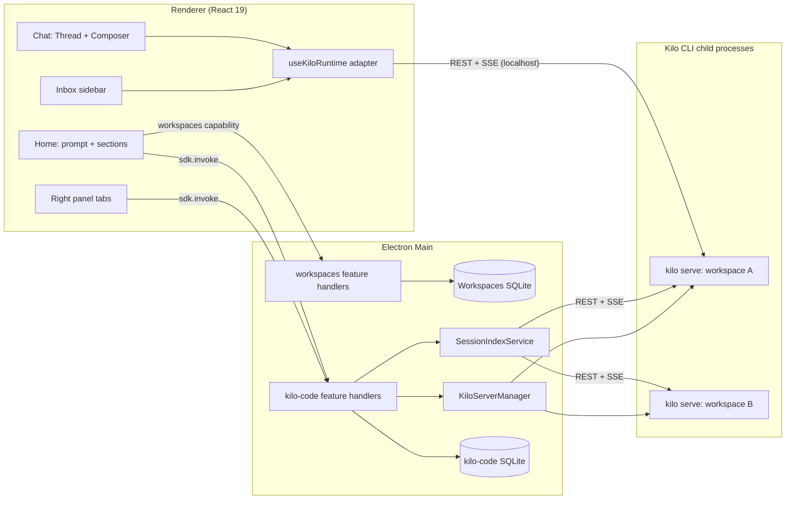
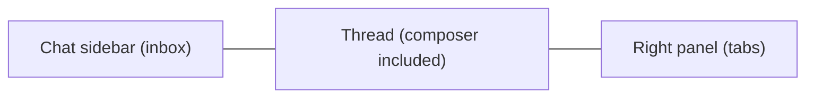

# Kilo Code Integration — Specification

Status: Draft (reference for phased implementation)
Owner: Desktop team
Last updated: 2026-07-31
Revisions: 2026-07-31 (rev 2) — workspaces split out as a shared platform feature (§3.5/§3.6/§4); Kilo CLI is bundled with the app, never user-installed (§3.2, §11, §14); sidebar: snooze capability removed, Needs You section added (§7)

This document is the full-picture spec for integrating [Kilo Code](https://kilo.ai) into the Anaconda Agentic Desktop app. It is written to be built **phase by phase** (see [§12 Phased implementation plan](#12-phased-implementation-plan)); each phase should be implementable from this document alone.

Key references used while writing this spec:

- Kilo CLI + SDK: [kilo.ai/docs/code-with-ai/platforms/cli](https://kilo.ai/docs/code-with-ai/platforms/cli), [Kilo-Org/kilocode](https://github.com/Kilo-Org/kilocode), DeepWiki "SDK and API" / "JavaScript SDK" pages
- Kilo Marketplace: [kilo.ai/docs/customize/marketplace](https://kilo.ai/docs/customize/marketplace), [Kilo-Org/kilo-marketplace](https://github.com/Kilo-Org/kilo-marketplace)
- assistant-ui OpenCode adapter (the workhorse we vendor): `/Users/jlowe/Repositories/assistant-ui/packages/react-opencode` + companion UI in `/Users/jlowe/Repositories/assistant-ui/examples/with-opencode`
- t3code sidebar reference: `/Users/jlowe/Repositories/t3code` (`apps/web/src/components/SidebarV2.tsx`, `Sidebar.logic.ts`, `AppSidebarLayout.tsx`, `sidebarProjectGrouping.ts`)
- Repo conventions: [CONTEXT.md](../CONTEXT.md), [AGENTS.md](../AGENTS.md), [docs/TESTING.md](./TESTING.md), `.agents/skills/new-feature/SKILL.md`, `.agents/skills/write-vitest/SKILL.md`, `.agents/skills/write-e2e-test/SKILL.md`

---

## 1. Overview & goals

The app becomes a desktop command center for Kilo Code agents. A user points the app at one or more **workspaces** (project folders), starts **chat sessions** with a chosen **agent** and **model**, approves tool calls when asked, and tracks what their usage is costing. Multiple agent sessions run concurrently across workspaces; the UI makes it obvious which sessions need a human and which are done.

UX pillars:

1. **One prompt away** — the home page is a single composer. Pick a workspace, agent, and model; hit send; land in the chat.
2. **Inbox for agents** — the chat sidebar is a t3code-V2-style inbox: sessions needing attention float up, finished work settles away.
3. **Kilo does the heavy lifting** — agents, tools, permissions, MCPs, skills, providers, and cost accounting all come from the Kilo CLI runtime. We build the shell, the inbox, and the settings surface — not an agent loop.

Explicit non-goals (for now): cloud/remote sessions (`kilo cloud`, `/remote`), teams/orgs switching, ACP editor protocol, voice/dictation, sharing sessions.

---

## 2. Concepts & terminology

| Concept              | Definition                                                                                                                                                                                                                  | Backed by                                                                                                                                                                                                                                                                                                |
| -------------------- | --------------------------------------------------------------------------------------------------------------------------------------------------------------------------------------------------------------------------- | -------------------------------------------------------------------------------------------------------------------------------------------------------------------------------------------------------------------------------------------------------------------------------------------------------- |
| **Workspace**        | A named collection of folders. Exactly one folder is the **primary folder** — the working directory the agent operates in. All other folders are **reference folders** the agent may read (and, if the user allows, write). | Owned by the shared **`workspaces` feature** (platform-level; consumed by kilo-code today, terminal/notebooks/git tomorrow — see §3.5). kilo-code maps a workspace to a `kilo serve` process rooted at the primary folder; reference folders are injected as `permission.external_directory` allow rules |
| **Chat session**     | A single conversation with an agent inside one workspace.                                                                                                                                                                   | Kilo-owned (Kilo `Session` / `GlobalSession`); app-owned metadata (visited/settled) layered on top                                                                                                                                                                                                       |
| **Agent**            | The persona/behavior running the session. Built-ins: `code`, `architect` (plan), `ask`, `debug`, `orchestrator`. Custom agents are markdown files.                                                                          | Kilo config: project `.kilo/agents/<name>.md`, global `~/.config/kilo/agents/<name>.md`                                                                                                                                                                                                                  |
| **Provider**         | A model source: Kilo Gateway (OAuth), OpenAI, Anthropic, etc.                                                                                                                                                               | Kilo auth store + `provider` config                                                                                                                                                                                                                                                                      |
| **Model**            | A `providerID/modelID` pair, e.g. `anthropic/claude-sonnet-4-6`. Selectable per session.                                                                                                                                    | Kilo server model catalog                                                                                                                                                                                                                                                                                |
| **Skill**            | Task-specific instructions/resources the agent loads when relevant.                                                                                                                                                         | `.kilo/skills/<name>/` (project), `~/.kilo/skills/<name>/` (global)                                                                                                                                                                                                                                      |
| **MCP server**       | External tool source configured under the `mcp` config key.                                                                                                                                                                 | `~/.config/kilo/kilo.json[c]` (global), `.kilo/kilo.json` (project)                                                                                                                                                                                                                                      |
| **Marketplace item** | An installable agent, skill, or MCP server from the Kilo Marketplace.                                                                                                                                                       | [Kilo-Org/kilo-marketplace](https://github.com/Kilo-Org/kilo-marketplace) catalog                                                                                                                                                                                                                        |
| **Attention state**  | Derived per-session UI state: Working / Approval / Input / Plan Ready / Failed / Done(unread).                                                                                                                              | Derived from Kilo session status + pending permissions/questions + our `lastVisitedAt`                                                                                                                                                                                                                   |

---

## 3. Runtime architecture

### 3.1 Shape



**Main-side decoupling note:** kilo-code's main code never calls the workspaces feature (today `MainSdk` has no cross-feature primitives, and cross-feature imports are forbidden). The renderer resolves a workspace's folders through the workspaces capability and passes them into kilo-code channels; kilo-code caches the mapping (§4.2 `workspace_servers`) so it can respawn servers on cold start without the renderer. See §3.6.

### 3.2 Kilo server lifecycle (main process)

- One `kilo serve` child process **per workspace**, spawned lazily on first use (chat opened, session created, or attention scan), rooted at the workspace's primary folder. Reference folders are passed at spawn time by deep-merging config into the process env (`KILO_CONFIG_CONTENT`, the same mechanism the SDK's `buildConfigEnv` uses):

```jsonc
{
	"permission": {
		"external_directory": {
			"/path/to/reference-folder-a/**": "allow",
			"/path/to/reference-folder-b/**": "allow",
		},
	},
}
```

- `KiloServerManager` (new, in the kilo-code feature's main code) owns: spawn via `cross-spawn` of the vendored CLI binary (or `createKiloServer` from `@kilocode/sdk/v2/server` pointed at that binary), port/token registry (`workspaceId → { baseUrl, token, pid, status }`), health checks, idle-timeout shutdown (default 15 min with no live sessions), and teardown on `mainSdk.onDispose`.
- **CLI provisioning (bundled — never rely on a user install)**: the packaged app ships the `kilo` binary for every target platform/arch. A build-time script (`scripts/fetch-kilo.ts`, run as `pnpm fetch:kilo` and wired into the Forge packaging pipeline) downloads the pinned release artifacts from [Kilo-Org/kilocode releases](https://github.com/Kilo-Org/kilocode/releases) (`kilo-darwin-arm64.zip`, `kilo-linux-x64.tar.gz`, `kilo-windows-x64.zip`, plus `-baseline` variants for CPUs without AVX) into `apps/desktop/vendor/kilo/<platform>-<arch>/`, verifying SHA256 checksums against the release manifest. Forge ships the vendor directory as packaged extra resources; at runtime the manager resolves the binary for the host platform/arch from `process.resourcesPath` (packaged) or the vendor dir (dev), selecting `-baseline` when AVX is absent. `KILO_CODE_CLI_PATH` overrides the binary path (hacking on a local kilo build). **Updates**: the binary revs only with app releases (bump the pin, run the smoke suite); no runtime self-update in v1. Signing/notarization of the bundled binary is covered in §14.
- **Version pinning (important)**: npm `@kilocode/cli`/`@kilocode/sdk` currently has `latest = 7.4.x` (legacy lineage) and `next = 1.0.x` (the OpenCode-fork line that exposes the v2 SDK: `createKiloClient`, `createKiloServer`, `x-kilo-workspace` headers). **We target the 1.x line.** Pin the exact CLI version in `scripts/fetch-kilo.ts` and the exact SDK version in `apps/desktop/package.json`; record the verified versions here once validated: _TBD_. See [§14 Risks](#14-risks--open-questions).

### 3.3 Renderer ↔ server transport

- The chat surface talks to `kilo serve` **directly over `http://127.0.0.1:<port>` (REST + SSE)** using a typed `@kilocode/sdk/v2/client` client created in the renderer. This is what the assistant-ui adapter is built for, and it keeps high-frequency token streaming off our IPC bridge.
- The renderer learns `{ baseUrl, token }` via `sdk.invoke("kilo-code", "server.getConnection", { workspaceId })`.
- **CORS fallback**: if the Kilo server does not send permissive CORS headers for `fetch` + `EventSource` from the Electron renderer origin, inject a custom `fetch` into the client config that proxies through the main process (the SDK client factories accept a custom fetch). Decision point is Phase 1; the adapter must not care which path is active.
- Main-process consumers (`SessionIndexService`, usage aggregator, settings service) use their own `@kilocode/sdk` client in Node, one per running server.

### 3.4 The `useKiloRuntime` adapter (renderer)

We vendor an adapter modeled on `@assistant-ui/react-opencode` (local source: `/Users/jlowe/Repositories/assistant-ui/packages/react-opencode`, ~2.9k LOC of source plus tests) retargeted from `@opencode-ai/sdk/v2/client` to `@kilocode/sdk/v2/client`. It already implements everything the chat needs:

| Capability                                                                                               | Where it comes from in the reference adapter                                                                                                          |
| -------------------------------------------------------------------------------------------------------- | ----------------------------------------------------------------------------------------------------------------------------------------------------- |
| Thread runtime over a remote session                                                                     | `useOpenCodeRuntime` → `useRemoteThreadListRuntime` + per-session `OpenCodeThreadController` (`useOpenCodeRuntime.ts`, `OpenCodeThreadController.ts`) |
| SSE subscription with reconnect                                                                          | `OpenCodeEventSource.ts`                                                                                                                              |
| OpenCode/Kilo part → assistant-ui message projection (text, reasoning, tool, file, snapshot, step parts) | `openCodeMessageProjection.ts`                                                                                                                        |
| Tool-call approval                                                                                       | `onRespondToToolApproval` → `replyToPermission(id, "once" \| "always" \| "reject")` (`openCodePermissionApproval.ts`)                                 |
| Agent follow-up questions                                                                                | pending `questions` + `replyToQuestion` / `rejectQuestion` (`hooks.ts`, `types.ts`)                                                                   |
| Per-message agent/model selection                                                                        | `OpenCodeUserMessageOptions { model: { providerID, modelID }, agent }`                                                                                |
| Thread list CRUD (list/rename/archive/delete/create/summarize)                                           | `openCodeThreadListAdapter.ts`                                                                                                                        |
| Hooks for custom UI                                                                                      | `useOpenCodeSession`, `useOpenCodeThreadState`, `useOpenCodePermissions`, `useOpenCodeQuestions`, `useOpenCodeStreamingTiming` (`hooks.ts`)           |

Vendored location: `apps/web/src/features/kilo-code/runtime/` (web-only code, no Node deps — it only needs `fetch`). Changes vs. the reference:

1. Swap the SDK import and types (`OpencodeClient` → `KiloClient`; the event union includes Kilo additions such as `EventPermissionAsked`/`EventPermissionReplied`).
2. Accept per-send **dynamic** `model`/`agent` getters (not just static `defaultModel`/`defaultAgent`) so the composer selectors apply per message. The reference applies defaults at send time in `onNew`; we extend `sendMessage` options to read from a selection ref.
3. Drop what we don't use (nothing expected; keep the public surface otherwise identical so upstream fixes port cleanly).

Companion chat UI is ported from `/Users/jlowe/Repositories/assistant-ui/examples/with-opencode/components` into `apps/web/src/components/assistant-ui/`, restyled to the Anaconda theme:

- `tools/opencode-tools.tsx` (`FallbackTool`), `tools/tool-group.tsx` (`ToolGroup`), `tools/reasoning-ghost.tsx` (`ReasoningGroup`), `tools/tool-ui-bash.tsx`, `tools/tool-ui-apply-patch.tsx`, `tools/tool-ui-inline.tsx`, `tools/tool-ui-shared.tsx`, `tools/toolkit.tsx`
- `tools/opencode-permission-card.tsx`, `tools/opencode-question-card.tsx`, `tools/opencode-tool-interactions.tsx`
- `opencode-data-part.tsx` (fallback data-part renderer)

### 3.5 Feature shape (per repo conventions)

The integration ships as **two features**. Workspaces are shared platform infrastructure — kilo-code is the first consumer, but terminal, notebooks, git, and future features all need "which folders am I working in" — so workspaces get their own feature rather than living inside kilo-code. The two features never import each other's code; every cross-feature flow goes through SDK primitives (`sdk.plugins` capabilities, `sdk.events`, `sdk.state`).

**`workspaces` feature** (platform-level):

| Layer        | Location                                        | Contents                                                                                                                                          |
| ------------ | ----------------------------------------------- | ------------------------------------------------------------------------------------------------------------------------------------------------- |
| Contract     | `packages/contracts/src/features/workspaces.ts` | workspace/folder Zod schemas + `defineContract({ list, get, create, update, remove })`; exported from `packages/contracts/src/index.ts`           |
| Main         | `apps/desktop/src/main/features/workspaces/`    | `index.ts` (`mainRegister`), `WorkspaceService.ts` (CRUD, path validation, primary-folder invariant), `schema.ts` (Drizzle)                       |
| Renderer     | `apps/web/src/features/workspaces/`             | workspace management dialog (create/edit/delete, folder picking), `useWorkspaces.ts` query factories, capability exposure + event emission (§3.6) |
| Persistence  | `${userData}/features/workspaces/data.db`       | own SQLite file + own Drizzle migrations                                                                                                          |
| Registration | both registries                                 | one `workspaces` entry in FEATURES + WEB_FEATURES; never hand-edit `Application.ts`                                                               |

**`kilo-code` feature** (this integration):

| Layer        | Location                                       | Contents                                                                                                                                                                                                                          |
| ------------ | ---------------------------------------------- | --------------------------------------------------------------------------------------------------------------------------------------------------------------------------------------------------------------------------------- |
| Contract     | `packages/contracts/src/features/kilo-code.ts` | Zod schemas + `defineContract({ ... defineMethod(input, output) })`; exported from `packages/contracts/src/index.ts`                                                                                                              |
| Main         | `apps/desktop/src/main/features/kilo-code/`    | `index.ts` (`mainRegister` with `mainSdk.channels(kiloCodeContract).handleAll({...})`), `KiloServerManager.ts`, `SessionIndexService.ts`, `UsageService.ts`, `SettingsService.ts`, `MarketplaceService.ts`, `schema.ts` (Drizzle) |
| Renderer     | `apps/web/src/features/kilo-code/`             | `runtime/` (vendored adapter), views, hooks (TanStack Query option factories taking `sdk` as an argument), selectors                                                                                                              |
| Registration | both registries                                | one `kilo-code` entry in FEATURES + WEB_FEATURES                                                                                                                                                                                  |
| Persistence  | `${userData}/features/kilo-code/data.db`       | own SQLite file via `createDatabase`, own Drizzle migrations folder; `mainSdk.onDispose` closes it                                                                                                                                |
| Errors       | —                                              | `FeatureError` for expected failures (survives IPC); never plain `Error`                                                                                                                                                          |

**New shell capabilities required (Phase 1):**

1. A generic main→renderer **feature event push channel** (`feature:event`), mirroring `feature:invoke`. Today only theme has push events (hand-wired), and `sdk.events` is renderer-only. The kilo-code feature needs server-pushed `session.status`/`attention`/`usage` updates. Implementation: preload listener + `ElectronWindow.broadcast` + bridge into `sdk.events` so feature code subscribes via `sdk.events.on("kilo-code.session-changed", ...)`. This is a small, generic shell addition owned by the platform, not a `LocalApi` feature method.
2. A native **directory-picker dialog** delegate (e.g. `sdk.shell.showOpenDialog`). `sdk.fs` is explicitly **not wired** today (calls reject, per `packages/feature-sdk/src/types/sdk.ts`) and no picker exists; the workspaces feature needs it for folder selection. Shell-owned, exposed through the SDK like the other delegates.

### 3.6 Cross-feature workspace capability

The workspaces feature exposes its API as a renderer-side capability (the SDK's sanctioned cross-feature mechanism — `packages/feature-sdk/src/types/sdk.ts`):

```typescript
// Exposed by the workspaces feature via sdk.plugins.expose("workspaceService", ...)
interface WorkspaceCapabilities {
	workspaceService: {
		list(): Promise<Workspace[]>;
		get(id: string): Promise<Workspace | null>;
		create(input: CreateWorkspaceInput): Promise<Workspace>;
		update(input: UpdateWorkspaceInput): Promise<Workspace>;
		remove(id: string): Promise<void>;
	};
}

// Consumed by kilo-code (and future features):
const caps = sdk.plugins.get<WorkspaceCapabilities>("workspaces"); // may be null — always handle
const workspaces = await caps?.workspaceService.list();
```

Rules for consumers:

- `sdk.plugins.get` returning `null` is the contract that keeps features independently loadable — every call site must degrade gracefully (e.g. the home workspace selector shows "workspaces unavailable" rather than crashing).
- Change notifications flow via events: `workspaces.workspace-created` / `workspaces.workspace-updated` / `workspaces.workspace-deleted`. The last-selected workspace id lives in an observable store: `sdk.state.get<string>("workspaces.active-workspace")`.
- **Main-side flow** (because `MainSdk` has no cross-feature primitives): the renderer resolves a workspace's folders through the capability and passes them into kilo-code channels — e.g. `server.getConnection({ workspace: { id, primaryFolder, referenceFolders } })`. kilo-code caches the mapping (`workspace_servers`, §4.2) so main can respawn servers during a cold-start attention scan without renderer involvement. Folder edits propagate: `workspaces.workspace-updated` event → kilo-code renderer → `server.syncWorkspace` → the workspace's server restarts with fresh `external_directory` rules.
- The **workspace management UI** (create/edit/delete dialog, folder picking) is owned solely by the workspaces feature. Other features open it by emitting `workspaces.open-manager` (e.g. the "Manage workspaces" entry in kilo-code's workspace selector).
- Future consumers (terminal cwd, notebooks working dir, git repo root) use the same capability — no kilo-code involvement.

---

## 4. Data model

### 4.1 Ownership split

- **Kilo-owned** (inside each `kilo serve`, survives app restarts): sessions, messages, parts, costs, token counts, agents/MCP/skill/provider config, session titles.
- **`workspaces`-feature-owned** (`${userData}/features/workspaces/data.db`): workspaces and their folders — the single source of truth for all features.
- **`kilo-code`-feature-owned** (`${userData}/features/kilo-code/data.db`): session metadata (visited/settled), the workspace→folder server cache, usage rollups, settings UI state.

Hard rule (per CONTEXT.md): each feature owns its own SQLite file and tables are never shared or joined across features. kilo-code rows carry plain `workspaceId` strings — **no foreign keys into the workspaces feature's DB**; folder/name resolution always goes through the workspaces capability (§3.6). If a workspace is deleted, kilo-code rows keep their `workspaceId` and the UI renders them under an "Unknown workspace" bucket until `sessions.delete`/archive cleans them up.

### 4.2 Tables

**`workspaces` feature** (Drizzle, `apps/desktop/src/main/features/workspaces/schema.ts`):

```typescript
// workspaces — a named project grouping
export const workspaces = sqliteTable("workspaces", {
	id: text("id").primaryKey(), // uuid
	name: text("name").notNull(),
	createdAt: integer("created_at").notNull(),
	updatedAt: integer("updated_at").notNull(),
});

// workspace_folders — ordered; exactly one primary per workspace
export const workspaceFolders = sqliteTable("workspace_folders", {
	id: text("id").primaryKey(),
	workspaceId: text("workspace_id")
		.notNull()
		.references(() => workspaces.id, { onDelete: "cascade" }),
	path: text("path").notNull(), // absolute path
	isPrimary: integer("is_primary", { mode: "boolean" }).notNull(),
	position: integer("position").notNull(),
});
```

**`kilo-code` feature** (Drizzle, `apps/desktop/src/main/features/kilo-code/schema.ts`):

```typescript
// session_metadata — app-layer state keyed by Kilo session id
export const sessionMetadata = sqliteTable("session_metadata", {
	sessionId: text("session_id").primaryKey(), // Kilo session id (ses_...)
	workspaceId: text("workspace_id").notNull(), // plain string; NO cross-feature FK
	lastVisitedAt: integer("last_visited_at"), // drives the "unread → Done" rule
	settledAt: integer("settled_at"), // inbox-zero settle
	settledOverride: text("settled_override"), // "settled" | "active" | null
	lastStatus: text("last_status"), // cache for cold start before servers spin up
	lastActivityAt: integer("last_activity_at"),
	createdAt: integer("created_at").notNull(),
});

// workspace_servers — kilo-code's cache of where each workspace lives on disk,
// so main can (re)spawn servers without querying the workspaces feature.
// Refreshed via server.getConnection / server.syncWorkspace (§3.6).
export const workspaceServers = sqliteTable("workspace_servers", {
	workspaceId: text("workspace_id").primaryKey(),
	primaryFolder: text("primary_folder").notNull(),
	referenceFolders: text("reference_folders", { mode: "json" }).$type<string[]>().notNull(),
	lastConnectedAt: integer("last_connected_at"),
});

// usage_daily — pre-aggregated cost/token rollups per UTC day
export const usageDaily = sqliteTable("usage_daily", {
	day: text("day").notNull(), // "2026-07-31"
	workspaceId: text("workspace_id").notNull(), // plain string; NO cross-feature FK
	providerId: text("provider_id").notNull(),
	modelId: text("model_id").notNull(),
	costUsd: real("cost_usd").notNull(),
	inputTokens: integer("input_tokens").notNull(),
	outputTokens: integer("output_tokens").notNull(),
	cacheTokens: integer("cache_tokens").notNull(),
	messageCount: integer("message_count").notNull(),
	// PK: (day, workspaceId, providerId, modelId)
});
```

### 4.3 Derived session summary (contract type, not a table)

The sidebar, attention section, and recent-chats list all consume one aggregated shape, produced by `SessionIndexService` (Kilo `GlobalSession` + live status + our metadata). Note it carries `workspaceId` only — workspace **names and folders are joined renderer-side** via the workspaces capability (the UI already subscribes to `workspaces.*` events, so renames propagate live); main-side `SessionIndexService` never queries the workspaces feature.

```typescript
const sessionSummarySchema = z.object({
	sessionId: z.string(),
	workspaceId: z.string(),
	title: z.string(),
	status: z.enum(["working", "approval", "input", "plan-ready", "failed", "done", "idle"]),
	statusChangedAt: z.number(),
	lastActivityAt: z.number(),
	lastVisitedAt: z.number().nullable(),
	isUnread: z.boolean(), // lastActivityAt > lastVisitedAt
	settledAt: z.number().nullable(),
	pendingPermissions: z.number(),
	pendingQuestions: z.number(),
	agent: z.string().nullable(),
	model: z.object({ providerId: z.string(), modelId: z.string() }).nullable(),
	error: z.string().nullable(),
});
```

Status derivation (mirrors t3code `resolveSidebarV2Status`): pending plan-exit permission → `plan-ready`; else pending permissions → `approval`; else pending questions → `input`; else session busy/retry → `working`; else last run errored → `failed`; else unread completion → `done`; else `idle`.

---

## 5. Home page

Route: `/` (existing `HomeView`, `apps/web/src/features/home/HomeView.tsx`). The stub `ChatModelAdapter` is removed; the composer gains selectors and section content appears below it.

### 5.1 Prompt composer

Centered hero composer (existing look kept) with three selectors rendered inside/under the composer input:

1. **Workspace selector** — lists workspaces via the `workspaces` capability (`sdk.plugins.get("workspaces")`, §3.6); defaults to the last-used workspace (persisted in renderer localStorage and mirrored into the `workspaces.active-workspace` state store so other features can observe it). A **Manage workspaces** entry emits `workspaces.open-manager`, opening the workspaces feature's management dialog (create/edit/delete, folder picking via the new shell directory-picker, §3.5). If no workspace exists, the selector funnels straight into that create flow.
2. **Agent selector** — `agents.list` for the selected workspace (built-ins first: Code, Architect/Plan, Ask, Debug, Orchestrator; then custom agents). Default: `code`.
3. **Model selector** — `models.list` grouped by provider; shows only providers that are connected (have credentials). Default: last-used model, else the provider-marked default. Unconnected providers show a disabled row linking to Settings → Providers.

On send: `sessions.create({ workspace })` (the resolved workspace object from the selector, §3.6) → navigate to `/chat/$sessionId?prompt=…` — the chat page's composer is pre-filled and auto-submits the first message with the chosen `{ agent, model }` (avoids racing session creation against the SSE stream on the home page).

### 5.2 Sections (below the composer, in order)

1. **Needs attention** — cards/rows from `sessions.attention()`: **unsettled** sessions in `approval`, `input`, `plan-ready`, or `failed` status (the same filter as the sidebar's **Needs You** section, §7.2). Each row: status pill, title, workspace name, relative time; click → `/chat/$sessionId`. Empty state: a quiet "All caught up" line.
2. **Usage** — period switcher (Daily / 7 days / 30 days / 90 days) over `usage.summary`: total cost headline, token totals, per-model breakdown bar/list, and a small per-day sparkline. Data is local (pre-aggregated `usage_daily`), so period switching is instant.
3. **Recent chats** — `sessions.list({ sort: "lastActivityAt", limit: 10 })` excluding settled; row = title, workspace, relative time, status dot; click → chat.

---

## 6. Chat page

Route: `/chat/$sessionId` (new, `apps/web/src/routes/chat/$sessionId.tsx`). Also `/chat` index: redirects to the most recently active session, or renders a "start a new chat" empty state when none exist.

Layout (three regions):



(Actual proportions: sidebar 256px resizable 208–(viewport−640), center flexible, right panel hidden until a tab is opened.)

- **Runtime**: the page reads the session's `workspaceId` from the aggregated index, resolves the workspace's folders via the workspaces capability (§3.6), calls `server.getConnection({ workspace: { id, primaryFolder, referenceFolders } })` (which also refreshes kilo-code's `workspace_servers` cache), and mounts `useKiloRuntime({ baseUrl, initialSessionId })` inside `AssistantRuntimeProvider`.
- **Thread (composer included)**: assistant-ui `Thread` (installed via the already-configured `@assistant-ui` shadcn registry) — the registry component already composes its own composer internally, so the chat page mounts **no separate `Composer` component**. We customize the composer action bar inside our installed copy of the registry `thread.tsx`: add the agent + model selectors and a read-only workspace chip (workspace is fixed for an existing session). Selections feed the per-message `{ agent, model }` send options (adapter extension, §3.4). Tool UI is ported per §3.4: `ToolFallback`, `ToolGroup`, `ReasoningGroup`, bash/apply-patch tool UIs, plus the permission card and question card rendered from `useKiloPermissions()` / `useKiloQuestions()`. The home page is the exception — it has no thread, so it keeps its own standalone composer (§5.1).
- **Approvals**: pending tool calls surface inline (permission card: Allow once / Always allow / Reject → `replyToPermission`) and via assistant-ui's `onRespondToToolApproval` on tool parts. Plan flow: when the agent is `architect`/plan and it proposes to build, a plan-exit permission surfaces as an **Approve plan & build** action (see §14 for the event-shape verification item).
- **New chat**: a new-chat button in the sidebar header (and `Cmd/Ctrl+Shift+O` — verify against existing bindings) creates a session in the current workspace (`sessions.create`) and navigates to it.
- **Cancel/revert/fork**: composer cancel → `runtime.thread().cancelRun()`; message actions expose revert/fork via the adapter extras where the ported Thread UI supports it.

---

## 7. Chat sidebar (t3code V2 inbox-style)

The sidebar of all chats, living inside the `/chat` layout. It mirrors **t3code's SidebarV2** (`/Users/jlowe/Repositories/t3code/apps/web/src/components/SidebarV2.tsx`, logic in `Sidebar.logic.ts`) in behavior and layout, reskinned to the Anaconda design tokens (`@anaconda/shadcn-theme` CSS variables, shadcn `base-nova` primitives, `lucide-react` icons), with two deliberate deviations: **t3code's Snoozed section is dropped entirely** (no snooze capability anywhere in the app), and a top-level **Needs You** section is added above Active. This section is the build reference; follow t3code's structure closely apart from those deviations.

### 7.1 Data source

Not the assistant-ui thread list — the inbox is **cross-workspace**, so it is our own component fed by `sessions.list` + live `kilo-code.session-changed` push events (§3.5). Thread mutations (rename/archive/delete) go through `sessions.*` channels, which proxy to the owning workspace's server and update our metadata; the server SSE stream confirms and re-broadcasts. The assistant-ui runtime on the chat page keeps its own per-workspace thread list adapter internally; the two reconcile via the shared server of truth.

### 7.2 Structure (top to bottom)

1. **Fixed header** — search button (opens a session palette; shows kbd hint), **new-chat** icon button (SquarePen; when more than one workspace exists it opens a "New chat in…" chooser), **workspace scope filter** ("All workspaces" / one workspace, with per-workspace overflow menu → workspace settings), and **New workspace** (FolderPlus) shortcut.
2. **Section: Needs You** — pinned above Active (header "Needs You (N)"), rendered only when non-empty. Contains **unsettled sessions with an unresolved need**: status ∈ {`approval`, `input`, `plan-ready`, `failed`}. Same card row as Active (below) but always at full opacity, sorted by most recent status change. A row leaves the section when the need **resolves** (permission/question answered, failed run retried or dismissed) or when the user **settles** it — merely visiting the chat does not clear the need (the pending permission/question card inside the thread is what clears it). This is the same filter as the home page's Needs attention section (§5.2).
3. **Section: Active** — unsettled sessions with no pending need (working, idle, unread-done). Card rows (~78px, three lines):
   - Line 1: workspace icon + workspace name; right slot = **status label** at rest ("Working" sky + ticking duration, "Done" emerald) or relative time when idle; **on hover** the right slot swaps to a Settle (✓) icon button.
   - Line 2: session title (double-click → inline rename; Enter commits, Esc cancels).
   - Line 3: metadata — agent/model chip, error icon when `failed`.
4. **Section: Settled** — expanded tail of dimmed slim rows, sorted by when work ended, paged (first 10, "Show 25 more"), hover **un-settle** (Undo2). The open session is always pulled into view. Sending a message to a settled session un-settles it (sets `settledOverride: "active"`).

Section membership is a **partition** — a session appears in exactly one of Needs You / Active / Settled at any time (§7.3).

### 7.3 Behavior rules (copy t3code, minus snooze)

- **Section assignment** (pure, unit-tested in `sessionStatus.ts`): settled → **Settled**; else status ∈ {`approval`, `input`, `plan-ready`, `failed`} → **Needs You**; else → **Active**. Lifecycle transitions move a row between sections (card fades out/in via `@formkit/auto-animate`-style animation — evaluate adding that dependency or hand-rolling FLIP).
- **Static ordering**: within Active, newest-first by creation and **activity never reorders rows**; within Needs You, most-recent-status-change-first.
- **Recede rule**: in-flight **working** rows in Active render at 70% opacity; prominence is reserved for rows needing a human — Needs You rows and unread-Done rows render at full opacity.
- **Unread**: `lastActivityAt > lastVisitedAt` → Done status shows emerald + bold title; visiting a session calls `sessions.markVisited`.
- **Settle model**: manual settle parks a row into Settled (this is also how a user dismisses a Needs You row without resolving it); auto-settle after N days idle (default 7, configurable in Settings — Needs You rows are exempt: an unresolved need never auto-settles); new activity or a new need on a settled session un-sets it back to Active or Needs You; opening a settled session keeps it readable.
- **Keyboard**: `Cmd/Ctrl+1..9` jump to the Nth visible row (hint badges while ⌘ held); up/down traversal; Enter opens; `Cmd/Ctrl+B` collapses the chat sidebar (offcanvas — slides fully away; a thin rail re-opens on click). Bindings must not conflict with the shell sidebar — the chat sidebar owns bindings only while a `/chat` route is focused.
- **Resize**: drag the right edge; default 256px, min 208px, max viewport−640px; width persisted in localStorage (`kilo_chat_sidebar_width`).
- **Context menu**: right-click row → Open, Rename, Mark unread, Copy session id, Settle/Un-settle, Archive, Delete (destructive, confirm dialog). `Cmd/Ctrl`-click multi-select and `Shift`-click range select → bulk bar (Mark unread (N), Archive (N), Delete (N)).
- **Row tooltip**: title, workspace, agent, model, pending counts, last error.

### 7.4 Component inventory (new, `apps/web/src/features/kilo-code/sidebar/`)

`ChatSidebar.tsx` (frame + sections), `ChatSidebarHeader.tsx`, `SessionCard.tsx` (shared card row for Needs You + Active), `SettledSessionRow.tsx`, `SessionStatusPill.tsx`, `sessionStatus.ts` (pure derivation, section assignment + sorting — unit tested), `useSessionList.ts` (query + push-event subscription), `useSidebarKeyboard.ts`. All interactive elements get stable `data-qa-id`s (`chat-sidebar`, `session-row`, `session-status-pill`, `new-chat-button`, …).

---

## 8. Right-side panel

A Cursor/Codex-style panel on the right of the chat route. **Phase 5 ships the frame + one tab; everything else plugs in later.**

- **Frame** (`apps/web/src/features/kilo-code/panel/ChatPanel.tsx`): resizable right panel (default 420px, min 320px, max viewport−480px; width persisted), collapsible (`Cmd/Ctrl+J` — verify no conflicts), with a **tab strip** on top. Multiple tabs can be open; one is active; tabs are closable and reorderable (drag).
- **Contribution model**: tabs are contributed, not hardcoded. The kilo-code feature registers a shell zone via `sdk.contribute("chat-panel", { component, label, priority })`. Future terminal/notebooks/git-diff features contribute their own tabs without touching kilo-code code. The panel host reads the contribution registry and renders tabs; open-tab state persists per session in localStorage.
- **First tab: Terminal** (separate `terminal` feature, Phase 5): `node-pty` in main (new dependency — see §14 for Windows notes), xterm.js in the renderer, cwd = the session's primary folder. Channel surface stays inside the terminal feature's own contract.
- **Later tabs** (spec'd here for shape only): **Changes** (git diff of the primary folder against the session's start point), **Notebooks** (anaconda-side notebook UI), **Files** (workspace tree).

---

## 9. Settings page

Route: `/settings` (new — **no settings page exists today**; `apps/web/src/routes/settings.tsx`). Layout: left section nav + content. Sections beyond "AI Agents" are out of scope here but the route must be built to grow (section registry, like the chat panel).

### 9.1 AI Agents section (`apps/web/src/features/kilo-code/settings/`)

Four sub-panels:

1. **Providers** (`providers.*` channels)
   - List available providers with connection state (connected providers from the Kilo server; `disabled_providers`/`enabled_providers` respected).
   - **Kilo Gateway**: OAuth connect — button starts the Kilo auth flow (main opens the auth URL via the shell `openExternal` delegate, polls/listens for completion, shows the Gateway profile on success). Disconnect clears stored auth.
   - **OpenAI / Anthropic / others**: API-key form → stored via the Kilo server auth store (preferred) or merged into global config `provider.<id>.options.apiKey`. Secrets never touch our SQLite. Validate by listing models after save.
   - Default model picker (writes `model` to global config).
2. **Custom agents** — table of agents from both scopes (global `~/.config/kilo/agents/*.md`, per-workspace `.kilo/agents/*.md`): name, scope, source path. Create/edit in a markdown editor pane (frontmatter: description, model, permissions); save writes the file and triggers a server reload (Kilo's `/reload` equivalent — verify server API in Phase 6; worst case restart the workspace server). Delete removes the file.
3. **Custom MCPs** — table of configured servers (`mcp` key): name, transport (stdio command / remote URL), scope, enabled toggle, status (from the server's MCP status). Add/edit form supports stdio (`command`, `args`, `env`) and remote (`url`, `headers`) with env-var indirection for secrets (`{env:VAR}` — only honored in trusted/global config, per Kilo docs; call this out in the UI copy). Writes merge into the scope's config without clobbering other keys.
4. **Custom skills** — table of skills (global `~/.kilo/skills/*/`, project `.kilo/skills/*/`): name, scope, description (from `SKILL.md` frontmatter). Create = scaffold a `SKILL.md` folder; edit = file editor; delete removes the folder.

### 9.2 Kilo Marketplace sub-panel

- Catalog from [Kilo-Org/kilo-marketplace](https://github.com/Kilo-Org/kilo-marketplace) (`marketplace.list`, cached 1h in main; offline → stale cache + warning).
- Item cards: type badge (Agent / Skill / MCP), name, description, author, source link; detail view shows prerequisites, requested parameters, and the MCP server's tool list before install (per Kilo's security guidance).
- **Install** → pick scope (Global / specific workspace) → writes to the destinations in §2 (agent md / skill dir / merged `mcp` config) → server reload. Installed items are tracked so **Remove** deletes exactly the marketplace-managed entry. Items requiring secrets prompt for env vars at install time and store references (`{env:VAR}`), never values, in project scope.

---

## 10. Contracts

Two contract files using `defineContract`/`defineMethod` (channel names unprefixed; scoped by `featureId` at registration).

**`packages/contracts/src/features/workspaces.ts`** — the shared workspace surface (also exposed renderer-side as the §3.6 capability, which simply delegates to these channels):

```typescript
const workspaceFolderSchema = z.object({
	id: z.string(),
	path: z.string().min(1), // absolute
	isPrimary: z.boolean(),
	position: z.number().int(),
});
const workspaceSchema = z.object({
	id: z.string(),
	name: z.string().min(1),
	folders: z.array(workspaceFolderSchema).min(1), // exactly one isPrimary — enforced in the service
	createdAt: z.number(),
	updatedAt: z.number(),
});

export const workspacesContract = defineContract({
	list: defineMethod(z.undefined(), z.array(workspaceSchema)),
	get: defineMethod(z.object({ id: z.string() }), workspaceSchema.nullable()),
	create: defineMethod(createWorkspaceInput, workspaceSchema),
	update: defineMethod(updateWorkspaceInput, workspaceSchema),
	remove: defineMethod(z.object({ id: z.string() }), z.object({ deleted: z.boolean() })),
});
export type WorkspacesService = InferContract<typeof workspacesContract>;
```

**`packages/contracts/src/features/kilo-code.ts`** — the integration surface (note: no workspace CRUD here — that lives in the workspaces feature; kilo-code channels take the **resolved** workspace where folder paths are needed):

```typescript
// Resolved via the workspaces capability renderer-side before calling (§3.6)
const resolvedWorkspaceInput = z.object({
	id: z.string(),
	primaryFolder: z.string().min(1),
	referenceFolders: z.array(z.string()),
});

export const kiloCodeContract = defineContract({
	// ── Server lifecycle
	"server.getConnection": defineMethod(
		z.object({ workspace: resolvedWorkspaceInput }),
		connectionSchema,
	),
	"server.syncWorkspace": defineMethod(z.object({ workspace: resolvedWorkspaceInput }), okSchema), // folder edits → restart with fresh external_directory rules
	"server.stop": defineMethod(
		z.object({ workspaceId: z.string() }),
		z.object({ stopped: z.boolean() }),
	),
	"server.status": defineMethod(z.object({ workspaceId: z.string() }), serverStatusSchema),

	// ── Catalogs (proxied from the workspace's Kilo server)
	// These ensure the server internally (spawn from the passed folders if needed,
	// refreshing workspace_servers) so they work on first contact with a workspace:
	"agents.list": defineMethod(
		z.object({ workspace: resolvedWorkspaceInput }),
		z.array(agentInfoSchema),
	),
	"models.list": defineMethod(
		z.object({ workspace: resolvedWorkspaceInput }),
		z.array(providerModelsSchema),
	),

	// ── Sessions (aggregated index + metadata)
	"sessions.list": defineMethod(sessionListInput, z.array(sessionSummarySchema)),
	"sessions.create": defineMethod(
		z.object({ workspace: resolvedWorkspaceInput }),
		z.object({ sessionId: z.string() }),
	),
	"sessions.rename": defineMethod(
		z.object({ sessionId: z.string(), title: z.string().min(1) }),
		okSchema,
	),
	"sessions.archive": defineMethod(z.object({ sessionId: z.string() }), okSchema),
	"sessions.delete": defineMethod(z.object({ sessionId: z.string() }), okSchema),
	"sessions.markVisited": defineMethod(
		z.object({ sessionId: z.string(), at: z.number() }),
		okSchema,
	),
	"sessions.settle": defineMethod(z.object({ sessionId: z.string() }), okSchema),
	"sessions.unsettle": defineMethod(z.object({ sessionId: z.string() }), okSchema),
	"sessions.attention": defineMethod(z.undefined(), z.array(sessionSummarySchema)),

	// ── Usage
	"usage.summary": defineMethod(
		z.object({ period: z.enum(["day", "7d", "30d", "90d"]) }),
		usageSummarySchema,
	),
	"usage.refresh": defineMethod(z.undefined(), okSchema),

	// ── Settings
	"providers.list": defineMethod(z.undefined(), z.array(providerInfoSchema)),
	"providers.connect": defineMethod(
		z.object({ providerId: z.string() }),
		z.object({ authUrl: z.string().optional() }),
	),
	"providers.setApiKey": defineMethod(
		z.object({ providerId: z.string(), apiKey: z.string().min(1) }),
		okSchema,
	),
	"providers.disconnect": defineMethod(z.object({ providerId: z.string() }), okSchema),
	"settings.getDefaultModel": defineMethod(z.undefined(), modelRefSchema.nullable()),
	"settings.setDefaultModel": defineMethod(modelRefSchema, okSchema),
	"agentFiles.list": defineMethod(z.undefined(), z.array(agentFileSchema)),
	"agentFiles.save": defineMethod(agentFileSaveInput, okSchema),
	"agentFiles.remove": defineMethod(agentFileRefInput, okSchema),
	"mcps.list": defineMethod(z.undefined(), z.array(mcpServerInfoSchema)),
	"mcps.save": defineMethod(mcpSaveInput, okSchema),
	"mcps.remove": defineMethod(mcpRefInput, okSchema),
	"mcps.setEnabled": defineMethod(
		z.object({ id: z.string(), scope: scopeSchema, enabled: z.boolean() }),
		okSchema,
	),
	"skills.list": defineMethod(z.undefined(), z.array(skillInfoSchema)),
	"skills.save": defineMethod(skillSaveInput, okSchema),
	"skills.remove": defineMethod(skillRefInput, okSchema),

	// ── Marketplace
	"marketplace.list": defineMethod(
		z.object({ type: marketplaceTypeSchema.optional() }),
		z.array(marketplaceItemSchema),
	),
	"marketplace.install": defineMethod(marketplaceInstallInput, okSchema),
	"marketplace.remove": defineMethod(marketplaceRemoveInput, okSchema),
});
export type KiloCodeService = InferContract<typeof kiloCodeContract>;
```

**Push events** (main → renderer, namespaced `kilo-code.*`, over the new `feature:event` bridge): `session-changed` (upsert/remove of a `sessionSummary`), `attention-changed` (full attention list), `usage-updated`, `server-status-changed` (`{ workspaceId, status }`), `settings-changed` (providers/agents/MCPs/skills reload trigger).

Validation and errors follow the SDK rules: `mainSdk.channels(kiloCodeContract).handleAll({...})` (exhaustive), inputs/outputs validated at the boundary, expected failures throw `FeatureError` (e.g. `new FeatureError("Workspace not found.", "NOT_FOUND")`).

---

## 11. Routing & shell changes

| Change                       | File                                                                                                  | Notes                                                                                                    |
| ---------------------------- | ----------------------------------------------------------------------------------------------------- | -------------------------------------------------------------------------------------------------------- |
| New route `/chat/$sessionId` | `apps/web/src/routes/chat/$sessionId.tsx`                                                             | Chat page (§6); also `/chat` index redirect/empty state                                                  |
| New route `/settings`        | `apps/web/src/routes/settings.tsx`                                                                    | Settings shell with section registry (§9)                                                                |
| Home page rework             | `apps/web/src/features/home/HomeView.tsx`                                                             | Remove stub adapter; wire selectors + sections (§5)                                                      |
| Workspace management dialog  | `apps/web/src/features/workspaces/`                                                                   | App-level dialog mounted near root; opened via `workspaces.open-manager` event (§3.6)                    |
| Shell nav                    | `apps/web/src/components/layout/AppSidebarLayout.tsx`                                                 | Add nav entries: Chats (`/chat`), Settings (`/settings`) with `data-qa-id="nav-chats"`, `"nav-settings"` |
| Feature event push channel   | `apps/desktop/src/main/` (shell) + `packages/contracts/src/features/feature-invoke.ts` area + preload | Generic `feature:event` broadcast → `sdk.events` bridge (§3.5)                                           |
| Directory-picker delegate    | shell platform + preload + `packages/feature-sdk`                                                     | Native `showOpenDialog` exposed via `sdk.shell` (§3.5) — `sdk.fs` is not wired today                     |
| Kilo CLI vendoring           | `scripts/fetch-kilo.ts` + `apps/desktop/vendor/kilo/` + Forge config                                  | Pinned, checksum-verified binaries packaged as extra resources (§3.2)                                    |
| Registrations                | `apps/desktop/src/main/features/registry/features.ts`, `apps/web/src/features/features.ts`            | **two** entries each: `workspaces` and `kilo-code` (FEATURES + WEB_FEATURES)                             |

Browser mode: `workspaces` ships a `browserRegister` with an in-memory `WorkspaceService` (it is Node-light — the only Electron-ism is the folder picker, which the dialog hides in browser mode). `kilo-code` needs Node (spawns processes, SQLite) so its Electron `mainRegister` is primary; for the standalone-browser dev mode it provides a `browserRegister` with fakes (empty sessions, "requires the desktop app" empty states, mirrors the sdk-producer fake pattern).

---

## 12. Phased implementation plan

Each phase is independently shippable and tested. File paths are relative to the repo root.

### Phase 1 — Foundations

- Scaffold the **`workspaces`** feature (follow `.agents/skills/new-feature`): contract file + export, `WorkspaceService` (CRUD, primary-folder invariant, path validation) + SQLite, management dialog with folder picking, capability exposure + events + `active-workspace` store (§3.6), FEATURES/WEB_FEATURES entries.
- Scaffold the **`kilo-code`** feature: contract file + export, `mainRegister` skeleton, FEATURES/WEB_FEATURES entries, SQLite + Drizzle setup.
- Shell additions: `feature:event` push channel (+ preload + `sdk.events` bridge); native directory-picker delegate via `sdk.shell`.
- **Bundle the Kilo CLI**: `scripts/fetch-kilo.ts` downloads the pinned 1.x-line release artifacts (per platform/arch incl. `-baseline`), verifies SHA256, writes `apps/desktop/vendor/kilo/`; Forge packaging ships it as extra resources; record verified versions in §3.2.
- `KiloServerManager`: spawn the **vendored** `kilo serve` per workspace (`KILO_CODE_CLI_PATH` override for local kilo builds), connection registry, health checks, idle shutdown, `onDispose` teardown. **CORS decision gate**: verify renderer `fetch`/SSE against the server; implement the custom-fetch IPC proxy if needed.
- Vendor the adapter into `apps/web/src/features/kilo-code/runtime/`, retarget to `@kilocode/sdk`, port its unit tests.
- Tests: unit (WorkspaceService, server manager with mocked spawn, adapter projection), integration (both features' SQLite round-trips), `createFakeSdk` browser test of the workspace dialog + capability exposure, `@smoke` e2e: create a workspace.

### Phase 2 — Chat MVP

- `/chat/$sessionId` route + layout (sidebar placeholder, thread).
- Port Thread (with its built-in composer) + tool UI from the `with-opencode` example; restyle to Anaconda tokens; add the agent/model selectors to the composer's action bar (§6).
- Home composer selectors (workspace/agent/model) + send → create session → navigate → auto-submit first message.
- Basic flat session list in the sidebar (no sections yet) + new-chat button.
- `sessions.*` channels + `SessionIndexService` v1 (single-server fan-out, no push events yet — TanStack Query polling/invalidation).
- Tests: browser tests of chat view with fake sdk; adapter send/approval unit tests; `@smoke` e2e: send a prompt, see a streamed response (fake kilo server fixture, §13).

### Phase 3 — Approvals, attention, V2 sidebar fidelity

- Permission + question cards wired to `replyToPermission`/`replyToQuestion`; plan-exit approval action (pending §14 verification).
- `kilo-code.session-changed` push events from `SessionIndexService` (SSE subscriptions to all running servers); drop polling.
- Full §7 sidebar: Needs You/Active/Settled sections, status pills + recede rule, settle model, keyboard (`Cmd+1..9`, traversal, `Cmd+B`), resize, context menu + multi-select bulk actions.
- Home **Needs attention** section + `sessions.attention` (shared Needs You filter).
- `sessions.markVisited` unread model.
- Tests: unit (`sessionStatus.ts` derivation + section-assignment matrix), browser (sidebar interactions with fake sdk), app-level (home attention section), `@smoke` e2e: tool approval flow + sidebar status transitions (working → Needs You → resolved).

### Phase 4 — Usage tracking

- `UsageService`: incremental aggregation from Kilo messages (cost/tokens per assistant message) into `usage_daily`; backfill on first run; validate totals against `kilo stats`.
- Home **Usage** section (period switcher, headline cost, per-model breakdown, per-day sparkline).
- `usage-updated` push event; `usage.summary`/`usage.refresh` channels.
- Tests: unit (bucketing math, period windows), integration (rollup against fixture messages), browser (usage section), `@smoke` e2e: usage renders after a session.

### Phase 5 — Right panel + terminal

- `ChatPanel.tsx` frame (tabs, resize, persistence) + `chat-panel` contribution zone.
- `terminal` feature (separate contract/registration): node-pty in main, xterm.js renderer tab, cwd = primary folder.
- Tests: unit (panel tab state), integration (pty echo), browser (panel tabs), `@smoke` e2e: open terminal tab, run a command.

### Phase 6 — Settings + marketplace

- `/settings` route + section registry; AI Agents section (providers incl. Kilo Gateway OAuth, custom agents editor, MCP manager, skills manager).
- `MarketplaceService` (catalog fetch/cache, install/remove at global/project scope) + marketplace UI.
- Server config reload strategy after settings writes (verify §9.1 reload item).
- Tests: unit (config merge writers — never clobber unrelated keys), integration (file writes to temp config dirs), browser (settings panels), `@smoke` e2e: set an API key, install a marketplace MCP (mocked catalog).

---

## 13. Testing strategy

Follows [docs/TESTING.md](./TESTING.md) tiers and `.agents/skills/write-vitest` / `.agents/skills/write-e2e-test`:

- **Unit (`*.test.ts`)**: `WorkspaceService` (primary-folder invariant, path validation), `sessionStatus.ts` derivation + section assignment, usage bucketing, config merge writers, adapter message projection + permission mapping (ported from the react-opencode tests), server manager state machine (mocked spawn/HTTP).
- **Integration (`*.integration.test.ts`)**: SQLite round-trips for both features (workspaces + folders; session metadata, workspace-servers cache, usage rollups), `SessionIndexService` against a **fake Kilo server** (see below), settings file writes into temp dirs.
- **Browser (`*.browser.test.tsx`)**: all views with `createFakeSdk` from `@anaconda-agentic-desktop/testing` — never hand-rolled fakes. Sidebar sections, home sections, settings panels, chat composer selectors, workspace management dialog. kilo-code view tests stub the workspaces capability through the fake SDK's `plugins.get("workspaces")` (verify the testing-package stubbing hook; the capability must be fakeable, per §3.6's null-handling rule).
- **App-level (`*.app.test.tsx`)**: router + providers tree: home → send → lands on `/chat/$sessionId`; settings nav; workspace create → selector reflects it (capability round-trip through both features).
- **E2E (`@smoke`, Playwright/Electron)**: one per feature area minimum — workspace creation, chat send/stream, tool approval, sidebar status + settle, usage section, terminal tab, settings provider key, marketplace install. Layout mirrors features: `e2e/specs/features/workspaces/`, `e2e/specs/features/kilo-code/` (matching page objects under `e2e/pages/features/`).
- **Fake Kilo server fixture** (new, `packages/testing` or `e2e/fixtures`): a small Node HTTP+SSE server implementing the subset of the Kilo v2 API we consume (session CRUD, messages, `session.status`/part-delta/permission events, provider+agent lists, cost fields). Used by integration tests and e2e so CI never needs real model credentials. Scripted scenarios: instant reply, slow stream, permission-ask, question-ask, error, cost-bearing messages.
- Coverage: repo gate is 90% lines/branches/functions/statements; the derivation/projection/aggregation modules should be at or near 100%.
- All interactive elements get stable `data-qa-id` attributes.

---

## 14. Risks & open questions

| #   | Item                                                                                                                                                                                                                                       | Impact                                                      | Mitigation / decision needed                                                                                                                                                        |
| --- | ------------------------------------------------------------------------------------------------------------------------------------------------------------------------------------------------------------------------------------------ | ----------------------------------------------------------- | ----------------------------------------------------------------------------------------------------------------------------------------------------------------------------------- |
| 1   | **SDK line**: npm `@kilocode/cli`/`@kilocode/sdk` `latest` is 7.4.x (legacy) while the OpenCode-fork v2 SDK (`createKiloClient`/`createKiloServer`) is the 1.0.x `next` line                                                               | Adapter + server manager target the wrong API if mis-pinned | Phase 1 gate: pin exact 1.x versions, run the adapter's ported tests against a real `kilo serve`; record verified versions in §3.2                                                  |
| 2   | **API parity**: Kilo's v2 API vs `@opencode-ai/sdk@^1.18` (what the reference adapter imports) — endpoint shapes, event names (`EventPermissionAsked`, `EventMessagePartDelta`), `experimental.session.list({ roots })`, workspace headers | Vendored adapter may need per-endpoint adjustments          | Phase 1: diff the two OpenAPI specs (`packages/sdk/openapi.json` in both repos); keep the adapter's client surface isolated so deltas are one-file changes                          |
| 3   | **CORS**: renderer-origin `fetch`/SSE to `http://127.0.0.1:<port>` may be blocked                                                                                                                                                          | All chat streaming depends on it                            | §3.3 custom-fetch IPC proxy fallback; decide in Phase 1 and hide behind the client factory                                                                                          |
| 4   | **Plan-approval representation**: exact Kilo event/permission shape when a plan-mode agent proposes to build (plan-exit permission? question? plain message?)                                                                              | "Press build on a plan" UX + `plan-ready` status            | Phase 3 spike against a real session; if it is a permission of a known kind, map to the violet pill + Approve-and-build action                                                      |
| 5   | **Marketplace catalog format**: `Kilo-Org/kilo-marketplace` repo structure may drift                                                                                                                                                       | Marketplace browse/install                                  | Cache + schema-validate the catalog; degrade to "marketplace unavailable" rather than breaking settings                                                                             |
| 6   | **Cost granularity**: 90-day rollups need per-message cost fields on every provider (Kilo Gateway vs direct providers)                                                                                                                     | Usage section accuracy                                      | Phase 4: verify cost presence per provider; fall back to token-only display with an estimate disclaimer for cost-less providers                                                     |
| 7   | **Process fan-out**: one `kilo serve` per workspace = N node processes                                                                                                                                                                     | Memory/CPU on large workspace counts                        | Idle-timeout shutdown (15 min), lazy spawn, cap concurrent servers (LRU evict), surface server status in Settings                                                                   |
| 8   | **Secrets storage**: provider API keys must not land in our SQLite or plaintext project config                                                                                                                                             | Security                                                    | Prefer the Kilo server auth store; project scope uses `{env:VAR}` indirection only (Kilo's trusted-config rule); document the behavior in settings UI copy                          |
| 9   | **node-pty on Windows** (Phase 5)                                                                                                                                                                                                          | Terminal tab portability                                    | Evaluate `node-pty` vs ConPTY support matrices before committing; the panel frame ships regardless                                                                                  |
| 10  | **assistant-ui version drift**: adapter peer `@assistant-ui/react ^0.15.0`; app has `^0.15.1`; upstream adapter moves fast                                                                                                                 | Runtime breakage on upgrades                                | Pin `@assistant-ui/react`; re-vendor deliberately; keep adapter unit tests green as the upgrade gate                                                                                |
| 11  | **Shell folder-picker**: workspace creation needs a native directory dialog; `sdk.fs` is explicitly **not wired** today (calls reject) and no picker delegate exists                                                                       | Workspace UX blocked without it                             | Phase 1 adds a shell-owned `showOpenDialog` delegate via `sdk.shell` (§3.5) — platform work, not a feature `LocalApi` method                                                        |
| 12  | **Keyboard conflicts**: chat sidebar bindings (`Cmd+B`, `Cmd+1..9`, `Cmd+J`) vs shell/Electron defaults                                                                                                                                    | UX papercuts                                                | Scope bindings to the `/chat` route focus tree; audit against `AppSidebarLayout` and the command palette in Phase 3                                                                 |
| 13  | **Bundled binary signing**: the vendored `kilo` binary must be code-signed (Developer ID) and inside the app's notarization on macOS, and signed on Windows — unsigned binaries get Gatekeeper/SmartScreen-blocked                         | App won't run the agent on user machines                    | Wire into the existing release pipeline ([docs/releases.md](./releases.md)); smoke-test the **packaged** app on a clean machine per platform; re-verify on every CLI pin bump       |
| 14  | **Capability drift**: kilo-code (and future features) consume workspaces via `sdk.plugins.get`, whose type parameter is asserted, not validated — a breaking change in the workspaces capability fails at runtime, not compile time        | Cross-feature breakage as features multiply                 | Keep capability changes additive; version the capability object if a break is unavoidable; cover the capability contract (expose + consume round-trip) with an app-level test (§13) |

---

## Appendix A — Glossary of external APIs consumed

From `@kilocode/sdk` v2 (names per the OpenCode-fork API; verify in Phase 1): `session.create/get/update/delete/summarize`, `experimental.session.list({ roots, archived })`, `session.messages`, prompt send (with `agent`, `model`, file parts), `permission.reply`, question reply/reject, provider list + auth endpoints, agent list, SSE `/event` stream (`session.*`, `message.*`, `part.delta`, `permission.*`, `question.*` events), config endpoints.

From assistant-ui: `AssistantRuntimeProvider`, `useRemoteThreadListRuntime`, `useExternalStoreRuntime`, `Thread`/`Composer` primitives + registry components, `useAui`/`useAuiState`, `makeAssistantToolUI` patterns (only for the ported tool UIs).
