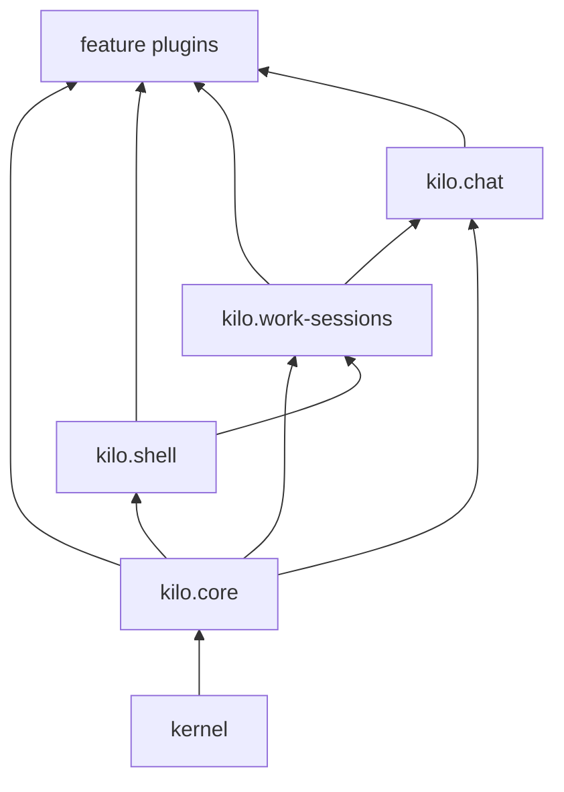

# Plugin architecture

Kilo Desktop is a client for the Kilo server, built entirely as plugins on a
product-agnostic kernel. The shell and every feature are plugins that use
exactly the API a third party gets. This document is the design: the building
blocks, the kernel, how the plugins are layered, how to design a feature with
them, and the decisions behind it.

| Read                                              | For                                                                                          |
| ------------------------------------------------- | -------------------------------------------------------------------------------------------- |
| This page                                         | The model and its rules; [designing a feature](#designing-a-feature) before you build one    |
| [docs/plugins/schema.md](./plugins/schema.md)     | Generated catalog: every plugin, extension point, domain object, object type and context key |
| [docs/plugins](./plugins/README.md)               | How to write a plugin: manifest, lifecycle, each building block, testing                     |
| [docs/agent-tools.md](./agent-tools.md)           | How agent tools reach Kilo and paired external apps                                          |
| [CONTEXT.md](../CONTEXT.md)                       | Packages and plugins in one line each, conventions                                           |
| `.agents/skills/design-feature`, `…/write-plugin` | Agent workflows for designing a feature and building a plugin                                |

---

## Principles

1. **Build the app the way we extend it.** A plugin API that performs a core
   action must be the path core uses for that action. Core plugins ship their
   built-ins through their own extension points (the chat's model picker is a
   `kilo.chat/composer-action`, its bash card a `kilo.chat/tool-renderer`),
   which proves each extension point is real.
2. **A plugin is a product area, not a concept.** Domain objects and
   extension points stay granular and well named inside it; the schema is the
   API, not the number of packages. Split a plugin only where something uses
   one half without the other (`kilo.core` is data only because the shell,
   features' main-process tools and paired external apps use it without UI).
   Inside a plugin, data and UI stay separate areas, so the seam still exists
   in the code.
3. **Extension points exist for other plugins.** Declare one only where
   something outside the owner contributes, or where third parties are meant
   to. Name it for the product concept (`kilo.chat/composer-mention`, not
   `composer-slot-2`), give it a kind and a typed contract. The window frame
   is the one place named by position (`kilo.shell/main`,
   `kilo.shell/status-bar-item`), because for the shell the layout is the
   product concept. Everything else is plain code in the plugin.
4. **Dependencies only point down.** A plugin requires only lower layers.
   Where a lower layer needs something from a higher one, the lower layer
   declares an extension point and the higher one fills it: kernel identity,
   flag sources and telemetry sinks, `kilo.work-sessions/vcs` and
   `kilo.local-inference/model-catalog` all work this way.
5. **Removable by default.** Removing any plugin, `kilo.shell` included,
   leaves the app booting and degraded, never crashed. A missing domain
   object resolves to `null`, an extension point whose owner is missing reads
   as empty, a missing pane kind renders "unavailable". CI boots the app with
   each bundled plugin removed.
6. **The kernel knows nothing about the product.** No plugin ids and no
   product concepts below the plugin line. The host (`apps/*`) provides
   `kernel/*` primitives, never features.
7. **Declarative first.** Static contributions live in `plugin.json`, so the
   kernel can validate, order and list them (and Diagnostics can show them)
   without running plugin code. Runtime registration is the escape hatch for
   dynamic entries.
8. **Always think about extensibility.** Every plugin is a potential host.
   When building or changing a surface, ask what another plugin, ours or a
   third party's, would naturally add to it, and record the answer in the
   [extensibility map](#extensibility-map). Design extension points broadly;
   build one when a real contributor exists.
9. **The workspace board is the litmus test.** Anything a board-level plugin
   needs must be reachable through the public domain objects and extension
   points of `kilo.work-sessions` and `kilo.chat`. `kilo.workspace-board` was
   rebuilt with no contract changes to either.
10. **We are Kilo.** Contracts speak Kilo plainly: chats are Kilo sessions,
    AI providers are the AI providers in Kilo's config. Kilo SDK and wire
    types never appear in contracts.

---

## Building blocks

Plugins are only the delivery mechanism. What they deliver is what matters
at runtime, and every feature is designed in these terms:

| Building block                | What it is                                                                                                                                                  | Declared in `plugin.json`               | Defined in `./contracts`             | Use it for                                                                  |
| ----------------------------- | ----------------------------------------------------------------------------------------------------------------------------------------------------------- | --------------------------------------- | ------------------------------------ | --------------------------------------------------------------------------- |
| **Plugin**                    | A workspace package with a manifest, a `main` and/or `web` entry and a `./contracts` export. A product area.                                                | the whole file                          | `*_DEFINITIONS`                      | Delivering everything below                                                 |
| **Domain object**             | A named object (`<plugin>/<name>`) with state, methods and events, provided in one process (its `home`) and usable from any process and window              | `domainObjects`                         | `defineDomainObject`                 | State and actions other plugins (or your own other half) read and call      |
| **Object type**               | The `type` of an `ObjectRef` (`{type, id}`): a kind of thing other plugins point at. A collection domain object resolves it                                 | `objectTypes`                           | `defineObjectType`                   | Passing things between plugins: drag and drop, openers, mentions            |
| **Extension point**           | A typed slot (`<plugin>/<point>`) other plugins contribute to: **additive** (many, ordered), **exclusive** (one winner, with fallback) or **decision**      | `extensionPoints`                       | `defineExtensionPoint`, `…Decision…` | Letting other plugins add to a surface or a behaviour you own               |
| **Contribution**              | One entry in an extension point: metadata in the manifest, plus an implementation bound in code when the point takes one                                    | `contributes.extensions`                | —                                    | Adding to another plugin's (or your own) surface or behaviour               |
| **Command**                   | A named action a person can trigger: a `kernel/command` contribution with a handler and no placement. Surfaces (palette, keys, menus, buttons) reference it | `kernel/command`                        | —                                    | Anything a person does; one id for every surface, rebindable keys           |
| **Context key**               | A named boolean condition, `global` or per `window`, set by the plugin that owns the concept and read by `when` clauses                                     | `contextKeys`                           | —                                    | Showing, hiding and enabling contributions without running plugin code      |
| **Service**                   | A supervised daemon or background task: a `kernel/service` contribution with `start` / `stop` / `health`                                                    | `kernel/service`                        | —                                    | Child processes, slow startup work, anything that must stop cleanly at quit |
| **Flag**, **telemetry event** | A declared feature flag (`kernel/flag`, read as `kernel/flag:<id>`) or analytics event (`kernel/telemetry-event`)                                           | `kernel/flag`, `kernel/telemetry-event` | —                                    | Gating unfinished features; reporting usage                                 |
| **Host primitive**            | A `kernel/*` domain object (windows, dialogs, clipboard, OS, keychain…) gated by `permissions.host`, or a per-plugin host service (`mainHost(sdk)`)         | `permissions`                           | (the kernel's)                       | Reaching the OS; never import Electron                                      |

One domain action is usually exposed three ways, all calling the same code: a
**method** on a domain object for other plugins' code, a **command** for
people, and an agent **tool** (`kilo.core/tool`) for the agent.

The generated [schema](./plugins/schema.md) lists every plugin, extension
point (with its contributing plugins), domain object, object type and context
key. Commands, services, flags and telemetry events are contributions: find
them in each plugin's `plugin.json`. How to use each one: [extension points](./plugins/extension-points.md),
[domain objects](./plugins/domain-objects.md), [commands and
keys](./plugins/commands-and-keys.md), [panes and
openers](./plugins/panes-and-openers.md), [chat and agent
tools](./plugins/chat-and-tools.md).

---

## The kernel

`packages/kernel` runs one **main kernel** (Electron main) and one kernel per
**window**, joined by one transport. It is the only part of the app that
cannot be a plugin, because it needs caller identity, runs before plugins or
enforces trust:

| Kernel responsibility                                                                                                                   | Why it is not a plugin                                                         |
| --------------------------------------------------------------------------------------------------------------------------------------- | ------------------------------------------------------------------------------ |
| Plugin runtime: discovery, manifest validation, ordering from `requires`, budgeted transactional activation, plugin status, safe mode   | It is the plugin system                                                        |
| The extension registry and the domain object registry, with cross-process proxies; the `when` evaluator                                 | Same                                                                           |
| Service supervision (`kernel/service`): start conditions, restart with backoff, awaited stop in reverse order under an overall quit cap | Child processes from many plugins must start, recover and stop consistently    |
| Per-plugin scoped services: storage and kv, sandboxed fs, net, assets, ports between a plugin's own halves                              | Identity-scoped: the provider must know who is calling                         |
| Security: protocol schemes and embedded hosts from manifests, IPC sender trust, payload validation, permission checks                   | Enforcement cannot live with the enforced                                      |
| Host primitives as permissioned `kernel/*` domain objects                                                                               | Plugins never import Electron                                                  |
| Commands (`kernel/command`) and keyboard dispatch                                                                                       | Shortcuts must work in every window, and keep working if the shell is replaced |
| Typed drag and drop of `ObjectRef`s                                                                                                     | A drag starts in one plugin's surface and ends in another's                    |
| Identity, flags and telemetry as vocabulary, with vendors plugged in from above                                                         | Every plugin needs them; no plugin should depend on the vendor                 |
| The renderer root (`kernel/root`), with a recovery screen when nothing is contributed or the root fails                                 | Something must render when nothing else does                                   |

The kernel registers its own items in the same registries under the reserved
owner `kernel`; there is no other privileged path.

### The extension registry

- An extension point is declared by its owner in `plugin.json` and exported
  from the owner's `./contracts` with
  `defineExtensionPoint({ id, kind, metadata, implementation })` or
  `defineDecisionExtensionPoint`. `metadata` is a zod schema for each
  contribution's data; `implementation("renderer" | "main" | "any")` says
  where its code binds (omit it for data-only points).
- **Additive (A)**: many contributions, ordered by `priority`.
  **Exclusive (X)**: one winner, the rest a fallback chain.
  **Decision (D)**: the owner asks a typed question with
  `sdk.extensions.decide`; handlers answer `proceed`, `{ask}` or `{reject}` in
  a fixed order under a time budget. Product decisions fail closed
  (`kilo.core/tool-approval`); quit and window-close fail open, so a plugin
  can never trap the user.
- Contributions come from the manifest (validated against the metadata
  schema at discovery) or from `sdk.extensions.add(Point, entry, impl)` at
  runtime. Code binds to a manifest contribution with
  `sdk.extensions.implement(Point, id, impl)`. A contribution to a point
  whose owner isn't installed is ignored with a warning, so optional
  integrations never break a plugin.
- Hosts read contributions with `useExtensions(Point)` /
  `sdk.extensions.list(Point)`, with `when` already evaluated. Every
  contribution is stamped with its plugin and mounted in its own error
  boundary. Hosts render what is contributed and never branch on who
  contributed it.
- **Contributions are self-sufficient.** They get their data from their own
  plugin (kilo.git polls pull requests in main), never from helpers a host
  mounts, so they work in any host and any window. A host may hand renderers
  of its objects to the surfaces it hosts (kilo.work-sessions gives every
  `work-sessions-view` `WorkSessionsViewProps.renderers`), so another plugin
  can show a work session exactly as the session list does.

### The domain object registry

```ts
// in kilo.work-sessions' contracts
export const WorkSessions = defineDomainObject({
	id: "kilo.work-sessions/work-sessions",
	home: "main", // where the real state lives
	state: z.object({ workSessions: z.array(workSessionSchema) /* … */ }),
	methods: { create: method(createInput, workSessionSchema) /* … */ },
	events: { deleted: z.object({ workSession: workSessionSchema }) /* … */ },
	lookup: (state, id) => state.workSessions.find((s) => s.id === id),
	objectType: WorkSessionType, // kilo.work-sessions/work-session
});

// any plugin, any process, any window
sdk.domainObjects.track(WorkSessions, {
	added(workSessions) {
		workSessions.on("deleted", ({ workSession }) => dropCard(workSession.id));
	},
	removed() {},
});
await sdk.domainObjects.get(WorkSessions)?.methods.rename({ id, title }); // null when unprovided
```

- **State** is one zod schema, observable (`subscribe`, and
  `useDomainObjectState` in React). **Methods** are typed calls validated
  against their schemas. **Events** belong to the domain object: only its
  provider emits them, anyone listens; fire-and-forget, no replay, so
  anything a late subscriber needs is in state too. There is no separate
  event bus.
- **Process-transparent.** The provider lives in its `home` process (usually
  main). Every other process and window gets a proxy: state as live
  snapshots, methods forwarded, events broadcast. A pop-out window therefore
  sees the same objects as the main window. Per-window state (focus, the
  open work session) uses `home: "renderer"` and never leaves its window.
- **Collections** are plural, declare a `lookup` by key, and name the
  object type they resolve; `sdk.domainObjects.resolve(ref)` finds the item.
  Exactly one plugin provides a given domain object.
- **Callers.** A provider can check which plugin is calling a method, and
  kernel host primitives require the matching `permissions.host` entry from
  non-owners. Expected failures throw `KernelError(code, message)`; its code
  and message cross processes, other errors are scrubbed.

**Not registries:** `sdk.ports` (streams between a plugin's own renderer and
main halves) and the per-plugin host services.

### Object references

An `ObjectRef` (`{type, id}`) is how plugins hand each other things. Drag
sources offer refs and drop targets declare the object types they accept
(the board accepts `kilo.work-sessions/work-session`); openers match on type
(a `kilo.work-sessions/file` ending `.ipynb` opens a notebook pane); mentions
resolve to refs. Plugins never exchange internal ids or components.

### `when` and context keys

A contribution's `when` (`{ "all": [...], "none": [...] }`) is evaluated by
the kernel without running plugin code, so commands, menu items and keys can
be listed or hidden without mounting anything. Keys are qualified
(`kilo.work-sessions/workSessionActive`, `kernel/flag:workspace-board`) and
each is declared by the plugin that owns the concept. A manifest-level
`when` runs the whole plugin only while it holds (a feature flag, typically),
activating and deactivating it live.

### Identifiers

| Thing                                                    | Form                      | Example                      |
| -------------------------------------------------------- | ------------------------- | ---------------------------- |
| Plugin                                                   | dotted `publisher.name`   | `kilo.chat`                  |
| Extension point, domain object, object type, context key | `<plugin>/<local name>`   | `kilo.chat/composer-mention` |
| Command, contribution                                    | `<plugin>/<id>` (its key) | `kilo.workspace-board/open`  |

Manifests use local names and the kernel qualifies them, so a plugin cannot
declare anything in another plugin's namespace. Contributions name their
target point by its qualified id. The `kilo.` publisher is reserved for
bundled plugins and `kernel` is a reserved owner. An extension point, a
domain object, an object type and a context key of one plugin never share an
id. Ids name the owning plugin, for traceability: moving one to another
plugin changes its id.

### Lifecycle

```
main process                                                  renderer
1 discover   read manifests, register URL schemes (no plugin code)
2 activate   main entries in dependency order: provide domain
             objects, bind contributions. Fast; no slow I/O.     splash
3 show window ──────────────────────────────────────────────▶ web entries activate,
                                                                the shell renders
4 start      services whose start conditions hold, in parallel
5 run        crash → restart with backoff; status in kernel/services
6 stop       kernel/quit decision; services stop in reverse order,
             each awaited under a timeout and an overall cap; then
             plugins deactivate (everything registered via sdk is disposed)
```

- **Activation declares and wires.** It is budgeted (a warning above 200 ms,
  failure and rollback at 10 s). Slow work, child processes, network and
  migrations are a `kernel/service` (`startOn: "activation" | "window-shown"
  | "first-use"`). Prefer `first-use`.
- **Depend on readiness, not order.** `requires` orders activation
  (`optional`) or leaves a plugin unresolved without its dependency
  (`required`). At runtime read a domain object's status, follow late
  providers with `track`, or call `kernel/services` `ensureStarted`.
- **Hooks, three kinds.** A plugin hooks into its own lifecycle through
  methods (`activate` / `deactivate`, a service's `start` / `stop`), observes
  everything else through domain object events (`kernel/app`
  `phase-changed`, `kernel/plugins` `state-changed`, `kernel/windows`
  `closed`, `kernel/system` `resume`…), and delays or vetoes through decision
  extension points (`kernel/quit`, `kernel/window-close`). Every lifecycle
  fact is also state (`kernel/app` `phase`: `starting → started → ready →
  stopping → stopped`), so a late subscriber never misses a transition.

---

## Layers and plugins



| Layer    | Plugin                                                                                                                                                                                                 | In one line                                                                                                 |
| -------- | ------------------------------------------------------------------------------------------------------------------------------------------------------------------------------------------------------ | ----------------------------------------------------------------------------------------------------------- |
| —        | kernel                                                                                                                                                                                                 | Plugin runtime and host primitives, plus identity, flags and telemetry vocabulary                           |
| data     | `kilo.core`                                                                                                                                                                                            | The Kilo server and everything it knows: account, terms, AI providers and models, chats, agent tools. No UI |
| UI       | `kilo.shell`                                                                                                                                                                                           | The window: frame, settings, onboarding, palette, appearance, account and AI settings, About and updates    |
| data+UI  | `kilo.work-sessions`                                                                                                                                                                                   | Workspaces, work sessions and their panes; the session list, the canvas, the New Session page               |
| UI       | `kilo.chat`                                                                                                                                                                                            | The chat pane: transcript, composer, tool renderers                                                         |
| features | `kilo.git`, `kilo.files`, `kilo.terminal`, `kilo.browser`, `kilo.notebook`, `kilo.marketplace`, `kilo.local-inference`, `kilo.environments`, `kilo.anaconda`, `kilo.workspace-board`, `kilo.developer` | One vertical product area each, on top of the layers below                                                  |

- A plugin requires only lower layers. Features may build on each other
  only through extension points pointing down (`kilo.anaconda` and
  `kilo.environments` fill `kilo.local-inference`'s `model-catalog` and
  `llama-runtime`).
- **Areas inside a plugin.** A plugin is composed of areas
  (`src/main/<area>`, `src/web/<area>`), each activated by the entry and
  meeting the others only through the plugin's own domain objects. Data
  areas are checked without UI first; UI areas sit on top. Anything shared
  only by one plugin's main and web halves lives in `src/shared`, not in
  contracts.
- **Storage.** Each plugin owns its data under its own storage directory
  (kv stores, files). Nothing shares a database; another plugin's data is
  reached through its domain objects.
- The chat ↔ work session link lives in the Kilo chat's metadata stamp
  (`workSessionId`, `workspaceId`, folders, worktree branch). kilo.core owns
  the stamp's format but treats the ids as opaque; kilo.work-sessions finds
  a work session's chats by reading it. The link survives reinstalls and is
  visible to the Kilo CLI.

Each plugin's line is in [CONTEXT.md](../CONTEXT.md); what each offers,
contributes and requires is in the generated [schema](./plugins/schema.md);
`pnpm docs:plugin-graph` regenerates the
[dependency graph](./plugins/dependency-graph.html).

---

## Designing a feature

Design every feature in building blocks before writing code. The outcome is
a short list, in the issue or PR description, of the plugins, domain objects,
object types, extension points, contributions, commands, context keys,
services, flags and telemetry events the feature adds or changes. Start from
the [schema](./plugins/schema.md): most features are contributions to
extension points that already exist.

1. **Find the owner.** Name the product concept and find the plugin that
   owns it. A feature that belongs to an existing product area goes in that
   plugin as a new area. Make a new plugin only for a new product area, or
   when something must be able to run, ship or be removed without it (a
   feature behind its own flag is still usually an area of its owner).
2. **Put state in domain objects.** State and actions other plugins, or your
   own other half, need are a domain object of the owner: `home: "main"` for
   shared state, `renderer` for per-window state. A collection is plural,
   has a `lookup` and an object type if other plugins refer to its items.
   Persist in the owner's own storage. Never mirror another plugin's state;
   read its domain object.
3. **Put UI in contributions.** Pane kinds, settings pages, composer
   actions, session menu items, decorations, top-bar actions, dialogs and
   onboarding steps are all contributions to existing extension points. A
   feature should not need edits to the plugin whose surface it appears in;
   if it does, that surface is missing an extension point.
4. **Expose actions three ways.** A method for code, a `kernel/command` for
   people (palette, keys, menus and buttons reference it by id), a
   `kilo.core/tool` for the agent when the agent should be able to do it.
5. **Express conditions as context keys.** Visibility and enablement are
   `when` clauses over context keys owned by the concept's plugin. Gate
   unfinished work with a `kernel/flag` and a manifest or contribution
   `when`.
6. **Supervise slow work.** Child processes and anything slow at startup are
   a `kernel/service`, started on first use where possible.
7. **Add an extension point only for another plugin.** If something outside
   the owner (another bundled plugin, or third parties by design) will
   contribute, declare an extension point: product-named, singular, with the
   right kind and a typed metadata schema and implementation. Then ship the
   owner's own built-ins through it. If a lower layer needs something from a
   higher one, the lower layer declares the extension point.
8. **Check removability both ways.** What does the app do without your
   plugin, and what does your plugin do without each thing it requires? Use
   `optional` requires and handle `null` domain objects.
9. **Record it.** Declare telemetry events, update the manifest, run
   `pnpm docs:schema`, add candidate extension points to the
   [extensibility map](#extensibility-map), and add a new plugin to
   `CONTEXT.md` and `packages/bundled-plugins`.

**A new view of existing things** (a board, a timeline) needs four things
from the owner of those things: a rich read model (its collection domain
object), renderers so it looks native, a way into the owner's menus, and
typed drag and drop. `kilo.workspace-board` uses exactly these from
kilo.work-sessions (`work-sessions`, `window`, `work-sessions-view` with its
`renderers`, `work-session-menu`, `work-session-grouping`,
`work-session-list-action`) and touches no other plugin's code.

**Example: pull request status on work sessions.** kilo.git owns pull
requests, so it provides `kilo.git/pull-requests` (polled in main, object
type `kilo.git/pull-request`) and contributes a
`kilo.work-sessions/work-session-decoration` (the badge on rows and board
cards) and a `kilo.work-sessions/work-session-facet` (the session list's
filter). kilo.work-sessions knows nothing about git.

**Smells.** Importing anything but another plugin's `./contracts`; adding a
special case for one feature to a host surface; product code in `apps/*`;
React context or shared storage across plugins; an extension point only its
owner contributes to (and no third party is meant to); a domain object that
copies another plugin's state; a plugin requiring a higher layer; work done
in `activate` that should be a service.

---

## Extensibility map

Every plugin is a host. Extension points that exist are in the
[schema](./plugins/schema.md); this map lists **candidates**: points a
plugin could offer, named for the product concept, with who would
contribute. **Next**: a plugin we ship has a clear use, or a hard-coded
special case exists. **Later**: plausible; build when a contributor appears.
_ext_ marks third-party examples. Promote a row to a real extension point
when a contributor appears (then remove it here), and add rows whenever a
surface is built or changed.

| Owner                | Candidate extension point    | Kind | Status | What it extends                                                             | Would contribute                                                                     |
| -------------------- | ---------------------------- | ---- | ------ | --------------------------------------------------------------------------- | ------------------------------------------------------------------------------------ |
| `kilo.chat`          | `composer-context`           | A    | Next   | Removable context chips from what the person is looking at                  | files (open file, selection); browser (current page); terminal (last failed command) |
| `kilo.chat`          | `composer-banner`            | A    | Next   | Notices above the composer                                                  | local-inference (model loading); core (server reconnecting); sign-in required        |
| `kilo.chat`          | `composer-attachment-source` | A    | Next   | Sources in the composer's "+" menu                                          | browser (pane screenshot); files (file picker); _ext_ Figma, Google Drive            |
| `kilo.chat`          | `empty-state`                | A    | Next   | Starter prompts in a new chat                                               | notebook ("Analyze a dataset"); environments; marketplace (featured agents)          |
| `kilo.chat`          | `message-action`             | A    | Next   | Actions on a message or selection                                           | chat (fork, today hard-coded); notebook (open as notebook); git (commit these)       |
| `kilo.chat`          | `chat-pane-action`           | A    | Next   | Chat pane header actions                                                    | chat (plan toggle, export)                                                           |
| `kilo.chat`          | `viewer-action`              | A    | Later  | Toolbar actions on what a chat's media viewer pane shows                    | chat (copy Mermaid source, built in); files (save to workspace)                      |
| `kilo.chat`          | `paste-handler`              | A    | Later  | Transform pasted content                                                    | browser (URL → mention); files (path → mention)                                      |
| `kilo.chat`          | `message-directive`          | A    | Later  | `::name{…}` blocks in replies rendered by a plugin                          | notebook (inline chart); git (commit card)                                           |
| `kilo.chat`          | `transcript-exporter`        | A    | Later  | Export formats                                                              | chat (markdown); notebook (`.ipynb`)                                                 |
| `kilo.chat`          | `message-dispatch`           | D    | Later  | Proceed or reject before a message is sent                                  | _ext_ cost guard, PII scrubber                                                       |
| `kilo.work-sessions` | `work-session-archive`       | D    | Next   | Proceed or ask before archiving a work session                              | git (uncommitted work in a worktree); terminal (processes running)                   |
| `kilo.work-sessions` | `work-session-template`      | A    | Next   | New Session templates: isolation, panes, first prompt                       | notebook ("Notebook analysis"); git ("Review a PR"); _ext_ "Fix a Jira issue"        |
| `kilo.work-sessions` | `layout-preset`              | A    | Next   | Built-in pane arrangements (today the `layout-presets` domain object's own) | notebook (chat + notebook + files); git (chat + changes)                             |
| `kilo.work-sessions` | `resource-action`            | A    | Next   | Actions on an `ObjectRef` (file, URL) wherever it is shown                  | chat (add to composer); git (stage, discard); files (reveal)                         |
| `kilo.work-sessions` | `file-decoration`            | A    | Next   | Badges on files wherever files are shown                                    | git (status); environments (`environment.yml`)                                       |
| `kilo.work-sessions` | `isolation`                  | A    | Later  | How a work session gets its own directory (today `vcs` worktrees only)      | git (worktree); _ext_ devcontainer, remote sandbox                                   |
| `kilo.work-sessions` | `work-session-activity`      | A    | Later  | Live state feeding a session's status and attention (today only its chats)  | terminal (command running); notebook (kernel busy)                                   |
| `kilo.work-sessions` | `notification-cue`           | A    | Later  | Cues the notifier sounds and shows                                          | terminal (long command finished); git (checks finished)                              |
| `kilo.work-sessions` | `project-detector`           | A    | Later  | Facts and suggestions about a workspace                                     | environments ("create env from environment.yml")                                     |
| `kilo.work-sessions` | `pane-tab-menu`              | A    | Next   | A pane tab's right-click menu (today kilo.work-sessions' own tab commands)  | files (reveal in Finder); git (open changes); browser (copy URL)                     |
| `kilo.core`          | `helper-model`               | X    | Later  | The small model for titles, commit messages, summaries                      | local-inference (local helper)                                                       |
| `kilo.core`          | `usage-source`               | A    | Later  | Usage and quota meters                                                      | local-inference (tokens/s); _ext_ provider accounts                                  |
| `kilo.shell`         | `theme`                      | A    | Later  | Colour themes                                                               | _ext_ community themes                                                               |
| `kilo.shell`         | `account-menu-item`          | A    | Later  | Entries in the sidebar's account menu (today kilo.shell's own UI)           | local-inference (usage); anaconda                                                    |
| `kilo.shell`         | `shortcut-hint`              | A    | Later  | Shortcut labels in tooltips and menus (today each surface formats its own)  | work-sessions (number chips); chat (composer hints)                                  |
| `kilo.developer`     | `diagnostics-panel`          | A    | Later  | Tabs in Settings → Developer → Diagnostics                                  | core (server log); notebook (runtimed); local-inference (model server)               |
| `kilo.git`           | `forge`                      | A    | Next   | Hosting providers: PR status, create PR, checks                             | git (GitHub); _ext_ GitLab, Bitbucket                                                |
| `kilo.git`           | `changes-file-action`        | A    | Next   | Actions on a file in the Changes pane                                       | files (external editor); chat (to composer)                                          |
| `kilo.git`           | `commit-check`               | D    | Later  | Proceed or reject before commit or push                                     | _ext_ secret scanner, test gate                                                      |
| `kilo.terminal`      | `terminal-profile`           | A    | Next   | Shell profiles for new terminals                                            | environments (activated conda env)                                                   |
| `kilo.terminal`      | `terminal-env`               | A    | Next   | Environment variables for new terminals                                     | local-inference (`OPENAI_BASE_URL`); environments (activation)                       |
| `kilo.terminal`      | `terminal-link`              | A    | Later  | Link matchers in terminal output                                            | git (commit SHAs); _ext_ issue keys                                                  |
| `kilo.browser`       | `browser-toolbar-action`     | A    | Next   | Browser pane toolbar actions                                                | chat (annotate and send to the agent)                                                |
| `kilo.files`         | `file-preview`               | A    | Next   | In-pane previews by file type                                               | notebook (read-only `.ipynb`); _ext_ CSV/Parquet viewer                              |
| `kilo.files`         | `editor-extension`           | A    | Later  | Editor language support and actions                                         | _ext_ language packs                                                                 |
| `kilo.notebook`      | `kernel-provider`            | A    | Later  | Kernels a notebook can use                                                  | environments (conda envs as kernels)                                                 |
| `kilo.notebook`      | `cell-action`                | A    | Later  | Actions on a notebook cell                                                  | chat (ask the agent about a cell)                                                    |
| `kilo.environments`  | `channel-source`             | A    | Later  | Package channels                                                            | anaconda (organisation-governed channels)                                            |
| `kilo.marketplace`   | `marketplace-source`         | A    | Next   | Catalogs of agents, skills and MCP servers                                  | _ext_ organisation-private or curated catalogs                                       |
| `kilo.workbooks`     | `section-action`             | A    | Later  | Actions on a workbook section or item ("start a session from this step")    | workbooks (plan steps); chat (ask the agent about an item); git (open PR)            |

Extension points that exist with no bundled contributor yet are kept on
purpose as third-party surfaces: `kilo.core/mcp-server`, `kilo.chat/mcp-app`,
`kilo.shell/right-sidebar-panel`, `kernel/quit` and `kernel/window-close`
(candidates: a running turn, an unsaved notebook, running terminal processes).

---

## Conventions

| Topic               | Rule                                                                                                                                                                                                                                                                                                   |
| ------------------- | ------------------------------------------------------------------------------------------------------------------------------------------------------------------------------------------------------------------------------------------------------------------------------------------------------ |
| Terms               | "Domain object" and "extension point" in full, in docs and code (`domainObjects`, `extensionPoints`); never "domain" or "point" alone in new prose                                                                                                                                                     |
| Domain object ids   | A collection is plural and declares a `lookup`; a singleton is singular (`kilo.core/server`, `kilo.chat/composer`). Name the concept in full, even when it repeats the plugin's name (`kilo.work-sessions/work-sessions`)                                                                              |
| Extension point ids | Singular: one contribution is one thing (`kilo.core/tool`, `kilo.core/ai-provider`). Name what it is, not just what it does                                                                                                                                                                            |
| Object types        | Singular, declared by the plugin that owns the concept and resolved by its collection (`kilo.core/chat`). A type with no collection (`kilo.work-sessions/file`, `…/url`) has an owner but no lookup                                                                                                    |
| Context keys        | camelCase, saying what holds (`workSessionActive`, `composerFocused`); `window` scope for anything about one window                                                                                                                                                                                    |
| Methods             | Verbs; setters are `setX({x})`. No migration or `importLegacy*` methods in contracts                                                                                                                                                                                                                   |
| Events              | Past tense, saying what changed (`deleted`, `phase-changed`)                                                                                                                                                                                                                                           |
| Commands            | `<verb>-<object>` (`add-column`); the title says what it does. Keep existing ids so saved keybindings keep working                                                                                                                                                                                     |
| Agent tools         | snake_case `<verb>[_<object>]` (`open_file`, `install_packages`); `open` shows something, `create` makes something. Kilo sees `desktop_<plugin>_<id>`. `external` defaults to false; set `external: true` to offer a tool to paired external apps. Keep existing ids (saved permission rules use them) |
| Shared vocabulary   | "AI provider" in full (`aiProviderId`, never `providerId`); `modelId` and one `ModelRef`; `{directory, path}` for file locations; "chat" for the conversation and "work session" in full for the container                                                                                             |
| Contracts           | Definitions plus the types, ids and constants needed to use them. Kilo SDK and wire types never appear in them                                                                                                                                                                                         |

---

## Open decisions and follow-ups

Keep these current in the same change as the work: add what a change leaves
open, delete what it settles.

**Open decisions**

| Question                                | Notes                                                                                                                                                                                                                                                                                                        |
| --------------------------------------- | ------------------------------------------------------------------------------------------------------------------------------------------------------------------------------------------------------------------------------------------------------------------------------------------------------------ |
| Agent name clashes between plugins      | `agent.<id>` and `command.<id>` from `kilo.core/agent-extension` use the bare contribution id, so two plugins contributing `review` clash (the first keeps it, the other is warned and skipped). Prefix with the plugin, or accept first-wins?                                                               |
| `agent.mode` is always written          | The contract defaults it to `subagent`; decide whether omitting it should let Kilo pick its own default.                                                                                                                                                                                                     |
| Commands that target an object type     | Instead of action points per surface (`work-session-menu`, `work-session-action`, a future `resource-action`), a command could declare the object type it acts on and every surface showing one would offer it.                                                                                              |
| Third-party plugins and lazy activation | Loading plugins from outside the app (one bundle per process, host-provided shared modules) and `activateOn` are not built; the example plugins show the shape they will have.                                                                                                                               |
| Shortcut sets: listed or inferred       | App Navigation lists the commands of its tab and session sets in code (`NUMBER_SETS`) and claims them in `plugin.json`; a unit test keeps the two equal. A `series` field on `kernel/command` would let any plugin's numbered commands form a set without a panel. Build it when a second plugin needs sets. |
| The ⌘/ list's row contract              | `kilo.shell/shortcuts-panel` `listRows` returns `{ title, labels, commands, searchText? }` from the platform and overrides only. A row can't yet read other panels' state or say which group it belongs in (it takes the first command's place).                                                             |

**Follow-ups**

| Item                                                            | Notes                                                                                                                                                                                                                                            |
| --------------------------------------------------------------- | ------------------------------------------------------------------------------------------------------------------------------------------------------------------------------------------------------------------------------------------------ |
| Packaged builds on every OS                                     | Check `better-sqlite3` (kilo.work-sessions' origin import loads it lazily and retries a failed read next launch), node-pty, LaunchDarkly and `atomically` load from a packaged build after `pnpm deploy`; declare them on `apps/desktop` if not. |
| Diagnostics layout                                              | Eight tabs wrap to two rows of four; only layout tests checked it. Diagnostics' "read by / gates" lists come from manifests only, so runtime conditions don't show.                                                                              |
| Chat panes for chat-adopted work sessions                       | kilo.work-sessions no longer opens a chat pane when a stamped chat appears; kilo.chat should open one for a work session with a chat but no pane showing it.                                                                                     |
| Origin pins and panes kept in a window's localStorage           | Hand them over from the web side through ordinary methods once, or accept the loss.                                                                                                                                                              |
| Fake Kilo server doesn't announce permission/question replies   | kilo.chat's cards wait for the server's reply events; tests send them by hand.                                                                                                                                                                   |
| Toasts sent before a window's frame renders are lost            | `kilo.shell/notifications` `toast` is fire-and-forget; tests wait for the frame first.                                                                                                                                                           |
| e2e specs that wait on a real server or model                   | The marketplace spec no longer waits for the Kilo server first (raise its 60 s timeouts if a cold start flakes); the git worktrees spec waits for a real model reply (add the completions stub if the packaged app has no answering model).      |
| Free models                                                     | `models[].free` comes from Kilo; the old composer trusted the gateway catalog's `isFree`.                                                                                                                                                        |
| git-client's tests are flaky in the push hook                   | `packages/git-client` runs real git and can time out (30 s) when many packages test at once. Raise the timeouts or run them serially if it keeps happening.                                                                                      |
| Windows skill links                                             | `KiloSkillConfig`'s junction path and its removal fallback are untested on Windows.                                                                                                                                                              |
| `production.ts` wiring has no tests                             | Each kilo.core area's real wiring is excluded from coverage; the e2e smoke spec is its only check.                                                                                                                                               |
| Refresh the `/` menu's server commands when Kilo restarts       | kilo.chat caches `command.list` per `[baseUrl, version, directory]`; `KiloServerManager.restart()` keeps both, so commands added by config or `agent-extension` only show after a window reload.                                                 |
| More client slash commands                                      | `/new`, `/models`, `/agents`, `/variant` (the pickers need a way to be opened from outside); arguments and nested sub-commands.                                                                                                                  |
| Slash commands from the palette and keys                        | Commands in the `/` menu are `palette: false` because the palette, keys and app menu pass no `ClientSlashCommandContext`. Resolve the focused composer's context when none is passed to offer them everywhere.                                   |
| Recent branches from Kilo's own history                         | The branch pickers' Recent group reads the main folder's HEAD reflog, so branches used only in Kilo worktrees never count. Merge in recent work sessions' branches; a "behind origin" marker needs ahead/behind counts in kilo.git.              |
| Install links while `environments-feature` is off               | `kilo.shell/deep-link` has no `when`, so the `packages` link opens "Section not found" instead of saying the feature is unavailable.                                                                                                             |
| A draft chat pane's first message if the pane closes mid-create | assistant-ui drops a draft's first send when its thread runtime is disposed before the chat exists. Telling a final dispose from a hidden one would let a chat pane hand it to main's prompt queue, as the New Session page does.                |
| Typed arguments for command placements                          | `kernel/command` handlers take `args?: unknown`; each placement (composer actions, slash commands) checks its own shape. A way for a placement extension point to declare its argument schema would replace these.                               |
| Chat fork follow-ups                                            | Not yet: a full-session fork from the sidebar or a tab; pre-filling the composer with the forked prompt; forking into a new work session or worktree (`WorkSessions.forkChat`); carrying the source's `agent`; persisted fork lineage.           |
| `GitActionsControl` branch coverage                             | 56% branches (the default-branch confirm's Cancel and "branch changed" paths).                                                                                                                                                                   |
| One Kilo sign-in gate                                           | kilo.environments, kilo.notebook and kilo.local-inference each have a copy.                                                                                                                                                                      |
| Workspace sources follow-ups                                    | The New workspace dialog's sources can't yet show clone progress or cancel a clone (git-client's `exec` takes a signal but no progress); self-hosted GitHub Enterprise isn't listed (the GitHub CLI's default host only).                        |
| Panes and work sessions                                         | Choosing among several openers ("Open with"); a pane status contract so a Browser pane's loading feeds work session status; a dirty indicator for Files and Notebook tabs; clicking a notification to open its work session; a dock badge.       |
| Pane tab menu                                                   | Opening it from the keyboard (Shift+F10) and showing keybindings in its items. Close others / to the right / all close one `Panes.close` at a time (so close guards ask in turn); a `Panes.closeMany` would save the broadcasts.                 |

---

## Decision log

The enduring design decisions, in the order they were made. Numbers are
kept from the original log, so code comments that cite a decision stay
valid; decisions about the build-up plan, and those superseded by later
ones, are gone. Names are today's.

| #   | Decision                                                                                                                                                                                                                                                                      |
| --- | ----------------------------------------------------------------------------------------------------------------------------------------------------------------------------------------------------------------------------------------------------------------------------- |
| 1   | Plugin ids are dotted `publisher.name` (`kilo.chat`); things a plugin owns are qualified with `/`                                                                                                                                                                             |
| 2   | Plugins can own extension points; the shell's are just the `kilo.shell` plugin's                                                                                                                                                                                              |
| 3   | Extension points are intentional and product-specific, not a generic UI framework                                                                                                                                                                                             |
| 5   | `when` is `{all, none}` over context keys, each declared by the plugin that owns the concept                                                                                                                                                                                  |
| 6   | Static contributions are declared in `plugin.json`; `sdk.extensions.add` is the typed runtime escape hatch                                                                                                                                                                    |
| 7   | The kernel is an "empty app": Electron, plugin runtime, registries, security, scoped services and permissioned host primitives. `kilo.shell` is a plugin                                                                                                                      |
| 9   | A work session is a workbench (directory and panes), not a chat; it can hold many chat panes, and New Session can start with any pane kind offered for it                                                                                                                     |
| 13  | Commands are the kernel-owned `kernel/command` extension point: a named action with no placement. Surfaces are owned by their UI's plugin and reference commands by id                                                                                                        |
| 14  | Extension point owners may hand renderers to the surfaces they host so other plugins display things natively; contributions are self-sufficient (no host-mounted helpers)                                                                                                     |
| 15  | Owned collections expose an observable, window-independent read model with actions; the workspace board is the validation case                                                                                                                                                |
| 16  | Plugins are only the delivery mechanism: they deliver extension points, contributions and domain objects (state, methods, events), which the kernel makes process- and window-transparent. Events belong to domain objects                                                    |
| 17  | Cross-plugin interaction (drag and drop, openers, mentions) uses typed `ObjectRef`s                                                                                                                                                                                           |
| 19  | Startup is a fixed set of kernel-owned phases; plugins never add steps; activation is fast and budgeted; the window shows before slow work starts                                                                                                                             |
| 20  | Long-running and background work is a `kernel/service`, supervised by the kernel; every child process goes through it                                                                                                                                                         |
| 21  | Plugins depend on readiness, not order: `requires` for ordering, domain object state and `ensureStarted` at runtime                                                                                                                                                           |
| 25  | Lifecycle hooks come in three kinds: notifications (domain object events), awaited hooks (`activate` / `deactivate`, service `start` / `stop`) and decisions (`kernel/quit`, `kernel/window-close`, failing open)                                                             |
| 26  | Registrations through `sdk` are disposed automatically on deactivation; lifecycle facts are also state, so late subscribers never miss a transition                                                                                                                           |
| 28  | Consent to collect data is a host primitive (`kernel/data-collection`), because crash reporting starts before plugins                                                                                                                                                         |
| 29  | A contribution to an extension point whose owner is not installed is a warning, not an error                                                                                                                                                                                  |
| 30  | A plugin that hosts extension points may export a `./testing` fixture that boots it around guest plugins; only tests may import it                                                                                                                                            |
| 32  | Host services locate a plugin's shipped files (`assets.resolve`, a `resources/` folder); an extension point declared `resources: true` gets `${resources}` in its contributions' metadata resolved by the kernel                                                              |
| 33  | Onboarding is hosted by kilo.shell; plugins contribute steps, and a `required` condition turns a step into a gate (terms)                                                                                                                                                     |
| 35  | UI shared by several plugins moves to `@kilo-desktop/ui` rather than being copied                                                                                                                                                                                             |
| 37  | Plugin data lives in the plugin's own store (kv unless it outgrows it); a plugin that replaced older code imports that code's saved data once                                                                                                                                 |
| 39  | Paths other plugins use are authorised in one place, `kilo.work-sessions/workspaces` `authorize`                                                                                                                                                                              |
| 40  | A work session has its own title, pin and archive state: the title follows its first chat until renamed, and archive can be undone                                                                                                                                            |
| 41  | kilo.work-sessions reads Kilo chats in main (from `kilo.core/chats`), so work sessions work before and without the chat UI                                                                                                                                                    |
| 43  | A work session's built-in actions (pin, rename, archive, delete) are rendered by the surface showing it; plugins add `kilo.work-sessions/work-session-menu` items                                                                                                             |
| 44  | Pane state lives in kilo.work-sessions in main, shared by windows; the canvas owns the layout's shape, the `panes` domain object which panes exist                                                                                                                            |
| 45  | Pane pop-outs are keyed kernel windows (`kernel/windows`)                                                                                                                                                                                                                     |
| 46  | The kernel gives plugins message ports between their own renderer and main halves (`sdk.ports`), for streams such as terminal I/O                                                                                                                                             |
| 47  | Agent tools are main-process `kilo.core/tool` implementations; kilo.core's gateway calls them directly                                                                                                                                                                        |
| 50  | kilo.core owns Kilo chats (one server event stream, `kilo.core/chats`); the chat ↔ work session link is the chat's metadata stamp, which kilo.core writes but treats as opaque                                                                                                |
| 51  | Chat state is split by need: main holds the chat list, activity, pending prompts and actions; the chat pane keeps the transcript runtime in the window                                                                                                                        |
| 53  | kilo.git provides `kilo.work-sessions/vcs` (what other plugins need from version control) and owns domain objects for its own actions and pull requests                                                                                                                       |
| 54  | Worktree isolation is chosen when a work session is created; kilo.work-sessions asks `vcs` to create, resolve or remove worktrees, and kilo.core releases a directory's Kilo instance before removal                                                                          |
| 57  | `kilo.core/chat-config` may add Kilo permission rules and instructions for a chat; plugins add detail to the chat's permission cards through `kilo.chat/permission-renderer`, not whole custom cards                                                                          |
| 58  | Local model providers reach the composer through `kilo.chat/model-source`; kilo.chat never reads kilo.local-inference                                                                                                                                                         |
| 61  | Every bundled plugin is removable, kilo.shell included (the window falls back to the kernel's recovery screen); CI boots each removal and builds each bundled plugin outside the monorepo                                                                                     |
| 62  | Authoring docs live in `docs/plugins` as how-to (this page is the design); the schema is generated from manifests and contracts and checked by lint; the example plugins are held to the same isolation checks                                                                |
| 63  | Settings categories are contributions (`kilo.shell/settings-category`); sections name a category and are ordered within it                                                                                                                                                    |
| 66  | Prompts queued while a chat works and unsent composer text are kilo.chat state in main (`prompt-queues`, `drafts`), so they follow a session switch, a pop-out and a reload                                                                                                   |
| 70  | Plugins are product areas in layers (kernel, `kilo.core`, `kilo.shell`, `kilo.work-sessions`, `kilo.chat`, features); dependencies point only down                                                                                                                            |
| 71  | Identity, flags and telemetry are kernel vocabulary; the Kilo account, LaunchDarkly and PostHog plug in from `kilo.core` through `kernel/identity-provider`, `kernel/flag-source` and `kernel/telemetry-sink`, and linked accounts (Anaconda) through `kernel/linked-account` |
| 72  | Object types are first-class: declared by the owning plugin, resolved by exactly one collection with a `lookup`                                                                                                                                                               |
| 73  | Contributions to Kilo itself are data: `kilo.core/agent-extension` and `kilo.core/mcp-server` carry agents, commands, skills, Kilo plugins and MCP servers in their metadata; `kilo.core/server-env` adds server environment variables                                        |
| 74  | `kilo.local-inference` and `kilo.environments` stay their own plugins; Anaconda's model catalog and conda's llama.cpp runtime are contributions to `kilo.local-inference`'s `model-catalog` and `llama-runtime`                                                               |
| 75  | Plugins own their shortcut UI on the Shortcuts page through `kilo.shell/shortcuts-panel`: a panel claims commands, Settings leaves them out of its list, and the ⌘/ list shows the panel's rows for them. kilo.shell has no knowledge of any plugin's commands                |

---

## References

Designs reviewed while shaping this one: **Envisage** (application and
plugin lifecycle events, vetoable starting and stopping), **OSGi** (bundle
states, service trackers, lazy activation), **VS Code** (`contributes`,
commands, menus and keybindings, `when`), **Paseo** (workspace tabs, panel
registry, data-first composer contributions), **bb** ("core uses the API",
decision hooks, exclusive slots with `Original`, transactional activation),
**Orca** (strict versioned manifest with cross-reference validation) and
**Kilo Code** (typed TUI slots, command and keymap layers).
