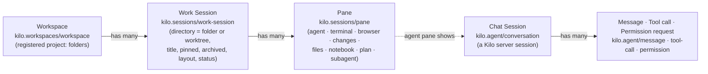
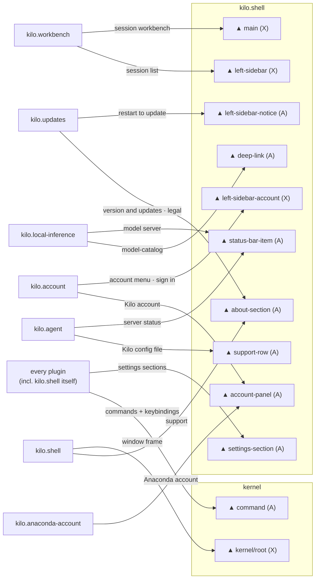
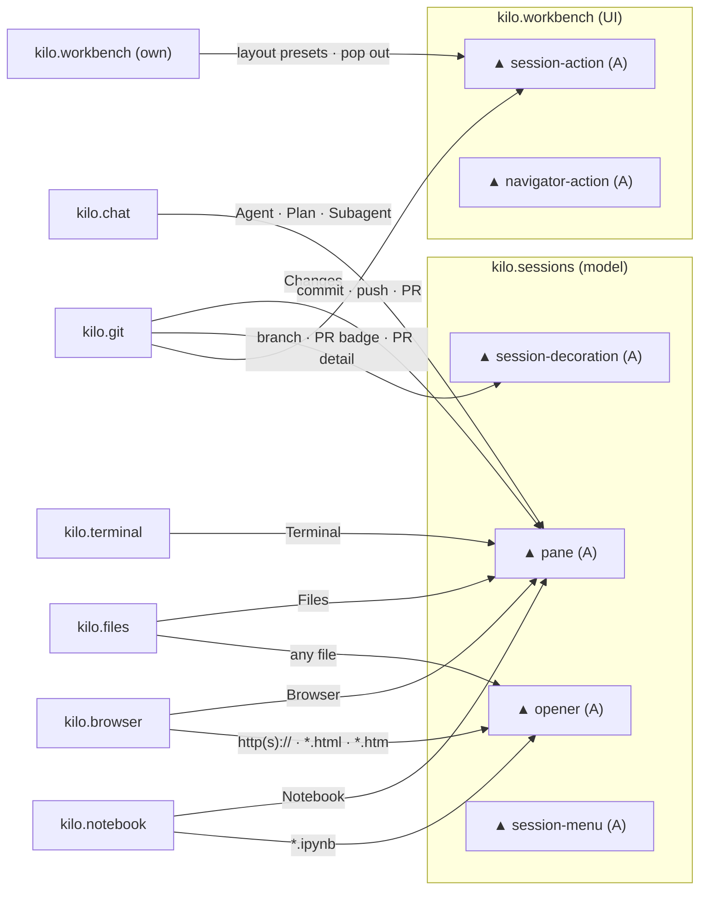
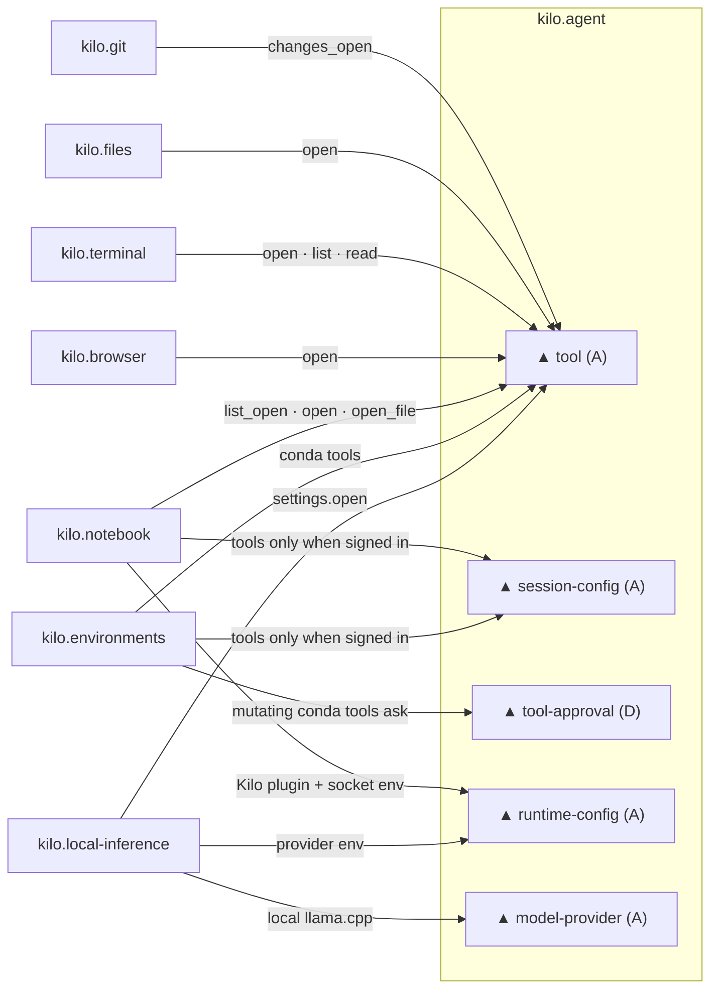
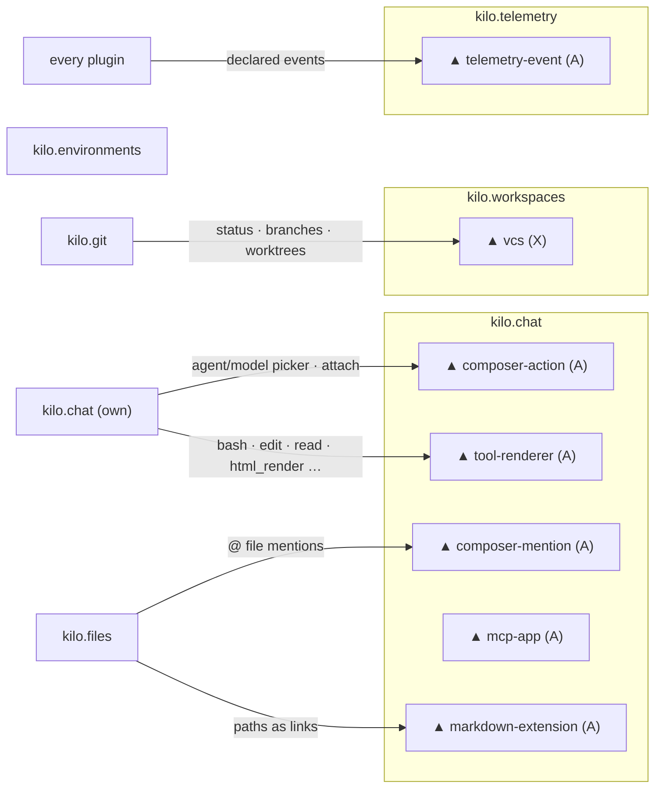
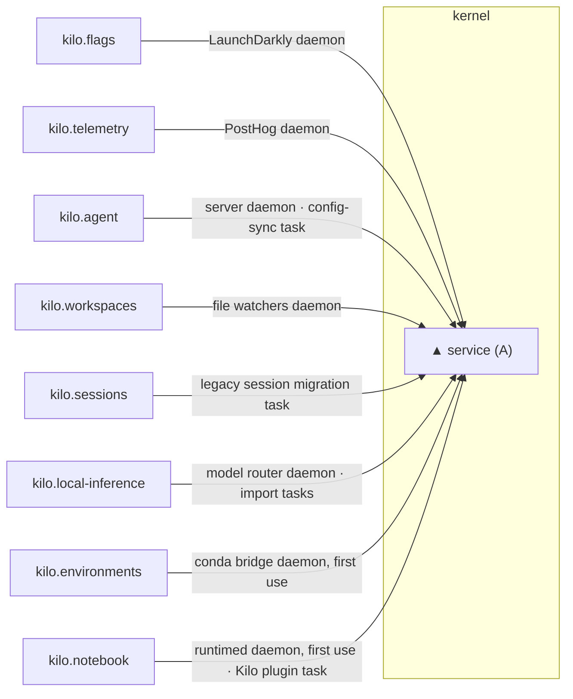
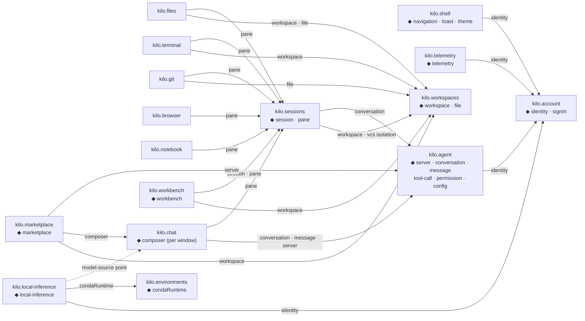

# Plugin Architecture — Design and Plan

**Status:** Implemented (October 2026; §9 records the build-up and what is
deferred). How-to for plugin authors: [docs/plugins](./plugins/README.md).
Supersedes the contribution model of the
retired feature SDK (deleted in step 13b).

Kilo Desktop is an agentic development environment. Its plugin system is
**intentional**, not a generic UI framework: every extension point exists
because the product needs it, is named for what it means in the product, has a
defined cardinality, and has a typed contract. The app is built the same way
it is extended — the shell and every core feature are plugins that use exactly
the API a third party gets.

---

## 1. Principles

1. **Build the app the way we extend it.** A plugin API that performs a core
   action must be the path core uses for that action. If core cannot use the
   API, it is not ready to ship.
2. **Intentional extension points.** No generic "put a component here" zones.
   Points are added when a real contributor needs them and are named for the
   product concept (`kilo.chat/composer-mention`, not `composer-slot-2`). The
   one exception is the window frame: kilo.shell's layout regions are named
   by where they are, `<region>-<slot>` (`kilo.shell/main`,
   `kilo.shell/left-sidebar-notice`, `kilo.shell/status-bar-item`), because
   for the shell the layout is the product concept and "where can I put
   this?" is a plugin author's first question. Each is still a typed point
   with a cardinality; placement inside one uses logical `start` / `end`.
3. **Every extension point is a published contract** — whether the kernel,
   the shell, or a feature plugin owns it. Hosts render what is contributed and
   never branch on _who_ contributed it.
4. **Declarative first.** Static contributions live in `plugin.json` so the app
   can validate, list, and (later) lazily activate them without running plugin
   code. Runtime registration is the escape hatch for dynamic entries.
5. **Removable by default.** Removing any plugin leaves the app booting and
   degraded, never crashed. Missing capabilities resolve to `null`; missing
   pane kinds render "unavailable".
6. **The kernel knows nothing about the product.** No plugin ids, no domain
   concepts below the plugin line.
7. **Always think about extensibility.** Every plugin is a potential host.
   When building or changing a surface, ask what another plugin — ours or a
   third party's — would naturally want to add to it, and record the answer in
   the extensibility map (§7). _Design_ points broadly; _build_ a point when a
   real contributor exists. Core plugins ship their built-ins through their
   own points (chat's model picker is a `composer-action`; chat's bash card is
   a `tool-renderer`), which proves each point is real.

---

## 2. The model

### 2.1 Kernel and plugins

```
┌──────────────────────────────────────────────────────────────────────────┐
│ Plugins (the delivery mechanism): kilo.shell · platform · core · feature │
│   each one can:  ▲ offer extension points                                 │
│                  ● contribute to extension points (including its own)     │
│                  ◆ offer domain objects (state · methods · events)        │
├──────────────────────────────────────────────────────────────────────────┤
│ Kernel ("the empty app"): Electron app + plugin runtime                   │
│   Extension registry · Domain registry (+ cross-process proxies) · `when`│
│   Plugin lifecycle · security · per-plugin scoped services               │
│   Host primitives (windows, menus, dialogs…) as permissioned capabilities│
│   Lifecycle phases · service supervision (`kernel/service`)               │
│   Commands (`kernel/command`) + keyboard dispatch                         │
│   Renderer root: mounts `kernel/root` or a recovery screen               │
└──────────────────────────────────────────────────────────────────────────┘
```

The kernel registers its own items in the same registries under the reserved
owner `kernel`. There is no other privileged path.

**Kernel responsibilities** (the only things that cannot be plugins, because
they need caller identity, must run before plugins, or enforce trust):

| Kernel responsibility                                                                                                                                                                                                                                                                | Why it is not a plugin                                                                                    |
| ------------------------------------------------------------------------------------------------------------------------------------------------------------------------------------------------------------------------------------------------------------------------------------ | --------------------------------------------------------------------------------------------------------- |
| Electron lifecycle (single instance, ready, quit/teardown barrier), crash reporting, logging                                                                                                                                                                                         | Runs before and after every plugin                                                                        |
| Plugin runtime: discovery, manifest validation, ordering from `requires`, lifecycle phases (§2.8), budgeted transactional activation, plugin status, safe mode                                                                                                                       | It is the plugin system                                                                                   |
| Service supervision: the `kernel/service` point — start conditions, parallel start after the window shows, restart with backoff, status and progress, awaited stop in reverse dependency order under an overall quit cap                                                             | Child processes from many plugins must start, recover and stop consistently, and quitting must never hang |
| Extension registry, domain registry with cross-process/window proxies (state synced, methods as calls, events broadcast), `when` evaluator                                                                                                                                           | Same                                                                                                      |
| Per-plugin scoped services injected into each SDK: storage dir, kv, sandboxed fs, logger, net, own main↔web `invoke`/ports                                                                                                                                                           | Identity-scoped — the provider must be trusted to know who is calling                                     |
| Security: protocol schemes (from manifests, pre-app-ready), CSP / embedded-host profiles, IPC sender trust, permission enforcement                                                                                                                                                   | Enforcement cannot live with the enforced                                                                 |
| Host primitives as **permissioned capabilities**: windows & pop-outs (including windows not tied to a session, sized content, focus main window), native app menu, dialogs, open/reveal, clipboard, OS notifications & badge, keychain, updater engine, browser host, embedded hosts | Plugins never import Electron                                                                             |
| Commands: the `kernel/command` point, execute-by-id, and keyboard dispatch (rebindable, conflict-safe defaults, `when`-scoped)                                                                                                                                                       | Shortcuts must work in every window, including pane windows, and keep working if the shell is replaced    |
| Drag and drop of domain objects: sources offer `ObjectRef`s, targets declare the object types they accept (§2.3)                                                                                                                                                                     | A drag starts on one surface and ends on another; plugins never see each other                            |
| Renderer root: the exclusive `kernel/root` point, with a recovery screen (safe mode, open logs) when nothing is contributed or the root fails                                                                                                                                        | Something must render when nothing else does                                                              |

### 2.2 The two registries

Plugins are only the **delivery mechanism**. What a plugin delivers is what
matters at runtime: extension points, contributions to extension points, and
domain objects. Plugins never talk to each other directly; they meet through
these.

**Extension registry** — extension points and contributions to them.

- An extension point is declared by its owner in `plugin.json`
  (`extensionPoints`) and exported from the owner's `./contracts` via
  `defineExtensionPoint({ id, kind, metadata: zodSchema, props: type<…>() })`.
- Three kinds:

  | Kind              | Meaning                                                                                                            | Example                    |
  | ----------------- | ------------------------------------------------------------------------------------------------------------------ | -------------------------- |
  | **Additive (A)**  | Many contributors, ordered by priority                                                                             | `kilo.sessions/pane-kind`  |
  | **Exclusive (X)** | One winner. Bundled default, user override, automatic fallback, crash placeholder; replacement receives `Original` | `kilo.shell/left-sidebar`  |
  | **Decision (D)**  | Core asks plugins a typed question: `proceed / ask / reject`. Deterministic order, fail closed, time budget        | `kilo.agent/tool-approval` |

- Contributions come from the manifest (`contributes.extensions`, validated
  against the owner's metadata schema at discovery) or from
  `sdk.extensions.add(Point, entry)` at runtime, which returns
  `{ update, remove }` and is validated against the same schema.
- **Owner-exported renderers.** A point's owner may export a component (as a
  renderer of one of its domain objects, below) that renders the point's
  contributions,
  so _other_ plugins can display them consistently without knowing the
  contributors. Example: kilo.sessions exports `SessionDecorations` as a Session renderer, so a
  board card shows git's PR badge exactly as the session list does.
  Contributions must therefore be self-sufficient: they get their data from
  their own plugin (e.g. git polls PR status in main from the session list),
  never from host-mounted helper components, so they work in any host and any
  window.
- Hosts read contributions with `useExtensions(Point)` — typed metadata, typed
  component props, `when` already evaluated. Every contribution is stamped with
  its plugin and activation generation and mounted inside its own error
  boundary.
- Commands, settings sections, panes, openers, tools and approval policies are
  all extension points in this one registry. There is no
  separate command, tool, or settings registry. Commands are the kernel-owned
  point `kernel/command` (see §2.6).

**Domain registry** — the domain objects plugins deliver. (These are the
"capabilities" of earlier drafts.)

A domain object type is defined once in its owner's `./contracts` and has
three parts (the full guide is [docs/plugins/domains.md](./plugins/domains.md)):

```ts
export const Sessions = defineDomain({
	id: "kilo.sessions/work-session",
	home: "main", // where the real state lives
	state: z.object({ sessions: z.array(sessionSchema) }),
	methods: { create, rename, setPinned, setArchived, remove /* … */ },
	events: {
		created: z.object({ session: sessionSchema }),
		updated: z.object({ before: sessionSchema, after: sessionSchema }),
		deleted: z.object({ session: sessionSchema }),
	},
});

// any plugin, any process, any window
sdk.domains.track(Sessions, {
	// follows the provider as it comes and goes
	added(sessions) {
		sessions.subscribe((state) => render(state.sessions));
		sessions.on("deleted", ({ session }) => removeCard(session.id));
	},
	removed() {},
});
await sdk.domains.get(Sessions)?.methods.setArchived({ id, archived: true }); // get: null when unprovided
```

- **State** is one zod schema, observable through `getState` / `subscribe`
  (and `useDomainState` in React).
- **Methods** are typed calls validated against the schema.
- **Events** belong to the object type: only the providing plugin can emit
  them (validated against their schema), anyone can listen; fire-and-forget,
  at most once, no replay — anything a late subscriber needs belongs in state
  too. Events are not a kind of extension point, and there is no separate
  event bus.
- **Listeners are isolated.** A state or event listener that throws is logged
  against the subscribing plugin and skipped; the other listeners, the
  broadcast to windows and the provider's `emit` are unaffected.
- **Renderers** let another surface show the object natively (a board card
  shows a session exactly as the session list does). They are not part of the
  domain definition: the plugin whose UI shows the object hands its renderers
  to the surfaces it hosts (kilo.workbench gives every sessions view
  `SessionsViewProps.renderers`).
- **Process-transparent.** The implementation lives in its `home` process
  (usually main). The kernel gives every other process and window a proxy:
  state arrives as live snapshots, methods are forwarded, events are
  broadcast from main to every window (in emit order per window). A pop-out
  window therefore sees and acts on the same objects as the main window by
  construction. Per-window state (composer draft, focus) uses
  `home: "renderer"`; its state and events never leave that window. Windows
  never emit to main: they call methods.
- Lazy and graceful-null; activation order does not matter. Exactly one plugin
  may provide a given domain object type.
- Kernel host primitives (windows, dialogs, clipboard…) are domain objects
  owned by `kernel`, gated by declared permissions.

**Not registries:** `sdk.invoke` / ports (a plugin talking to its own other
half) and the per-plugin scoped services.

### 2.3 Object references

One concept connects surfaces across plugins: a typed reference to a domain
object.

```ts
type ObjectRef<T extends DomainId> = { type: T; id: string }; // { type: "kilo.sessions/work-session", id }
```

| Used by       | How                                                                                                                                                     |
| ------------- | ------------------------------------------------------------------------------------------------------------------------------------------------------- |
| Drag and drop | Sources offer `ObjectRef`s; targets declare accepted types (the board accepts `kilo.sessions/work-session`; the composer accepts files, sessions, URLs) |
| Openers       | Match on object type (`kilo.workspaces/file` with `*.ipynb` → notebook pane)                                                                            |
| Mentions      | `resolve` returns `ObjectRef`s that the agent context is built from                                                                                     |
| Commands      | A command may declare the object type it acts on (see the open decision in §2.6)                                                                        |

Plugins never exchange internal ids or components; they exchange references to
shared domain objects, and render them with the owner's renderers.

### 2.4 `when` — conditions the host evaluates

A contribution's `when` is evaluated by the host without running plugin code.
It is needed for commands, keybindings, menu items and launcher entries, which
must be listed or hidden without mounting anything.

```jsonc
"when": { "all": ["sessionActive", "vcs"], "none": ["paneWindow"] }
```

Context keys are a closed vocabulary, but each key is **declared by the plugin
that owns the concept** (in its manifest) and evaluated by the kernel:

| Key                                                | Owner                                             |
| -------------------------------------------------- | ------------------------------------------------- |
| `desktop`, `mac`, `windows`, `linux`, `paneWindow` | kernel                                            |
| `sessionActive`, `workspaceActive`                 | kilo.workbench                                    |
| `vcs`                                              | kilo.workspaces                                   |
| `signedIn`                                         | kilo.account                                      |
| `flag:<name>`                                      | kilo.flags (all flags evaluate false when absent) |
| `composerFocused`                                  | kilo.chat                                         |
| `terminalFocused`                                  | kilo.terminal                                     |

### 2.5 Identifiers

| Thing           | Form                    | Example                                |
| --------------- | ----------------------- | -------------------------------------- |
| Plugin          | dotted `publisher.name` | `kilo.chat`                            |
| Extension point | `<plugin>/<point>`      | `kilo.chat/composer-mention`           |
| Command         | `<plugin>/<command>`    | `kilo.git/push`                        |
| Domain object   | `<plugin>/<type>`       | `kilo.sessions/work-session`           |
| Domain event    | `<type>` + event name   | `kilo.sessions/work-session` `deleted` |

**Ids are plugin-named, for traceability.** An id tells you which plugin
delivers it. The trade-off: moving a domain object or extension point to
another plugin changes its id. When that happens, the kernel will accept the
old id as a deprecated alias for a release so contributors keep working.

**Namespacing rules** (enforced by the kernel at discovery):

- Plugin ids are unique. A second plugin with the same id is rejected, and the
  `kilo.` publisher prefix is reserved for bundled plugins. `kernel` is a
  reserved owner and cannot be used as a plugin id.
- A plugin declares extension points, commands, domain objects and context
  keys by **local name only**; the kernel qualifies them with the
  declaring plugin's id. A plugin cannot declare anything in another plugin's
  namespace, so `kilo.notebook` cannot create `kilo.shell/theme`.
- Local names are unique within their owner and kind (duplicate `extensionPoints`
  entries in one manifest are a validation error).
- Contributions always reference the **fully qualified** id
  (`"kilo.shell/theme"`). An unqualified or unknown target is a validation
  error, not a silent no-op.
- Two plugins may therefore both offer a point with the same local name
  (`kilo.shell/theme`, `kilo.notebook/theme`): they are different points with
  different contracts and no collision. That is legal but usually a design
  smell — one product concept should have one owner. Prefer consuming the
  owner's point or domain object, or a narrower name for a different concept
  (`kilo.notebook/cell-output-renderer`).

Tables in this document show points by local name under an **Owner** column as
shorthand; the full id is `<owner>/<point>`.

### 2.6 Commands

A **command** is a named action a _person_ can trigger: `{ id, title, icon,
keybinding?, when }` plus a handler. It has **no placement**. The plugin that
owns the action declares it as a contribution to the kernel-owned
`kernel/command` point, named `<plugin>/<command>`.

The **surface** that shows a command is owned by whoever owns that piece of UI,
and refers to the command by id:

| Surface                               | Owner                      | How a command appears there                                                    |
| ------------------------------------- | -------------------------- | ------------------------------------------------------------------------------ |
| Command palette                       | kilo.shell                 | Every titled command whose `when` holds (opt out with `palette: false`)        |
| Keyboard                              | kernel                     | The command's `keybinding`; user-rebindable; conflicting defaults stay unbound |
| Session header actions                | kilo.workbench             | `session-action: { command: "kilo.git/push", icon }`                           |
| Composer actions                      | kilo.chat                  | `composer-action: { command: "kilo.chat/attach" }`                             |
| Native app menu, session context menu | kilo.shell, kilo.workbench | Future `menu` points that reference command ids                                |

Surface contributions may still use an inline handler when the action has no
meaning outside that surface.

Commands are scoped by `when`, not only global:

| Scope        | Examples                                                                     |
| ------------ | ---------------------------------------------------------------------------- |
| App          | new session (workbench), open settings (shell), sign in (account)            |
| Session      | new terminal, push branch, create PR, open file, add pane                    |
| Focused pane | clear terminal (⌘K), save file (⌘S), reload page, focus composer, stop agent |

One domain action is typically exposed three ways, all calling the same
function: a **command** for people, a **domain object method** for other plugins' code,
and a **tool** for the agent.

**Why commands exist** (rather than each surface owning its own handler and
shortcut):

1. **Keyboard shortcuts across plugins.** Pane plugins need shortcuts (⌘S,
   ⌘K, ⌘W) that must not collide with each other or the app, must be scoped to
   the focused pane, must work in pane windows, and should be user-rebindable.
   That requires one registry that knows every shortcut and its `when`.
2. **One action, many surfaces.** A header button, palette entry, shortcut and
   menu item for "Push" run the same handler with the same `when`, disabled
   state and telemetry instead of four copies.
3. **Discoverability.** The palette lists what can be done right now, across
   every plugin, without any plugin building UI for it.
4. **Addressability.** A stable id lets deep links, onboarding tips, e2e tests,
   and (later) the native menu trigger an action without importing the plugin.

If we wanted none of these — no palette, no rebindable or cross-plugin
shortcuts — surfaces could carry inline handlers and commands could be dropped.
Today the app has two hard-coded shortcuts (⌘, and ⌘B) and no palette.

**Open decision — commands that target an object type.** Instead of separate
action points per surface (`session-menu`, `session-action`, `resource-action`,
`message-action`), a command could declare `target: "kilo.sessions/work-session"`
and every surface that shows a session (row menu, header, board card menu)
would offer it automatically. Non-action UI (decorations, panes, composer
mention sources…) keeps its own extension points either way.

### 2.7 Manifest v1 (sketch)

```jsonc
{
	"manifestVersion": 1,
	"id": "kilo.notebook",
	"displayName": "Notebooks",
	"version": "0.3.0",
	"engines": { "kilo-desktop": "^1.0" },
	"main": "./src/main/index.ts",
	"web": "./src/web/index.ts",
	"when": { "all": ["kilo.flags/flag:notebooks"] }, // optional: run the whole plugin only while this holds

	"requires": { "kilo.sessions/pane-kind": "optional", "kilo.agent/tool": "optional" },
	"permissions": { "embeddedHosts": ["notebook"], "protocols": [] },
	"contextKeys": [],
	"extensionPoints": [],

	"contributes": {
		"extensions": {
			"kilo.sessions/pane-kind": [
				{
					"id": "notebook",
					"component": "NotebookView",
					"title": "Notebook",
					"icon": "NotebookIcon",
					"keepAlive": true,
					"launch": { "newSession": true, "inSession": true },
					"when": { "all": ["signedIn"] },
				},
			],
			"kilo.sessions/opener": [
				{ "match": { "type": "kilo.workspaces/file", "pattern": "*.ipynb" }, "pane": "notebook" },
			],
			"kilo.agent/tool": [
				{
					"name": "open",
					"approval": "auto",
					"presentation": { "label": "Open notebook", "icon": "NotebookIcon" },
				},
			],
			"kilo.agent/runtime-config": [
				{ "kiloPlugins": ["./kilo-plugin"], "env": ["NOTEBOOK_SOCKET"] },
			],
			"kilo.shell/settings-section": [
				{ "id": "notebooks", "title": "Notebooks", "component": "NotebookSettings" },
			],
			"kernel/service": [
				{
					"id": "runtimed",
					"title": "Notebook runtime",
					"kind": "daemon",
					"startOn": "first-use",
					"stopTimeout": "5s",
				},
			],
			"kernel/command": [
				{ "id": "new", "title": "New Notebook", "when": { "all": ["sessionActive"] } },
			],
		},
	},
}
```

### 2.8 Lifecycle: startup and shutdown

Plugins do not add steps to the startup sequence. The kernel owns a fixed set
of phases; plugins declare what they need in each phase, and the kernel orders
plugins from their declared `requires`.

```
main process                                                  renderer
1 discover   read manifests, register URL schemes (no plugin code)
2 activate   plugin main entries in dependency order:            splash (short)
             provide domain objects, register handlers and
             contributions. Fast; no slow I/O.
3 show window ───────────────────────────────────────────────▶ web entries activate,
                                                                shell renders
4 start      services whose start conditions hold, in parallel, UI shows each
             supervised by the kernel                           service's status
5 run        crash → restart with backoff · status changes
6 stop       services stop in reverse dependency order, each
             with a grace period and awaited child exit, under
             an overall cap; then plugins are disposed
```

**Activation** (phase 2) only declares and wires things up. It is budgeted
(warning above ~200 ms, failure above a hard cap). Anything slow — spawning
processes, network calls, migrations, disk scans — is a service or task. The
window appears in about a second regardless of what plugins are doing.

**`kernel/service`** is the extension point for long-running and background
work:

```jsonc
"kernel/service": [{
  "id": "server",
  "title": "Kilo agent server",
  "kind": "daemon",                       // or "task": one-off background work
  "startOn": "window-shown",              // | "first-use" | "activation" (discouraged)
  "when": { "all": ["termsAccepted"] },   // e.g. don't spawn before the terms gate
  "restart": { "policy": "on-failure", "maxRetries": 5 },
  "stopTimeout": "5s"
}]
```

```ts
mainSdk.services.implement("server", {
	async start({ signal, progress }) {
		progress("Starting Kilo…");
		await manager.start(signal);
	},
	async stop() {
		await manager.stop();
	}, // awaited at quit, up to stopTimeout
	async health() {
		return manager.ping();
	},
});
```

The kernel evaluates start conditions, starts eligible services in parallel,
restarts crashed daemons with exponential backoff, tracks status
(`starting / ready / error / stopped`) and progress, and stops everything in
reverse dependency order at quit with awaited child exits and an overall cap, so
quitting can never hang. It publishes all of this as the `kernel/services`
domain object (list, status, progress, logs, restart), which kilo.developer
shows in Settings → Developer → Diagnostics.

**Depend on readiness, not order.** A plugin that needs another plugin's
service depends on the domain object and its status:

```ts
const server = sdk.domains.get(AgentServer); // kilo.agent/server
server?.getState().status; // or render a pending state: useDomainState(AgentServer, (s) => s.status)
// start it if needed and wait until it is ready (throws if it failed to start)
await sdk.domains.get(KernelServices)?.methods.ensureStarted({ key: SERVER_SERVICE_KEY });
```

With `startOn: "first-use"`, that call is what starts the service, so rarely
used plugins cost nothing at startup.

**Rules for plugin authors**

1. Activation declares and wires; slow work is a service or task.
2. Never assume something has started; depend on a domain object's status, or
   on a method that waits for it (`kernel/services` `ensureStarted`).
3. Every child process goes through `kernel/service`.
4. Prefer `first-use` or a `when` condition to starting things just in case.

**Lifecycle hooks.** Plugins cannot add phases, but the kernel offers many
hooks into them, in the style of Envisage (application `starting` / `started` /
`stopping` / `stopped`, plugin `start()` / `stop()`, vetoable window and exit
events) and OSGi (bundle states and events, service registered / unregistering
events, service trackers, lazy activation). Hooks come in three kinds with
different guarantees:

| Hook kind        | Semantics                                                                                                                                                                                                  | Examples                                                                                                            |
| ---------------- | ---------------------------------------------------------------------------------------------------------------------------------------------------------------------------------------------------------- | ------------------------------------------------------------------------------------------------------------------- |
| **Notification** | A domain-object event: fire-and-forget, cannot delay or change anything. Listeners run in the order they subscribed (which follows activation, so dependency order), each isolated from the others' errors | `kernel/app` `phase-changed`, `kernel/plugins` `state-changed`, `kernel/windows` `closed`, `kernel/system` `resume` |
| **Awaited hook** | A function the kernel calls and awaits, with a time budget                                                                                                                                                 | the plugin's own `activate(sdk)` / `deactivate()`; a service's `start()` / `stop()`                                 |
| **Decision**     | A decision extension point (kind D): handlers answer `proceed / ask / reject` in a fixed order with a time budget; `ask` answers are merged into one prompt                                                | `kernel/quit`, `kernel/window-close`; product decisions such as `kilo.sessions/session-archive`                     |

Quit and window-close decisions **fail open**: a handler that errors or times
out counts as `proceed`, and a second quit request after a prompt always quits,
so a plugin can never trap the user. Product decisions (tool approval) fail
closed.

The kernel exposes its hooks as events on kernel-owned domain objects
(`KernelApp`, `KernelPlugins`, … from `@kilo-desktop/kernel`). Where an object
has a lifecycle, its state holds the current value and one event reports each
change:

| Domain object       | States / events                                                                                                                                                                                                                                                                           | Typical use                                                                         |
| ------------------- | ----------------------------------------------------------------------------------------------------------------------------------------------------------------------------------------------------------------------------------------------------------------------------------------- | ----------------------------------------------------------------------------------- |
| `kernel/app`        | `phase`: `starting` → `started` (all plugins active, main window shown) → `ready` (startup services settled) → `stopping` → `stopped`, announced by `phase-changed`; also `url-opened`                                                                                                    | Defer non-essential work to `started`; measure time-to-ready; flush on `stopping`   |
| `kernel/plugins`    | Per plugin: `resolved` (requires satisfied) → `activating` → `active` → `deactivating` → `resolved`; also `unresolved`, `failed`, `inactive` (its manifest `when` is false), `disabled` (turned off by the user; `setEnabled` applies from the next launch), announced by `state-changed` | Diagnostics; react to a plugin being enabled or disabled at runtime                 |
| `kernel/services`   | Per service: `idle` → `starting` → `ready` → `stopping` → `stopped`; also `completed`, `restarting`, `failed`, announced by `status-changed`                                                                                                                                              | Show progress; start and wait with `ensureStarted`                                  |
| `kernel/domains`    | `provided`, `withdrawn` per domain object type; `track(Type, { added, removed })`                                                                                                                                                                                                         | Bind to a provider that appears late or goes away (removability, future hot reload) |
| `kernel/extensions` | `contributions-changed` per extension point                                                                                                                                                                                                                                               | Hosts re-render when contributions are added or removed at runtime                  |
| `kernel/windows`    | `opened`, `focused`, `blurred`, `closed` (main and pane windows)                                                                                                                                                                                                                          | Pause work for hidden windows; restore pane windows                                 |
| `kernel/system`     | `suspend`, `resume`, `online`, `offline`, `appearance-changed`, `app-focused`, `app-blurred`                                                                                                                                                                                              | Pause polling while asleep or offline; refresh after resume                         |

Product lifecycles (a Work Session being archived, a Chat Session turn ending)
are events on the owning plugin's domain objects, not kernel hooks.

**How a plugin hooks in: methods for its own lifecycle, events for
everything else.**

| What the plugin wants                                      | Mechanism                                                              | Why                                                                                                                                                                                                          |
| ---------------------------------------------------------- | ---------------------------------------------------------------------- | ------------------------------------------------------------------------------------------------------------------------------------------------------------------------------------------------------------ |
| Run code when **it** starts or stops                       | Methods on the plugin object: `activate(sdk)`, optional `deactivate()` | The kernel must await them, apply a time budget, attribute failures to the plugin and roll back a failed activation. Events cannot do that, and a plugin cannot subscribe to anything before it is activated |
| Run a **service** it owns                                  | Methods on the service: `start()`, `stop()`, `health()`                | Same reasons: awaited, budgeted, supervised                                                                                                                                                                  |
| React to **the app, other plugins, windows or the system** | Events on kernel or plugin domain objects, subscribed from `activate`  | Many listeners, no waiting, no ability to delay; works for any part of the plugin and for other plugins' domain events                                                                                       |
| **Delay or veto** something (quit, closing a window)       | A contribution to a decision extension point                           | Needs ordering, a time budget and merged prompts — neither a plain event nor a method on every plugin                                                                                                        |

```ts
// shaped after plugins/notebook/src/main/entry.ts
export default definePlugin({
	async activate(sdk) {
		// awaited, budgeted
		sdk.domains.provide(Notebooks, notebooksImpl);
		sdk.extensions.implement(KernelService, "runtimed", runtimedService); // start/stop/health
		const app = sdk.domains.get(KernelApp);
		if (app?.getState().phase === "ready") warmKernelList(); // state first…
		else app?.on("phase-changed", ({ phase }) => phase === "ready" && warmKernelList()); // …then notification
		sdk.domains.get(KernelSystem)?.on("resume", () => runtimed.reconnect());
		sdk.extensions.implement(KernelQuit, "unsaved-notebooks", () =>
			// decision (contribution declared in plugin.json)
			notebooks.hasUnsaved() ? { ask: "Unsaved notebooks will be lost." } : "proceed",
		);
	},
	// deactivate() is optional: everything registered through `sdk` is removed
	// automatically when the plugin deactivates.
});
```

Rules:

- The plugin object has **only** `activate` and `deactivate`. No `onAppStarted`,
  `onWindowClosed`, `onResume` methods: a fat interface that every plugin
  half-implements does not scale, and cannot cover other plugins' domain
  events.
- Everything registered through `sdk` (subscriptions, domain objects, service
  implementations, decision handlers, runtime contributions) is stamped with
  the plugin's activation and **disposed automatically** on deactivation, so
  `deactivate` is rarely needed.
- **State, not just events.** Every lifecycle fact is also readable as state on
  the domain object (`kernel/app` `phase`, `kernel/plugins` `plugins[id].state`,
  `kernel/services` `services[key].status`). A subscriber that arrives late,
  such as a lazily activated plugin, never misses a transition: it reads the
  current state, then listens. `domains.track` calls `added` for providers
  that already exist.
- The web entry follows the same shape (`activate(sdk)` in each window); React
  components read lifecycle state with `useDomainState(KernelApp, (s) => s.phase)`
  rather than subscribing themselves.

The whole timeline with its hooks:

```
kernel   discover manifests → resolve requires
app      starting
plugins  in dependency order: plugin.activating → activate() → plugin.activated
windows  main window opened
app      started                      ← "the UI is up": defer non-essential work to here
services startOn: window-shown → service.starting → start() → service.ready | failed
app      ready                        ← startup services settled
… running: window.*, system.*, plugin.* (enable/disable), domain provided/withdrawn,
           contributions-changed, product domain events …
quit     kernel/quit decision (proceed / ask / reject; fails open)
app      stopping
services reverse order: service.stopping → stop() → service.stopped
plugins  reverse order: plugin.deactivating → deactivate() → plugin.deactivated
app      stopped                      (kernel only: flush logs and telemetry, exit)
```

Plugins observe from their own activation onward. `app.starting` and earlier
states are visible through kernel diagnostics rather than to plugin code. A
later lazy-activation step (OSGi's lazy activation policy, VS Code's activation
events) would let a plugin declare `activateOn` — for example its pane kind being
opened or one of its commands being run — without changing these hooks.

**Startup today → under this model**

| Today                                                                                                       | Becomes                                                                                                                              |
| ----------------------------------------------------------------------------------------------------------- | ------------------------------------------------------------------------------------------------------------------------------------ |
| Every `mainRegister` awaited in sequence behind the splash; window created only after all finish            | Fast activation; window shown in phase 3; slow work in services                                                                      |
| Kilo spawned as a side effect of the renderer's auth check; up to 60 s + 10 s with no UI                    | `kilo.agent` `server` service, `startOn: window-shown` (terms gate added with kilo.account, step 4); progress in Diagnostics         |
| kilo-server's `configReady` holds up the splash                                                             | `kilo.agent`'s `config-sync` task, started at activation without blocking the window; the server service and `connect()` wait for it |
| local-inference router, environments conda bridge, notebook runtimed each hand-rolled                       | Services: router `when` a model is configured; bridge and runtimed `startOn: first-use`                                              |
| Crash handling differs per plugin; only notebook's shutdown is awaited; the shutdown barrier has no timeout | Kernel restart policy; awaited `stop()` with `stopTimeout`; overall quit cap                                                         |
| Hard-coded boot order (`feature-order.ts`)                                                                  | Order derived from `requires`                                                                                                        |
| One-off startup work (legacy cleanup, migrations, adopting old files)                                       | `task` services after the window is up, unless activation genuinely needs it                                                         |

---

## 3. Domain model



**Glossary.** In the UI and in code, **session** means a **Work Session**
(`kilo.sessions/work-session`). A **Chat Session** (`kilo.agent/conversation`) is
one agent conversation shown in an agent pane.

- **Work Session** is the top-level unit in the sidebar. It is a workbench,
  not a chat. It can contain zero, one, or many agent panes.
- **"New session"** opens the New Session page: the welcome headline, where
  the session runs (workspace, isolation — Local / New worktree, only when
  `vcs` — and branch), kilo.chat's composer (`kilo.workbench/session-starter`),
  whose first send creates the session (and its worktree), and under it a
  tile per pane kind offered for new sessions (`launch.newSession`) and an
  empty session, which start a session without spending tokens. Other pane
  kinds are added from the "+" menu inside a session, built from pane
  contributions.
- Session status is the most urgent pane status:
  `needs input > failed > running > attention > done`.
- Agent tools receive `{ sessionId, paneId }`, resolved by kilo.sessions from
  the calling Chat Session (including subagent children). `kiloSessionId`
  leaves the SDK types.

**Panes and where they launch:**

| Pane     | Plugin        | New session         | "+" in session         | `when`     | Instances       | Feeds session status   |
| -------- | ------------- | ------------------- | ---------------------- | ---------- | --------------- | ---------------------- |
| Agent    | kilo.chat     | ✓ (inline composer) | ✓                      | —          | many            | run state, needs input |
| Terminal | kilo.terminal | ✓                   | ✓                      | —          | many            | activity               |
| Browser  | kilo.browser  | ✓                   | ✓                      | `desktop`  | many            | loading                |
| Changes  | kilo.git      | ✓                   | ✓                      | `vcs`      | one per session | —                      |
| Files    | kilo.files    | ✓                   | ✓                      | —          | many            | —                      |
| Notebook | kilo.notebook | ✓                   | ✓                      | `signedIn` | many            | —                      |
| Plan     | kilo.chat     | —                   | — (from an agent pane) | —          | one per session | —                      |
| Subagent | kilo.chat     | —                   | — (from an agent pane) | —          | one per child   | running                |
| Viewer   | kilo.chat     | —                   | — (from a transcript)  | —          | one per chat    | —                      |

---

## 4. Plugins

| Plugin                  | Layer        | Comes from                                                        | Owns                                                                                                                                              |
| ----------------------- | ------------ | ----------------------------------------------------------------- | ------------------------------------------------------------------------------------------------------------------------------------------------- |
| `kilo.shell`            | platform     | `apps/web` layout, settings, header; theme                        | Window frame, router, settings host, command palette, status bar, toasts, appearance                                                              |
| `kilo.flags`            | platform     | `apps/desktop/.../feature-flag`                                   | Feature-flag transport (LaunchDarkly)                                                                                                             |
| `kilo.telemetry`        | platform     | `apps/desktop/.../telemetry`, Privacy section                     | Consent, telemetry transport (PostHog), declared events                                                                                           |
| `kilo.updates`          | platform     | `apps/desktop/.../updates`, About, update pill                    | Update UX over the kernel updater                                                                                                                 |
| `kilo.developer`        | platform     | kilo.shell's Diagnostics settings                                 | The Developer settings category and Diagnostics (kernel, plugins, services, and an inspector over points and domain objects)                      |
| `kilo.account`          | platform     | kilo-ui account/onboarding, `KiloAuthGate`, shell auth            | Identity, sign-in, terms, onboarding                                                                                                              |
| `kilo.agent`            | core (model) | `plugins/kilo-server` + kilo-ui chat runtime                      | Kilo CLI server (as a service), agent config, tool gateway; the **Chat Session** domain: conversations, messages, tool calls, permission requests |
| `kilo.sessions`         | core (model) | kilo-ui session list/activity, pane store, chat worktree handlers | The **Work Session** and **Pane** domain objects: main-process session store, status aggregation, tool-caller binding, isolation                  |
| `kilo.workspaces`       | core         | kilo-ui workspaces (main) + shell `workspace` watcher             | Workspace registry, path authorisation, file watching                                                                                             |
| `kilo.workbench`        | core (UI)    | kilo-ui pane canvas, presets, pane windows, session list UI       | The session workbench UI: canvas, launcher, navigator, pop-outs                                                                                   |
| `kilo.chat`             | core (UI)    | kilo-ui chat UI                                                   | Agent pane: thread, composer, message/tool rendering, permission prompts                                                                          |
| `kilo.git`              | feature      | `plugins/git`                                                     | Git status, worktrees, diffs, repo actions, PRs                                                                                                   |
| `kilo.files`            | feature      | `plugins/files`                                                   | File explorer/editor, file opener, file mentions and links, `open` tool                                                                           |
| `kilo.terminal`         | feature      | `plugins/terminal`                                                | PTY terminals                                                                                                                                     |
| `kilo.browser`          | feature      | `plugins/browser`                                                 | Web pages in panes                                                                                                                                |
| `kilo.notebook`         | feature      | `plugins/notebook`                                                | nteract notebooks in panes, `*.ipynb` opener, notebook tools + notebook Kilo plugin (12b)                                                         |
| `kilo.environments`     | feature      | `plugins/environments`                                            | Conda environments                                                                                                                                |
| `kilo.anaconda-account` | feature      | `plugins/anaconda-account`                                        | Anaconda sign-in and the Anaconda API key (keyring shared with the Anaconda CLI); the Anaconda row in Settings → Account                          |
| `kilo.local-inference`  | feature      | `plugins/local-inference`                                         | Local model server and catalog                                                                                                                    |
| `kilo.marketplace`      | feature      | `plugins/kilo-marketplace`                                        | Installing agents/skills/MCPs into Kilo config                                                                                                    |
| `kilo.workspace-board`  | feature      | kilo-ui workspace board                                           | The workspace board: sessions in named columns, a detachable sessions view (§8, 13a)                                                              |
| ~~todos~~               | —            | `plugins/todos`                                                   | Deleted in 13b (old-SDK demo, only user of generic pages/nav); `examples/hello-plugin` is the example plugin (13d)                                |

**Split by domain, not by layer.** Each plugin owns a domain; inside a plugin,
`contracts/` · `main/` · `web/` already separate model from UI. A domain is
delivered as two plugins (model + UI) only when at least one of these holds:

1. Other plugins use the model without the UI.
2. The UI should be replaceable, or there should be several UIs.
3. The model must work headless (in main regardless of windows, for agent
   tools, a future CLI or automation).
4. The model needs a different lifecycle or trust level from the UI.

Under this rule two domains split: **Work Sessions** (`kilo.sessions` model,
`kilo.workbench` UI) and **Chat Sessions** (`kilo.agent` model, `kilo.chat`
UI). Everything else is one plugin.

---

## 5. Diagrams

### 5.1 Contributions (who contributes to whose extension points)

One diagram per owner. The owner is the box on the right; each **▲** node
inside it is an extension point. Arrows point from the contributor to the
extension point, labelled with what is contributed.

#### kernel and kilo.shell

The command palette lives in kilo.shell but only _reads_ `kernel/command`.



#### kilo.sessions and kilo.workbench



#### kilo.agent



#### kilo.chat, kilo.workspaces and kilo.telemetry



#### kernel/service



### 5.2 Domain objects (who uses whose)

Arrows point from consumer to provider, labelled with the domain object used.
Kernel domain objects (host primitives, services) and `kilo.flags` are used
widely and omitted.



### 5.3 Plugin cards

Legend: **▲ offers** extension points · **● contributes** to extension points
(`(own)` = to its own) · **◆ domain objects** it offers (capabilities). Cards show points
with contributors today; candidate points are in the extensibility map (§7).

```
╭─ kernel ──────────────────────────────────────────────────────────────────────
│ ▲ kernel/root (X) ................ the renderer root
│   kernel/command (A) ............. named user actions: id, title, when, keybinding, handler
│   kernel/service (A) ............. supervised daemons and background tasks
│   kernel/quit (D) ................ proceed / ask / reject before quitting (fails open)
│   kernel/window-close (D) ........ proceed / ask / reject before closing a window
│ ● —
│ ◆ app (starting, started, ready, stopping, stopped) · plugins (states, events)
│   services (list, status, progress, logs, restart) · domains (provided, withdrawn, track)
│   extensions (contributions-changed) · windows (open by key, params, setHidden;
│     opened, focused, closed)
│   system (suspend, resume, online, offline, appearance-changed)
│   commands (execute by id, list) · keyboard dispatch (rebindable, conflict-safe)
│   ports (a plugin's window ↔ main message ports, for streams)
│   host primitives (permissioned): windows · appMenu · dialogs · os (open/reveal)
│     clipboard · notifications · keychain · updater · dataCollection (consent)
│     browserHost · embeddedHosts
│   drag and drop of ObjectRefs
│   injected per plugin (not in the registry): storage · kv · fs · logger · net · invoke/ports
│   context keys: desktop · mac · windows · linux · paneWindow
╰───────────────────────────────────────────────────────────────────────────────

╭─ kilo.shell ──────────────────────────────────────────────────────────────────
│ ▲ kilo.shell/main (X) ............ the main area
│   kilo.shell/left-sidebar (X) .... the left sidebar's body
│   kilo.shell/left-sidebar-account (X) account entry at its foot
│   kilo.shell/left-sidebar-notice (A) notices above the account entry
│   kilo.shell/settings-category (A)  sidebar headings, ordered by priority
│   kilo.shell/settings-section (A)  schema or component, under a category
│   kilo.shell/about-section (A) ... blocks of Settings → About, by priority
│   kilo.shell/support-row (A) ..... rows in About → Support
│   kilo.shell/account-panel (A) ... panels in Settings → Account (Kilo, Anaconda)
│   kilo.shell/status-bar-item (A) . the status bar (start: app / workspace,
│                                    end: the open session)
│   kilo.shell/deep-link (A) ....... kilo-desktop://{host}/…
│ ● kernel/root .................... window frame, router, settings host
│   kilo.shell/settings-category (own)  General, AI
│   kilo.shell/settings-section (own)  Appearance, Shortcuts, About, Account (General)
│   kilo.shell/about-section (own) . Support (application logs + support rows)
│   kernel/command ................. open settings, toggle sidebar, open command palette
│ ◆ navigation · toast · theme
│   (hosts the command palette: a consumer of kernel/command)
╰───────────────────────────────────────────────────────────────────────────────

╭─ kilo.flags ──────────────────────────────────────────────────────────────────
│ ▲ —
│ ● kernel/service ................. LaunchDarkly daemon
│ ◆ flags                            context key: flag:<name>
╰───────────────────────────────────────────────────────────────────────────────

╭─ kilo.telemetry ──────────────────────────────────────────────────────────────
│ ▲ kilo.telemetry/telemetry-event (A, manifest data) ... events a plugin may send
│ ● kilo.shell/settings-section .... Privacy (over kernel/data-collection)
│   kernel/service ................. PostHog daemon ("Desktop Initialized", flush on quit)
│ ◆ telemetry (track; no-op when absent)
│   (reports Page Visit by observing kilo.shell/navigation)
╰───────────────────────────────────────────────────────────────────────────────

╭─ kilo.updates ────────────────────────────────────────────────────────────────
│ ▲ —
│ ● kilo.shell/left-sidebar-notice . restart to update
│   kilo.shell/about-section ....... version and updates (above Support), Legal (below)
│ ◆ legal                            (uses kernel updater)
╰───────────────────────────────────────────────────────────────────────────────

╭─ kilo.developer ──────────────────────────────────────────────────────────────
│ when kilo.flags/flag:developer (the whole plugin)
│ ▲ —                                (others add sections under Developer)
│ ● kilo.shell/settings-category ... Developer
│   kilo.shell/settings-section .... Diagnostics (over kernel/app, plugins, services, discovery)
│ ◆ —
╰───────────────────────────────────────────────────────────────────────────────

╭─ kilo.account ────────────────────────────────────────────────────────────────
│ ▲ —
│ ● kilo.shell/left-sidebar-account  account menu, sign in
│   kilo.shell/account-panel ....... the Kilo account
│   kilo.shell/onboarding-step ..... welcome + terms (required), sign in
│   kilo.agent/provider-panel ...... Kilo Gateway row in AI Providers
│ ◆ identity (sign-in flow; events signed-in / signed-out)
│   terms (accept; events accepted / linked)
│                                    context keys: signedIn · termsAccepted
╰───────────────────────────────────────────────────────────────────────────────

╭─ kilo.agent (model: Chat Sessions) ───────────────────────────────────────────
│ ▲ kilo.agent/provider-panel (A) .. featured provider rows in AI Providers (Kilo Gateway)
│   kilo.agent/tool (A) ............ agent tools + declarative presentation + approval
│   kilo.agent/session-config (A) .. per-session tools, permission rules, instructions
│                                    (at chat creation; permissions 12a)
│   kilo.agent/tool-approval (D) ... proceed / ask / reject
│   kilo.agent/runtime-config (A) .. env, Kilo plugins, MCP servers (read at server start)
│   kilo.agent/model-provider (A) .. a provider entry in Kilo's config
│   kilo.agent/chat-owner (A) ...... which Work Session holds a chat (kilo.sessions)
│ ● kernel/service ................. server (daemon, window-shown) · config-sync (task, activation)
│                                     · tool-gateway (daemon, activation)
│   kilo.shell/settings-section .... AI Providers, External AI apps (flag)
│   kilo.shell/onboarding-step ..... work style
│   kilo.shell/support-row ......... Kilo config file
│ ◆ server (status; connect waits for ready; restart; disposeInstance — 9b) · config (user config file;
│     MCP/skills/agents later) · external-clients (paired apps: enable, port,
│     pair, revoke; kilo.agent's own settings only)
│   conversation = Chat Session (list, activity, pending prompts; create, rename,
│     abort, archive, delete, replies, sessionConfig; events created, updated,
│     deleted, turn-started / -ended, permission- / question-requested / -resolved;
│     generate: one structured answer from an unlisted throwaway chat — 9e;
│     generateBranchName, setWorktreeBranch, event user-message — 9f;
│     prompt: kilo.chat's queued prompts, sent from main — decision 66)
│   message · tool-call · permission · model
╰───────────────────────────────────────────────────────────────────────────────

╭─ kilo.workspaces ─────────────────────────────────────────────────────────────
│ ▲ kilo.workspaces/vcs (X) ........ status, branches, default branch, worktrees
│                                    (create, resolve, remove, rename, work check,
│                                    managed branches, Agent Manager link) — main, 9a
│ ● kernel/service ................. file watcher (daemon)
│   kernel/command ................. add workspace · manage workspaces
│   kilo.shell/overlay ............. workspace dialogs
│   kilo.shell/onboarding-step ..... create a workspace (when there are none)
│ ◆ workspace (list, active, folder availability, authorize(path, rule);
│     events created, updated, deleted)
│   file (watched folders; event changed)
│                                    context keys: hasWorkspaces · vcs (provider present, 9a)
╰───────────────────────────────────────────────────────────────────────────────

╭─ kilo.sessions (model: Work Sessions) ────────────────────────────────────────
│ ▲ kilo.sessions/pane-kind (A) ......... pane kinds: launch, singleton, keepAlive, order, availableWhen
│   kilo.sessions/opener (A) ....... open an ObjectRef in a pane (first match; "Open with" later)
│ ● kilo.agent/chat-owner .......... the session holding a chat
│                                    (pin, rename, archive, delete are each host's built-ins)
│ ◆ session = Work Session (create, rename, pin, archive / unarchive, delete;
│     events created, updated, deleted)  — 6a; isolation at create (local /
│     new / existing worktree via kilo.workspaces/vcs), isolationOptions,
│     delete with removeWorktree for orphans after kilo.agent/server
│     disposeInstance, Agent Manager links + backfill — 9b; setWorktreeBranch — 9f
│   pane (per session: panes, active pane, layout, arrangement; open, openObject,
│     activate, update, close, setLayout, setArrangement; events opened, closed) — 6c
╰───────────────────────────────────────────────────────────────────────────────

╭─ kilo.workbench (UI: the session workbench) ──────────────────────────────────
│ ▲ kilo.workbench/session-menu (A) ....... session menu items wherever the workbench
│                                            shows a session (optional choices — 13a)
│   kilo.workbench/session-decoration (A) . row badge or hover line (hover /
│                                            hover-branch, 9d), given the session
│   kilo.workbench/session-action (A) ..... workbench header actions (placement start
│                                            / end, 9e)
│   kilo.workbench/pane-kind-menu (A) ..... entries in a pinned pane kind's header
│                                            menu (agent: the session's chats)
│   kilo.workbench/navigator-action (A) ... session-list header buttons
│   kilo.workbench/launcher-option (A) .... launcher options (slot branch, 9c)
│   kilo.workbench/session-starter (X) .... the New Session page's body, given
│                                            start() (chat's composer)
│   kilo.workbench/session-facet (A) ...... read-only per-session facts the list
│                                            filters by (pull-request, 9d)
│   kilo.workbench/sessions-view (A) ...... another view of the sessions in place of
│                                            the open session; detachable → pop-out (13a)
│ ● kilo.shell/main ................ a sessions view, the open session (pane canvas
│                                    from 6c), or the New Session page (headline,
│                                    workspace / isolation / branch, starter, tools)
│   kilo.shell/left-sidebar ........ session list (shelves, filter, view menu, search)
│   kilo.shell/settings-section .... Notifications (8b)
│   kernel/window-view ............. popped-out pane; popped-out sessions view (13a)
│   kernel/command ................. new session, search, next / previous / go to session 1–9,
│                                    next session needing attention (8b), pin;
│                                    tab commands (6c), pop out pane (6d);
│                                    open-session / show-sessions-view for other
│                                    windows (13a)
│   kilo.workbench/session-action (own) ..... layout presets (flag chat-layouts)
│ ◆ workbench (per window: workspace focus, open session, shown sessions view,
│     popped-out views; openSession / closeSession / setFocus / showView —
│     view 13a; openPane — shows or opens a kind in the open session)
│   layouts (presets, default; save / rename / remove / setDefault)
│   (session rows drag kilo.sessions/work-session refs — 13a)
│   (launcher isolation control — local / new worktree + base / existing,
│    remembered per workspace, shown with the vcs key; orphan-worktree
│    delete dialog — 9b)
│                                    context keys: sessionActive · workspaceActive
│   (per window, not domains: live row status, unread, number chips, chat
│    notifications in the main window — 8b)
│ uses: kilo.sessions/work-session · kilo.sessions/pane · kilo.workspaces/workspace ·
│       kilo.workspaces vcs key · kilo.agent/conversation · kernel/notifications ·
│       kernel/windows
╰───────────────────────────────────────────────────────────────────────────────

╭─ kilo.chat (UI: the agent pane) ──────────────────────────────────────────────
│ ▲ kilo.chat/composer-action (A) .. data: action | menu | popover | view (9b), slot
│                                    toolbar / toolbar-end / footer / draft-footer — 8d
│   kilo.chat/composer-mention (A) . trigger char + search + resolve into agent
│                                    context (text and/or file parts) — 8d
│   kilo.chat/tool-renderer (A) .... per tool (Kilo's name), receives Original;
│                                    standalone, category — 8e
│   kilo.chat/mcp-app (A) .......... MCP App widget for a tool (ui:// resource,
│                                    optional own HTML) — 8e
│   kilo.chat/markdown-extension (A)  remark plugins + component decorators for
│                                    replies, given {sessionId, workspaceFolders} — 8e
│   kilo.chat/interaction-renderer (A) title, detail, "Always allow" policy on
│                                    permission cards; answer warnings — 12a
│   kilo.chat/model-source (A) ..... local model provider: picker rail, start,
│                                    prepare before prompts — 12c
│ ● kilo.workbench/pane-kind-menu .. the Agent button's chats: reopen a closed agent pane
│ ● kilo.workbench/session-starter . the New Session page's composer: first send starts
│                                    the session, chat and Agent pane, then opens it
│   kilo.sessions/pane-kind ........ Agent (8c; order 10, listed first in every "+"; one chat
│                                    per pane, several per session), Plan (singleton,
│                                    anchors in metadata), Subagent (one per child chat,
│                                    id subagent:<child>) — neither in the launcher or "+" (8f)
│   kilo.chat/composer-action (own)  attach, agent picker, model picker (+ effort),
│                                    approval mode — 8d
│   kilo.chat/tool-renderer (own) .. read, edit, write, bash, search, glob, web,
│                                    apply_patch, skill, task, question / todo (as
│                                    nothing), html_render (both names) — 8e;
│                                    plan_exit (standalone plan card), PlanAware
│                                    edit / write — 8f
│   kilo.agent/tool ................ html_render (main) — 8e
│   kilo.shell/settings-section .... Chat (text size)
│   kernel/command ................. focus-composer (Mod+L / Ctrl+Shift+L) — 8c;
│                                    send / new line / cycle agent (Enter, Shift+Enter,
│                                    Shift+Tab; handledLocally, listed in Shortcuts) — 8d
│ ◆ composer (per window: focusedSessionId; focus / insert /
│             startNewChat) — 8d   context key: composerFocused (window) — 8c
│   drafts (main: unsent text by Work Session and agent pane) — decision 66
│   prompt-queue (main: prompts queued while a chat works, sent in order
│             when it goes idle; Send now, pause, reorder, edit) — decision 66
│   model-preferences (main, kv: new-chat model per agent, effort, recent,
│             favourites; origin's kilo-ui file adopted once, favourites
│             handed over from localStorage once) — 8d
│   gateway-models (main: the Kilo Gateway's public model catalog, cached) — 8d
│   auto-approve (main, kv: manual | auto, holding; answers permission
│             requests over kilo.agent/conversation; origin's mode handed
│             over once) — 8d
│   html-pages (main: save an agent page into a workspace folder) — 8e
│   (embedded host mcp-app: html_render pages and MCP App widgets — 8e)
│   (per window, not domains: the Kilo connection, clients, one event
│    stream and the catalog query cache shared by the window's panes;
│    plan and subagent panes run their own runtime for the chat — 8f)
│ uses: kilo.agent/server · kilo.agent/conversation · kilo.agent/tool ·
│       kilo.account/identity · kilo.shell/navigation · kilo.shell/theme · kilo.flags ·
│       kilo.sessions/work-session · kilo.sessions/pane · kilo.workspaces/workspace ·
│       kilo.workbench/workbench · kilo.sessions/opener · kernel/clipboard ·
│       kernel/os
╰───────────────────────────────────────────────────────────────────────────────

╭─ kilo.git ────────────────────────────────────────────────────────────────────
│ ▲ —
│ ● kilo.workspaces/vcs ............ git (main): status, branches, worktrees — 9a
│   kilo.chat/composer-action ...... branch label / Initialize Git (footer, view) — 9b
│   kilo.sessions/pane-kind ............. Changes (singleton; vcs) — 9c
│   kilo.workbench/launcher-option . branch picker (slot branch) — 9c
│   kilo.workbench/session-decoration ... PR badge (row), live branch (hover-branch),
│                                    PR link (hover) — 9d
│   kilo.workbench/session-facet ... pull-request (the list's PR filter) — 9d
│   kilo.workbench/session-action .. commit / push / PR split button (start) — 9e
│   kilo.agent/tool ................ changes_open (main) — 9c
│   kernel/command ................. Open Changes (Ctrl+Shift+G) — 9c; Commit Changes,
│                                    Push, Create Pull Request — 9e
│   kilo.telemetry/telemetry-event . Commit Message Generated, Pull Request
│                                    Content Generated — 9e
│ ◆ repository (main: status, branches, repository type, worktrees, checkout,
│     init, diff contents, fetch, stage, commit, push, pull, origin URL, GitHub
│     CLI status, pull requests and their context, working-tree stats; event
│     worktree-branch-renamed) — 9a
│   pull-requests (main: snapshot per session directory, GitHub CLI status;
│     setActive per window, refresh, recordCreated; 15 s / 2 min polling) — 9d
│   (branch namer, main: renames a new worktree's kilo/ branch from its chat's
│    first prompts — kilo.agent user-message / turn-ended, progress in kv;
│    the main window toasts worktree-branch-renamed — 9f)
│   (protocol kilo-git: working-tree patches for the Changes pane — 9a;
│    other plugins reach git through kilo.workspaces/vcs)
│ uses: kilo.workspaces/workspace (authorize) · kilo.workspaces/file (changed)
│   · kilo.sessions/work-session (setWorktreeBranch) · kilo.sessions/pane ·
│   kilo.workbench/workbench · kilo.shell/theme · kernel/app (renderer origins) ·
│   kernel/windows · kernel/os · kilo.agent/conversation (generate,
│   generateBranchName, setWorktreeBranch, user-message, turn-ended) ·
│   kilo.chat/model-preferences · kilo.chat/composer (insert) ·
│   kilo.telemetry/telemetry
│ (worktree isolation is kilo.sessions' through vcs)
╰───────────────────────────────────────────────────────────────────────────────

╭─ kilo.files ──────────────────────────────────────────────────────────────────
│ ▲ —
│ ■ documents (main) ............... list, read, write, existingPaths,
│   resolveFileLink, gitStatus, external editors
│ ● kilo.sessions/pane-kind ............. Files (explorer, or one file; canClose)
│   kilo.sessions/opener ........... any file (priority -100)
│   kilo.chat/composer-mention ..... @ Files
│   kilo.chat/markdown-extension ... file links
│   kilo.agent/tool ................ open
│   kilo.telemetry/telemetry-event . File Opened, Notebook Opened
│ ◆ kilo.workspaces/workspace (authorize "folder") · kilo.workspaces/file
│   (changed) · kilo.workspaces/vcs (status) · kilo.sessions/work-session ·
│   kilo.sessions/pane (openObject, update, opened) · kilo.shell/theme ·
│   kilo.flags/flags · kilo.telemetry/telemetry
╰───────────────────────────────────────────────────────────────────────────────

╭─ kilo.terminal ───────────────────────────────────────────────────────────────
│ ▲ —
│ ● kilo.sessions/pane-kind ............. Terminal (launcher and "+", kept alive)
│   kilo.agent/tool ................ open, list, read
│   kernel/command ................. new terminal · clear (⌘K while focused)
│ ◆ terminals (list, read, close; event exited)   context key: terminalFocused
╰───────────────────────────────────────────────────────────────────────────────

╭─ kilo.browser ────────────────────────────────────────────────────────────────
│ ▲ —
│ ● kilo.sessions/pane-kind ............. Browser (kept alive, desktop)  (permission: browser-host, shell)
│   kilo.sessions/opener ........... kilo.browser/url · *.html / *.htm workspace files
│   kilo.chat/markdown-extension ... web links open in a Browser pane
│   kilo.agent/tool ................ open
│   kernel/command ................. Open Browser (⌘⇧B)
│   kilo.telemetry/telemetry-event . Browser Tab Opened
│ ◆ pages (prepare, attach, detach, navigate, command; state per pane)
╰───────────────────────────────────────────────────────────────────────────────

╭─ kilo.notebook ───────────────────────────────────────────────────────────────
│ ▲ —
│ ● kilo.sessions/pane-kind ............. Notebook (keep-alive, signedIn, close guard)
│                                    (permission: embeddedHosts notebook) — 12b
│   kilo.sessions/opener ........... *.ipynb (above kilo.files' -100) — 12b
│   kilo.agent/tool ................ list_open, open, open_file (desktop_notebook_*);
│                                    requiresSignIn with origin's prompt — 12b
│   kilo.agent/runtime-config ...... notebook Kilo plugin + runtimed env — 12b
│   kernel/service ................. runtimed (daemon, first use; warmed when ready) — 12b
│   kilo.shell/settings-section .... Notebooks (behind the sign-in gate) — 12b
│ ◆ notebooks (main: status, save, updateSettings, prepareEnvironment,
│   resolvePane; state settings + dirty) — 12b
╰───────────────────────────────────────────────────────────────────────────────

╭─ kilo.environments ───────────────────────────────────────────────────────────
│ ▲ —
│ ● kilo.agent/tool ................ origin's 13 conda tools (desktop_environments_conda_*);
│                                    the 8 mutating ones approval: ask; all requiresSignIn
│                                    with origin's prompt (signInPrompt) — 12a
│   kilo.agent/session-config ...... origin's conda bash ask rules (permissions); conda
│                                    tools off while conda isn't ready — 12a
│   kilo.chat/interaction-renderer . conda summary + "per action only" (mutating tools),
│                                    local-file warning (bash, answers) — 12a
│   kernel/service ................. conda bridge (daemon, first use) — 12a
│   kilo.shell/settings-section .... Conda Environments (when flag) — 12a
│   kilo.telemetry/telemetry-event . Environment Created / Removed — 12a
│ ◆ conda (main: envs, packages, channels, repodata; job-progress, setup-requested)
│   conda-runtime (main: ensureEnvironment for plugin-owned environments) — 12a
╰───────────────────────────────────────────────────────────────────────────────

╭─ kilo.local-inference ────────────────────────────────────────────────────────
│ ▲ —
│ ● kilo.agent/model-provider ...... kilo-desktop-model-server (llama.cpp proxy) — 12c
│   kilo.agent/runtime-config ...... the router's API key (env) — 12c
│   kilo.agent/tool ................ settings.open (main) — 12c
│   kilo.chat/model-source ......... Local Model Server rail, start, prepare — 12c
│   kernel/service ................. router (daemon, window shown), Anaconda Desktop
│                                    import (task) — 12c
│   kilo.shell/settings-section .... Local Model Server (behind the sign-in gate) — 12c
│   kilo.shell/deep-link ........... model-catalog (pathParam catalogModel) — 12c
│   kilo.shell/overlay ............. model-loading toast — 12c
│   kilo.telemetry/telemetry-event . Local Model Installed / Server Started / Stopped — 12c
│ ◆ local-inference (main: status, models, downloads; methods, prepare;
│   settings-requested) — 12c
│ uses: kilo.environments/conda-runtime · kilo.flags/flags · kilo.account/identity ·
│       kilo.anaconda-account/account (API key, site; catalog refetch on `changed`)
╰───────────────────────────────────────────────────────────────────────────────

╭─ kilo.anaconda-account ───────────────────────────────────────────────────────
│ ▲ —
│ ● kilo.shell/account-panel ....... the Anaconda account (when flag local-model-catalog)
│   kilo.telemetry/telemetry-event . Anaconda Logged In / Logged Out
│ ◆ account (main: session, signingIn; session, refresh, signIn, cancelSignIn,
│   signOut, siteDomain, apiKey — kilo.local-inference only; changed)
│ uses: kernel/os (browser) · kernel/windows (focus after sign-in) ·
│       kilo.telemetry/telemetry · the Anaconda keyring (~/.anaconda, system keychain)
╰───────────────────────────────────────────────────────────────────────────────

╭─ kilo.marketplace ────────────────────────────────────────────────────────────
│ ▲ —
│ ● kilo.shell/settings-section .... Agent Behavior — 12d
│   kilo.telemetry/telemetry-event . Marketplace Tab Viewed / Install Button Clicked /
│                                    Item Installed / Item Removed — 12d
│ ◆ marketplace (main: list, refresh, install, remove, authenticateMcp,
│   checkCommands) — 12d
│ uses: kilo.agent/server · kilo.agent/runtime-config · kilo.workspaces/workspace ·
│       kilo.chat/composer
╰───────────────────────────────────────────────────────────────────────────────

╭─ kilo.workspace-board ──────────────────────────────────────────────────────────────────
│ ▲ —                                   (could later offer `card-field`)
│ ● kilo.workbench/sessions-view ....... Workspace Board (detachable) — 13a
│   kilo.workbench/navigator-action .... board toggle — 13a
│   kilo.workbench/session-menu ......... add to / move on / remove from board — 13a
│   kilo.shell/overlay ................. clear-board confirmation — 13a
│   kernel/command ..................... open (toggle), add column, clear — 13a
│   kilo.telemetry/telemetry-event ..... Opened / Session Placed / Column Added /
│                                        Cleared — 13a
│   (all behind flag workspace-board)
│ ◆ board (main: columns of session ids, revision; place, remove, clear, addColumn,
│   renameColumn, moveColumn, deleteColumn) — 13a
│ uses: kilo.sessions/work-session (+ the workbench's renderers) · kilo.workbench/workbench ·
│       kilo.workspaces/workspace · kernel drag and drop · scoped kv
│ listens: kilo.sessions/work-session `deleted`
╰───────────────────────────────────────────────────────────────────────────────
```

---

## 6. Extension point catalog

| Owner           | Extension point        | Kind           | A contribution provides                                                                                                                                                                                             | Contributors today                                                                                               |
| --------------- | ---------------------- | -------------- | ------------------------------------------------------------------------------------------------------------------------------------------------------------------------------------------------------------------- | ---------------------------------------------------------------------------------------------------------------- |
| kernel          | `kernel/root`          | X              | Renderer root component                                                                                                                                                                                             | kilo.shell                                                                                                       |
| kernel          | `command`              | A              | `{id, title, icon, keybinding?, when, palette?}` + handler; no placement                                                                                                                                            | shell, updates, account, workspaces, workbench, chat, git, files, terminal, browser, notebook                    |
| kernel          | `service`              | A              | `{id, title, kind: daemon \| task, startOn, when, restart, stopTimeout}` + `start` / `stop` / `health`                                                                                                              | flags, telemetry, agent, workspaces, sessions, notebook, environments, local-inference                           |
| kilo.shell      | `main`                 | X              | Main area                                                                                                                                                                                                           | kilo.workbench                                                                                                   |
| kilo.shell      | `left-sidebar`         | X              | Left sidebar body                                                                                                                                                                                                   | kilo.workbench                                                                                                   |
| kilo.shell      | `left-sidebar-account` | X              | Account entry at the left sidebar's foot                                                                                                                                                                            | kilo.account                                                                                                     |
| kilo.shell      | `left-sidebar-notice`  | A              | Notice above the account entry                                                                                                                                                                                      | updates                                                                                                          |
| kilo.shell      | `overlay`              | A              | Always-mounted component (app-wide dialogs opened by commands)                                                                                                                                                      | workspaces                                                                                                       |
| kilo.shell      | `onboarding-step`      | A              | `{label, layout: card \| splash, required?: when}` + `useStep(controls)` → heading, body, aside, primary                                                                                                            | account                                                                                                          |
| kilo.shell      | `settings-category`    | A              | `{id, title, priority}`: a sidebar heading; categories ordered by priority, empty ones hidden; unknown category → General                                                                                           | shell                                                                                                            |
| kilo.shell      | `settings-section`     | A              | `{id, title, category: <settings-category key>, priority, schema \| component, when}`; ordered within its category                                                                                                  | shell, telemetry, updates, account, agent, workbench, chat, notebook, environments, local-inference, marketplace |
| kilo.shell      | `status-bar-item`      | A              | `{id, title, kind: view \| action \| popover, align: start \| end, command?, priority, when}` + `Component` \| `useTrigger` with `run` or `Content`; the bar hides while no item renders                            | local-inference                                                                                                  |
| kilo.shell      | `deep-link`            | A              | `{host, to, params}`                                                                                                                                                                                                | local-inference                                                                                                  |
| kilo.shell      | `about-section`        | A              | Component: a block of Settings → About, ordered by priority around the shell's Support (200)                                                                                                                        | shell, updates                                                                                                   |
| kilo.shell      | `support-row`          | A              | Row component in About → Support                                                                                                                                                                                    | agent                                                                                                            |
| kilo.shell      | `account-panel`        | A              | Panel component in Settings → Account, ordered by priority; an empty panel leaves no frame                                                                                                                          | account, anaconda-account                                                                                        |
| kilo.shell      | `menu-item`            | A              | `{command, menu: app \| file \| edit \| view \| window \| help, label?, group, priority, when}`: a command in the native app menu, greyed out while it can't run in the focused window                              | shell, workbench                                                                                                 |
| kilo.telemetry  | `telemetry-event`      | A              | `{id, name}`: an event the contributing plugin may send (manifest data)                                                                                                                                             | every plugin                                                                                                     |
| kilo.agent      | `tool`                 | A              | `{name, description, input, approval, signInPrompt?}` + handler                                                                                                                                                     | git, files, terminal, browser, notebook, environments, local-inference                                           |
| kilo.agent      | `session-config`       | A              | `configure(ctx) → {disableTools, instructions, permissions}`; permissions are Kilo rules added at chat creation (12a)                                                                                               | environments (12a)                                                                                               |
| kilo.agent      | `tool-approval`        | D              | `proceed / ask / reject` per tool call                                                                                                                                                                              | environments                                                                                                     |
| kilo.agent      | `runtime-config`       | A              | `{read() → {env, kiloPlugins, mcpServers}, subscribe?}`; env restarts a running server                                                                                                                              | notebook (12b), local-inference                                                                                  |
| kilo.agent      | `model-provider`       | A              | `{providerId}` + `{read() → Kilo provider entry, subscribe?}`                                                                                                                                                       | local-inference                                                                                                  |
| kilo.agent      | `provider-panel`       | A              | `{providerId}` + row component shown above the provider list in AI Providers                                                                                                                                        | account                                                                                                          |
| kilo.agent      | `chat-owner`           | A              | `sessionOf(chatId) → sessionId \| null`, asked for a chat then each ancestor                                                                                                                                        | sessions                                                                                                         |
| kilo.workspaces | `vcs`                  | X              | Main: `available`, `status` / `branches` / `defaultBranch` / `worktrees(dir)`, worktree create / resolve / remove / rename, `hasWorktreeWork`, `isManagedBranch`, Agent Manager link                                | git                                                                                                              |
| kilo.sessions   | `pane-kind`            | A              | `{title, launch, singleton, keepAlive, layoutKind, order, availableWhen}` + `{component, icon, canClose?}`; props `{sessionId, pane, workspaceId, directory, visible}`                                              | chat, files, git, terminal, browser, notebook                                                                    |
| kilo.sessions   | `opener`               | A + preference | `{match: object type (+ pattern), pane}`                                                                                                                                                                            | files, notebook, browser                                                                                         |
| kilo.workbench  | `session-decoration`   | A              | `{slot: row \| hover \| hover-branch}` + component given the session (hover slots 9d)                                                                                                                               | git (PR badge, hover branch and PR, 9d)                                                                          |
| kilo.workbench  | `session-menu`         | A              | `{title, destructive}` + `run(session, choiceId?)`, optional `appliesTo(session)`, `choices(session)` (submenu, 13a)                                                                                                | git (step 9), board (step 13)                                                                                    |
| kilo.workbench  | `session-action`       | A              | `{placement: start \| end}` + component in the open session's header, given the session (placement 9e)                                                                                                              | workbench (6d), git (repository actions, 9e)                                                                     |
| kilo.workbench  | `session-facet`        | A              | `{facet: pull-request}`; impl `{get() → {sessionId: open \| merged \| closed}, subscribe}` (9d)                                                                                                                     | git (9d)                                                                                                         |
| kilo.workbench  | `navigator-action`     | A              | Component in the session list's header                                                                                                                                                                              | board (step 13)                                                                                                  |
| kilo.workbench  | `sessions-view`        | A              | `{title, detachable}` + `{component, headerActions?, preferredWidth?}` given `{focus, openSession, detached}`; shown via `Workbench.showView` (13a)                                                                 |
| kilo.chat       | `composer-action`      | A              | `{slot: toolbar \| toolbar-end \| footer \| draft-footer, kind: action \| menu \| popover \| view, title, command?, when}`; impl `useButton` / `run` · `useMenu` · `useTrigger` + `Content` (8d) · `Component` (9b) | chat (attach, agent, model, approval); git (step 9)                                                              |
| kilo.chat       | `composer-mention`     | A              | `{trigger, title}`; impl `{search(query, ctx) → {id, label, detail?, icon?}[], resolve(item, ctx) → {text?, files?}, icon?}` (8d)                                                                                   | files (step 10)                                                                                                  |
| kilo.chat       | `tool-renderer`        | A              | `{tools, standalone?, category?}`; impl `{component}` given the tool-call props + `Original` (8e)                                                                                                                   | chat                                                                                                             |
| kilo.chat       | `mcp-app`              | A              | `{tools, resourceUri, serverId}`; impl (optional) `{loadHtml}` (8e)                                                                                                                                                 | —                                                                                                                |
| kilo.chat       | `markdown-extension`   | A              | impl `(ctx: {sessionId, workspaceFolders}) → {remarkPlugins?, decorateComponents?}` (8e)                                                                                                                            | files, browser                                                                                                   |
| kilo.chat       | `interaction-renderer` | A              | `{permissions?}`; impl `{permissionTitle?, PermissionDetail?, allowAlways?, optionWarning?}` (12a)                                                                                                                  | environments                                                                                                     |
| kilo.chat       | `model-source`         | A              | `{providerId, title, settingsSection?}`; impl `{useState() → {status, modelIds, pending}, start?, prepare?(modelId)}` (12c)                                                                                         | local-inference                                                                                                  |

This catalog lists the points with contributors today. Candidate points for
every plugin are in the extensibility map (§7). A generated table of every
defined point (kind, process, manifest contributors) is in
[docs/plugins/extension-points.md](./plugins/extension-points.md#catalog).

**Removed from today's model:** generic `routes` / `nav` pages, the
`sidebar-header-actions`, `page-header-actions`, `status-bar` and `dashboard`
zones, untyped `sdk.contribute`, `sdk.commands`, `sdk.state`, the
`sdk.intents` / `sdk.dispatch` stubs, and `LocalApi`.

---

## 7. Extensibility map

Every plugin is a host. This map lists the extension points each plugin
**could** offer, named for the product concept, with who would contribute.

Status: **Now** — contributors exist today (in the §6 catalog) · **Next** — a
plugin we ship has a clear use, or a hard-coded special case exists today ·
**Later** — plausible; build when a contributor appears. External examples
(e.g. a Jira or Linear plugin) show third-party value and are marked _ext_.

Rows of kind **E** list events of the owner's domain objects (§2.2), not
extension points.

The map is a living document: promote a point from Later → Next → Now when a
contributor appears, and add new rows whenever a surface is built or changed.

### 7.1 kilo.chat — the agent pane (UI)

Anatomy of the agent pane and where each point appears:

```
┌ Agent pane ───────────────────────────────────────────────────────────────┐
│ agent-pane-action:  [Plan] [Export ▾] [Share]                              │
├────────────────────────────────────────────────────────────────────────────┤
│ empty-state:        "Analyze a dataset" · "Fix failing tests" · …          │
│ timeline:           messages                                               │
│                     ├ tool-renderer ......... rich card per tool           │
│                     ├ message-directive ..... ::chart{…} blocks in replies │
│                     ├ timeline-item ......... plugin rows (commit, run)    │
│                     ├ interaction-renderer .. custom question/approval UI  │
│                     └ message-action ........ on hover / text selection    │
├ composer ──────────────────────────────────────────────────────────────────┤
│ composer-banner:    ⚠ Local model loading… · Sign in to use notebooks       │
│ composer-context:   [main.py:10–40 ×] [localhost:3000 ×] [last error ×]    │
│ > Fix the failing test in @tests/test_api.py  /review                      │
│     composer-mention (@…) · composer-slash-command (/…) · paste-handler    │
│ [+ attachment-source ▾]   [composer-action …]              [Send ▾]        │
│                                                     composer-send-option   │
│ message-dispatch (D): checked before the message leaves                    │
└────────────────────────────────────────────────────────────────────────────┘
```

| Extension point              | Kind | Status | What it extends                                                                                              | Contributors                                                                                                                                                                                           |
| ---------------------------- | ---- | ------ | ------------------------------------------------------------------------------------------------------------ | ------------------------------------------------------------------------------------------------------------------------------------------------------------------------------------------------------ |
| `composer-action`            | A    | Done   | Buttons/menus/popovers in the composer toolbar, before send, and the chat / draft footers                    | chat (attach, agent, model + effort, approval mode — shipped, 8d); git (footer branch label, draft branch / worktree menus); local-inference (local model toggle); usage (cost meter as a footer item) |
| `composer-mention`           | A    | Done   | Trigger-char sources: `search` while typing, `resolve` at send into text and file parts (8d)                 | files (files, `@`); git (branches, commits, PRs); terminal (terminal output); browser (open tabs/page); notebook (cells); environments (envs); _ext_ Jira/Linear issues                                |
| `tool-renderer`              | A    | Done   | Rich rendering of a tool call, receiving `Original`; `standalone`, `category` (8e)                           | chat (read, edit, bash, search, web, apply_patch, task, html_render — shipped, 8e); notebook (cell result); git (diff card); terminal (open / read rows)                                               |
| `mcp-app`                    | A    | Done   | Interactive MCP App widgets for a tool's calls, framed in the `mcp-app` host (8e)                            | _ext_ MCP servers with `ui://` apps                                                                                                                                                                    |
| `markdown-extension`         | A    | Done   | Remark plugins and component decorators for the agent's replies (8e)                                         | files (paths as links); browser (URLs open in a pane); notebook (cell refs)                                                                                                                            |
| `composer-context`           | A    | Next   | Auto-suggested, removable context chips from what the user is looking at                                     | files (open file + selection); browser (current URL/selection); terminal (last failed command); notebook (active cell)                                                                                 |
| `composer-banner`            | A    | Next   | Notices above the composer                                                                                   | local-inference (model loading — a `kilo.shell/overlay` toast today, 12c); account (sign-in required); agent (server reconnecting)                                                                     |
| `composer-attachment-source` | A    | Next   | "+" menu sources; host owns the picker, plugin supplies `search`                                             | browser (screenshot of pane); files (file picker); terminal (selection); _ext_ Figma, Google Drive                                                                                                     |
| `composer-slash-command`     | A    | Next   | `/` commands: client-side actions or prompt templates (8d shows only the server's catalog)                   | git (`/review`, `/commit`); notebook (`/analyze`); marketplace (installed Kilo commands)                                                                                                               |
| `empty-state`                | A    | Next   | Starter prompts/cards in a new agent pane                                                                    | notebook ("Analyze a dataset"); environments ("Create an environment"); marketplace (featured agents)                                                                                                  |
| `message-action`             | A    | Next   | Actions on a message or text selection                                                                       | workbench (fork into new session); notebook (open as notebook); git (commit these changes); chat (copy, retry)                                                                                         |
| `lightbox-action`            | A    | Later  | Toolbar actions on the item shown in a chat's Viewer pane (diagram, image or page)                           | chat (copy Mermaid source — built in today); files (save to workspace, open in Files pane); _ext_ open in system image viewer (needs a host primitive)                                                 |
| `interaction-renderer`       | A    | Done   | Title, details and "Always allow" policy on permission cards; answer warnings (12a)                          | environments (conda summary, local-file warning, per-action rule — shipped, 12a); _ext_ secrets prompt                                                                                                 |
| `model-source`               | A    | Done   | Local model providers: their picker rail (before Kilo lists them), start, model loading before prompts (12c) | local-inference (Local Model Server — shipped, 12c); _ext_ Ollama, MLX                                                                                                                                 |
| `agent-pane-action`          | A    | Next   | Agent pane header actions                                                                                    | chat (plan toggle, export); workbench (pop out)                                                                                                                                                        |
| `paste-handler`              | A    | Later  | Transform pasted content                                                                                     | browser (URL → page mention); files (path → file mention); terminal (stack trace → attachment)                                                                                                         |
| `message-directive`          | A    | Later  | `::name{…}` blocks in assistant markdown rendered by a plugin                                                | notebook (inline chart/table); git (commit card); _ext_ diagrams                                                                                                                                       |
| `timeline-item`              | A    | Later  | Plugin-emitted timeline rows with versioned kind + schema                                                    | git (committed abc123); terminal (command exited 1)                                                                                                                                                    |
| `transcript-exporter`        | A    | Later  | Export formats                                                                                               | chat (markdown); notebook (`.ipynb`)                                                                                                                                                                   |
| `composer-send-option`       | A    | Later  | Send-menu alternatives                                                                                       | workbench (send to new session); _ext_ send later                                                                                                                                                      |
| `message-dispatch`           | D    | Later  | Proceed / wait / reject before sending                                                                       | _ext_ concurrency limit, cost guard, PII scrubber                                                                                                                                                      |

### 7.2 kilo.sessions — Work Sessions and panes (model)

| Extension point                                                                    | Kind     | Status | What it extends                             | Contributors                                                              |
| ---------------------------------------------------------------------------------- | -------- | ------ | ------------------------------------------- | ------------------------------------------------------------------------- |
| `pane-kind`                                                                        | A        | Now    | Pane kinds                                  | chat, files, git, terminal, browser, notebook                             |
| `opener`                                                                           | A + pref | Now    | Open an `ObjectRef` in a pane ("Open with") | files, notebook, browser                                                  |
| `session-archive`                                                                  | D        | Next   | Proceed / ask before archiving a session    | git (uncommitted changes in worktree); terminal (processes still running) |
| `session`: `created`, `updated`, `archived`, `deleted`; `pane`: `opened`, `closed` | E        | Next   | Announcements                               | board (drop cards of deleted sessions); telemetry; _ext_ time tracking    |

### 7.3 kilo.workbench — the session workbench (UI)

| Extension point      | Kind | Status | What it extends                                                                                                                                     | Contributors                                                                                      |
| -------------------- | ---- | ------ | --------------------------------------------------------------------------------------------------------------------------------------------------- | ------------------------------------------------------------------------------------------------- |
| `session-decoration` | A    | Now    | Session row badge or hover detail — wherever the workbench shows a session                                                                          | git (branch, PR); terminal (running processes); agent (cost)                                      |
| `session-menu`       | A    | Now    | Session menu wherever a session is shown — sidebar row, board card (references commands)                                                            | sessions (pin, rename, archive, delete); git (create PR); board (add / move / remove from board)  |
| `session-action`     | A    | Now    | Workbench header actions, `placement` start (before the pane controls) or end                                                                       | workbench (layouts, pop out); git (commit/push/PR, 9e)                                            |
| `pane-kind-menu`     | A    | Now    | Entries under "New <kind>" in the menu of a kind pinned to the session header (`launch.sessionHeader`); with one, the button opens the menu         | chat (the session's chats, to reopen a closed agent pane). Candidates: terminal / browser recents |
| `navigator-action`   | A    | Now    | Buttons in the session-list header (references commands)                                                                                            | workbench (new session, filter); board (open board)                                               |
| `sessions-view`      | A    | Now    | Alternative main-area views of the session collection; toggled from the navigator header; workbench handles pop-out                                 | board (kanban); _ext_ timeline, calendar                                                          |
| `session-template`   | A    | Next   | Launcher templates: isolation + panes + initial prompt + agent                                                                                      | notebook ("Notebook analysis"); git ("Review a PR"); _ext_ "Fix a Jira issue"                     |
| `layout-preset`      | A    | Next   | Pane arrangements (today a hard-coded enum)                                                                                                         | workbench (defaults); notebook (agent + notebook + files); git (agent + changes)                  |
| `resource-action`    | A    | Next   | Actions on an `ObjectRef` (file, URL, selection) wherever it appears — may be replaced by commands that target an object type (open decision, §2.6) | chat (add to composer); git (stage, discard, blame); files (reveal); browser (open in browser)    |
| `launcher-option`    | A    | Now    | Session-creation options under the launcher's buttons, folded into `WorkSessions.create` (slot `branch` beside the isolation control, 9c)           | git (branch picker, 9c); environments (conda env); _ext_ issue picker                             |
| `session-starter`    | X    | Now    | The New Session page's body, under workbench's location row: given `start()`, which creates the session without opening it                          | chat (origin's draft composer); _ext_ a form-based starter (issue → session)                      |
| `session-facet`      | A    | Now    | Read-only facts per session the session list filters by (facet `pull-request`, 9d); more facets as filters need them                                | git (pull request state, 9d); _ext_ issue state                                                   |
| `navigator-filter`   | A    | Later  | Session list filters/groups                                                                                                                         | git (by branch); chat (needs input)                                                               |
| `session-activity`   | A    | Later  | Live state a session's row, attention and unread combine (today only its Kilo chats, read from `kilo.agent/conversation`)                           | terminal (command running / waiting for input); notebook (kernel busy)                            |
| `notification-cue`   | A    | Later  | Cues the notifier sounds and shows under the Notifications settings (today the built-in chat "done" / "needs you")                                  | terminal (long command finished); git (checks finished)                                           |

Beside these points, the workbench's per-window `kilo.workbench/workbench`
domain object has `openPane({ kind })`: plugins' "Open Files / Terminal /
Browser / Changes" commands go through it, so pop-out focusing and the "Pane
Opened" event stay in one place. A `pane-launch` point (per-kind launch behaviour)
would replace it if a kind ever needs something other than show-or-open.

### 7.4 kilo.agent — what the agent can do and know (model)

| Extension point                                                                                                        | Kind         | Status | What it extends                                                                                                  | Contributors                                                                                           |
| ---------------------------------------------------------------------------------------------------------------------- | ------------ | ------ | ---------------------------------------------------------------------------------------------------------------- | ------------------------------------------------------------------------------------------------------ |
| `tool`                                                                                                                 | A            | Now    | Agent tools with presentation + approval                                                                         | git, files, terminal, browser, notebook, environments, local-inference                                 |
| `session-config`                                                                                                       | A            | Now    | Per-session tools, permissions and instructions                                                                  | environments (12a)                                                                                     |
| `tool-approval`                                                                                                        | D            | Now    | Proceed / ask / reject per tool call                                                                             | environments                                                                                           |
| `runtime-config`                                                                                                       | A            | Now    | Env vars, Kilo plugins, MCP servers (server start)                                                               | notebook (12b), local-inference                                                                        |
| `model-provider`                                                                                                       | A            | Now    | Model providers (catalog in manifest)                                                                            | local-inference; _ext_ enterprise gateways                                                             |
| `instructions`                                                                                                         | A            | Next   | System-prompt contributions per session                                                                          | environments (active env, "use conda"); notebook (notebook workflow); workspaces (project conventions) |
| `skill`                                                                                                                | A (manifest) | Next   | Plugin-shipped `SKILL.md` folders                                                                                | notebook (notebook authoring); environments (conda); git (PR workflow)                                 |
| `agent-profile`                                                                                                        | A (manifest) | Next   | Bundled agents/modes                                                                                             | notebook + environments ("Data scientist"); git ("Reviewer")                                           |
| `helper-model`                                                                                                         | X            | Later  | Small model for titles, commit messages, summaries (today `Conversations.generate` takes the caller's model, 9e) | local-inference (local helper); agent (gateway default)                                                |
| `usage-source`                                                                                                         | A            | Later  | Usage/quota meters                                                                                               | local-inference (tokens/s); _ext_ provider accounts                                                    |
| `conversation`: `created`, `turn-started`, `turn-ended`, `permission-requested`, `deleted`; `server`: `status-changed` | E            | Next   | Announcements                                                                                                    | sessions (pane status); local-inference (re-register on server restart); telemetry; notifications      |

### 7.5 kilo.workspaces — projects, folders and files

| Extension point                                                 | Kind | Status | What it extends                                                    | Contributors                                                                    |
| --------------------------------------------------------------- | ---- | ------ | ------------------------------------------------------------------ | ------------------------------------------------------------------------------- |
| `vcs`                                                           | X    | Now    | Status, branches, worktrees                                        | git                                                                             |
| `isolation`                                                     | A    | Next   | How a session gets its own directory (launcher "Isolation")        | workspaces (local); git (worktree); _ext_ devcontainer, remote sandbox          |
| `workspace-source`                                              | A    | Next   | Ways to add a workspace                                            | workspaces (open folder); git (clone repository); marketplace (from template)   |
| `file-decoration`                                               | A    | Next   | Badges on files wherever files are shown (tree, changes, mentions) | git (M/A/U status); environments (`environment.yml`); notebook (running kernel) |
| `project-detector`                                              | A    | Later  | Facts and suggestions about a workspace                            | environments ("create env from environment.yml"); notebook (has notebooks)      |
| `workspace`: `created`, `updated`, `deleted`; `file`: `changed` | E    | Now    | Announcements                                                      | git, files, sessions                                                            |

### 7.6 Feature plugins

| Owner                | Extension point          | Kind | Status | What it extends                                                          | Contributors                                                                     |
| -------------------- | ------------------------ | ---- | ------ | ------------------------------------------------------------------------ | -------------------------------------------------------------------------------- |
| kilo.git             | `forge`                  | A    | Next   | Hosting providers: PR status, create PR, checks                          | git (GitHub); _ext_ GitLab, Bitbucket, Azure DevOps                              |
| kilo.git             | `commit-check`           | D    | Later  | Proceed / reject before commit or push                                   | _ext_ secret scanner, test gate                                                  |
| kilo.terminal        | `terminal-profile`       | A    | Next   | Shell profiles in the launcher and "+" menu                              | terminal (default shell); environments (activated conda env); agent (Kilo CLI)   |
| kilo.terminal        | `terminal-env`           | A    | Next   | Environment variables for new terminals                                  | local-inference (`OPENAI_BASE_URL` → local server); environments (activation)    |
| kilo.terminal        | `terminal-link`          | A    | Later  | Custom link matchers in output (paths and URLs go to openers by default) | git (commit SHAs); _ext_ issue keys                                              |
| kilo.browser         | `browser-toolbar-action` | A    | Next   | Browser pane toolbar actions                                             | chat (annotate & send to agent, screenshot to composer)                          |
| kilo.files           | `file-preview`           | A    | Next   | In-pane previews by file type                                            | files (markdown, image); notebook (read-only `.ipynb`); _ext_ CSV/Parquet viewer |
| kilo.files           | `editor-extension`       | A    | Later  | Editor language support / editor actions                                 | _ext_ language packs                                                             |
| kilo.notebook        | `kernel-provider`        | A    | Later  | Kernels a notebook can use                                               | environments (conda envs as kernels); local-inference (model-backed kernels)     |
| kilo.notebook        | `cell-action`            | A    | Later  | Actions on a cell                                                        | chat (ask agent about cell / output)                                             |
| kilo.environments    | `channel-source`         | A    | Later  | Package channels                                                         | account (organisation-governed channels)                                         |
| kilo.local-inference | `model-catalog`          | A    | Later  | Model catalog sources                                                    | local-inference (Anaconda catalog); _ext_ Hugging Face                           |
| kilo.local-inference | `inference-runtime`      | X    | Later  | Runtimes that serve models                                               | local-inference (llama.cpp); _ext_ MLX, Ollama                                   |
| kilo.marketplace     | `marketplace-source`     | A    | Next   | Catalogs of agents/skills/MCPs                                           | marketplace (Kilo); account (organisation-private); _ext_ Anaconda curated       |

### 7.7 Kernel and platform plugins

| Owner          | Extension point       | Kind | Status | What it extends                                                         | Contributors                                                                                                      |
| -------------- | --------------------- | ---- | ------ | ----------------------------------------------------------------------- | ----------------------------------------------------------------------------------------------------------------- |
| kernel         | `service`             | A    | Now    | Supervised daemons and background tasks (§2.8)                          | flags, telemetry, agent, workspaces, sessions, notebook, environments, local-inference                            |
| kernel         | `quit`                | D    | Next   | Proceed / ask / reject before quitting (fails open)                     | agent (a turn is running); notebook (unsaved notebook); terminal (processes running); updates (update installing) |
| kernel         | `window-close`        | D    | Next   | Proceed / ask / reject before closing a main or pane window             | notebook (unsaved notebook in a pane window)                                                                      |
| kilo.shell     | `onboarding-step`     | A    | Now    | `{label, layout, required?}` + `useStep(controls)`: first-run steps     | account (terms, sign in); environments (set up conda); local-inference (download a model)                         |
| kilo.shell     | `theme`               | A    | Later  | Colour themes (semantic tokens, host expands)                           | _ext_ community themes                                                                                            |
| kilo.shell     | `menu-item`           | A    | Now    | Commands in the native app menu, by menu and group (shell lays it out)  | shell (settings, palette, sidebar, shortcuts); workbench (new session, new tab, close tab); _later_ git, terminal |
| kilo.shell     | `header-action`       | A    | Later  | Buttons in the page header, beside the main view's own                  | workbench (its header buttons, as the first contributor); _ext_ app-wide actions                                  |
| kilo.shell     | `right-sidebar`       | A    | Later  | Tabbed panels in a right sidebar behind an icon rail, one open          | _ext_ notifications inbox, issue feed, app-wide assistant; developer (activity log)                               |
| kilo.account   | `account-menu`        | A    | Next   | Account menu entries (reference commands)                               | updates (check for updates); shell (settings); local-inference (usage)                                            |
| kilo.shell     | `left-sidebar-notice` | A    | Now    | Notices above the account entry                                         | updates (restart to update); _later_ account (trial ending), agent (server needs attention)                       |
| kilo.shell     | `status-bar-item`     | A    | Now    | Views, buttons and popovers in the status bar under the main page       | _later_ developer (plugin activity), agent (server starting), local-inference (model loaded), git (sync)          |
| kilo.shell     | `about-section`       | A    | Now    | Blocks of Settings → About around the shell's Support                   | updates (version and updates, legal notices); _later_ agent (Kilo CLI version)                                    |
| kilo.shell     | `support-row`         | A    | Now    | Rows in About → Support                                                 | agent (Kilo config file); _later_ environments (conda info), local-inference (model server logs)                  |
| kilo.shell     | `account-panel`       | A    | Now    | Panels in Settings → Account                                            | account (Kilo account); anaconda-account (Anaconda account)                                                       |
| kilo.telemetry | `telemetry-event`     | A    | Now    | Analytics events a plugin may send                                      | every plugin that reports usage                                                                                   |
| kilo.developer | `diagnostics-tab`     | A    | Later  | Tabs in Settings → Developer → Diagnostics beside Plugins, Services     | agent (server log and config); notebook (runtimed daemon); local-inference (model server)                         |
| kilo.developer | `inspector-section`   | A    | Later  | Sections in Diagnostics' inspector for a point, domain object or plugin | agent (agent tools over a domain object); telemetry (events a plugin declares); sessions (live pane kinds)        |

---

## 8. Case study: the workspace board as a plugin

The workspace board is exactly the kind of
feature we want third parties to be able to build: a kanban view that
organises sessions into user-defined columns. It was built inside kilo-ui.
This section checks whether it could have been a separate plugin under this
design.

### 8.1 What was built

- About 3,050 lines of production code inside kilo-ui plus ~2,770 lines of
  tests, a full-page route with header actions, a toggle in the session-list
  header, cards showing session status, title, git's PR badge and relative
  time, the session row menu plus "Move on board / Remove from board", custom
  drag and drop (cards, columns, and sidebar rows onto the board), column
  storage in main-process KV, a pop-out window, and the shared "No workspace"
  filter.
- It imports ~25 kilo-ui internals directly: the assistant-ui thread list,
  the session-activity store, the workspaces context, session-list view state
  and pins, session row menu and rename/delete dialogs, row glyphs and status
  labels, git metadata provider mounting, and pane-canvas drag previews.
- It required shell/SDK changes: pane windows without a session, window
  width, and `focusMainWindow`.
- The pop-out could not trust its own copy of the chat runtime, so it added a
  hand-written request/response protocol over events for cards, open, rename,
  archive and delete, plus keeping the main window's event stream alive.
- It had to mount git's PR-polling helpers in the pop-out window, because
  PR data depended on a host-mounted provider.

### 8.2 Mapped onto this design

| Board need                                                                        | Under this design                                                                                                                             | Status                                                 |
| --------------------------------------------------------------------------------- | --------------------------------------------------------------------------------------------------------------------------------------------- | ------------------------------------------------------ |
| A place to render the board                                                       | `kilo.workbench/sessions-view`                                                                                                                | **Built (13a)**                                        |
| Toggle in the session-list header                                                 | `kilo.workbench/navigator-action` referencing command `kilo.workspace-board/open` (+ keybinding)                                              | **Built (13a)** (no default keybinding, as origin)     |
| Header actions (add column, clear, pop out)                                       | The view's `headerActions` beside its title; pop-out / dock added by the workbench for any detachable view                                    | **Built (13a)**                                        |
| Session list with title, status, unread, archived, updatedAt, workspace, worktree | `kilo.sessions/work-session` domain object: observable, window-independent                                                                    | **Strengthened** (was list/active/create)              |
| Workspace filter incl. "No workspace"                                             | `kilo.workbench/workbench` domain object (workspace focus)                                                                                    | **Strengthened**                                       |
| Card looks like a session row: glyph, status label, PR badge                      | Session renderers `Glyph`, `Status`, `Decorations` (`SessionsViewProps.renderers`, from kilo.workbench); git's badge via `session-decoration` | **Built (13a)** (principle in §2.2)                    |
| Card menu (pin, rename, archive, delete with worktree check)                      | Session renderer `Menu`, backed by Session methods                                                                                            | **Built (13a)**                                        |
| "Move on board" in sidebar row menus                                              | Board contributes to `kilo.workbench/session-menu` (column choices as a submenu)                                                              | **Built (13a)**                                        |
| Drag sidebar rows onto the board                                                  | Kernel typed drag and drop; navigator rows are `kilo.sessions/work-session` drag sources, board columns are drop targets                      | **Built (13a)** (kernel)                               |
| Column storage                                                                    | Board's own scoped `kv`                                                                                                                       | Covered                                                |
| Drop cards for deleted sessions                                                   | `deleted` event of `kilo.sessions/work-session`                                                                                               | **Built (13a)**                                        |
| Pop-out window not tied to a session                                              | Workbench pops out detachable views using the kernel `windows` capability (sessionless windows, content width, focus main)                    | Covered (the pop-out changes become kernel primitives) |
| Pop-out showing live cards and running actions                                    | Sessions live in kilo.sessions in main; the kernel proxies them to every window (§2.2)                                                        | Removed by design (step 6)                             |
| PR badges in the pop-out                                                          | Decorations are self-sufficient (git polls in main)                                                                                           | Removed by design                                      |
| Feature flag                                                                      | `when: { all: ["flag:workspace-board"] }` per contribution, or a manifest `when` for the whole plugin                                         | Covered                                                |
| Telemetry                                                                         | Declared via `kilo.telemetry/telemetry-event`                                                                                                 | Covered                                                |
| Shared UI (inputs, dialogs, menus, drag ghost)                                    | `@kilo-desktop/ui` (shared runtime); a drag-preview primitive moves there from pane-canvas                                                    | Covered with a small `ui` addition                     |

Status (13a): every gap above is built and kilo.workspace-board ships as its own
plugin (`plugins/workspace-board`, ~1.9k lines of production code). The only edits
outside it were the gaps themselves (workbench, sessions contracts, kernel
drag and drop and cross-window commands) and registration.

### 8.3 Verdict

With the original proposal the board could **not** have been a plugin: it had
nowhere to render, no way to show sessions the way the session list does, no
cross-plugin drag and drop, and no way into the session row menu. With the
additions above it can, and needs **no edits to any other plugin or the
shell**:

```
╭─ kilo.workspace-board (example third-party-style plugin) ───────────────────────────────
│ ▲ —                                   (could later offer `card-field`)
│ ● kilo.workbench/sessions-view ....... Board (detachable)
│   kilo.workbench/navigator-action .... open board
│   kilo.workbench/session-menu ......... add to / move on / remove from board
│   kernel/command ..................... open board, add column, clear board
│   kilo.telemetry/telemetry-event ..... board events
│ ◆ —
│ uses: kilo.sessions/work-session (+ renderers) · kilo.workbench/workbench · kernel drag and drop · scoped kv
│ listens: kilo.sessions/work-session `deleted`
╰───────────────────────────────────────────────────────────────────────────────
```

Expected size: the board-specific parts only (columns model, storage, column
UI, card layout, drop handling) — roughly half of today's code, with the
cross-window protocol, provider mounting and shell changes gone.

**Lesson for the design:** a plugin that offers a new _view of existing
things_ needs (1) a rich read model of those things from their owner, (2) the
owner's renderers so it looks native, (3) a way into the owner's menus, and
(4) typed drag and drop. These now apply to every owned collection, not just
sessions: workspaces, files and panes should follow the same pattern.

---

## 9. Plan: build up from the kernel

**Status: complete.** Every step (0–13) is done: the app boots from the
kernel with all 20 bundled plugins, each removable and buildable outside
the monorepo, and plugin authors have [docs/plugins](./plugins/README.md),
[`llms.txt`](../llms.txt), the `write-plugin` skill and
[`examples/hello-plugin`](../examples/hello-plugin). What remains deferred,
gathered from the "settled" notes below (step in brackets):

- **Panes and sessions:** choosing among several openers ("Open with",
  preferences) [6c]; the `kilo.sessions/session-archive` decision, so
  archive warns about uncommitted work [9b]; a pane status contract, so a
  Browser pane's loading feeds session status [11]; a pane dirty indicator
  (origin's tab dot for Files and Notebook) [10, 12b].
- **Notifications:** clicking a notification to open its session, a dock
  badge, other plugins' `session-activity` / `notification-cue` [8b].
- **Chat:** chips for resolved mentions in sent messages [8d, 8e, 10];
  MCP warm-up before retry [8e]; approval-flow e2e, which needs a scripted
  model [8e].
- **Points designed, not built:** `kilo.shell/status-bar-item` has no
  contributor yet, and `composer-banner`, `terminal-env`, `model-catalog`,
  `inference-runtime` [12c], `kernel-provider` [12b] and
  `marketplace-source` [12d] wait for contributors; agent tools that read
  the live browser page [11].
- **Shared UI:** one Kilo sign-in gate instead of the copies in
  kilo.environments, kilo.notebook and kilo.local-inference [12a].
- **Platform:** loading third-party plugins from outside the app (one
  bundle per process, host-provided shared modules) and
  lazy activation (`activateOn`) [§2.8, §9.5, 13d]; commands that target an
  object type (§2.6's open decision); the OpenCode V2 ideas in §9.5.

The work happens on this short-lived branch by **building the app up from an
empty kernel, one plugin at a time**, until it reaches today's functionality.
Each step adds one plugin (or a small group) using only the public extension
points and domain objects, so the app can be run and the plugin sanity-checked
after every step. That proves the app really is built the way it is extended.
Everything lands in a single PR once all plugins are built.

### 9.1 How the branch works

- **Start empty.** Step 0 replaces the boot path with the kernel and an empty
  plugin list. Existing plugins stay **in place, unregistered**; they are not
  deleted.
- **Add, don't rewrite.** Each step converts a plugin to `definePlugin`, its
  `./contracts`, domain objects and extension points, moves its code where the
  design says it belongs, and adds it to the plugin list. Code is moved and
  reshaped, not rewritten.
- **Every step boots and gets a hands-on check.** After each step the app runs
  (`pnpm dev`) with exactly the plugins added so far, and still boots with the
  newest one removed. The next step starts only after that check.
- **Commit per step**, so the branch history reads as the build-up.
- **Merge `origin/main` before each step.** Upstream changes to plugins that
  are not yet converted come along cleanly; changes to already-converted code
  are ported as part of the merge. kilo-ui, split across steps 1–8, is the
  main thing to watch.
- **E2E smoke specs are tagged by plugin.** CI runs only the specs of
  registered plugins; each step re-enables its plugin's specs, which act as
  the parity checklist.
- **Landing.** One PR from this branch once all plugins are built (end of step
  13).

### 9.2 Steps

| Step   | Adds                                                                            | Delivers                                                                                                                                                                                                                                                                                                                                                                                                                                                                                                                                                                                                                                                                                                                                                                                                                                                                                                                                                  | Demo after this step                                                                            |
| ------ | ------------------------------------------------------------------------------- | --------------------------------------------------------------------------------------------------------------------------------------------------------------------------------------------------------------------------------------------------------------------------------------------------------------------------------------------------------------------------------------------------------------------------------------------------------------------------------------------------------------------------------------------------------------------------------------------------------------------------------------------------------------------------------------------------------------------------------------------------------------------------------------------------------------------------------------------------------------------------------------------------------------------------------------------------------- | ----------------------------------------------------------------------------------------------- |
| **0**  | **kernel**                                                                      | Extension registry (A/X/D) with `defineExtensionPoint` / `useExtensions` / `sdk.extensions.add`; domain registry (`defineDomain`, `sdk.domain`) with cross-process/window proxies; `ObjectRef` and drag and drop; `when` evaluator with plugin-declared keys; manifest v1 (`manifestVersion`, `engines`, `requires`, `permissions`, `contextKeys`, `extensionPoints`) with ordering from `requires`; `definePlugin({ activate, deactivate })` with automatic disposal; lifecycle phases and hooks (`kernel/app`, `plugins`, `services`, `domains`, `extensions`, `windows`, `system`); `kernel/quit` and `kernel/window-close` decisions; `kernel/service` supervision with awaited, capped shutdown; `kernel/command` with keyboard dispatch; per-plugin scoped services; permissioned host primitives; `kernel/root` + recovery screen; one plugin list for both processes; lint rules (no plugin ids below the plugin line, no cross-plugin internals) | The app boots to the recovery screen                                                            |
| **1**  | **kilo.shell**                                                                  | Window frame, router, settings host, command palette, status strip, theme; points `home`, `navigator`, `account`, `settings-section`, `status-item`, `deep-link`; Appearance and Diagnostics settings; ⌘, and ⌘B as commands                                                                                                                                                                                                                                                                                                                                                                                                                                                                                                                                                                                                                                                                                                                              | An empty frame with settings, palette and Diagnostics                                           |
| **2**  | **kilo.flags · kilo.telemetry · kilo.updates**                                  | Feature flags (`flag:` keys), telemetry consent and `telemetry-event`, update notice and About                                                                                                                                                                                                                                                                                                                                                                                                                                                                                                                                                                                                                                                                                                                                                                                                                                                            | Privacy and About settings; update notice                                                       |
| **3**  | **kilo.agent** (model)                                                          | `server` service (`startOn: window-shown`) and domain object; `config-sync` task; `config` domain object; points `runtime-config`, `model-provider`; Kilo config row in About                                                                                                                                                                                                                                                                                                                                                                                                                                                                                                                                                                                                                                                                                                                                                                             | Kilo server starts after the window, shown in Diagnostics                                       |
| **4**  | **kilo.account**                                                                | `identity` and `signIn`; `signedIn` / `termsAccepted` keys (and the server's terms gate); terms, sign-in and onboarding (`kilo.shell/onboarding-step`); account settings and menu; AI Providers settings (moved from step 3: Kilo Gateway sign-in)                                                                                                                                                                                                                                                                                                                                                                                                                                                                                                                                                                                                                                                                                                        | Sign in, accept terms, onboarding                                                               |
| **5**  | **kilo.workspaces**                                                             | `workspace` and `file` domain objects; path authorisation; file-watcher service; workspace dialogs and the onboarding workspace step (the `vcs` point and key move to step 9)                                                                                                                                                                                                                                                                                                                                                                                                                                                                                                                                                                                                                                                                                                                                                                             | Add and list workspaces                                                                         |
| **6**  | **kilo.sessions + kilo.workbench**                                              | In four parts. 6a `kilo.sessions`: the Work Session domain object and store, headless sync of Kilo chats, import of origin's sessions and pins. 6b `kilo.workbench`: session list (navigator), session page header, empty home and launcher, `navigator` domain object, `session-menu` / `session-decoration` points. 6c: pane canvas with the `pane` domain object and `pane` / `opener` points. 6d: pop-out pane windows and layout presets. Session status, unread and notifications move to step 8; the workspace board to step 13                                                                                                                                                                                                                                                                                                                                                                                                                    | Create, rename, pin and archive sessions; the launcher is empty because no pane kinds exist yet |
| **7**  | **kilo.terminal**                                                               | Terminal pane, tools, commands; the agent tool gateway with kilo.agent's `tool`, `tool-approval` and `session-config` points and External AI Apps (moved from step 3: the terminal is the first tool contributor)                                                                                                                                                                                                                                                                                                                                                                                                                                                                                                                                                                                                                                                                                                                                         | **A terminal-only session** — proves a session is not a chat                                    |
| **8**  | **kilo.chat**                                                                   | Agent pane over `kilo.agent/conversation`; the Chat Session domain objects (`conversation`, `message`, `tool-call`, `permission`) moved from kilo-ui into kilo.agent (from step 3: designed against this UI); composer handle; `composer-action`, `composer-mention`, `tool-renderer`; Plan and Subagent panes                                                                                                                                                                                                                                                                                                                                                                                                                                                                                                                                                                                                                                            | The core product is back; existing chats appear as sessions                                     |
| **9**  | **kilo.git**                                                                    | `vcs` and worktree isolation in the launcher; Changes pane; PR decorations; commit / push / PR actions                                                                                                                                                                                                                                                                                                                                                                                                                                                                                                                                                                                                                                                                                                                                                                                                                                                    | Worktree sessions, diffs, PR badges                                                             |
| **10** | **kilo.files**                                                                  | Files pane, file opener, `@` file mentions, tool                                                                                                                                                                                                                                                                                                                                                                                                                                                                                                                                                                                                                                                                                                                                                                                                                                                                                                          | Browse, open and mention files                                                                  |
| **11** | **kilo.browser**                                                                | Browser pane, URL opener, tool                                                                                                                                                                                                                                                                                                                                                                                                                                                                                                                                                                                                                                                                                                                                                                                                                                                                                                                            | Web pages in sessions                                                                           |
| **12** | **kilo.notebook · kilo.environments · kilo.local-inference · kilo.marketplace** | Remaining features, each with its services, tools and settings                                                                                                                                                                                                                                                                                                                                                                                                                                                                                                                                                                                                                                                                                                                                                                                                                                                                                            | **Full current functionality**                                                                  |
| **13** | **kilo.workspace-board** + clean-up                                             | Workspace board as a standalone plugin (§8); delete kilo-ui and the old host code; CI boots with each plugin removed; CI builds bundled plugins outside the monorepo; fake plugin host with `renderSlot`; plugin authoring docs, `llms.txt` and skill                                                                                                                                                                                                                                                                                                                                                                                                                                                                                                                                                                                                                                                                                                     | The board as proof that a third party could build it — **open the PR**                          |

### 9.3 Gates for every step

- The plugin's `@smoke` e2e specs pass, along with all specs of earlier steps.
- The app boots with the new plugin removed.
- Lint finds no plugin ids below the plugin line and no imports of another
  plugin's internals.
- The extensibility map (§7) is updated for anything the step adds or learns.

### 9.4 Progress

| Step | Status | Notes                                                                                                                                                                                                                                                                                                                                                                                                                                                                                                                                           |
| ---- | ------ | ----------------------------------------------------------------------------------------------------------------------------------------------------------------------------------------------------------------------------------------------------------------------------------------------------------------------------------------------------------------------------------------------------------------------------------------------------------------------------------------------------------------------------------------------- |
| 0    | Done   | `packages/kernel`, `packages/bundled-plugins` (empty list), kernel boot in `apps/desktop/src/main/kernel` and `apps/web/src/kernel`, kernel preload, boundary check in `pnpm lint`, `e2e/specs/kernel` `@smoke`. The app boots to the recovery screen.                                                                                                                                                                                                                                                                                          |
| 1    | Done   | `plugins/shell` (kilo.shell) registered: frame, TanStack router (`/`, `/settings/$section`), settings host with Appearance, Shortcuts and Diagnostics, command palette, appearance in main with native chrome. Old `apps/web` shell code deleted; shell, settings and theme e2e specs ported.                                                                                                                                                                                                                                                   |
| 2    | Done   | `plugins/flags`, `plugins/telemetry`, `plugins/updates` registered: LaunchDarkly and PostHog as supervised daemons, Privacy and About settings, the restart-to-update notice. Old desktop flag, telemetry, privacy and update code and the old `Application.ts` boot deleted; privacy and About e2e specs enabled.                                                                                                                                                                                                                              |
| 3    | Done   | `plugins/agent` (kilo.agent) registered: the Kilo CLI server as a supervised daemon with the `server` and `config` domain objects, the `config-sync` task, the `runtime-config` and `model-provider` points and the About → Support Kilo config row. Server and config code moved from `plugins/kilo-server`, which kept only the tool gateway and External AI Apps (unregistered) until step 7b. Agent server smoke spec added; About Kilo config spec enabled.                                                                                |
| 4a   | Done   | `plugins/account` (kilo.account) registered: identity and device sign-in in main, terms acceptance gating the Kilo server, the welcome / terms and sign-in onboarding steps, the sidebar account entry and Account settings with the `account-panel` point. kilo.shell hosts onboarding (`onboarding-step`, `kilo.shell/onboarding`). Flags and telemetry follow the signed-in account. Brand components, `ProviderIcon` and `WizardStepIndicator` moved to `@kilo-desktop/ui`.                                                                 |
| 4b   | Done   | AI Providers moved into kilo.agent (`provider-panel` point; Kilo Gateway row from kilo.account; owner-only `storedApiKey` / `presentEnv`); work-style (kilo.agent) and features (kilo.shell) onboarding steps; the kernel ignores implementations for points of absent plugins. AI Providers e2e spec moved to the agent area.                                                                                                                                                                                                                  |
| 5    | Done   | `plugins/workspaces` (kilo.workspaces) registered: workspaces in kv with a one-time import of origin's, folder availability, the active workspace, one `authorize` for paths, the file watcher daemon and `file` domain object; dialogs through commands and `kilo.shell/overlay`; the onboarding workspace step (`showWhen`). The `vcs` point waits for git (step 9). Workspaces and watcher e2e specs on the kernel bridge.                                                                                                                   |
| 6a   | Done   | `plugins/sessions` (kilo.sessions) registered: Work Sessions with their own title (following their first chat until renamed), pin, undoable archive and workspace, in kv; headless sync of Kilo chats through kilo.agent (adoption, titles, archive, live events); renames and deletes reach the server best effort; origin's sessions and pins imported once.                                                                                                                                                                                  |
| 6b   | Done   | `plugins/workbench` (kilo.workbench) registered: origin's session list on kilo.sessions (shelves, grouping, ordering, filters, view menu, search, row actions, ⌘N / ⌃1–9 / next / previous / pin commands), the per-window `navigator` domain object, the launcher and the open session's header; the `session-menu` / `session-decoration` and `session-action` / `navigator-action` points. Workspace picker in `@kilo-desktop/ui`; kilo.workspaces edit / delete commands take a workspace id. Sessions `@smoke` spec.                       |
| 6c   | Done   | `kilo.sessions/pane` domain object (kv in main, shared by windows; origin's per-window state handed over once) and the `pane-kind` / `opener` points; origin's canvas as a generic `PaneCanvas` in kilo.workbench, the header "+" and carousel toggle, the new-pane picker, launcher pane kinds, tab commands.                                                                                                                                                                                                                                  |
| 6d   | Done   | Pop-out pane windows on `kernel/windows` (keyed opens, params and hidden in state, `setHidden`); kilo.workbench's main entry with the `layouts` domain object (origin's presets adopted once), the presets menu behind `chat-layouts`, the default layout for new empty sessions.                                                                                                                                                                                                                                                               |
| 7a   | Done   | kilo.terminal on the kernel: terminal pane kind, `terminals` domain object, commands, the kernel's `ports` primitive for PTY streams; terminal e2e moved into `e2e/`.                                                                                                                                                                                                                                                                                                                                                                           |
| 7b   | Done   | kilo.agent's agent tool gateway on the kernel (`tool-gateway` daemon): tools from the `tool` point run in main, served to Kilo (`mcp.desktop`, per-start token) and to paired external AI apps (`external-clients` domain object, settings behind `external-api-apps-settings`); `tool-approval` / `session-config` points and `toolPermissionRules`; terminal tools. `plugins/kilo-server` deleted.                                                                                                                                            |
| 8a   | Done   | The Chat Session model in kilo.agent (main): the Kilo chat stream and `conversation` domain object (list, activity, create, abort, delete, replies), the `chat-owner` point; kilo.sessions follows conversations instead of its own sync.                                                                                                                                                                                                                                                                                                       |
| 8b   | Done   | Live status, unread and attention in the session list from kilo.agent's conversations (a session's chats and their subagents combined); per-window last visits (origin's adopted); next-attention command; number chips on rows and tabs; chat notifications in the main window on `kernel/notifications`; Notifications settings (origin's modes adopted).                                                                                                                                                                                     |
| 8c   | Done   | `plugins/chat` (kilo.chat) registered: the Agent pane kind (draft → chat on first send, recorded in the pane), react-opencode runtime per pane over the window's Kilo connection and one shared event stream, thread (markdown, mermaid, reasoning, one-line tool calls, errors, working indicator), composer (plain input, send / stop / queue, attachments), `focus-composer`; unscoped chats get their own folder from kilo.agent; e2e on the launcher.                                                                                      |
| 8d   | Done   | Composer on the kernel: origin's Lexical input (chips, Enter / Shift+Enter, paste / drop, steer-on-Enter), slash commands (`/cmd args` → `session.command`), the `composer-action` / `composer-mention` points with kilo.chat's pickers shipped through them, per-pane agent / model selection (Shift+Tab, plan), the `composer` / `model-preferences` / `gateway-models` / `auto-approve` domain objects (auto-approve in main), usage footer, queue editing behind `prompt-queue-editing`.                                                    |
| 8e   | Done   | Tool rendering on the kernel: the `tool-renderer` (renderers get `Original`), `mcp-app` and `markdown-extension` points with origin's renderers shipped through `tool-renderer`, activity groups and the settled turn's fold, permission and question cards in place of the composer, revert / restore / retry, the sign-in card, the composer task list, `html_render` (tool in main, `html-pages`, the `mcp-app` embedded host); agent-tools e2e moved into `e2e/`.                                                                           |
| 8f   | Done   | Plan and Subagent panes on the kernel: the plan projection, plan card (`PlanAware` edit / write, `plan_exit` renderer), Plan pane (anchors in pane metadata), approve / refine answering the plan follow-up, Subagent pane per child chat with its prompt, the composer subagent strip and stop; each pane runs its own runtime for its chat.                                                                                                                                                                                                   |
| 9    | Done   | kilo.git, in parts 9a–9f.                                                                                                                                                                                                                                                                                                                                                                                                                                                                                                                       |
| 9a   | Done   | kilo.git on the kernel (main only): git service and worktree manager ported, the `kilo.workspaces/vcs` point and key (status, branches, worktrees create / resolve / remove / rename, managed branches), `kilo.git/repository` domain object (checkout, init, diff, fetch, commit, push, pull, PRs), `kilo-git` protocol with CORS from `kernel/app`, guard on `Workspaces.authorize`; git specs parked for 9b / 9c.                                                                                                                            |
| 9b   | Done   | Worktree isolation: `WorkSessions.create` isolation (local / new / existing worktree through `vcs`, created worktree removed on failure) and `isolationOptions`; the launcher's isolation control (origin's draft menus, mode remembered per workspace); kilo.git's web entry with the footer branch label / Initialize Git (`composer-action` kind `view`); orphan-worktree delete (`WorkSessions.remove({removeWorktree})` after `AgentServer.disposeInstance`); Agent Manager links and backfill in kilo.sessions; `init.spec.ts` un-parked. |
| 9c   | Done   | Changes pane (`kilo.git/changes`: origin's diff view and file tree for the session's folders, singleton, `availableWhen` vcs, reveal in pane metadata), refreshed from `kilo.workspaces/file` `changed`; the launcher's branch picker (`launcher-option`, slot `branch`); `changes_open` agent tool in main; Open Changes (Ctrl+Shift+G); changes and branch-selector specs un-parked.                                                                                                                                                          |
| 9d   | Done   | Pull requests in main (`kilo.git/pull-requests`: origin's scheduler over every session directory, windows report what they show, kv snapshots), row badge and hover branch / PR via `session-decoration` (new `hover` / `hover-branch` slots), the session list's PR filter through the new `kilo.workbench/session-facet`.                                                                                                                                                                                                                     |
| 9e   | Done   | Origin's repository split button as a `session-action` (new `placement`), Commit / Push / Create Pull Request commands, "Fix in chat" through `kilo.chat/composer.insert`; `kilo.agent/conversation.generate` (throwaway chat, deny-all but StructuredOutput, deleted, never listed) under kilo.git's commit / PR prompts; two declared telemetry events. Origin's old git web UI deleted.                                                                                                                                                      |
| 9f   | Done   | Origin's worktree branch namer in kilo.git main (prompt 1 counts, 2–4 name, one idle try for a single prompt with work; only a session-created `kilo/` worktree its chat alone uses), driven by kilo.agent's new `user-message` and `turn-ended`; `Conversations.generateBranchName` / `setWorktreeBranch`, `WorkSessions.setWorktreeBranch`; progress in kv; the main window toasts `worktree-branch-renamed`. Origin's renderer namer deleted.                                                                                                |
| 10   | Done   | kilo.files on the kernel: Files pane kind (explorer or one file per pane, close guard), opener for `kilo.workspaces/file`, `@` mentions, file links in replies, `open` agent tool in main, `documents` over `Workspaces.authorize`, tree git status through `vcs`; files specs moved to `e2e/`.                                                                                                                                                                                                                                                 |
| 11   | Done   | kilo.browser on the kernel: Browser pane kind (kept alive, `<webview>` guests attached to main's `pages`), openers for `kilo.browser/url` and `*.html` / `*.htm` workspace files (ahead of kilo.files), web links in replies, `open` agent tool in main, Open Browser (⌘⇧B), local files authorized by kilo.workspaces; browser specs on the launcher.                                                                                                                                                                                          |
| 12   | Done   | Remaining features, in parts 12a–12d.                                                                                                                                                                                                                                                                                                                                                                                                                                                                                                           |
| 12a  | Done   | kilo.environments on the kernel: `conda` and `conda-runtime` domain objects over one bundled conda bridge (`bridge` daemon, first use), origin's conda tools in main (same Kilo names), the Conda Environments settings page, origin's conda `bash` ask rules through `session-config`'s new `permissions`, conda details and "per action only" on chat's cards through the new `kilo.chat/interaction-renderer`.                                                                                                                               |
| 12b  | Done   | kilo.notebook on the kernel: the Notebook pane (origin's `notebook.notebook` tab, signed in only), the `*.ipynb` opener ahead of kilo.files, the `notebooks` domain over nteract's host service with `runtimed` as a kernel service, frames on the `host` port, the notebook Kilo plugin through `runtime-config`, origin's three notebook tools in main, the Notebooks settings page.                                                                                                                                                          |
| 12c  | Done   | kilo.local-inference on the kernel: the `local-inference` domain object (origin's contract, `prepare`), the llama.cpp router as the `router` kernel service with llama.cpp from a `conda-runtime` environment, the provider through `kilo.agent/model-provider` and its key through `runtime-config`, the Local Model Server settings page, the model-loading toast as an overlay, and the composer's Local Model Server rail and model loading before prompts through the new `kilo.chat/model-source`.                                        |
| 12d  | Done   | kilo.marketplace on the kernel: the `marketplace` domain object over Kilo's Marketplace API (server from `kilo.agent/server`, workspaces from `kilo.workspaces`, the app's own MCP servers from `runtime-config`), the Agent Behavior settings page, "Fix in chat" through `kilo.chat/composer.startNewChat`.                                                                                                                                                                                                                                   |
| 13   | Done   | kilo.workspace-board and clean-up, in parts 13a–13d.                                                                                                                                                                                                                                                                                                                                                                                                                                                                                            |
| 13a  | Done   | kilo.workspace-board: the workspace board as a standalone plugin (§8): `kilo.workbench/sessions-view` (detachable), session renderers, typed drag and drop, `session-menu` items (with choices).                                                                                                                                                                                                                                                                                                                                                |
| 13b  | Done   | Deleted kilo-ui, todos, feature-sdk, sdk-react, testing and contracts, the old desktop registries, feature handlers, auth and legacy preload; the host's remaining types moved into `apps/desktop`; anaconda-account parked outside the workspace; old-SDK docs and skills removed.                                                                                                                                                                                                                                                             |
| 13c  | Done   | CI boots the bundled set with each plugin removed (main and window), `check-plugin-isolation` builds every bundled plugin outside the monorepo, `createPluginHost` / `renderSlot` for plugin authors.                                                                                                                                                                                                                                                                                                                                           |
| 13d  | Done   | Plugin authoring docs (`docs/plugins`, with a generated extension point catalog), `llms.txt`, the `write-plugin` skill and `examples/hello-plugin`; the react-opencode first-send error fixed in a patch; a signed-in identity for packaged e2e in kilo.account.                                                                                                                                                                                                                                                                                |

**What Anaconda account parity settled:**

- **kilo.anaconda-account is a kernel plugin (decision 64):** origin's
  `plugins/anaconda-account` is back in the workspace and the bundled set,
  with its `AnacondaAccountService`, token→API-key exchange and OAuth
  loopback sign-in ported as they were. The `kilo.anaconda-account/account`
  domain object (main) carries the session (origin's `anonymous` /
  `authenticated {user}` / `error {reason}`) and `signingIn`; `session` /
  `refresh` resolve it lazily (never at activation), `signIn` /
  `cancelSignIn` / `signOut` never fail, `changed` fires on a session or key
  change, and `apiKey` answers only kilo.local-inference (and the plugin
  itself), as kilo.agent restricts provider secrets. Telemetry (Anaconda
  Logged In / Out) and focusing the main window after sign-in moved from
  origin's renderer capability into main, once per sign-in.
- **The keyring is the user's, not the app's:** origin's host half
  (`features/auth`: the Anaconda keyring readers and site config) moved into
  the plugin's `main/credentials`. The key stays where the Anaconda CLI and
  conda read it — `config.toml`, `~/.anaconda/keyring`, or the system
  keychain's `Anaconda Cloud` service (through `@github/keytar` in the
  plugin, not `kernel/keychain`, which namespaces entries under the app) —
  so preview/stable sign-ins carry over with nothing to import. Packaged
  e2e still sets `ANACONDA_SKIP_KEYRING`.
- **The row and the catalog:** origin's `AnacondaAccountRow` is the
  `kilo.account/account-panel` contribution, gated in the manifest on
  `kilo.flags/flag:local-model-catalog` as origin gated it in code.
  kilo.local-inference reads the key and site from the domain in main (the
  sign-in message when either is missing) and drops its catalog snapshot on
  `changed`; its window provides the catalog's `AnacondaAccountContext` from
  the domain and refetches the catalog on `changed`. kilo.account gained a
  `./testing` fixture (its page over a signed-out account) for panel tests.
- **e2e:** the plugin's own `@smoke` spec (signed-out row) runs again, now
  that its manifest is a v1 kernel manifest.

**What building step 13d settled:**

- **Authoring docs are how-to, not design:** `docs/plugins/` has the
  README (layout, manifest v1 field by field, lifecycle, permissions,
  shipping), `extension-points.md`, `domains.md`, `commands-and-keys.md`,
  `panes-and-openers.md`, `chat-and-tools.md` and `testing.md`. They link
  here for rationale instead of repeating it.
- **The point catalog is generated:** `scripts/list-extension-points.mjs`
  reads every bundled manifest and its contracts (kind and implementation
  process from the definitions, contributors from manifests) and writes the
  table in `extension-points.md` (`pnpm docs:extension-points`); `pnpm lint`
  runs it with `--check` (ignoring oxfmt's column padding), so a new or
  changed point fails lint until the table is regenerated. 44 points today.
- **The example plugin is a workspace package, never bundled:**
  `examples/hello-plugin` (`@kilo-desktop/example-hello`, id
  `example.hello` — `kilo.` is reserved for bundled plugins) has a main
  domain object kept in kv, a command, a settings section, and node and
  browser tests on `createPluginHost`. `examples/*` is in the pnpm
  workspace, so `pnpm check` / `pnpm test` cover it;
  `check-plugin-isolation` checks examples like bundled plugins and builds
  them outside the monorepo by default; the boundary check covers
  `examples/` too.
- **Agents:** `llms.txt` (llmstxt.org format: docs, kernel entry points,
  rules) and `.agents/skills/write-plugin/SKILL.md` (workflow), listed in
  AGENTS.md; `write-vitest` points at `createPluginHost` and
  `docs/plugins/testing.md`.
- **react-opencode's first-send error (§9.5) was assistant-ui's:**
  `RemoteThreadListHookInstanceManager` (in `@assistant-ui/core`) starts
  `threadListItem.initialize()` on the thread's `initialize` event and only
  stores the promise; react-opencode's send awaits the same task, restores
  the text, reports the failure (kilo.chat's toast) and rethrows to its
  caller, but the stored copy rejected with no handler. A one-line patch
  (`plugins/chat/patches/@assistant-ui__core@0.3.5.patch`) attaches a no-op
  catch to that copy; the vitest config no longer ignores the error.
- **A signed-in identity for packaged e2e (§9.5):** e2e builds
  (`VITE_KILO_E2E_AUTH=1`, baked by `package:e2e`) wrap kilo.account's
  client (`main/e2e-identity.ts`) so the account reads as `e2e@kilo.dev`,
  as origin's builds did; launching with `KILO_E2E_SIGNED_OUT=1` reads the
  real (empty) account. Only kilo.account reports it — the CLI has no
  credentials, so nothing calls the gateway as that user. Account and
  Notebook specs now check signed in on the shared app and signed out in
  their own `appLaunchEnv` worker; the settings spec opens the gated
  sections signed in. The `settings` and `notebook` keys wait for the Kilo
  server (identity is read through it). The Notebook check stops at the
  launcher's enabled entry: opening a notebook starts runtimed, which
  builds kernel environments on a cold cache.

**What building step 13c settled:**

- **Every bundled plugin is removable, kilo.shell included.** No manifest
  `requires` another plugin's items as `required`, so each removal takes out
  only that plugin (`pluginRemovals` in `@kilo-desktop/bundled-plugins/testing`
  still adds `required` dependents, transitively). Without kilo.shell nothing
  contributes `kernel/root`, so the window shows the kernel's recovery screen —
  booting and degraded (principle 5), the shell being replaceable rather than
  required.
- **Removal is tested per process, with real entries.** Main entries import
  Node built-ins and web entries import the DOM, so no single test host loads
  both: `apps/desktop/src/main/kernel/plugins.removability.test.ts` boots every
  real main entry (renderer with manifests only) on the host's own
  `createHostServices` with in-memory kv and files, no network and a temp
  storage folder; `apps/web/src/kernel/removability.app.test.tsx` boots every
  real web entry (main with manifests only, as browser mode) and renders the
  window. Each asserts every remaining plugin is `active`, no error issues and
  nothing logged as an error (crashed contributions log). Nothing is stubbed;
  services are not started (that waits for the window and spawns the CLI,
  PTYs, conda), so the tests cover activation and first render. Both run in
  the existing CI coverage job (the apps depend on every plugin).
- **What the removal tests found:** kilo.workbench crashed without
  kilo.sessions (`useExtensions` on an absent plugin's point threw). The
  kernel now reads a point whose owner isn't installed as having no
  contributions (`list` / `all` / `exclusive`), matching how contributing to
  one is already ignored; an unknown point of an installed plugin still
  throws. kilo.flags failed to activate without a LaunchDarkly client-side ID
  (LaunchDarkly's client throws); it now uses a defaults-only provider, as its
  warning already promised.
- **Building outside the monorepo:** `scripts/check-plugin-isolation.mjs`
  (`pnpm check:plugin-isolation`, CI job `plugin-isolation`) checks every
  bundled plugin's manifest against the kernel schema, its `./plugin.json` /
  `./contracts` exports and export targets, that every bare import in `src/` is
  declared (dependencies / peers for shipped code; devDependencies too for
  tests, `./testing` and build tooling) and names an export of the workspace
  package it reaches, and that workspace dependencies are published-shape:
  the kernel, `@kilo-desktop/ui`, other plugins, or a library one plugin owns
  (`git-client` → kilo.git, `pane-layout` → kilo.workbench, the opencode SDK
  shim → kilo.chat). It then `pnpm deploy`s each plugin (offline, frozen
  lockfile; workspace packages copied, not linked) into a temp folder and
  type-checks its sources and tests there with its own TypeScript. CI builds
  all 19 (about 3½ minutes locally, up to four at a time); locally the default
  builds kilo.workspace-board, the third-party-style plugin.
- **What the isolation check found:** contracts that need types their
  package didn't declare (`@types/picomatch` moved to kilo.workspaces'
  dependencies, `@types/semver` / `@types/which` to git-client's; kilo.sessions
  peers on `react` for its contract types) and `motion` imported but
  undeclared by kilo.agent and kilo.workspaces.
- **Fake plugin host:** `@kilo-desktop/kernel/testing/plugin-host` exports
  `createPluginHost(plugins)` → `renderSlot(point, props?, {select})`, which
  renders every contribution to a point inside its plugin's sdk (so an author
  tests a contribution without the owner's UI — the owner needs only its
  manifest and contracts definitions), and `invoke(domain, method, input)`.
  It renders with React DOM directly (no testing-library dependency) and is a
  subpath so node-tier users of `./testing` don't load it. kilo.updates' test
  renders its sidebar notice through it. `createTestKernelPair` takes a
  `logger`.

**What building step 13b settled:**

- **Deleted (~121k lines, ~111k of them in six packages):** `plugins/kilo-ui`
  (557 files, ~95k lines), `plugins/todos`, `packages/feature-sdk`,
  `packages/sdk-react`, `packages/testing`, `packages/contracts`; in `apps/desktop` the feature
  registry and bundled-plugin loader, the old shell / fs / notifications /
  theme handlers, the host auth feature (keyrings, auth capability), the
  `IpcServer`, splash window, deep-link service, boot-progress and shutdown
  helpers and `legacy-preload.ts` — none reachable from `main.ts` /
  `preload.ts` / `apps/web/src/main.tsx` (traced with esbuild);
  `ElectronWindow`'s pane windows, broadcast and route loading (the kernel's
  `openSecondary` replaced them); docs that only described the old SDK
  (`add-a-feature`, `plugin-ready-development`) and the `new-feature` / `migrate-to-plugin`
  skills (the authoring docs and skill come in 13d); kilo.git's contract
  types that only kilo-ui used (`GitCapabilities`, the old state-store keys).
- **What the host still needed moved into the host:** the embedded-web-host
  CSP profiles and `kilo-file:` URL helpers (`apps/desktop/src/main/platform`),
  the release-notes schema (`apps/desktop/config/release-notes.ts`, shared by
  the updater and release scripts), the updater state and browser-host types
  (next to their classes); theme tokens come from `@kilo-desktop/ui/themes`,
  chords and kv types from `@kilo-desktop/kernel`. `ScopedFsService` checks
  plugin ids with the kernel's `isPluginId`. No kernel plugin imported
  `contracts`, so nothing moved into a plugin's contracts.
- **todos is deleted, not moved to `examples/`:** it was built entirely on
  the old SDK (`mainRegister`, drizzle, generic pages/nav) and cannot build
  without it; the example plugin belongs with the authoring docs (13d).
- **anaconda-account is parked:** it imports feature-sdk, sdk-react and
  testing, so it is excluded from the workspace (`pnpm-workspace.yaml`) with
  a README pointing at decision 60; its sources stay for the rebuild, and its
  host half (the deleted `features/auth`) is recovered from git history then.
  Its e2e spec stays skipped (no v1 manifest).
- **e2e:** `CHAT_ISOLATION_KEYS` lists only keys specs use; the unused
  `pave-workspace-chat` page (old `feature:invoke`) is gone; PR selection
  maps `chat` and `agent` to the chat specs instead of kilo-ui.
- **Boundary check:** the kernel may not import `bundled-plugins`,
  `git-client` or `pane-layout` (the removed SDK packages no longer exist).
- **Kept:** `packages/vite-plugin-externalize-deps` (the desktop main build
  uses it), `packages/pane-layout` (kilo.workbench). `docs/dai/domain-model.dai`
  and the notebook docs remain origin-era records.

**What building step 13a settled:**

- **Where a sessions view shows:** `kilo.workbench/sessions-view` renders in
  the home area in place of the open session (origin's full-page route),
  with the session list beside it; `Navigator.showView` picks it (per window,
  remembered), opening a session leaves it, and its title (focused workspace
  › view title) and `headerActions` take the window header. A session behind
  a view isn't active: no row highlight, no visit, `sessionActive` off.
- **Pop-out, generic:** a `detachable` view gets the workbench's Pop out
  button; the workbench opens it as the `sessions-view-window` window view
  keyed by the view (6d's pattern), shows a placeholder with Bring to front
  / Dock in place, and `Navigator.state.detachedViews` follows
  `kernel/windows`. Showing a popped-out view focuses its window. The view
  is given `{focus, openSession, detached}`: in a pop-out `openSession` and
  Dock run the main window's `open-session` / `show-sessions-view` commands,
  and the focus follows the main window's saved navigator.
- **Commands across windows:** a window now runs a command only another
  window implements (forwarded through main), replacing origin's board-window
  event protocol.
- **Session renderers live in the workbench:** kilo.workbench hands every
  sessions view `SessionsViewProps.renderers` (rendered as kilo.workbench),
  the session list's own parts — live glyph, one status label (live state > archived > unread),
  decorations by slot, and the row menu with pin, optional rename, archive /
  restore, plugins' items and delete with the worktree dialog. A pop-out
  follows the main window's visits through `storage` events.
- **Session menu choices:** `session-menu` items may offer `choices(session)`
  (a radio submenu; `run(session, choiceId)`); items are evaluated when the
  menu opens, so `appliesTo` reads current state.
- **Drag and drop:** session rows drag `kilo.sessions/work-session` refs
  (`useDragSource`); board columns are `useDropTarget`s, which now report
  the pointer (`onOver` / `onLeave`) for insertion previews. Column reorder
  stays board-private (its own MIME type); the drag ghost is the browser's.
- **Board storage:** `kilo.workspace-board/board` (main) holds the columns of session
  ids and a `revision`; windows apply origin's pure operations optimistically
  until the saved board reaches the revision their calls returned. Stored in
  the board's own kv (`board`); origin's `kilo-ui/workspace-board.json` is
  adopted once, and cards origin kept under a chat id move to the session
  holding the chat. Cards of deleted sessions drop on `deleted`; unknown ids
  are kept but hidden.
- **Flag and surfaces:** everything is behind `kilo.flags/flag:workspace-board`;
  the clear confirmation is an overlay in the main window and part of the
  view in its own window. The filter is the session list's workspace focus
  (incl. "No workspace"), not a board-own control, as origin.
- **e2e:** origin's spec moved to `e2e/specs/features/board/` (owner
  `kilo.workspace-board`, isolation key `board`), now starting a session from the
  launcher and adding a row-drop case.

**What building step 12d settled:**

- **One domain object, origin's contract:** `kilo.marketplace/marketplace`
  (main, no state) has origin's six channels as methods (`list`, `refresh`,
  `install`, `remove`, `authenticateMcp`, `checkCommands`). Kilo still owns
  catalog, detection and writes; main adds workspace identity, runtime
  inventory and MCP status, and refuses an MCP install whose template
  changed since the person reviewed it (origin's guard).
- **What it reads instead of capabilities:** Kilo's server from
  `kilo.agent/server.connect` (the connection carries `globalDirectory`),
  workspaces from `kilo.workspaces/workspace` state, and the MCP servers the
  app itself adds to Kilo from the `kilo.agent/runtime-config` contributions'
  `mcpServers` (shown as built in, not as installs) — replacing origin's
  `kilo-server` / `kilo-ui` capabilities.
- **Page:** the Agent Behavior settings section keeps origin's id
  (`kilo-marketplace`, so `/settings/kilo-marketplace` still works); the
  active workspace comes from `Workspaces.activeId`; "Fix in chat" uses
  `kilo.chat/composer.startNewChat` and is hidden without kilo.chat; links
  and copy through `kernel/os` / `kernel/clipboard`. Origin had no flag;
  its four telemetry events are declared.
- **e2e:** the plugin's own spec runs again (owner from its manifest); the
  settings test data already named `kilo.marketplace`.
- **Deferred:** the `marketplace-source` point (§7) — Kilo's catalog is the
  only source.

**What building step 12c settled:**

- **Domain object:** `kilo.local-inference/local-inference` (main) mirrors
  status, models and catalog downloads as state (replacing origin's
  `status-changed` / `models-changed` / `catalog-download-changed` events;
  windows write them into their query cache), with origin's 17 channels as
  methods plus `prepare({modelId})`. `settings-requested` is the agent's
  `settings.open` tool (main) asking the main window to open the section.
- **The router is a kernel service:** `LocalInferenceService` (origin's
  reconciler) starts halted; activation refreshes the registry and publishes
  the provider entry (the proxy listens, no process), so kilo.agent's first
  config sync has it. The `router` daemon (`window-shown`, no restarts)
  lets it run the router and stops router and proxy; `prepare`, `connect`
  and the proxy's on-demand loads `ensureStarted` it first so failures show
  in Diagnostics. Anaconda Desktop's models are imported by the `import`
  task. llama.cpp comes from `conda-runtime.ensureEnvironment` (12a).
- **Provider and env through kilo.agent:** the entry is a
  `kilo.agent/model-provider` source (`kilo-desktop-model-server`, origin's
  id, so chats keep their models) and the router's API key a
  `runtime-config` env var; kilo.agent writes the config and restarts.
- **Chat seams — `kilo.chat/model-source`** (additive, renderer;
  `{providerId, title, settingsSection?}`, impl `{useState, start?,
  prepare?}`): the picker shows the source's rail before Kilo lists the
  provider (empty state opens `settingsSection`), choosing the rail starts
  it, a change in its installed models re-reads the catalog, and
  `PromptOptions.prepareModel(model)` loads a prompt's model first when a
  source serves its provider. Chosen over kilo.chat reading the
  local-inference domain by id: kilo.chat knows nothing of llama.cpp, and
  another local runtime contributes the same way (decision 58).
- **Text generation needs no seam:** kilo.git's `conversation.generate`
  with a local model goes through the proxy, which loads the model on
  request (origin's proxy hook), so origin's separate `prepareModel` call
  for git is not needed.
- **Window pieces:** origin's "Loading model…" toast is a
  `kilo.shell/overlay` reading domain state (every window); the settings
  section sits behind a copy of the sign-in gate, the catalog behind
  kilo.flags' `local-model-catalog`; `kilo-desktop://model-catalog/<id>`
  is a `kilo.shell/deep-link` with the new `pathParam` (first path segment
  → `?catalogModel=`), replacing the legacy `PLUGIN_DEEP_LINKS` entry.
- **Origin's data:** its registry (`plugins/local-inference/models.json`:
  models, settings, enabled, Desktop import) and downloaded models folder
  are taken over once (folder moved only into an empty place, paths
  rewritten).
- **e2e:** the model selector's Local Model Server spec is back (owner
  kilo.chat); kilo-ui's Local Model Server spec is gone — the settings spec
  covers the section (owner `kilo.local-inference`, checked signed out
  until the signed-in e2e seam).
- **Deferred:** the catalog's Anaconda API key (origin's anaconda-account
  awaits the later sign-in rework — the catalog asks to sign in);
  `kilo.shell/status-item`, `composer-banner`, `terminal-env`,
  `model-catalog` / `inference-runtime` points; kilo-ui's dead local
  inference readers go with kilo-ui (step 13).

**What building step 12b settled:**

- **Panes, not right-panel tabs:** `kilo.notebook/notebook` (keep-alive,
  `layoutKind: notebook`, `availableWhen` `kilo.account/signedIn` with
  origin's "Sign in to Kilo to use embedded notebooks.") replaces origin's
  `notebook.notebook` tab; kilo.sessions' legacy map hands tabs over with
  their metadata (`notebookId`, `notebookPath`, `notebookOpenState`,
  `notebookOpenError`). Origin's scratch tabs were keyed by the notebook's
  UUID (the pane id, once `notebook.notebook:`-prefixed), which stays their
  notebook. The pane and the settings page sit behind a copy of
  kilo.environments' sign-in gate (origin's copy).
- **Main gives panes their notebooks:** on `Panes` `opened` (and on the
  pane's `notebooks.resolvePane`, for panes restored mid-open) main records
  a new notebook id, or opens the file the pane was opened for (`opening` →
  `ready` / `error`, titled after the file). Notebook titles retitle their
  pane; unsaved notebooks are `notebooks.dirty`, which the pane's close
  guard reads (Save / Discard / Cancel — kilo.files' dialog moved to
  `@kilo-desktop/ui` `pane-close-dialog`). Origin's dirty dot is not ported
  (no pane field), as for Files.
- **Opener:** `kilo.workspaces/file` `*.ipynb` → the Notebook pane at the
  default priority, above kilo.files' -100; kilo.files' "Open as a
  notebook" state (already `Panes.openObject`) now opens it. `openObject`
  does not consult `availableWhen`, so a signed-out person gets the pane's
  sign-in gate, as origin's tab showed it.
- **runtimed is a kernel service:** `kilo.notebook/runtimed` (daemon,
  `first-use`, `restart: never` — the daemon manager respawns): methods and
  frame connections ask `kernel/services` to start it, so a failed start
  shows in Diagnostics, and stopping it disposes nteract's host service
  (its relays and notebooks). Origin started the daemon at boot; main still
  starts the service once the app is `ready`, unless
  `KILO_NOTEBOOK_DEFER_RUNTIMED=1` (packaged e2e).
- **Frames talk over a kernel port:** the pane opens `host` with the
  notebook, title, file and the session's folder, and hands the port to the
  frame (origin's handshake, rail capability, theme messages). Main adapts
  the kernel port to the Electron port nteract's `serveElectronNotebookHost`
  expects; dialogs, links and window focus come from `kernel/dialogs`
  (`save` now takes `filters`), `kernel/os` and `kernel/windows`. The
  frame is the `notebook` embedded host (outputs `active-untrusted-content`,
  clipboard write), registered through the host's `embeddedHosts`.
- **Kilo plugin through `runtime-config`:** `kiloPlugins.notebooks` (the
  built tool plugin) and env `NTERACT_RUNTIMED_NODE_PATH` /
  `RUNTIMED_SOCKET_PATH`, as origin's reconcile wrote them. kilo.agent's
  managed-plugin ownership treats origin's short source id (`notebook`) as
  `kilo.notebook`'s, so the file origin installed is taken over, not
  orphaned.
- **Tools in main, origin's names:** `list_open`, `open`, `open_file` →
  `desktop_notebook_*` with origin's model-facing descriptions; Kilo chats
  only (`external: false`, the calling session owns the panes, as origin
  refused visual focus); `requiresSignIn` with origin's prompt. Failures
  throw (origin returned `{error}` results).
- **Kernels stay runtimed's:** new untitled notebooks get a workspace
  `environment.yml` before connecting (origin's `prepareEnvironment`);
  runtimed picks conda / uv / pixi itself. Origin did not use
  kilo.environments, so `conda-runtime` is not used and `kernel-provider`
  stays unbuilt.
- **Settings and facts in kv:** `settings` / `notebook-state` namespaces;
  origin's `settings.json` / `notebook-state.json` (sibling `notebook`
  storage folder) are taken over once. Runtime telemetry follows
  `kernel/data-collection` and the `notebook-host-telemetry` flag from
  kilo.flags. No commands or telemetry events (origin had none; the card's
  "new notebook" command and `session-config` gating are dropped —
  `requiresSignIn` covers the tools).
- **Assets under `resources/`:** `resources/{notebook,kilo-plugin,runtimed}`
  (was `build/`), resolved through host `assets` and packaged as extra
  resources, so they no longer also ship inside the plugin's node_modules
  copy.
- **e2e:** packaged e2e has no signed-in identity (origin's test identity
  seam is not rebuilt), so `features/notebook` checks the launcher's gated
  Notebook entry and the settings spec's signed-in pass skips sign-in-gated
  sections; the pane is covered by the Vitest browser tier.

**What building step 12a settled:**

- **Domain objects, not capabilities:** `kilo.environments/conda` (home main)
  replaces origin's `conda.*` contract one method per call
  (`listEnvironments`, `createEnvironment`, `installPackages`,
  `findRepodata`, `cancelJob`…, same schemas), with state
  `{status: disabled | unavailable | ready}` (the `environments-feature`
  flag, then the bridge payload) and events `job-progress` (origin's
  `environments.job-progress`) and `setup-requested`. Methods refuse with
  `UNAVAILABLE` unless `ready`. `kilo.environments/conda-runtime`
  (`ensureEnvironment`) replaces origin's `condaRuntime` capability for
  plugin-owned environments (local-inference in 12c); it works with the flag
  off. `condaExecutable` (pure) moved into the contracts.
- **The bridge is a kernel service:** `kilo.environments/bridge` (daemon,
  `first-use`): every `conda` call asks `kernel/services` to start it, so a
  failed spawn shows in Diagnostics and a restart releases the process; the
  backend still respawns on demand. Windows ARM64 keeps origin's second
  `CONDA_SUBDIR=win-arm64` bridge for `conda-runtime`. The payload is the
  plugin's `resources/bridge` asset (packaged: `Resources/bridge`, as
  origin's forge staging) or `BRIDGE_PAYLOAD`; `__ENVIRONMENTS_PLUGIN_ROOT__`
  is gone. Bridge telemetry follows `kernel/data-collection` (origin read
  the shell's preferences capability).
- **Tools in main, origin's names:** ids are origin's contract keys
  (`conda.envs.create`), so `toolWireName` yields origin's
  `desktop_environments_conda_envs_create` and no second renderer is needed.
  Origin's model-facing schemas (no `prefix`, named channels only) and
  descriptions carry over; `conda.envs.createFromFile` stays off the agent.
  The mutating eight use `approval: "ask"` (origin's
  `buildMutatingCondaPermissionRules`); every tool `requiresSignIn` with
  origin's sign-in prompt via `kilo.agent/tool`'s new `signInPrompt`, which
  kilo.chat's sign-in card now reads. `conda.setup.open` emits
  `setup-requested`; the main window opens the section. While `conda` is not
  `ready`, `session-config` turns the tools off.
- **`kilo.agent/session-config` returns permission rules:**
  `{disableTools, instructions, permissions}`; `permissions`
  (`{permission, pattern, action}[]`) go after the workspace folders and
  before the tools' ask and deny rules (Kilo's last match wins, so a
  contributed rule never loosens a tool that asks), matching origin's order.
  kilo.environments contributes origin's `buildCondaCliPermissionRules`
  (ask before conda / mamba / micromamba mutations run through `bash`).
- **`kilo.chat/interaction-renderer`** (additive, renderer,
  `{permissions?}` limits it to requests for those tools): impl
  `{permissionTitle?, PermissionDetail?, allowAlways?, optionWarning?}`.
  The permission card takes the first title ("Allow installing conda
  packages?"), renders each detail in its contributor's context below the
  patterns (given `{permission, patterns, args}`, args read from the
  thread's call as origin did), and hides "Always allow" when any
  contribution says so; the question card shows option warnings. The
  minimal hook over the plan's per-request custom UI: cards keep their own
  buttons and layout. kilo.environments contributes origin's invocation
  summary and channel warnings (mutating tools), the local-file warning and
  per-action rule (`bash`), and the local-file warning on answers.
- **Window:** origin's settings page, panels and dialogs unchanged, on the
  domain object through TanStack Query (`web/conda.ts` replaces
  `useSdkQuery` / `useSdkMutation`), `?env=` through `kilo.shell/navigation`,
  dropped files through the kernel's `pathForFile`, the two telemetry events
  declared; the section is `when` the flag's key. Origin's `KiloAuthGate`
  is a local `KiloSignInGate` over `kilo.account/identity` (no shared gate
  yet). Origin's conda environments widget (`mcp-app`) is not carried over:
  `conda.envs.list` renders as an ordinary tool call.
- **No e2e specs:** origin had none for environments (the flag is off in
  e2e builds); `e2e/testdata/settings.ts` keeps its commented row owned by
  `kilo.environments`.
- **Not yet:** a shared sign-in gate for Kilo-gated pages (account or
  shell); kilo-ui's copies of the conda card helpers (unregistered) go with
  kilo-ui in step 13; origin's staging-progress event (never emitted) was
  dropped.

**What building step 11 settled:**

- **No new host primitive.** Origin's `<webview>` design carries over: the
  pane's window embeds the guest (`acquireBrowserGuest`, laid over the
  pane's surface outside React) and main verifies and drives it through the
  host's embedded browser (`ElectronBrowserHost`, already behind the
  `browser-host` permission since step 0). kilo.browser types the host
  service itself (`main/browser-host.ts`, as the kernel asks). The host keeps
  origin's guards unchanged: permission requests denied, loopback
  sub-resources of remote pages cancelled, web pages kept out of local files
  and local pages off the web, popups loaded in place, guests only from
  trusted windows (`will-attach-webview` pins the partition and web
  preferences).
- **`kilo.browser/pages`** (home main, decision 47's shape for tools):
  `prepare` (initializes the partition, as origin's `config` did, so the
  loopback spec's capture still precedes it), `attach` / `detach` (stale
  detaches ignored), `navigate` (origin's normalization), `command` (back,
  forward, reload, hard reload, zoom, devtools); state is each pane's page,
  keyed `<session>/<pane>`. `BrowserViews` is the main-side registry of live
  guests by pane, so commands and tools always reach the pane's current
  guest; a closed pane or deleted session closes its page.
- **Panes follow their page in main** (origin did it from the renderer):
  title, favicon (`iconKey`, `globe` without one) and metadata `url`
  (origin's key, so handed-over `browser.browser` panes reopen their page)
  plus `objectType` / `objectId` of the page shown, so `Panes.openObject`
  reuses a pane already on a URL (origin's "focus the tab on that URL"). A
  pane any opener creates is titled with its host or file name.
- **Openers:** `kilo.browser/url` (id the normalized http(s) URL) and
  `kilo.workspaces/file` with `*.html` / `*.htm` (origin opened HTML files in
  the Browser, closing step 10's deferral) at the default priority, ahead of
  kilo.files' -100. Local files load as `kilo-file:` URLs, each request
  authorized with `Workspaces.authorize({rule: "inside"})` (origin's rule),
  failing closed; the URL helpers moved into kilo.browser's contracts (the
  host keeps feature-sdk's copy until step 13).
- **Markdown links, tool, command:** origin's `BrowserMarkdownExtension`
  through `kilo.chat/markdown-extension` (plain click → `openObject`,
  modified click or no pane → default browser, "Browser Tab Opened"
  declared); origin's WebMCP `browser_open` is `open`
  (`desktop_browser_open`, Kilo chats only, http(s) only, errors thrown);
  Open Browser (origin's ⌘⇧B tab shortcut) shows the session's last Browser
  pane or opens one.
- **Pop-outs:** the guest is window-bound, so a popped-out pane creates its
  own guest in the pane window (which allows `<webview>`) and re-attaches,
  replacing the main window's; it reopens the pane's last URL, without its
  back / forward history.
- **Desktop only:** the pane kind is `availableWhen` `kernel/desktop`;
  without `pages` (browser mode) the pane says so.
- **Deferred:** the pane's loading state feeding session status (§3; no pane
  status contract yet); agent tools that read or capture the live page (the
  `BrowserViews` registry is where they would run).

**What building step 10 settled:**

- **One pane kind, two shapes** (`kilo.files/files`, not singleton, not kept
  alive, order 40 from origin's tab priority 60): a pane without a file is
  origin's explorer of the session's folders (folder picker, tree, git
  decorations); a pane with one shows that file (editor, Markdown / Mermaid
  preview, image, table viewer). Choosing a file in an explorer opens it
  through `Panes.openObject` in its own pane, as origin's per-explorer file
  tabs did; origin's `explorerId` ownership is gone (the opener reuses the
  object's pane). Panes read the session's folders from kilo.workspaces with
  the worktree standing in for the primary (`sessionFolders`, moved from
  kilo.git's contracts to kilo.workspaces' so both plugins share it).
- **Pane metadata:** opened panes carry kilo.sessions' `objectType` /
  `objectId` (the absolute path); origin's `workspaceDirectory` /
  `relativePath` (the legacy hand-over of `files.files`) still work, and an
  explorer records its chosen folder. `line` / `column` with a
  `revealRequest` (new per request) reveal a place, so revealing the same
  place again scrolls again. Main titles a file pane any opener creates
  with its file's name (on `Panes` `opened`).
- **Opener:** `kilo.workspaces/file` → `kilo.files/files` at priority -100,
  so kilo.notebook's `*.ipynb` opener (12b, default priority) wins.
  Without it a notebook opens in Files with origin's "Open as a notebook"
  state, whose button reports the Notebook panel unavailable.
- **Close guard** (decision noted in 6c): `PaneImplementation.canClose?
  ({sessionId, pane}) → Promise<boolean>`, asked by kilo.workbench before
  `Panes.close` from a tab's close button and `close-pane`; a guard that
  rejects lets the pane close. kilo.files registers a guard per mounted
  dirty pane (from the commit that shows the unsaved state) and shows
  origin's Save / Discard / Cancel dialog; a conflicting save keeps the
  pane open. Origin's dirty dot on the tab isn't ported (no pane field).
- **`documents` (main):** origin's `FilesService` and external editors
  unchanged, with `KernelError`s; every call re-authorizes its folder with
  `Workspaces.authorize({rule: "folder"})` (workspace folders and their
  managed worktrees, origin's rule) and fails closed without kilo.workspaces.
  Tree decorations call `vcs.status` (decision 55) behind origin's `.git`
  gate; no provider or a failure degrades to none.
- **Watching:** origin's `useWorkspaceWatcher` became a filter over
  kilo.workspaces' `file` `changed` batches (same includes / types and
  debounce); window focus refetches the explorer as origin's host did.
- **Composer and transcript:** the `@` mention source lists the composer's
  folders (cached 30 s) and resolves to origin's `@/path` text (relative in a
  single-folder workspace, absolute otherwise); file links in replies open
  through the openers at their line and column. Both render inside
  kilo.chat with kilo.files' own query cache and domain handles; existence
  checks share one batcher per window.
- **Agent tool:** origin's WebMCP `files_open` became main-side `open`
  (`desktop_files_open`, Kilo chats only): the session comes from the call,
  the path must be an existing file inside its folders.
- **Deferred:** chips for mentions in sent messages (needs a kilo.chat
  contract to recognise `@/path` in user text); origin's tab dirty
  indicator; HTML files opening in a Browser pane (step 11's opener).

**What building step 9f settled:**

- **The namer runs in kilo.git main** (decision 55, `main/branch-namer`):
  origin's controller ported (prompt 1 only counts, prompts 2–4 dispatch a
  generation, then disarm; one dispatch when a single prompt's turn ends,
  only while `vcs.hasWorktreeWork` finds work against the session's
  `baseRef`; a name generated while busy waits for the turn's end; one
  request slot per chat; a successful git rename disarms before anything is
  recorded). Turn ends come from `kilo.agent/conversation` `turn-ended`
  instead of origin's store subscription.
- **Arming:** a chat is armed when it becomes the first chat of a session
  kilo.sessions created a worktree for (`worktreeCreated`), from the
  session's `updated` event — origin armed at the creating send. It stays
  eligible while the session's branch is managed (`kilo/`), it is the only
  Work Session in the directory (`isOrphanedWorktreeSession`) and the only
  root chat there; a deleted session's chats are dropped.
- **Persistence:** origin armed in renderer memory, so a reload failed
  closed. Main saves each armed chat's progress (prompt count, idle try,
  base ref, last model) in kv `branch-namer` on every change: a restart
  continues where it was and a renamed chat is never armed again (the
  first-chat event fires once per session). A name held while busy is not
  saved.
- **User messages:** kilo.agent's `user-message {chatId, messageId, text,
  model?}`, announced once per message from the stream — `message.updated`
  (role `user`) then its first non-synthetic text part — only while ready
  and for published chats. The text is the generation prompt (origin passed
  the outgoing text).
- **Server calls in kilo.agent:** `Conversations.generateBranchName({chatId,
  prompt, model?})` → `{branch | null}` (Kilo's `branchName.generate` in
  the chat's directory); `Conversations.setWorktreeBranch({id, branch})`
  rewrites the stamp's `worktree.branch`, keeping other metadata keys and
  carrying origin's pre-rename stamp over (origin's restamp).
- **Recording:** the rename is kilo.git's own `vcs.renameWorktreeBranch`
  (emits `worktree-branch-renamed`), then `WorkSessions.setWorktreeBranch`
  (new, general; fails for a session without a worktree — isolated sessions
  ignore their chats' branch) and the chat's stamp, best effort and logged.
- **Toast:** main can't toast; kilo.git's web entry shows origin's "Branch
  renamed to …" on `worktree-branch-renamed`, unless
  `kernel/secondaryWindow`.
- **Removed:** origin's `worktree-branch-namer` and its hook from kilo-ui
  (the unregistered `ChatFeatureProvider` no longer arms or counts);
  kilo-ui's legacy `chat.renameWorktreeBranch` / `chat.hasWorktreeWork`
  handlers stay until kilo-ui is deleted (step 13).

**What building step 9e settled:**

- **Repository actions** (`kilo.workbench/session-action` `repository-actions`):
  origin's `GitActionsControl` ported as is (changed-files summary opening
  the Changes pane, the split button — commit, commit & push, commit, push &
  PR, push, pull, view / create PR — its menu, the default-branch and
  push-failure dialogs) for the session's directory (its worktree, else the
  workspace's primary folder; none outside a workspace, as origin's header).
  Origin drew it before the pane controls, so `session-action` gained
  `placement: start | end` (default `end`; the layouts menu stays at the
  end). Reads use the window's repository cache (`status`, `originUrl`,
  `workingTreeStats` joined the cached methods; the watcher refreshes
  `workingTreeStats` with `status`, as origin's did); runners call
  `kilo.git/repository`; in-flight progress per directory is a window
  object (origin's zustand store), so a session sharing a checkout shows it
  busy. A branch the last lookup hasn't seen asks `pull-requests.refresh`
  at once; finished actions refresh with `settle`; a created PR is
  `recordCreated`. GitHub CLI setup toasts (origin's `GitPrStatusProvider`)
  are raised by the PR action itself.
- **Generation in kilo.agent (`Conversations.generate`):** origin's
  `source-control-writer` mechanics in main — a chat created without the
  app's stamp (so `kilo.agent/conversation` never publishes it and
  kilo.sessions never adopts it), permission deny-all except
  `StructuredOutput`, one prompt with `format: json_schema`, `system` and
  `snapshotInitialization: wait`, the chat deleted whatever happens; resolves
  the structured object or fails (`BUSINESS` when none). The commit / PR
  prompts and answer parsing stay kilo.git's (`web/actions/source-control-writer.ts`).
  Model: kilo.chat's `model-preferences` `preferred` (what new chats start
  with — kilo.git already depends on kilo.chat's contracts for
  `composer-action`), else the server's default; origin's "Select a model"
  error and local-model preparation are gone (local inference returns in its
  own step).
- **Commands** (`kernel/command`, category Git, when `sessionActive` and the
  `vcs` key): Commit Changes, Push, Create Pull Request (origin had none, so
  no keybindings). They hand the request to the open session's control,
  which runs it like the menu item (default-branch confirmation, disabled
  reasons toasted; Create PR opens an open PR instead).
- **Fix in chat:** `kilo.chat/composer.insert({sessionId, text})` (adds to the
  session's draft and shows its agent pane), replacing origin's
  `onAppendToChat` prop.
- **Telemetry:** "Commit Message Generated" and "Pull Request Content
  Generated" are `kilo.telemetry/telemetry-event` contributions sent with
  `Telemetry.track` (no content), so kilo.telemetry drops them unless
  declared.
- **Removed:** origin's git feature-sdk contracts (`contracts/schemas.ts`),
  zustand stores, `GitEventsProvider` (the entry refreshes cached branches
  and status on `worktree-branch-renamed`), the PR status provider, targets
  and the `git.pull-request-status` state store, and kilo-ui's
  `sourceControlWriter` capability. kilo.git no longer depends on
  feature-sdk / sdk-react. No e2e spec: origin had none for these.

**What building step 9d settled:**

- **`kilo.git/pull-requests`** (home main): origin's `PrStatusScheduler`
  moved into main unchanged in behaviour (15 s for shown directories, 2 min
  full sync, batched `gh api graphql` lookups with single-lookup fallback, 3
  at a time, 5 failures → 15 min quarantine, forced refreshes with 2 s / 8 s
  settle) and origin's snapshot rules (an unnamed branch keeps a known PR, a
  created PR survives empty lookups for 30 s). State: `byDirectory`
  (snapshot, `updatedAt`, `createdAt?`) and `githubStatus`. Targets are every
  session with a workspace — archived ones too, as origin's rows had badges —
  at its worktree or else the workspace's primary folder, one per directory.
- **Active and visible:** windows call `setActive({windowId, directories,
  visible})` with their open session's directory (kilo.workbench's
  `Navigator` is per window) and `document.visibilityState`, replacing
  origin's per-window "active session" and visibility checks; polling starts
  with the first visible window, pauses while none is (new targets wait for
  the catch-up sync), and closed windows' reports are dropped
  (`kernel/windows`).
- **Persistence:** snapshots in kv (`pull-requests`, a day's worth restored
  at start). Origin's `git.pr-status:v2` is per-window localStorage keyed by
  origin's status ids, so it is not adopted: lookups refill it within
  seconds of the first visible window.
- **Decorations** (`kilo.workbench/session-decoration`): `row` — origin's
  `#123` badge (the board's interactive variant returns with the board);
  `hover-branch` — origin's live branch line (repository probe gated on the
  repository type, falling back to the last lookup's branch, then the
  stamped branch), taking the place of the session's own branch line; `hover`
  — origin's PR link (opened through `kernel/os`, kilo.git now has the
  `os` permission). The hover slots are new; kilo.workbench's hover card
  renders them. No `header` decoration: origin's header showed the PR
  through the repository actions (9e). Rows and hover hide a PR while the
  window's cached `status` shows another branch, as origin.
- **The PR filter:** kilo.workbench must not depend on kilo.git (decision
  53), so it gained `kilo.workbench/session-facet` — read-only per-session
  facts, today facet `pull-request` (`open | merged | closed` by session
  id); the filter shows while one is contributed. kilo.git computes it from
  `pull-requests`, sessions and workspaces in the window (origin's
  projection, without the header's awaiting-lookup rule). The list filters
  by session id instead of origin's status ids.

**What building step 9c settled:**

- **Changes pane** (`kilo.git/changes`, title Changes, origin's GitCompare
  icon, `singleton`, `launch: {inSession: true}`, `availableWhen:
  {all: ["kilo.workspaces/vcs"]}`, not kept alive — origin's tab was
  `active-only`; `order` 45, origin's priority 55 mapped to lower-first):
  origin's `GitDiffView` ported as is (streaming CodeView, `@pierre/trees`
  sidebar, settings, collapse, large-patch pause, init on 404) over
  `kilo-git://diff/patch?cwd=` (9a's protocol). Its folders are the
  session's (`sessionFolders`: the workspace's, the pane's `directory` — the
  session's worktree — in place of the primary); the folder picker offers
  them. Pane metadata `workspaceDirectory` / `revealPath` / `revealRequest`
  (origin's tab keys) pick a folder and file once per request.
- **Refresh from `kilo.workspaces/file`:** no watcher in kilo.git — the
  window already receives `changed` batches from kilo.workspaces' watcher
  (the workspace card's file domain object). The pane's watch scope
  (origin's `resolveDiffWatchScope`, 1 s debounce, 5 s cooldown, hidden-pane
  and hidden-window waits) filters them with `createWorkspaceChangeFilter`;
  a window-wide watcher (origin's `GitRepositoryWatcherProvider`: 75 ms
  debounce / 1 s max, `.git` noise excluded, a `.git` change refreshes
  branches, worktrees and repository types; single-flight per query) keeps
  the window's one TanStack cache of repository reads current.
- **Repository reads** go through `kilo.git/repository` (`useDomain`)
  instead of feature-sdk queries, cached per window under
  `["git", method, {directory}]`; the cache is the web entry's and wraps the
  pane and the branch picker.
- **Branch picker:** origin showed it in the new-chat draft footer; the
  draft is the launcher now (7b/9b), so it is the new
  `kilo.workbench/launcher-option` point (`{slot: "branch"}`, props
  `{workspaceId, repositoryDirectory, directory, onIsolationChange,
  onChanged, disabled}`), taking the read-only branch's place beside the
  isolation control in local and existing-worktree modes. Checkout / create
  through `repository.checkout`; picking a branch checked out in another
  worktree moves the launcher there (`onIsolationChange`, origin's
  retarget); switching a worktree that sessions work on asks first (sessions
  with that directory and branch replace origin's session-directories
  store). It waits for the worktree list if a pick beats it.
- **`changes_open`** (`kilo.agent/tool`, Kilo chats only, origin's
  description and `path` schema): in main, from the trusted
  `ctx.sessionId`; the path must resolve inside the session's folders
  (`resolvePathInFolders`, deepest folder, relative to the primary);
  `Panes.open({sessionId, kind, metadata})` reuses the singleton, and
  without a path the pane is only shown, keeping the person's folder.
- **Open Changes** (`kernel/command` `kilo.git/open-changes`, Ctrl+Shift+G
  as origin, when `kilo.workbench/sessionActive` and the vcs key hold) is
  kilo.git's: it reads the window's session from kilo.workbench's
  `Navigator` (a contracts import the boundaries allow) and opens the pane.
- **Removed:** origin's draft menus, base-branch picker, footer branch label
  and init button, Changes-tab glue, webmcp tool, feature-sdk queries and
  kilo-ui capability shims (replaced by 9b/9c). Origin's PR / commit UI stays
  unregistered for 9d–9e.
- **e2e:** `changes.spec.ts` and `branch-selector.spec.ts` run under
  kilo.git: an Agent session from the launcher, Changes from the pane `+`;
  the branch popover from the launcher.

**What building step 9b settled:**

- **Isolation at creation (decision 54):** `WorkSessions.create({workspaceId,
  title?, isolation?})` with `isolation` `{kind: "local"} | {kind:
  "new-worktree", baseBranch?} | {kind: "existing-worktree", directory}`.
  kilo.sessions resolves the workspace's primary folder and calls
  `kilo.workspaces/vcs` `createWorktree` / `resolveWorktree` before the
  session exists; a requested worktree never degrades to the checkout
  (no `vcs`, workspace or primary folder → the create fails with a clear
  error), and a worktree it created is removed again when the session can't
  be saved. The session records `isolation`, `directory`, `worktreeBranch`,
  `baseRef?` and `worktreeCreated` (only for ones it created); the new
  fields are optional so stored and chat-adopted sessions stay valid.
  Sessions with `isolation` keep their directory and branch whatever their
  chats report; chat-adopted sessions (no `isolation`) still follow them.
  `WorkSessions.isolationOptions({workspaceId})` (renderer-callable, backed by
  `vcs`) gives the primary folder's current / default branch, branches,
  recent branches and other worktrees, or null without `vcs` or a
  repository — so kilo.workbench reaches git through kilo.sessions and
  `vcs`, never kilo.git (decision 53).
- **Delete:** `WorkSessions.remove({id, removeWorktree?})` → `{deleted,
  worktreeRemoved?, worktreeError?}`. With `removeWorktree` and an orphaned
  session (`isOrphanedWorktreeSession` in kilo.sessions' contracts: it has a
  worktree branch and no other session shares its directory) it awaits the
  chats' deletion, releases the directory's Kilo instance
  (`kilo.agent/server.disposeInstance({directory})` — origin's
  `dispose-kilo-instance.ts`: subscribe, `POST /instance/dispose`, wait ≤ 5 s
  for `server.instance.disposed`; nothing while the server is stopped; best
  effort), then `vcs.removeWorktree`. A failed removal is reported, not
  thrown: the session is already gone. kilo.workbench shows origin's dialog
  (Keep worktree / Delete both) for orphans and toasts the branch.
- **Archive:** the `session-archive` decision point (§7.2) is not built, so
  there is no uncommitted-work warning on archive yet; it comes with that
  point.
- **Launcher:** an isolation control (origin's `GitDraftMenus`: mode menu
  with Local repository / New worktree, the searchable Existing worktrees
  submenu, the base-branch picker; New worktree disabled for a repository
  without commits) under the launcher's buttons, shown only while the
  `kilo.workspaces/vcs` key holds and `isolationOptions` answers. The mode is
  remembered per workspace (`kilo.workbench.isolation:v1`, seeded from
  origin's global `git.draftMode:v1`); base branch and existing-worktree
  picks last while the launcher is open. Local shows the current branch
  read-only — origin's checkout selector and Create branch return with the
  branch-selector work in 9c. No `draft-footer` contribution: a draft Agent
  pane belongs to a session already placed, so isolation can't change
  before the first send, and it shows the `footer` strip (where it works,
  the branch) from the start.
- **kilo.git web entry** (`src/web/entry`, registered in apps/web): a
  `kilo.chat/composer-action` in slot `footer` of the new kind `view`
  (`{Component}` given the composer context — the composer draws it as is,
  for read-only labels). It shows the branch of the chat's directory
  (`repository.repositoryType` / `branches`; "Detached HEAD"), re-read on
  window focus, `worktree-branch-renamed` and after Initialize Git
  (`repository.init`) for a folder that is not a repository. Origin's other
  web UI stays unregistered until 9c–9e.
- **Agent pane:** 8c already passes the session's worktree directory and
  branch and the workspace folders with the worktree in place of the primary
  (origin's rule) to `Conversations.create`; unchanged.
- **Agent Manager links** live in kilo.sessions main (it knows sessions and
  their worktrees): a worktree session's first chat is linked through
  `vcs.linkAgentManagerSession` (with `baseRef`) when it joins — the Agent
  Manager opens Kilo chats, and a session has none at creation. The one-time
  backfill runs once per run on the first full chat read (one root chat per
  worktree directory, live before archived, newest first), from kilo.agent's
  chat summaries instead of a second server listing.
- **e2e:** `init.spec.ts` runs under kilo.git: an Agent session from the
  launcher in a plain folder (no isolation offered), first send, footer
  Initialize Git → branch label. The draft-footer and external-init cases are
  gone with the draft footer; the Changes-tab init case moved to
  `changes.spec.ts` (parked under `kilo.git@9c`).

**What building step 9a settled:**

- **`kilo.workspaces/vcs`** (exclusive, main implementation; kilo.git
  contributes `git`): `available`, `status` / `branches` / `defaultBranch` /
  `worktrees(directory)`, `createWorktree({directory, baseBranch?,
  branch?})`, `resolveWorktree({directory, worktree})`,
  `removeWorktree({directory, deleteBranch?})`, `renameWorktreeBranch`,
  `hasWorktreeWork`, `isManagedBranch(branch)` (the `kilo/` marker) and
  `linkAgentManagerSession` — origin's `gitService` capability with
  `directory` naming throughout. The types (`VcsStatus`, `VcsBranches`,
  `VcsWorktree`…) are TypeScript interfaces in kilo.workspaces' contracts,
  structural supersets of git's zod outputs, so kilo.workspaces stays below
  kilo.git. `createWorktree`'s `branch` names the branch (`kilo/<slug>`,
  made unique); `deleteBranch: false` keeps the branch on removal (both new
  — origin always generated and always deleted). kilo.workspaces sets the
  global `vcs` key while the point's winner is implemented.
- **`kilo.git/repository`** (home main, empty state) carries origin's
  `gitContract` and `gitActionsContract` methods with `directory` in place of
  `workingDirectory` (`pullRequestSnapshots` takes `directories` and answers
  `{directory, snapshot}`), plus `available` and `defaultBranch`; event
  `worktree-branch-renamed {directory, branch}`, emitted when a `vcs`
  rename succeeds.
- **Guard:** `GitService` takes a `WorkspaceAccess` (`authorize`,
  `folderPaths`); kilo.git answers it from `Workspaces.authorize({path,
  rule: "inside"})` (managed `.kilo/worktrees/*` pass because they are
  inside the folder) and the workspace state for worktree listing.
  Workspaces absent → VALIDATION, as origin failed closed without kilo-ui.
  `vcs` worktree methods stay unguarded like origin's capability (main-only
  callers); every renderer-reachable method and the protocol are guarded.
- **`kilo-git` protocol:** declared in `permissions.protocols` (the
  privileged scheme list comes from the bundled manifests), handled through
  `sdk.host.protocol`. Streaming, error codes and CORS are origin's; allowed
  origins are read per request from `kernel/app` `rendererOrigins` (origin's
  hard-coded dev / prod fallback is gone, so an unknown host grants none).
  Patches go to the OS temp folder (origin passed Electron's temp path; the
  kernel has no temp-path service).
- **Errors and logs:** `FeatureError(message, code)` → `KernelError(code,
  message)` throughout; `KernelLogger` feeds git-client.
- **Contracts split:** `contracts/models.ts` (zod schemas, store keys, the
  legacy `GitCapabilities` type kilo-ui still reads) and
  `contracts/index.ts` (kernel definitions, the package's `./contracts`);
  `contracts/schemas.ts` keeps origin's feature-sdk contracts only for the
  unregistered web UI until 9b–9e. `KILO_WORKTREE_SEGMENTS` is now
  kilo.workspaces', re-exported.
- **No web entry yet;** origin's web UI stays in place, unregistered, with
  its browser tests. `init.spec.ts` is parked under `kilo.git@9b` (its
  "Initialize Git" button is the 9b footer label), `changes.spec.ts` and
  `branch-selector.spec.ts` under `kilo.git@9c`. The legacy desktop registry
  no longer lists git, so no legacy manifest declares a protocol.

**What building step 8f settled:**

- **Pane kinds** (`kilo.sessions/pane-kind`, launch none — opened by the chat,
  as origin's tabs were `addable: false`): `kilo.chat/plan` ("Plan",
  singleton, order 20) and `kilo.chat/subagent` ("Subagent", order 30, pane
  id `subagent:<childChatId>` so a delegation opens or re-shows its one
  pane). Metadata: plan `{chatId, planAnchorCallId,
  planNewestAnchorCallIdAtOpen}` (origin kept the anchors in its
  right-panel store; kilo.sessions' hand-over now copies them from origin's
  session entry onto the handed-over plan pane); subagent `{childSessionId,
  chatId?}` (origin's key kept). Keys and helpers are in kilo.chat's
  contracts (`PLAN_PANE_KIND`, `planPaneMetadata`, `subagentPaneId`…).
  Later, `kilo.chat/media` ("Viewer", order 40, pane id `media:<chatId>`)
  joined them: a chat's diagrams, images (attachments, images the assistant
  or its tools returned, image files the turn saved) and `html_render`
  pages, the first two zoomable, pages in their usual sandboxed frame. Its
  items can be large, so they live in the in-memory `kilo.chat/media-viewers`
  domain (main, so pop-outs see them) rather than pane metadata, which only
  names the item shown. Its state broadcasts just a revision per viewer; a
  pane takes its items from its own window when that window showed them,
  else fetches them, so no window receives another viewer's images. Opening
  an item sends it plus at most 19 neighbours within a small budget; main
  holds a bounded total across viewers, dropping the least recently used.
  Main closes viewer panes restored at launch, whose items are gone, and
  drops items whose pane never opened. Outside a session (the New Session
  page, the web build) the transcript falls back to a lightbox dialog. The
  viewer itself (`MediaViewer`) is shared UI; kilo.files previews image and
  Mermaid files with it.
- **Each side pane runs its own runtime** (`ChatMirror`): a react-opencode
  runtime for the chat (plan: `chatId`, else the session's first chat for
  origin's panes; subagent: `chatId`, else kilo.agent's `parentId` for the
  child, else the session's first chat) over the window's connection and
  shared event stream. Origin read the agent pane's runtime through shared
  context; that breaks when the agent pane is in another group, closed, or
  in another window (pop-outs render panes in their own window), so the
  panes depend on nothing but the chat id. The cost is a second load of
  the chat's messages per open side pane.
- **Plan:** origin's projection (`write` / `edit` of plan files, `plan_exit`
  hand-over, revisions, settled runs), card, pane content (file read
  through the chat's Kilo client when the calls carry no content) and
  approval UI ported. `PlanAware` (8e's seam) shows the anchor call as the
  card and hides the plan's other calls; `plan_exit` is a standalone
  `tool-renderer` contribution (category `planning`). Plan calls stay out of
  activity groups. Approve answers Kilo's plan follow-up (`Continue here`)
  and switches the pane's agent to `code`; without a follow-up it sends
  origin's implement prompt with `code`. While the follow-up is pending the
  question card is not shown; the composer's Send becomes Refine (Enter
  too, ahead of queueing), answering with the typed text. Approving from
  the Plan pane (or another window) moves the agent pane's agent along once
  Kilo carries on with another agent (`FollowPlanApproval`). Approved state
  is per window.
- **Subagents:** delegation rows open the child's pane (8e's
  `OpenSubagentPaneContext` filled through `Panes.open`); the pane shows the
  child transcript read-only (`ReadonlyThread`) and the prompt the child
  waits on (answered there, Enter left to the composer). The composer strip
  lists running subagents and jumps to their rows; Stop stops the chat's
  tree. Aborts go through `kilo.agent/conversation.abort` for chats
  kilo.agent knows, else to the server in the chat's folder as origin did.
- **Not ported:** origin's session-activity patching from the subagent
  provider (kilo.agent's activity covers subagents since 8b); origin's
  plan / subagent browser tests that mocked modules are replaced by
  fake-server tests through the real panes.

**What building step 8e settled:**

- **`kilo.chat/tool-renderer`** (additive, renderer): metadata `{tools:
  string[] (Kilo's names: `bash`, `desktop_terminal_open`), standalone?:
  boolean, category?: editing | writing | reading | searching | web |
  terminal | planning | asking | skill | subagent}`; implementation
  `{component}` given assistant-ui's tool-call props plus `Original` — the
  next contribution for the tool by priority, ending in the one-line
  fallback — so a plugin wraps or replaces kilo.chat's renderer. `standalone`
  keeps calls out of activity groups and the settled turn's fold;
  `category` joins a built-in group (Kilo's own tools keep theirs). The
  toolkit is built from contributions into `useAui({tools: Tools({toolkit,
  mcpApp})})` per pane, each renderer inside its plugin's context and error
  boundary. kilo.chat's renderers (read, edit / write, bash, grep / glob /
  list / codebase_search, web search / fetch, apply_patch, skill, task,
  question and todo calls as nothing, html_render) are its own
  contributions.
- **`kilo.chat/mcp-app`** (additive, renderer, implementation optional):
  `{tools, resourceUri: ui://…, serverId = desktop}` + `{loadHtml?}`.
  Replaces origin's `LOCAL_MCP_APPS` allow-list (only
  `desktop_environments_conda_envs_list`): chat frames only contributed
  widgets, stamps `mcp.app` on their calls through the patched projection
  (`setLocalMcpApps`), and reads a widget without `loadHtml` from its server
  through Kilo's `/experimental/resource/read`. Widget tool calls go to
  `/experimental/mcp/call-tool` scoped to `serverId`, from the window over
  its Kilo connection — origin's main-side proxy is gone (the window already
  holds the connection). No bundled plugin contributes one (origin's conda
  environments widget was dropped).
- **`kilo.chat/markdown-extension`** (additive, renderer): the
  implementation is origin's factory `(ctx: {sessionId, workspaceFolders})
  → {remarkPlugins?, decorateComponents?}`, made once per transcript and
  composed over the shared markdown components. kilo.chat ships none; files
  and browser links come with steps 10–11.
- **`html_render`** is a `kilo.agent/tool` contribution from kilo.chat's main
  entry (wire name `desktop_chat_html_render`; origin's description, schema
  and system-prompt section, now part of every chat's system prompt). It
  only acknowledges; the page is in the call's args. Its renderer is
  registered for origin's `desktop_kilo_ui_html_render` too, so recorded
  chats keep their pages. Pages and widgets are framed by the `mcp-app`
  embedded host (manifest permission `embeddedHosts: ["mcp-app"]`, inline
  shell documents with the html-render / active-untrusted CSP profiles).
  Saving a page is the `html-pages` domain object (main): the folder must
  pass `kilo.workspaces/workspace.authorize(folder)`, and files are created
  exclusively (`wx`, numbered names); "Open" offers a pane only when an
  `opener` for workspace files exists.
- **Permission and question cards** replace the composer while a prompt is
  pending (the chat's and its subagents'), replying through the
  react-opencode controller; kilo.agent's `conversation` follows from the
  server's events. Requests main's auto-approver is answering (`holding`)
  are hidden, and so are requests it will answer but has not reported yet,
  for the 3 s reveal window (the window can hear of a request first).
  Origin's conda summaries and local-file warnings on the cards and the
  "per action only" rule for conda mutations are not in chat: they return
  with kilo.environments (step 12), through `interaction-renderer` or the
  tool presentation.
- **Sign-in card:** a failed call to a `requiresSignIn` tool carrying
  kilo.agent's `[desktop:sign-in-required]` marker renders as the card
  (Sign in → kilo.account's device flow, then "continue" is sent once the
  model catalog settles; Not now → the agent is told to continue without).
  Not now also declines the tool's plugin in `kilo.agent/tool-sign-in`, which
  withdraws that plugin's sign-in tools from every agent's tool list
  (`tools/list_changed`) until sign-in clears it, as origin's gateway did.
  The card also remembers the declined call in localStorage, so it keeps
  saying so after a restart (kilo.agent keeps declines in memory).
- **Revert / retry:** origin's revert-to-here, the composer's reverted
  messages shelf (restore one at a time, undo) and retry of a turn the
  Gateway refused (in place, `promptAsync({messageID, parts: []})`), with
  Connect for a signed-out Kilo Gateway model. The composer task list
  (`todowrite`) shows over the composer while a turn runs.
- **Diffs** use one window-wide Pierre worker pool (not per pane, so closing
  a pane can't cancel another's highlighting), themed from
  `kilo.shell/theme`.
- **Deferred:** chips for resolved mentions in sent messages (the sent text
  carries resolved text, not the directive; needs a marker kilo.files can
  render — still deferred after step 10); approval-flow e2e (needs a scripted model);
  MCP warm-up before retry (8c dropped it).

**What building step 8d settled:**

- **`kilo.chat/composer-action`** (additive, renderer): metadata `{slot:
  toolbar | toolbar-end | footer | draft-footer, kind: action | menu |
  popover, title, command?}`, ordered by priority. Implementations are data
  plus hooks the composer runs while it shows (so contributions read their own
  state): `action` → `useButton(ctx)` (label, icon, colour, disabled, busy,
  hidden, `run`) or `run(ctx)` or just the manifest's `command`; `menu` →
  `useMenu(ctx)` (items, value, select — the pick-one dropdown the agent and
  approval pickers are); `popover` → `useTrigger(ctx)` + `Content({open,
  close, ...ctx})` rendered inside the composer's popover root (the model
  picker, its trigger label being the selected model + effort). `ctx` is
  `{sessionId, chatId | null, directory, workspaceId, workspaceFolders}`.
  kilo.chat's attach, agent, model and approval controls ship through it;
  git's branch label (`footer`) and draft menus (`draft-footer`) come in
  step 9. The draft footer strip only shows when something is contributed
  (origin's workspace selector is gone: the session's workspace is chosen in
  the launcher).
- **`kilo.chat/composer-mention`** (additive, renderer): metadata `{trigger:
  one char (not "/"), title}`; implementation `{search(query, ctx & signal) →
  items {id, label, detail?, icon?}, resolve(item, ctx) → {text?, files?},
  icon?}`. Chips are written into the composer text as
  `:m_<contribution>[label]{name=<id>}`; at send the prompt wrapper resolves
  them (text in place, label when none / on failure; files appended as file
  parts). The async `search` is adapted to assistant-ui's synchronous
  trigger adapter (per-query cache, abort on the next query). kilo.chat ships
  no mention; kilo.files contributes `@` files in step 10 (resolving to
  origin's `@/path` text).
- **Selection is per pane:** agent and model live in the pane (hydrated from
  what Kilo recorded for the chat until the person picks); a draft starts
  from `model-preferences` and what is picked there is remembered for new
  chats, a chat's pick is recorded as recent; a draft's choice carries over
  to the chat its first send creates. Shift+Tab cycles agents (plan
  included). Enter / Shift+Enter / Shift+Tab are `handledLocally` commands —
  a new `kernel/command` metadata flag: listed (not rebindable) in
  Shortcuts, never captured or dispatched, contesting nothing.
- **Main entry:** `model-preferences` (kv; origin's
  `plugins/kilo-ui/model-preferences.json` adopted once; favourites moved
  from localStorage into it, handed over once by kilo.chat's windows),
  `gateway-models` (the Gateway's public catalog, read in main with a 5-min
  freshness so windows share it — presentation data for the picker only, so
  not kilo.account's identity domain nor kilo.agent's server), and
  `auto-approve`.
- **Auto-approve in main** (decision 51) over kilo.agent's `conversation`:
  `permission-requested` → `permissionRequests({id})` (new on
  `kilo.agent/conversation`: the server's full request, with its metadata
  flags) → `replyPermission(once)`; drains pending requests when Auto turns
  on and whenever the chat list becomes ready. Origin's rules kept:
  sandbox-escalation / protected-config left to a person, skill-shell
  answered but not held, and in Manual a `requiresSignIn` tool's request is
  answered while signed out. `holding` lists requests being answered (cards
  hide them until resolved, a failed reply, or 3 s — for 8e's cards). The
  mode is app-wide like origin's (no per-session override); origin's
  `kilo-ui:auto-approve` value is handed over once.
- **`composer` domain object** (per window): `focusedSessionId`, `focus`, `insert` (appends, opening the agent
  pane if needed), `startNewChat({text, workspaceId?})` (the launcher's flow:
  create the session, open it, add an Agent pane, prefill) — the replacement
  for origin's `chatComposer.startNewChat` capability kilo-marketplace used.
  Unsent text moved to main's `drafts` (decision 66), kept per agent pane:
  panes report it as it changes, the pane starts with it in any window (a
  pop-out, a reload), and it is cleared on send. A session's own text (a new
  chat prefilled before its pane exists) goes to its first agent pane shown.
- **Catalog freshness:** the window's query cache can't be invalidated by
  AI Providers (kilo.agent), so the model catalog is re-read when older than
  a minute on mount / focus.
- **e2e:** the mode, model and approval selector specs are back under
  `kilo.chat`; their page objects read the server connection from
  `kilo.agent/server.connect` and find sent chats' Work Sessions through the
  agent pane's `data-kilo-agent-session` (renamed for the session list row).
  The Local Model Server spec is `fixme` until kilo.local-inference (back
  in 12c).
- **Deferred:** the Local Model Server rail and `prepareModel` (a
  `PromptOptions.prepareModel` seam waits for kilo.local-inference — done in
  12c through `kilo.chat/model-source`);
  permission cards that hide `holding` requests (8e); user-message chips
  for resolved mentions (8e's message rendering); dictation stays as origin
  had it (capability-gated).

**What building step 8c settled:**

- **The agent pane shows one chat:** `pane.metadata.chatId`, else the
  session's first chat (origin's `agent:<sessionId>` panes carry no
  metadata), else a **draft**: a new chat that opens with its composer docked at the
  bottom, as it will look with messages (the launcher greets a session, so
  the pane shows no welcome of its own). The first
  send creates the chat through `Conversations.create({sessionId, directory,
  workspaceId, workspaceFolders, worktreeBranch})` and records `chatId` in the
  pane (`Panes.update`); kilo.sessions attaches it to the session on its own.
  The thread is not remounted for the chat it is creating, whichever of the
  two records arrives first; a different chat remounts it.
- **A session without a workspace** passes no directory: `Conversations.create`
  now makes one under the app's `chats` folder (origin's unscoped chats).
- **One runtime per pane, one stream per window.** Each agent pane runs
  react-opencode (`useOpenCodeRuntime`, patched; patch and the
  `@opencode-ai/sdk` facade moved to `plugins/chat`) with an always-empty
  thread list — sessions own the list. Live message parts aren't on
  kilo.agent's main-process stream, so the window keeps one subscription to
  Kilo's global stream for all its panes (decisions 50–51), opened by the
  first pane and kept until the window goes: panes unmount on every session
  switch, and a stream reopened per switch missed what was published while it
  connected (a turn's end, leaving the thread "running"). Threads also resync
  on each `server.connected`, not just react-opencode's early reconnect signal.
  kilo.agent's stream stays the source of truth for status and activity.
  The connection comes from `kilo.agent/server.connect()`, re-read after the
  server leaves `ready`; writes go to the chat's own directory.
- **Prompts** carry origin's snapshot policy and system prompt (workspace
  folders, a worktree standing in for the primary, plus kilo.agent's
  `sessionConfig` instructions); agent / model / variant getters are the seam
  8d filled (with slash commands, mention resolution and a local-model seam).
- **Launcher order:** `kilo.sessions/pane-kind` gained `order` (default 100; lower
  first, ties keep plugin order); Agent is 10.
- **e2e:** the chat fixtures wait for the home view and the session list's
  New session instead of origin's chat route; chat specs start an Agent
  session from the launcher. Specs for features of later steps map to a
  `<plugin>@<step>` owner in `e2e/utils/registered-specs.ts` (never a
  registered id) until that step lands — the mode, model and approval
  selector specs wait on `kilo.chat@8d`.

**What building step 8b settled:**

- **A session's activity is its chats' activity**, combined in kilo.workbench
  from `kilo.agent/conversation` (no new domain): the session's `chatIds`
  (and chats stamped with its id), then their subagents at any depth.
  Prompts are unioned (a subagent's approval is its session's); the session
  works while any chat works (busy over retry), from the earliest
  `workingSince`; `completedAt` is the latest; the error is the latest root
  chat's (shown in the row's hover card). Rows, the status filter and the
  status shelves use it through origin's `deriveSessionRowState`.
- **Unread is per window** (`kilo.workbench.last-visited:v1`, keyed by Work
  Session): a session is visited when this window shows it (open in the
  navigator while the home view is up) and again when its chats finish
  while shown. "Done" needs a visit before the finish, as in origin.
  Origin's per-chat visits are carried over once and count for the session
  holding the chat until it is visited here.
- **Attention commands:** `next-attention-session` (⌘⌥A / Ctrl+Shift+A) moves
  down the visible order through sessions with pending prompts, wrapping.
  Number chips show on rows (⌃1–9) and tabs (⌘1–9) while the series'
  modifier is held, read from the effective keybindings; no kernel support
  was needed (the desktop host already resumes key events after a jump).
- **Notifications run in the main window** over conversation events, which
  fire only for live changes: done when a root chat's turn ends cleanly,
  needs you on a prompt (a subagent's counts as its root's) or a root chat's
  failure, also one arriving after the turn ended. kilo.agent publishes only
  this app's chats, so origin's throwaway sessions never notify. Origin's
  rule stays: the sound plays unless `smart` and the main window is focused
  on that session; the system notification (`kernel/notifications`, silent,
  origin's titles) shows only while no app window is focused
  (`kernel/windows`; browser mode now reports window focus too). Modes live
  in `kilo.workbench.notifications:v1` with origin's adopted once; the
  Notifications section keeps origin's UI and priority.
- **Not yet:** clicking a notification to open its session
  (`kernel/notifications.show` has no click event; origin had none either);
  a dock badge (origin set none); other plugins' activity and cues (§7.3
  `session-activity`, `notification-cue`).

**What building step 8a settled:**

- **kilo.agent owns Kilo chats** (decision 50): one server event stream and
  the `conversation` domain object (this app's root chats and their
  subagents; activity, pending permissions and questions; create, rename,
  delete, abort, archive, replies). It follows the server: reads everything
  (list without a directory, statuses and pending prompts per working
  directory) on each connection, reconnects with backoff, and clears
  activity when the server stops. Writes go to each chat's own directory.
- **kilo.sessions follows conversations** and answers `kilo.agent/chat-owner`;
  the tool gateway asks owners for a chat and then its ancestors. The
  duplicated session schema is gone. A chat created with a `sessionId` joins
  that session instead of starting a new one (for kilo.chat in 8c).
- **Chat creation applies the tool points:** workspace folder allow rules,
  then `ask` rules (tool `approval: ask` or a tool-approval `ask`), then
  `deny` rules (tool-approval `reject`, session-config `disableTools`) —
  Kilo applies the last matching rule. Tool-approval is asked once per tool
  at creation; a failing handler denies. Session-config instructions are
  served by `sessionConfig` for 8c's prompts. Origin's conda rules move with
  kilo.environments (step 12).
- **Not yet:** unread and last-visited, row state and the subagent prompt
  rollup (8b); the workspace system prompt, auto-approve and local model
  preparation (8c / 8d).

**What building step 7b settled:**

- **Tools are contributions run in main** (decision 47): the catalog is
  `kilo.agent/tool` contributions implemented in main, re-listed (one MCP
  `tools/list_changed`) only when names, descriptions, schemas or metadata
  change; input schemas are `z.toJSONSchema(input, { io: "input" })` and
  calls are validated against the zod schema first.
- **Names:** the MCP server lists `toolWireName(key)` without `desktop_`;
  Kilo prefixes its `desktop` server name, so Kilo and its permission rules
  see the wire name. External apps see the unprefixed name, as in origin.
- **Caller:** Desktop's Kilo plugin stamps `desktop_*` calls with the chat
  and call ids; the gateway strips the envelope and finds the chat's Work
  Session in `kilo.sessions/work-session` state at call time. kilo.sessions
  depends on kilo.agent, so kilo.agent reads it through a local view of the
  domain (by id, only `id` and `chatIds`). External callers get
  `{ external: true, sessionId: null }` and never see `external: false` tools.
- **Sign-in:** `requiresSignIn` tools are refused while
  `kilo.account/signedIn` is false, with origin's messages (marked
  `[desktop:sign-in-required]`). Origin's per-plugin "declined" withdrawal
  is back (`kilo.agent/tool-sign-in`, driven by kilo.chat's sign-in card): a
  declined plugin's sign-in tools leave both views' lists until sign-in.
- **Approvals:** `toolPermissionRules(tools)` turns `approval: "ask"` tools
  into Kilo permission rules for kilo.chat to apply at chat creation.
- **Endpoints as origin:** Kilo on `127.0.0.1:0/mcp` with a 32-byte token per
  start (the server restarts only when it was spawned with another endpoint);
  external apps on the per-channel port with SHA-256-hashed paired tokens,
  `Origin` and foreign `Host` rejected, revocation closing sessions. Their
  mutations come only from kilo.agent's settings (pairing hands out a
  token); origin's paired apps are adopted once from `kilo-server`'s storage.

**What building step 7a settled:**

- **The terminal is the first pane kind** and a terminal-only session works
  from the launcher. A pane's shell is its id under its session (imported
  origin terminals keep origin's `terminalSessionId` from pane metadata, so
  their transcripts carry over; origin's transcripts are copied once).
- **Main ties shells to panes:** a closed pane or deleted session closes its
  shell and deletes its transcript; an exiting shell closes its pane; the
  foreground process becomes the pane's title. Frames stream over the
  kernel's ports (decision 46) with origin's protocol v4 unchanged.
- **Folders are checked by kilo.workspaces** (`authorize`, primary folders
  and managed worktrees), failing closed; no folder means home.
- **The frame ships as a plugin resource** (`resources/terminal`, served by
  the `terminal` embedded host with clipboard write).
- **Conditional chords:** when several conditional commands share a chord and
  hold, the last contributed wins (as later rules do in VS Code), so
  kilo.terminal's Clear narrows kilo.workbench's ⌘K search while a terminal
  has focus (`kilo.terminal/terminalFocused`).
- **Terminal tools** (7b) reuse the `terminals` domain object's list and read
  in main. Browser mode shows "Terminals aren't available here".

**What building step 6d settled:**

- **Pop-outs are kernel windows** (decision 45): `kernel/windows.open` takes
  a `key` (one window per view and key; opening again shows it), a `title`,
  and keeps `params`, `key` and `hidden` in state; `setHidden` hides or
  shows a secondary window. A pane's pop-out is the `kilo.workbench/pane`
  window view keyed `<session>/<pane>`; the main window shows only the open
  session's pop-outs, closes one whose pane or session went away, and makes a
  docked pane its session's active pane. Desktop only, opened from the main
  window.
- **Layout presets live in kilo.workbench's main entry** (`layouts` domain
  object, kv): slots name pane kinds; origin's chat / changes / terminal /
  files slots map to the agent, git, terminal and files kinds, adopted once.
  Applying reuses the session's panes of each kind in tab order, opens the
  rest in the background, closes nothing (extras keep a column at the end),
  and skips kinds not installed. The default applies to sessions started
  empty from the launcher. Still behind `chat-layouts`; preset telemetry
  waits for layouts events. Browser mode has no presets.
- **The header** shows plugins' header decorations, then "+" and a button for
  each pane kind pinned there (`launch.sessionHeader`; left out of that "+"
  menu; the Agent kind is), then the carousel toggle, then session actions
  (presets). A pinned kind with `kilo.workbench/pane-kind-menu` entries opens
  a menu, "New <kind>" first: the Agent button lists the session's chats, so
  a closed agent pane can be reopened (its chat outlives the pane).

**What building step 6c settled:**

- **Pane state lives in kilo.sessions in main** (decision 44): each
  session's panes, active pane, serialized layout and arrangement, in kv,
  shared by every window. Opening applies a kind's manifest rules (singleton)
  without loading its plugin, so `kilo.sessions/pane-kind` implementations are
  optional: a kind whose plugin is missing still names its panes, which
  render as unavailable. A deleted session's panes go with it.
- **The canvas owns the layout's shape; kilo.sessions owns which panes
  exist.** kilo.workbench derives the layout from the saved one (panes opened
  since join as their own column, closed ones drop out, titles follow), shows
  a change at once and saves it; another window's save replaces it.
- **Origin's state is handed over once** by the main window (after origin's
  sessions import): its tab definitions map to the kinds of the plugins that
  take them over (`terminal.terminal` → `kilo.terminal/terminal`, …), and the
  chat becomes a `kilo.chat/agent` pane under origin's `agent:<session>` id.
- **Pane kinds are ordinary contributions:** `{title, launch: {newSession,
  inSession, sessionHeader, tabGroup}, singleton, keepAlive, layoutKind, availableWhen,
  unavailableHint}` with `{component, icon}`; components get `{sessionId,
  pane, workspaceId, directory, visible}`. Hidden panes of kinds that aren't
  kept alive unmount. The agent pane is no special case.
- **Openers resolve in main:** `openObject({sessionId, ref})` picks the first
  opener whose type and glob match and reuses the object's pane. Choosing
  among several ("Open with", preferences) waits for their contributors.
- **Tab commands** (new tab, close, new group right / below, next /
  previous, go to tab 1–9, carousel) act on the window's open session. Pane
  close guards (dirty files) arrive with their kinds (steps 7, 10).
- **No pane e2e yet:** the app has no pane kinds until step 7; the canvas is
  covered by browser tests with test kinds. Its `data-qa-id`s keep origin's
  `chat-pane-*` names for now.

**What building step 6b settled:**

- **The navigator is per window** (decision 42): `kilo.workbench/navigator`
  holds the workspace focus and the open session, remembered per window in
  localStorage (a first run adopts origin's session-list filter). Opening or
  closing a session also brings the window home; a deleted open session is
  let go. `sessionActive` / `workspaceActive` follow it. The rest of origin's
  view options (grouping, ordering, shown fields, status filter, archived
  shelf) stay in origin's localStorage keys.
- **New session opens the launcher** (decision 42): ⌘N, the list's New
  session entry and a workspace shelf's "+" close the open session (keeping
  its workspace active), and the launcher's Start session creates one in the
  active workspace. Sessions start empty until pane kinds arrive (6c);
  origin's draft chat returns as the agent pane's inline composer (step 8).
- **Built-in session actions belong to the host** (decision 43): the row
  renders pin, inline rename, archive or restore (archive is undoable now)
  and a confirmed delete from Session methods; plugins add items to
  `kilo.workbench/session-menu` (`{title, destructive}` + `run(session)`,
  `appliesTo`). Rows render `session-decoration` by `slot`, the header
  `kilo.workbench/session-action`, the list header
  `navigator-action`; all are given the session, not internal ids.
- **The workspace picker is a plain `@kilo-desktop/ui` component** over a
  `WorkspacePickerSource` each host provides; kilo.workbench's reads
  kilo.workspaces' domain object and opens its dialogs through its commands
  (`edit` / `delete` take `{ workspaceId }`).
- **Session shortcuts are commands** in the manifest (New session, Search,
  next / previous, go to session 1–9, pin), implemented in each window over
  the order the list shows. On Windows and Linux pin is Ctrl+Alt+P, so it
  no longer shares Ctrl+Shift+P with the palette; a bundled-plugins test
  fails on any default chord two commands could claim at once.
- **Not yet:** live status, unread, attention, "next session that needs
  attention", number chips and Notifications settings (step 8); the PR filter
  and worktree-aware delete (step 9); dragging rows (board, step 13).
- **e2e:** the account and AI Providers specs no longer use chat isolation
  keys (they waited for origin's chat route, which no longer exists); the
  settings test data lists the AI group and AI Providers.

**What building step 6a settled:**

- **Step 6 was split** into 6a (model), 6b (navigator and home) and 6c
  (panes); the pane model and its points moved to 6c and the session-menu /
  decoration points to 6b, each designed with its consumer. Session status,
  unread and notifications need live chat activity and move to step 8; the
  workspace board moves to step 13.
- **Sessions own their title** (decision 40): "New session" until the first
  chat has a title, then that title until the person renames it; a rename
  also renames the first chat on the server. Archive lives in our store and
  can be undone; a chat archived on the server archives its session only if
  that happened after the session's last archive change.
- **Chats are read in main** (decision 41): once kilo.agent's server is
  ready, kilo.sessions lists every root chat and follows the server's event
  stream; this app's chats without a session are adopted (title, workspace,
  worktree branch, directory, created time), subagent and other clients'
  chats are left alone, a deleted chat is detached (the session stays).
- **Deleting a session deletes its chats on the server**, best effort, as
  origin did; renames and deletes always change the session even offline.
- **Carry-over:** origin's `sessions` / `session_chats` rows are imported once
  (ids kept, titled by the next chat sync); the main window hands origin's
  pins over from localStorage once, and pins saved under chat ids apply when
  those chats are adopted. Pane state follows in 6c.
- **Removing a workspace clears it from its sessions** locally; origin's
  server-metadata cleanup queue isn't needed, since the session's workspace
  now lives in our store.

**What building step 5 settled:**

- **Workspaces live in kilo.workspaces' kv** (one value, atomic writes) and
  origin's are imported once from `plugins/kilo-ui/data.db` by a task that
  never overwrites, and retries next launch if the old file can't be read
  (better-sqlite3 loads lazily, so a mismatched native build can't break
  activation). Origin kept the active workspace per renderer; it now lives
  in main, shared by windows, and moves to the next one when removed.
- **One authoriser** (`authorize({path, rule})`, rules `folder`, `primary`,
  `inside`; managed `.kilo/worktrees` children count; symlinks resolved, and
  not-yet-existing paths judged by where they would land) replaces five
  per-plugin copies; terminal, git, files and browser adopt it as they move.
- **Folder availability is checked in main** (every 30 s and after changes)
  instead of each renderer polling every 4 s.
- **The file watcher is a daemon** started once the window shows; it
  watches the union of workspace folders, re-reconciles serially on every
  change, and publishes status (via a new `onStatusChange` hook) and
  `changed` events on the `file` domain object. The change filter lives in
  kilo.workspaces' contracts for consumers.
- **New kernel and shell pieces:** `RendererKernel.pathForFile(file)` (dropped
  folders, null in browser mode); `kilo.shell/overlay` for app-wide dialogs;
  `showWhen` on onboarding steps.
- **Not yet:** the workspace picker, composer selector and session-list
  grouping and filter (step 6, their hosts); the `vcs` point (step 9).
- **Analytics from events again:** kilo.telemetry reports "Workspace Created"
  (with `source`) and "Workspace Removed" from the workspace domain events,
  sending folder counts only.

**What building step 4b settled:**

- **Featured provider rows are contributed.** AI Providers (kilo.agent)
  renders `kilo.agent/provider-panel` rows above its list and leaves those
  providers out of it; kilo.account contributes the Kilo Gateway row, so
  kilo.agent never imports kilo.account.
- **Secrets stay with their owner's UI.** `kilo.agent/config.storedApiKey`
  and `presentEnv` refuse every caller but kilo.agent.
- **Optional integrations stay optional at runtime too:** implementing or
  adding to a point whose owner isn't installed does nothing (discovery
  already warns), so kilo.agent activates without kilo.updates.
- **The pages keep their data through a server restart:** the connection
  hook keeps the previous connection until the new one arrives.
- **The shell test host finishes onboarding by default** (`onboarding: true`
  keeps it), since the shell's own features step is always present.
- **Known gaps until later steps:** the Local Model Server row (step 12);
  refreshing the chat model picker after provider changes (step 8); the
  "Work Style Onboarding Shown / Selected" events (kilo.agent can't depend on
  kilo.telemetry without a cycle — a domain event is the fix when needed).

**What building step 4a settled:**

- **One account, in main.** Identity and the device sign-in flow run in
  kilo.account's main entry over kilo.agent's server, so every window and
  plugin shares one state and one flow (concurrent sign-ins share it; a
  cancelled or superseded attempt never lands). The account UI reads it
  through `useKiloAuth()`, the same shape kilo-ui's context had.
- **Terms gate the server** (`when: kilo.account/termsAccepted` on its
  service); `connect()` refuses while gated. Without kilo.account installed
  the server never starts — kilo.account is how the terms get accepted.
- **Onboarding is a shell host with contributed steps.** Steps declare a
  label, a `card` or `splash` layout and an optional `required` condition,
  and provide a `useStep` hook (run inside the step's own plugin context).
  A required step shows whenever its condition holds, even after onboarding
  is done, and can't be dismissed. The outcome lives in `kilo.shell/onboarding`.
- **Domain events instead of telemetry calls** (decision 34): kilo.account
  and the onboarding host emit events (`signed-in`, `accepted`, `shown`, …)
  and kilo.telemetry reports them, avoiding a package cycle.
- **Shared UI moved to `@kilo-desktop/ui`**: brand components, `ProviderIcon`
  and `WizardStepIndicator`, used by onboarding, AI Providers and chat.
- **No fake signed-in identity in e2e:** the Account page now reads the same
  identity a gate would; gated pages decide their e2e story in step 12.
- **Test harnesses live in `src/test/`**, which the boundary check treats as
  test code (so they may use another plugin's `./testing`).
- **No sign-in commands yet:** origin had none; the palette entries wait for
  the account menu point.

**What building step 3 settled:**

- **Step 3 was split** (decision 31): the tool gateway with the `tool`,
  `tool-approval` and `session-config` points and External AI Apps move to
  step 7, the Chat Session domain objects to step 8, AI Providers to step 4.
- **The server is a supervised daemon** started once the window shows; it
  waits for the `config-sync` task (started at activation, so `connect()`
  before the window shows still works). A crash is reported to the
  supervisor with `fail()` so the restart policy applies; `server.restart`
  restarts in place (same port and password) while running, otherwise
  through the supervisor. Quit awaits a non-disposing `stop()`.
- **No terms gate yet:** `kilo.account/termsAccepted` doesn't exist until
  step 4 and an undeclared key is false, so the `when` arrives with it.
- **Contributions are sources, not calls.** `runtime-config` and
  `model-provider` implementations are `{read(), subscribe?}`; kilo.agent
  reads them at config-sync and re-reads on change or removal, owning every
  write per contributing plugin. They replace the old `serverEnv`,
  `configuration` and `providerConfig` capabilities.
- **Hosts locate plugin files and know their origins** (decision 32):
  `mainHost(sdk).assets.resolve("resources/…")` maps a plugin's `resources/`
  folder (its package in development, the app's resources when packaged);
  `kernel/app` publishes `rendererOrigins` for the CLI's CORS allowlist.
- **Telemetry consent** reaches the CLI from `kernel/data-collection`, both at
  spawn (`KILO_TELEMETRY_LEVEL`, `KILO_MACHINE_ID`) and live. A failed live
  sync is only logged: the Privacy toggle no longer waits on plugins.
- **New storage folder:** the plugin's storage is `plugins/kilo.agent`, so
  Kilo's app-owned config is regenerated and its XDG state (recent models,
  prompt history) starts fresh. Sessions live in Kilo's own data folder and
  are unaffected.
- **No status strip contribution:** the strip stays empty (and hidden)
  until its design is agreed. Meanwhile a server failure shows one error
  toast with Restart (replaced on each failure, dismissed once running);
  a normal start shows nothing. The server's state is also in Diagnostics.
- **kilo.updates exports `./testing`** (its plugin as a guest of the shell
  test host) for plugins that contribute About → Support rows.

**What building step 2 settled:**

- **Consent belongs to the host.** Crash reporting starts before any plugin,
  so `kernel/data-collection` (saved choice, effective consent, installation
  id, environment; changes need the `data-collection` permission) replaces
  the old preferences capability. kilo.telemetry reads it per event and
  provides the Privacy page on top.
- **Plugins declare the events they send.** `kilo.telemetry/telemetry-event`
  replaces the closed event list; `Telemetry.track` drops events the caller
  did not declare. Page visits are reported by kilo.telemetry observing
  `kilo.shell/navigation`, so the shell knows nothing about telemetry.
- **Flags reach `when` as context keys.** kilo.flags sets
  `kilo.flags/flag:<key>` while a flag is `true`; About's track switcher
  reads the key, not the Flags object. Flags stay anonymous until
  kilo.account provides an identity (step 4), and so does telemetry.
- **Network clients run as `kernel/service` daemons** (LaunchDarkly,
  PostHog), so Diagnostics shows them and quit awaits their flush.
- **Optional integrations don't raise problems.** A contribution to a point
  whose owner is not installed is a warning (`absent-extension-point-owner`);
  an unknown point of an installed owner is still an error.
- **Updater actions return `{ accepted, state }`** and `kernel/os` gained
  `logFilePath`; `showLogs` reveals the log file and reports whether it
  could. Track switching is gated in the UI only: `updater` callers are
  already limited by permission.
- **New points:** `kilo.shell/sidebar-notice` (the update pill's slot above
  the account entry) and `kilo.updates/support-row` (About → Support rows;
  kilo.agent's Kilo config row arrives in step 3, with its e2e spec split
  into `about-kilo-config.spec.ts`).
- **Hosts ship a test fixture.** kilo.shell exports `./testing`
  (`renderShell` with guest plugins); plugin tests may import another
  plugin's `./testing`, nothing else beyond `./contracts`.

**What building step 1 settled:**

- **Design tokens live in the design system.** App themes, theme tokens and
  `SettingsPageHeader` moved to `@kilo-desktop/ui`, so every plugin can use
  them without `@kilo-desktop/contracts`.
- **The kernel gained** `kernel/native-theme` (OS colour scheme and native
  window chrome, `appearance` permission), a launch URL and `url-opened` on
  `kernel/app` (app URLs reach the kernel raw; kilo.shell's `deep-link` point
  decides what they mean), a keyboard recording pause, and safe mode in every
  process (renderers skip activation too).
- **Settings sections and the home view bind objects, not bare components**
  (`{ component, icon }`, `{ component, headerLeading, headerActions }`);
  hosts render one part with `RenderContribution`'s `select`.
- **Appearance is saved in main** and mirrored to every window; the theme is
  applied by a runtime outside React so pop-out windows follow it too, and a
  localStorage cache keeps the pre-React bootstrap painting the right theme.
- **e2e enables a plugin's specs when its plugin.json becomes a v1 kernel
  manifest**, and test data lists settings sections with their owning plugin.
- **Visual parity with origin/main while building up.** Each step keeps the
  app looking as it does on main; the rebuild changes structure, not the UI.
  Additions are deliberate (step 1 keeps its command palette, Diagnostics
  section and Go home command).
- **Keybinding conflicts follow main's rule, not "both stay off"**: user
  overrides claim first, then defaults in plugin order; the first claimer
  keeps the chord and Settings → Shortcuts names it on the other rows.
  Conditional (`when`) commands never contest a chord: they share it and win
  while their condition holds. No shortcut runs behind an open dialog.
  Commands carry an `order` within their category and may have several
  default shortcuts.

**What building step 0 settled** (refinements of §2):

- **Implementations are bound in code, not named in manifests.** A manifest
  contribution carries metadata only; the plugin binds its component, handler
  or service at activation with `sdk.extensions.implement(Point, id, impl)`
  (typed by the point). Manifest sketches that show `"component": "Name"` are
  illustrative of what gets bound, not a field.
- **Context keys are always qualified** in `when` (`kilo.account/signedIn`,
  `kernel/mac`). Kernel keys: `kernel/desktop`, `mac`, `windows`, `linux`,
  `safeMode` (global) and `kernel/secondaryWindow` (per window).
- **Secondary windows render `kernel/window-view` contributions.**
  `kernel/windows.open({ view, params, key, title })` opens a plugin's own
  declared view; the new window's renderer implements it. A `key` makes the
  window one per view and key (opening it again shows it); each window's
  `params`, `key` and `hidden` are in the domain state, and `setHidden` hides
  or shows a secondary window. Pane pop-outs (step 6d) build on this.
- **Ports stream between a plugin's own halves** (decision 46). Main
  `sdk.ports.handle(name, (port, args, caller) => …)`; a window
  `sdk.ports.open(name, args)` returns a transferable `MessagePort` (the
  terminal hands it to its frame). A window can only open its own plugin's
  ports, args are validated by the handler, and an unhandled port closes at
  once. Electron forwards ports through the preload (contextBridge can't carry
  them).
- **Host primitives come in two forms.** Serializable ones are kernel domain
  objects gated by `permissions.host` (windows, dialogs, clipboard, shell,
  notifications, app-menu, keychain, updater). Ones that hand back
  main-process objects are main-only `sdk.host` services gated the same way
  (`protocol` for declared schemes, `embeddedHosts` for declared hosts,
  `browser` for `browser-host`), alongside per-plugin `storage`, `fs` and
  `net` (`mainHost(sdk)` gives them typed).
- **Commands resolve keys in the renderer.** The renderer resolves chords
  against `when` (including window keys) and user overrides
  (`kernel/keybindings`), syncs the live chords to main's capture, and
  executes wherever the handler lives (renderer → main by request, main →
  implementing window by message).
- **The native menu is a capability; its layout is kilo.shell's.** Each
  window sets its own tree through `kernel/app-menu` (submenus, commands, an
  allow-listed set of OS roles with no developer tools or reload, separators),
  because only the window can judge its commands' `when`; the host shows the
  focused window's tree, fills in command titles and current shortcuts (shown,
  never registered, so key capture stays in one place), runs a clicked command
  in that window (`commands.executeInWindow`), and falls back to OS roles only
  until a window sets a menu. kilo.shell builds the tree from
  `kilo.shell/menu-item` contributions.
- **One plugin list.** `BUNDLED_PLUGINS` holds manifests and contracts
  definitions; each process attaches its entries with `withEntries`. Pre-ready
  protocol schemes come from validated manifests only.
- **Contribution entries use the schema's input type**, so fields with schema
  defaults (a command's `palette`) are optional when authoring.

### 9.5 Working notes

How each step is carried out and checked, so the build-up can continue
without the history of earlier sessions.

- **Each step:** merge `origin/main`; agree the test seams first; build the
  plugin (`plugins/<dir>`, v1 `plugin.json`, `src/{contracts,main,web}`);
  register it in `packages/bundled-plugins/src/plugins.ts` and the entry maps
  (`apps/desktop/src/main/kernel/plugins.ts`, `apps/web/src/kernel/plugins.ts`,
  keyed by the manifest's id); delete the old code it replaces; port its e2e
  specs; update §9.4; commit.
- **Keep it looking like origin/main.** Rebuild structure, not UI; compare
  against main's components and screenshots of the packaged build.
- **Verify:** `pnpm check`, `pnpm lint` (includes the boundary check),
  `pnpm format`, `npx vitest run --coverage` in each touched package (80%
  gate), `pnpm check:plugin-isolation` when a plugin's imports or
  package.json change, `pnpm docs:extension-points` when a point changes,
  and `npx tsc --noEmit` in `e2e/`. A new bundled plugin
  is covered by the removal tests in `apps/desktop` and `apps/web` as soon as
  it is registered.
- **Don't run e2e tests locally.** Keep specs, page objects, fixtures and test
  data current with each step (and type-checked); CI runs them.
- **e2e scope:** only specs of plugins whose `plugin.json` is a v1 kernel
  manifest run (`e2e/utils/registered-specs.ts` maps spec areas and files to
  owning plugins); settings test data lists each section's owner.
- **kilo.chat browser tests:** `renderAgentPane` renders kilo.shell's window
  too, which sits over the pane (sidebar rail, status bar); composer tests
  lift the pane above it with a test-only style. Components that only need
  kilo.chat's domains use `src/test/kernel-harness.tsx` (kernel pair, no
  shell window).
- **Vitest browser tests:** use `page` locators from `vitest/browser`
  (`data-qa-id`); `toHaveTextContent` is unreliable on composite elements, so
  scope a `getByText` inside the element instead. Testing Library's
  `fireEvent` clones a `DataTransfer` per event, so drag tests dispatch native
  `DragEvent`s sharing one.
- **Testing one contribution on its own:** `createPluginHost` from
  `@kilo-desktop/kernel/testing/plugin-host` boots just the named plugins
  (the point's owner as manifest + definitions) and `renderSlot(point)`
  renders the point's contributions; `invoke` calls domain methods.
- **Testing a plugin that contributes to kilo.shell:** boot it with
  `renderShell` from `@kilo-desktop/plugin-shell/testing` and provide host
  primitives in `beforeRender`. Errors thrown across processes keep their
  message only as `KernelError`s, so fakes throw those. Keep code that
  imports Node built-ins out of modules browser tests load (kilo.telemetry
  splits `main/entry.ts` from the PostHog wiring for this).
- **Carry origin's saved data over (decision 37):** this branch replaces
  origin in one PR, so every plugin that takes over origin code imports the
  data origin saved for it (kv namespaces, SQLite tables, files) once,
  without overwriting, retrying on failure. kilo.workspaces imports
  workspaces; sessions and the workspace board (step 6) are next.
  - **The rules every import follows:** a missing or unusable origin file
    (not JSON, fails its schema, a SQLite file that isn't a database or lacks
    origin's tables) counts as imported, and one bad entry is skipped rather
    than failing the whole import; a read that fails (EACCES, EBUSY…) leaves
    the `importedFromOrigin` marker unset so the next launch tries again. A
    retried import never overwrites what the person did here meanwhile: it
    merges origin's data underneath (this app's values win), or is skipped
    once they have changed the data. Imports that depend on another (pins and
    panes on sessions) wait for it and only mark themselves done after it
    succeeds. Files are copied to a temporary name and renamed, so a crash
    never leaves a partial copy.
    Origin's data is left in place so a downgrade still finds it: large files
    (local models) are hard-linked, never moved or copied. Data origin kept
    in the window's localStorage is handed over by the main window (or read
    alongside the new key) and origin's key is never written.
  - **Known resets (not imported):** custom keyboard shortcuts. Origin kept
    them in localStorage as `feature.id` → several chords/disabled/series
    modifiers; the kernel keeps `plugin/id` → one chord, and most command ids
    were renamed, so an import needs an id map and a host-level hand-over (a
    follow-up). The Kilo CLI's own state folder (`XDG_STATE_HOME`: the CLI's
    recent models, kv and prompt history) moves from `kilo-server` to
    `kilo.agent` without a copy; sessions and credentials live in the CLI's
    data folder, which is unchanged, and the app sends the model with every
    prompt, so only the CLI's fallback model can differ.
- **Resolved in 8a — the duplicated session schema** (from step 7b): kilo.agent
  read `kilo.sessions/work-session` through a local partial domain definition
  because kilo.sessions depends on kilo.agent. Now kilo.agent owns chats
  (decision 50) and asks `kilo.agent/chat-owner` (implemented by
  kilo.sessions) for a chat's Work Session, trying the chat and then each
  ancestor; the partial definition is gone.
- **Resolved in 12a — conda permission rules and card details** (from steps
  8a / 8e): the mutating conda tools ask through `approval: "ask"`, origin's
  conda `bash` rules come from `session-config`'s new `permissions`, and the
  card's conda summary, local-file warning and "per action only" rule come
  from `kilo.chat/interaction-renderer`.
- **Resolved in 13d — react-opencode's uncaught first-send error** (from
  step 8c): the unhandled rejection came from `@assistant-ui/core`'s
  fire-and-forget `initialize()`, not react-opencode; patched there, and
  kilo.chat's vitest config no longer ignores it.
- **Resolved in 13d — a signed-in identity for packaged e2e** (from step
  12b): kilo.account reports `e2e@kilo.dev` in e2e builds unless launched
  with `KILO_E2E_SIGNED_OUT=1`; account, settings and notebook specs cover
  both states.
- **Ideas from OpenCode V2's plugin API to adopt when the need arises**
  (reviewed after step 4a; our model already covers registries, contracts
  and main/window IPC):
  - Settings search entries (`{id, title, keywords}`) on settings sections,
    indexed without mounting the page — when settings search grows.
  - Typed per-plugin stores with global and per-session scopes — step 6.
  - Decide on i18n before many more manifests carry English strings.
  - A general "bind to the providing plugin" helper for components handed
    across plugins through domain objects — step 8 renderers.
  - Command `slash` (composer `/` menu), `section` (Shortcuts grouping),
    `editable` (fires in text fields), and `run` returning false to decline
    a key — when composer actions and shortcuts need them (step 8).
  - Pane lifecycle: preview and pinned tabs, reopen-closed with restore
    data, canonical tab ids, stable tab objects, mobile views — step 6.
  - A link-handler decision point (`priority`, `match`, `open`, `exists`)
    for paths and URLs in messages — steps 8–10.
  - Composer pills (`show(session)` → pill or nothing) — step 8.
  - Dependency status that tells "not installed" from "failed" (`Live`).
  - A dev-only "reload plugin" command over activate/deactivate.
  - Third-party plugins: one bundle per process with host-provided shared
    modules (fail the build on duplicates such as React or the kernel),
    code served only by main. (The per-plugin disable switch exists:
    `kernel/plugins` `setEnabled`, applied from the next launch, in
    Diagnostics.)
  - Agent tools as a Kilo CLI server plugin (tools, hooks, typed RPC back to
    the desktop) instead of origin's MCP gateway — deferred to the move to
    OpenCode V2 (decision 36); step 7 keeps the MCP gateway.
  - Our `tool-renderer` goes beyond OpenCode (no tool or part renderers);
    keep declarative presentation as the fallback for CLI-plugin tools.
- **Known local failures unrelated to the rebuild:** plugin-git browser
  tests that can flake under full-suite load (they pass alone).

---

## 10. Decision log

| #   | Decision                                                                                                                                                                                                                                                                                                                                                                               |
| --- | -------------------------------------------------------------------------------------------------------------------------------------------------------------------------------------------------------------------------------------------------------------------------------------------------------------------------------------------------------------------------------------- |
| 1   | Plugin ids are dotted `publisher.name` (`kilo.chat`); things a plugin owns are qualified with `/`                                                                                                                                                                                                                                                                                      |
| 2   | Plugins can own extension points; the shell's points are just the `kilo.shell` plugin's points                                                                                                                                                                                                                                                                                         |
| 3   | Extension points are intentional and product-specific, not a generic UI framework                                                                                                                                                                                                                                                                                                      |
| 4   | Two registries: extension registry (points + contributions; kinds A/X/D) and capability registry (typed tokens) — refined by #16: capabilities are domain objects and events belong to them. Commands, tools, settings, events are extension points; `sdk.state` folds into capabilities                                                                                               |
| 5   | `when` is `{all, none}` over a closed set of keys, each declared by the plugin that owns the concept                                                                                                                                                                                                                                                                                   |
| 6   | Static contributions are declared in `plugin.json`; `sdk.extensions.add` is the typed runtime escape hatch                                                                                                                                                                                                                                                                             |
| 7   | The kernel is an "empty app": Electron + plugin runtime + registries + security + scoped services + permissioned host primitives. `kilo.shell` is the first plugin                                                                                                                                                                                                                     |
| 8   | kilo.workbench and kilo.chat are separate plugins                                                                                                                                                                                                                                                                                                                                      |
| 9   | A session is a workbench (directory + panes), not a chat. "New session" can launch with any appropriate pane                                                                                                                                                                                                                                                                           |
| 10  | Multiple agent panes per session are allowed (shared directory)                                                                                                                                                                                                                                                                                                                        |
| 11  | Worktrees are created at session launch; removed on session archive                                                                                                                                                                                                                                                                                                                    |
| 12  | `kilo.account` stays separate from `kilo.agent`                                                                                                                                                                                                                                                                                                                                        |
| 13  | Commands are a kernel-owned extension point (`kernel/command`): a named user action with no placement. Surfaces (palette, keyboard, header actions, composer actions, menus) are owned by their UI's plugin and reference commands by id                                                                                                                                               |
| 14  | Point owners may export renderers for their points so other plugins can display contributions natively; contributions must be self-sufficient (no host-mounted helpers)                                                                                                                                                                                                                |
| 15  | Owned collections (sessions first) expose an observable, window-independent read model with actions; the workspace board is the validation case (§8)                                                                                                                                                                                                                                   |
| 16  | Plugins are only the delivery mechanism. They deliver extension points, contributions, and **domain objects** (attributes, methods, events, renderers) that the kernel makes process- and window-transparent. Events belong to domain objects, not extension points                                                                                                                    |
| 17  | Cross-plugin interaction (drag and drop, openers, mentions) uses typed `ObjectRef`s to domain objects                                                                                                                                                                                                                                                                                  |
| 18  | Ids stay plugin-named (`kilo.sessions/work-session`) for traceability; moves between plugins keep a deprecated alias for a release                                                                                                                                                                                                                                                     |
| 19  | Startup is a fixed set of kernel-owned lifecycle phases (§2.8). Plugins never add steps; activation is fast and budgeted; the window is shown before slow work starts                                                                                                                                                                                                                  |
| 20  | Long-running and background work is contributed to `kernel/service` (daemon or task) and supervised by the kernel: start conditions, restart with backoff, status, awaited stop under an overall quit cap. Every child process goes through it                                                                                                                                         |
| 21  | Plugins depend on readiness, not order: `requires` for ordering, domain-object status / `whenReady()` at runtime                                                                                                                                                                                                                                                                       |
| 22  | Split by domain, not by layer; a domain becomes model + UI plugins only under the rule in §4                                                                                                                                                                                                                                                                                           |
| 23  | Work Sessions: `kilo.sessions` (model) + `kilo.workbench` (UI). Chat Sessions: `kilo.agent` (model) + `kilo.chat` (UI)                                                                                                                                                                                                                                                                 |
| 24  | Glossary: "session" means Work Session (`kilo.sessions/work-session`); a Chat Session is `kilo.agent/conversation`                                                                                                                                                                                                                                                                     |
| 25  | Plugins cannot add lifecycle phases, but the kernel offers rich lifecycle hooks (Envisage/OSGi style) in three kinds: notifications (domain-object events), awaited hooks (`activate` / `deactivate`, service `start` / `stop`), and decisions (`kernel/quit`, `kernel/window-close`, failing open)                                                                                    |
| 26  | A plugin hooks into its own lifecycle through methods (`activate` / `deactivate` on the plugin, `start` / `stop` on its services); it observes everything else through domain-object events and vetoes through decision contributions. Registrations through `sdk` are disposed automatically; lifecycle facts are also readable as state so late subscribers never miss a transition  |
| 27  | The work happens on a short-lived branch by building up from an empty kernel, one plugin at a time (§9), running the app after each step. Unconverted plugins stay in place, unregistered; the branch merges `origin/main` before each step and lands as a single PR once all plugins are built                                                                                        |
| 28  | Consent to collect data is a host primitive (`kernel/data-collection`), because crash reporting starts before plugins; kilo.telemetry builds the Privacy page and analytics on it                                                                                                                                                                                                      |
| 29  | A contribution to a point whose owning plugin is not installed is a warning, not an error, so optional integrations do not show as problems                                                                                                                                                                                                                                            |
| 30  | A plugin that hosts points may export a `./testing` fixture that boots it around guest plugins; tests (only) may import it                                                                                                                                                                                                                                                             |
| 31  | Step 3 holds only the kilo.agent core; the tool gateway moves to step 7, the Chat Session model to step 8 and AI Providers to step 4, each next to the consumer it is designed against                                                                                                                                                                                                 |
| 32  | Host services locate a plugin's shipped files (`assets.resolve`, a `resources/` folder) and `kernel/app` publishes renderer origins; plugin main code spawns processes with Node directly                                                                                                                                                                                              |
| 33  | Onboarding is hosted by kilo.shell; plugins contribute steps with a `useStep` hook, and a `required` condition turns a step into a gate (terms)                                                                                                                                                                                                                                        |
| 34  | Plugins report analytics-worthy moments as domain events; kilo.telemetry subscribes and reports them, so no plugin depends on telemetry                                                                                                                                                                                                                                                |
| 35  | UI shared by several plugins (brand, provider icons, wizard steps) moves to `@kilo-desktop/ui` rather than being copied                                                                                                                                                                                                                                                                |
| 36  | Step 7 keeps origin's MCP tool gateway; agent tools move to Kilo CLI server plugins (OpenCode V2 style) only when Kilo adopts OpenCode V2                                                                                                                                                                                                                                              |
| 37  | Plugin data lives in the plugin's own store (kv unless it outgrows it); every plugin that replaces origin code imports origin's saved data once                                                                                                                                                                                                                                        |
| 38  | Onboarding steps may be offered conditionally with `showWhen`, checked once when onboarding opens; `when` stays live everywhere                                                                                                                                                                                                                                                        |
| 39  | Paths other plugins use are authorised in one place, `kilo.workspaces/workspace.authorize(path, rule)`                                                                                                                                                                                                                                                                                 |
| 40  | A Work Session has its own title, pin and archive state: the title follows its first chat until renamed (renames reach the chat), and archive can be undone                                                                                                                                                                                                                            |
| 41  | kilo.sessions reads Kilo chats in main (full list, then the server's event stream) rather than from the chat UI, so sessions work before and without it                                                                                                                                                                                                                                |
| 42  | Each window's `kilo.workbench/navigator` holds what it shows (workspace focus, open session); "New session" closes the open session to show the launcher, which creates the session                                                                                                                                                                                                    |
| 43  | A session's built-in actions (pin, rename, archive / restore, delete) are rendered by the surface showing it from Session methods; plugins add `kilo.workbench/session-menu` items (`{title, destructive}` + `run(session)`)                                                                                                                                                           |
| 44  | Pane state lives in kilo.sessions in main, shared by windows; the canvas owns the layout's shape, kilo.sessions which panes exist                                                                                                                                                                                                                                                      |
| 45  | Pane pop-outs are keyed kernel windows (`kernel/windows` keys, params, hidden); layout presets are kilo.workbench's, with slots naming pane kinds                                                                                                                                                                                                                                      |
| 46  | The kernel gives plugins message ports between their own renderer and main halves (`sdk.ports`), for streams such as terminal I/O                                                                                                                                                                                                                                                      |
| 47  | Agent tools are main-process `kilo.agent/tool` implementations; the gateway calls them directly (no renderer-published catalog)                                                                                                                                                                                                                                                        |
| 48  | `tool-approval` and `session-config` are defined with the gateway (7b) and applied by kilo.chat when it creates chats (step 8)                                                                                                                                                                                                                                                         |
| 49  | Step 8 is split 8a–8f (model, live status, agent pane, composer, tool rendering, plan / subagents), each bootable                                                                                                                                                                                                                                                                      |
| 50  | kilo.agent owns Kilo chats (one server event stream, the `conversation` domain object); kilo.sessions follows it and answers chat → session through kilo.agent's `chat-owner` point, so dependencies run one way                                                                                                                                                                       |
| 51  | Chat state is split by need: main holds the chat list, activity, pending prompts and actions; the agent pane keeps the react-opencode transcript runtime in the window                                                                                                                                                                                                                 |
| 52  | Step 9 is split 9a–9f (core and `vcs`, isolation, Changes pane, PRs, actions, branch namer), each bootable                                                                                                                                                                                                                                                                             |
| 53  | kilo.git provides `kilo.workspaces/vcs` (what other plugins need from version control) and owns domain objects for its own actions and pull requests                                                                                                                                                                                                                                   |
| 54  | Worktree isolation is chosen when a session is created (`WorkSessions.create` isolation); kilo.sessions asks `vcs` to create, resolve or remove worktrees, and kilo.agent releases a directory's Kilo instance before removal                                                                                                                                                          |
| 55  | The branch namer runs in kilo.git main, driven by kilo.agent conversation turns; files' git status moves to `vcs` with kilo.files (step 10)                                                                                                                                                                                                                                            |
| 56  | Step 12 is split per plugin: environments, notebook (uses environments), local inference, marketplace                                                                                                                                                                                                                                                                                  |
| 57  | `kilo.agent/session-config` may add Kilo permission rules (after workspace folders, before tool ask / deny rules); plugins add detail and policy to chat's permission and question cards through `kilo.chat/interaction-renderer`, not whole custom cards                                                                                                                              |
| 58  | Local model providers reach the composer through kilo.chat's `model-source` point (picker rail, start, model loading before prompts); kilo.chat never reads kilo.local-inference                                                                                                                                                                                                       |
| 59  | kilo.local-inference's llama.cpp router is a kernel service and its provider entry a `kilo.agent/model-provider` source: the entry is published at activation, the process runs once the window shows                                                                                                                                                                                  |
| 60  | Step 13 is split 13a–13d (board, deleting the old code, CI isolation checks, authoring docs); anaconda-account stays unregistered until the later sign-in rework                                                                                                                                                                                                                       |
| 61  | Every bundled plugin is removable, kilo.shell included (the window falls back to the kernel's recovery screen); CI boots each removal and builds each bundled plugin outside the monorepo                                                                                                                                                                                              |
| 62  | Authoring docs live in `docs/plugins` as how-to (this document stays the design), with the extension point catalog generated from manifests and contracts and checked by lint; the example plugin is a workspace package outside the bundled set, held to the same isolation checks                                                                                                    |
| 63  | Settings categories are contributions (`kilo.shell/settings-category`, ordered by priority); sections name a category key and are ordered within it. kilo.shell ships General, AI and Developer                                                                                                                                                                                        |
| 64  | kilo.anaconda-account is rebuilt as a standalone kernel plugin for parity with origin (the Anaconda row in Settings → Account, the catalog's API key through its `account` domain object, read by kilo.local-inference only); the later sign-in rework later changes what it does, not where it plugs in                                                                               |
| 65  | A new chat opens in the docked layout, composer at the bottom; the welcome headline lives only on the launcher                                                                                                                                                                                                                                                                         |
| 66  | Prompts queued while a chat works and unsent composer text are kilo.chat state in main (`prompt-queue`, `drafts`), so they follow a session switch, a pop-out and a reload; the queue sends from main through kilo.agent's `conversation.prompt` when the chat goes idle, with what the window prepared when it was queued                                                             |
| 67  | kilo.workbench's `navigator` and `pane-launcher` domain objects are one per-window `kilo.workbench/workbench` (`Workbench`): workspace focus, open session, sessions view, and `openPane({ kind })`. Moving within the home view is the workbench's; leaving it (Settings, deep-linked pages) is kilo.shell's `Navigation` (supersedes the name in 42)                                 |
| 68  | kilo.sessions is the model only (sessions, panes, pane kinds, openers): `session-menu` and `session-decoration` belong to kilo.workbench, which renders them; `session-decoration` loses its unused `header` slot (`session-action` is the header's); the `session-renderer` point is gone — kilo.workbench hands its renderers to every sessions view (`SessionsViewProps.renderers`) |
| 69  | A Work Session is `WorkSession` in code (`WorkSessions`, `workSessionSchema`, `WorkSessionPanes`, `WorkSessionIsolation`) and `kilo.sessions/work-session` as a domain object; the plugin keeps the id kilo.sessions. The pane-kinds point is `kilo.sessions/pane-kind`, apart from the `kilo.sessions/pane` domain object (`Panes`); saved panes keep their `kind` field              |

---

## 11. References

Designs reviewed while shaping this plan:

- **Envisage** (Enthought) — application `starting` / `started` / `stopping` /
  `stopped` events (starting and stopping vetoable), plugin `start()` / `stop()`,
  Tasks-layer `window_opening` / `window_closing` (vetoable) and
  `application_initialized` / `application_exiting`; extension points and a
  service registry.
- **OSGi** — bundle states (`INSTALLED`, `RESOLVED`, `STARTING`, `ACTIVE`,
  `STOPPING`), `BundleActivator.start/stop`, bundle / service / framework
  events, `ServiceTracker`, Declarative Services, lazy activation policy.

- **Paseo** — workspace-as-unit with
  agent/terminal/browser/changes tabs (`packages/app/src/workspace-tabs/`),
  panel registry (`packages/app/src/panels/panel-registry.ts`), data-first
  composer contributions (`packages/plugin/src/client/contracts.ts`),
  timeline renderers, `before` hooks, agent-oriented plugin docs.
- **bb** — "core uses the API" rule
  (`AGENTS.md`), events vs decision hooks
  (`packages/plugin-sdk/src/backend-contract.ts`), tool registration +
  per-session `configure`, declarative persisted tool presentation,
  exclusive slots with `Original`, transactional activation
  (`apps/server/src/services/plugins/plugin-runtime.ts`), typed `when`
  (`packages/domain/src/app-keybindings.ts`).
- **Orca** — strict versioned manifest
  with cross-reference validation
  (`src/shared/plugins/plugin-manifest.ts`), single host-API spec table,
  capability consent.
- **Kilo Code** ([Kilo-Org/kilocode](https://github.com/Kilo-Org/kilocode)) — typed named TUI
  slots (`packages/plugin/src/tui.ts`), command/keymap layers, VS Code
  `contributes` split of commands, menus and keybindings.
