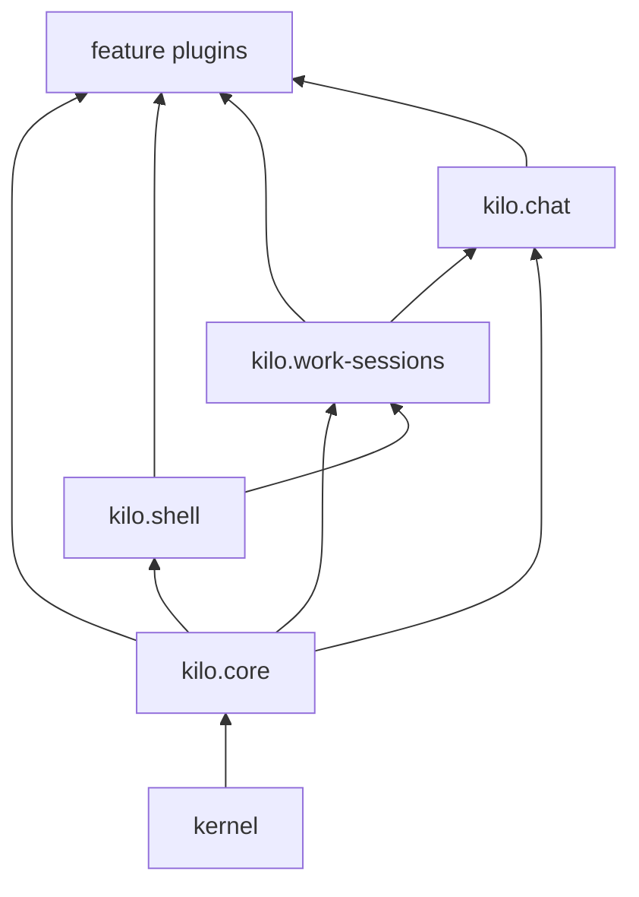

# Plugin Plan v2 — fewer, layered plugins

**Status:** Built on `kilo/plugin-plan-v2` (November 2026): steps 0 to 14
are built, so every plugin is back. What remains before merging is in
[Follow-ups](#follow-ups) (the e2e suites and a packaged build). See
[Progress](#progress). Rebuilt on a fresh branch,
layer by layer, as #942 was. Supersedes the plugin list (§4), the extension point
catalog (§6) and the build-up plan (§9) of
[plugin-architecture.md](./plugin-architecture.md); the kernel model (§2)
stands.

## Progress

Keep this table, [Deferred decisions](#deferred-decisions) and
[Follow-ups](#follow-ups) current as each step lands: what was built, what
it settled (each step's "What building step N settled"), and anything left
to come back to.

| Step | Plugin                 | Status             | Notes                                                                                                                                                                                                                                                                                                                                                                        |
| ---- | ---------------------- | ------------------ | ---------------------------------------------------------------------------------------------------------------------------------------------------------------------------------------------------------------------------------------------------------------------------------------------------------------------------------------------------------------------------- |
| 0    | kernel                 | Built (`452563ec`) | Plugins removed; renames, object types, identity, flags, telemetry, schema fixes. [Settled](#what-building-step-0-settled)                                                                                                                                                                                                                                                   |
| 1    | `kilo.core`            | Built (`fa86c0f8`) | Five areas (account, agent, models, flags, telemetry); host, packaging, CI and a headless `@smoke` spec; kernel `${resources}` resolution; agent extensions as data. [Settled](#what-building-step-1-settled)                                                                                                                                                                |
| 2    | `kilo.shell`           | Built (`deed1883`) | Frame, settings, onboarding, updates, account, AI providers, external apps, work style, support; navigation and notifications in main; `kilo.core/work-style`; shell e2e restored. [Settled](#what-building-step-2-settled)                                                                                                                                                  |
| 2b   | `kilo.developer`       | Built (`deed1883`) | Diagnostics ported (kernel, plugins, problems, points, domain objects, services) plus object types, context keys, flags and identity; `@smoke` spec; kilo.core smoke spec reads identity there. [Settled](#what-building-step-2b-settled)                                                                                                                                    |
| 3    | `kilo.work-sessions`   | Built (`6ab85645`) | Workspaces, file watcher, work sessions (generic isolation, chats linked by stamp), panes and openers, layout presets; window, canvas, panes, layouts, views, session list, New Session page, attention, notifications, workspace dialogs. [Settled](#what-building-step-3-settled)                                                                                          |
| 4    | `kilo.chat`            | Built (`04a00522`) | The chat pane end to end: transcript, composer, model picker over `kilo.core/models`, permission and question cards, plan/subagent/media panes, HTML render, MCP apps; chat panes and tab status from main. [Settled](#what-building-step-4-settled)                                                                                                                         |
| 5    | `kilo.git`             | Built (`fb071b92`) | Repository, `vcs` contribution (isolation is back), patch protocol, pull requests, branch namer, `changes_open`; Changes pane, branch pickers, repository actions, PR decorations and facet; four e2e specs restored. [Settled](#what-building-step-5-settled)                                                                                                               |
| 6    | `kilo.files`           | Built (`b40bc549`) | Documents (list, read, save, git status, external editors), `open` tool, file pane titles; Files pane (explorer, editor, table viewer), `@` mentions, file links; files and table-viewer e2e specs restored. [Settled](#what-building-step-6-settled)                                                                                                                        |
| 7    | `kilo.terminal`        | Built (`ed1a9e3f`) | Shells over node-pty, saved history and origin import, `terminals`, agent tools (offered to external apps, as origin); terminal pane, embedded ghostty frame, commands; node-pty and frame packaging; terminal e2e and the external-apps tool check restored. [Settled](#what-building-step-7-settled)                                                                       |
| 8    | `kilo.browser`         | Built (`c780d164`) | Pages (guest attach, navigation, page commands; lookup by pane), `open` tool, local HTML files; Browser pane, web links; browser and loopback-guard e2e restored. [Settled](#what-building-step-8-settled)                                                                                                                                                                   |
| 9    | `kilo.notebook`        | Built (`b13f0b9a`) | runtimed daemon and peer auth, notebooks, trust and telemetry, workspace environment, panes and tools; Kilo plugin as an agent extension with its env through the new `kilo.core/server-env`; Notebook pane, settings, sign-in gate; runtimed, `@runtimed/node`, koffi, native setup action and CI restored; notebook e2e restored. [Settled](#what-building-step-9-settled) |
| 10   | `kilo.marketplace`     | Built (`308d302c`) | Marketplace over Kilo's Marketplace API across workspaces (list, install, remove, MCP sign-in, launch-command checks); built-in MCP servers from `kilo.core/mcp-server` contributions; Agent Behavior settings page; marketplace e2e restored. [Settled](#what-building-step-10-settled)                                                                                     |     |
| 11   | `kilo.local-inference` | Built (`97e0e930`) | Local Model Server (registry, llama.cpp router and proxy, `kilo.core/ai-provider`, downloads, `settings.open`); `local-models` and `model-server`; new `model-catalog` and `llama-runtime` extension points (filled in steps 12–13); `kilo.chat/model-source` restored for the picker; settings page, loading toast; e2e restored. [Settled](#what-building-step-11-settled) |     |
| 12   | `kilo.environments`    | Built (`6eef5e8f`) | Conda bridge, environments, packages and channels, `conda-runtime`; origin's 13 tools (`external: true`); chat config, permission renderers; llama.cpp for the Local Model Server as a `llama-runtime` contribution; Conda Environments page; bridge packaging and notices; e2e restored. [Settled](#what-building-step-12-settled)                                          |
| 13   | `kilo.anaconda`        | Built (`27ccff6f`) | Anaconda account renamed from `kilo.anaconda-account` (OAuth sign-in, shared keyring, `apiKey()` for itself in main), Account panel; `kernel/linked-account` `anaconda`, `anacondaSignedIn`; Anaconda's catalog as a `model-catalog` contribution (origin's client); `resolveAccess` added for the lazy session; e2e moved. [Settled](#what-building-step-13-settled)        |
| 14   | `kilo.workspace-board` | Built (`2b4a6c63`) | Board (kv `board`, origin's adoptions), detachable work sessions view, list toggle, session-menu items, commands `open`/`add-column`/`clear` (origin's), clear confirmation as a `kilo.shell/dialog`, `workspace-board` flag; no contract changes (the litmus test held); e2e restored. [Settled](#what-building-step-14-settled)                                            |

Not yet run on this branch: the e2e suites (type-checked only) and a
packaged build.

## Why

Since #942 the app has grown to 21 plugins, each owning one concept. The
public schema is spread thin and several dependencies point the wrong way:
flags depend on the account, the account on the agent server, telemetry on
almost everything, and features on the chat UI. Too much of it is wiring:
`requires` chains, contracts and extension points that exist only to join
plugins that are really one product area.

We are building **Kilo Desktop: a client for the Kilo server**. The schema
can say so. Plugins should be product areas, built up from the kernel in a
few clear layers. Extension points stay where the product needs to be
pluggable: AI providers, model catalogs, agent tools, pane kinds, sessions
views and the workspace board.

## Terms

| Term                | Meaning                                                                                                                                                                                                                                                                 |
| ------------------- | ----------------------------------------------------------------------------------------------------------------------------------------------------------------------------------------------------------------------------------------------------------------------- |
| **Domain object**   | A named object (`<plugin>/<name>`) with state, methods and events, provided in one process and usable from any. Always "domain object", never just "domain".                                                                                                            |
| **Extension point** | A typed slot a plugin declares for others to fill: additive, exclusive or decision. Always "extension point", never just "point".                                                                                                                                       |
| **Contribution**    | What a plugin puts into an extension point: metadata in `plugin.json`, plus an implementation when the extension point takes one.                                                                                                                                       |
| **Context key**     | A named condition for `when` clauses, declared by the plugin that owns the concept.                                                                                                                                                                                     |
| **Object type**     | The `type` of an `ObjectRef` (`{type, id}`): a singular name declared by the plugin that owns the concept (`kilo.core/chat`, `kilo.work-sessions/file`). A collection domain object declares the object type it resolves (`kilo.core/chats` resolves `kilo.core/chat`). |

The same rule applies in code: `domainObjects`, `DomainObjectDefinition`,
`defineDomainObject`, `extensionPoints`, `ExtensionPointDefinition`. The
manifest's `domains` key becomes `domainObjects`.

## Principles

1. **A plugin is a product area, not a concept.** Domain objects and
   extension points stay granular and well named inside it. The schema is
   the API, and the number of packages isn't.
2. **Split a platform plugin only where something uses one half without
   the other.** `kilo.core` is data only because the shell, every feature's
   main-process tools and paired external apps use it without its UI.
   `kilo.work-sessions` keeps its data and its UI together because nothing
   uses one without the other: every feature that touches work sessions
   also needs the canvas, and panes, pane kinds and openers are one concept.
   Inside a plugin, data and UI stay separate areas (main areas checked
   without UI first; window areas on top), so the seam still exists in the
   code. Leaf feature plugins stay vertical too.
3. **We are Kilo.** Contracts speak Kilo plainly: chats are Kilo sessions,
   and AI providers are the AI providers in Kilo's config. Kilo SDK and wire types still
   never appear in contracts.
4. **Extension points exist for other plugins.** Declare one only where
   something outside the owner contributes, or where third parties are
   meant to. Everything else is plain code in the plugin.
5. **Dependencies only point down.** A plugin requires only lower layers.
   Where a lower layer needs something from a higher one, the lower layer
   declares an extension point and the higher one fills it. Kernel identity,
   flag sources, telemetry sinks and `vcs` all work this way.
6. **The workspace board is the litmus test.** Anything a board-level plugin
   needs must be reachable through the public domain objects and extension
   points of `kilo.work-sessions` and `kilo.chat`.

## Layers

| Step | Plugin               | Layer    | In one line                                                                                                                                            |
| ---- | -------------------- | -------- | ------------------------------------------------------------------------------------------------------------------------------------------------------ |
| 0    | kernel               | —        | Plugin runtime and host primitives, plus identity, flags and telemetry vocabulary                                                                      |
| 1    | `kilo.core`          | data     | The Kilo server and everything it knows: identity, terms, AI providers and models, chats, tools                                                        |
| 2    | `kilo.shell`         | UI       | The window: frame, settings, onboarding, palette, appearance, account and AI settings, About and updates                                               |
| 3    | `kilo.work-sessions` | data+UI  | Workspaces, work sessions and their panes; the session list, the canvas, the New Session page                                                          |
| 4    | `kilo.chat`          | UI       | The chat pane: transcript, composer, tool renderers                                                                                                    |
| 5–14 | features             | vertical | One per step: git, files, terminal, browser, notebook, marketplace, local-inference, environments, `kilo.anaconda`, workspace-board (developer was 2b) |

Each plugin below lists what it **offers** (domain objects, extension
points, context keys, object types) and what it **contributes** to other
plugins' extension points (lower layers' extension points, or its own).

---

## Step 0 — kernel

The kernel stays product-agnostic. Flags and telemetry become kernel
vocabulary, with vendors plugged in from above.

### Offers

**Domain objects** (all homed in main; host primitives are gated by
permissions)

| Domain object                                                                                | What                                                                                | New?                          |
| -------------------------------------------------------------------------------------------- | ----------------------------------------------------------------------------------- | ----------------------------- |
| `kernel/app`                                                                                 | Lifecycle phase, version, platform, quit and relaunch                               |                               |
| `kernel/plugins`                                                                             | Collection of plugins: states and issues; turning plugins on or off                 |                               |
| `kernel/services`                                                                            | Collection of contributed services: status, restarts, failures                      |                               |
| `kernel/windows`                                                                             | Collection of windows: opening, focusing, hiding and closing them                   |                               |
| `kernel/system`                                                                              | OS state: online, appearance, focus, suspend                                        |                               |
| `kernel/keybindings`                                                                         | Collection of user keybinding overrides, by command                                 |                               |
| `kernel/native-theme`, `kernel/app-menu`                                                     | Native chrome and the native menu                                                   |                               |
| `kernel/dialogs`, `kernel/clipboard`, `kernel/os`, `kernel/notifications`, `kernel/keychain` | OS primitives                                                                       |                               |
| `kernel/updater`                                                                             | App updates, with a precise state schema                                            | stricter schema               |
| `kernel/data-collection`                                                                     | Consent for usage data and crash reports                                            |                               |
| `kernel/identity`                                                                            | The primary user plus linked accounts. Flags and telemetry key on the primary user. | new                           |
| `kernel/flags`                                                                               | Collection of evaluated flag values                                                 | new                           |
| `kernel/telemetry`                                                                           | `track({event, data})`, honouring consent                                           | new                           |
| `kernel/domain-objects`, `kernel/extensions`                                                 | Introspection for developer tooling                                                 | renamed from `kernel/domains` |

**Extension points**

| Extension point                      | Kind                | What a plugin contributes                                                   | New?            |
| ------------------------------------ | ------------------- | --------------------------------------------------------------------------- | --------------- |
| `kernel/root`                        | exclusive           | The main window's interface                                                 |                 |
| `kernel/window-view`                 | additive            | A view a secondary window can show                                          |                 |
| `kernel/command`                     | additive            | A named user action                                                         |                 |
| `kernel/service`                     | additive            | A supervised daemon or task: start policy, restart policy, progress, health | kept, see below |
| `kernel/quit`, `kernel/window-close` | decision            | Proceed, ask or reject                                                      |                 |
| `kernel/identity-provider`           | exclusive           | The primary identity                                                        | new             |
| `kernel/linked-account`              | additive            | Another signed-in account, added to the identity flags and telemetry see    | new             |
| `kernel/flag`                        | additive (metadata) | A declared flag: id, description, default                                   | new             |
| `kernel/flag-source`                 | exclusive           | Evaluates flags for the identity                                            | new             |
| `kernel/telemetry-event`             | additive (metadata) | An event the plugin may send                                                | new             |
| `kernel/telemetry-sink`              | additive            | Delivers events                                                             | new             |

**Context keys:** `desktop`, `mac`, `windows`, `linux`, `paneWindow`,
`secondaryWindow` (now declared, not just documented), and `flag:<id>`.

**Host services** (`mainHost(sdk)`, per plugin, main only): storage and kv
stores, sandboxed fs, net, protocols, embedded hosts, the embedded browser
host (now typed) and assets.

### Why `kernel/service` stays

It is one of the most used extension points: 7 of today's plugins
contribute 11 services. In v2 they would be:

| Plugin                 | Services                                                                                                      |
| ---------------------- | ------------------------------------------------------------------------------------------------------------- |
| `kilo.core`            | `server` (daemon), `tool-gateway` (daemon), `config-sync` (task), `launchdarkly` (daemon), `posthog` (daemon) |
| `kilo.work-sessions`   | `file-watcher` (daemon)                                                                                       |
| `kilo.notebook`        | `runtimed` (daemon, first use)                                                                                |
| `kilo.local-inference` | `router` (daemon, window shown), `import` (task)                                                              |
| `kilo.environments`    | `bridge` (daemon, first use)                                                                                  |

It gives every long-running process one start order (activation, window
shown, first use), one restart policy and one status the user can see
(Diagnostics, `kernel/services`). The rest of the app needs none of that.
The pair also shows the naming rule: the extension point is singular (one
contribution is one service), the domain object listing them is plural.

### What building step 0 settled

- **The branch starts from the kernel alone.** `plugins/` is empty and
  `BUNDLED_PLUGINS` is `[]`; the window boots to the kernel screen
  (`data-situation="healthy"`), checked by an `@smoke` spec. Plugin code
  comes back from history layer by layer, along with what it needs in the
  host's packaging (CLI, terminal, notebook and conda resources, native
  modules) and CI setup steps.
- **Renames.** `defineDomainObject`, `DomainObjectDefinition`,
  `ExtensionPointDefinition`, `defineDecisionExtensionPoint`,
  `sdk.domainObjects`, `useDomainObject(State)`, the manifest's
  `domainObjects` key, `kernel/domain-objects`, and `extensionPoints` in
  discovery and the registry.
- **Object types are first-class.** `defineObjectType` and a manifest
  `objectTypes` key; a collection names its `objectType` and must declare a
  `lookup`; one collection per type; `sdk.domainObjects.resolve(ref)` finds
  the item. `handle.lookup(key)` now takes the key, not a ref. Discovery
  rejects an extension point, domain object, context key and object type of
  one plugin sharing an id.
- **Identity.** `kernel/identity` is `{primary, linked}`, each account
  `{id, email?, name?, organization?, attributes, source}`. Contributions
  implement `{current(), subscribe()}`; an invalid account counts as signed
  out.
- **Flags.** Declarations are read from manifests, so a plugin gated on
  `kernel/flag:<id>` can be started by its own flag. Value order: host
  override (`flagOverrides`, from `VITE_FEATURE_FLAG_OVERRIDES`), then the
  `flag-source`, then the default. `ready` is true at once without a source.
  The source is called with `identify(identity)` on binding and on every
  identity change. The first plugin to declare a flag id owns it.
- **Telemetry.** `track({event, data})` sends only events the caller's
  manifest declares, only with `kernel/data-collection` consent, to every
  sink in parallel; a failing sink is logged and never fails the caller. The
  envelope carries the identity, installation id and environment.
- **Schema fixes.** Kernel context keys carry descriptions (`flag:*`
  included); `kernel/updater` has an enum status and typed release notes;
  `mainHost(sdk).browser` is the typed `HostBrowser`; `kernel/windows`
  resolves the `kernel/window` object type; `kernel/keybindings`,
  `kernel/domain-objects` and `kernel/extensions` declare lookups and list
  every definition for developer tooling.

---

## Step 1 — `kilo.core` (data)

What used to be kilo.agent, the model half of kilo.account, kilo.flags and
kilo.telemetry, plus the model data that lives in kilo.chat today. No web
UI: everything users see of it is drawn by `kilo.shell`, `kilo.work-sessions`
and `kilo.chat`.

### Offers

**Domain objects**

| Domain object             | What                                                                                                                                |
| ------------------------- | ----------------------------------------------------------------------------------------------------------------------------------- |
| `kilo.core/server`        | Kilo CLI packaging, server lifecycle and status, connection for kilo.core's own clients                                             |
| `kilo.core/account`       | The signed-in Kilo account: profile, organisations, sign-in and sign-out. No UI state.                                              |
| `kilo.core/terms`         | Terms acceptance                                                                                                                    |
| `kilo.core/chats`         | Collection of Kilo chats (Kilo sessions): activity, prompts, permission requests and questions                                      |
| `kilo.core/generation`    | One-shot structured calls: commit messages, PR text, branch names                                                                   |
| `kilo.core/models`        | Collection of available models with their AI providers, plus the preferred model, favourites, recent models and the gateway catalog |
| `kilo.core/external-apps` | Collection of paired external AI apps, plus the listener's settings and status                                                      |

**Extension points** (all implemented in main)

| Extension point             | Kind                | What a plugin contributes                                                                                                                          |
| --------------------------- | ------------------- | -------------------------------------------------------------------------------------------------------------------------------------------------- |
| `kilo.core/ai-provider`     | additive            | An AI provider entry in Kilo's config                                                                                                              |
| `kilo.core/model-catalog`   | additive            | Removed in step 11: catalogs of downloadable models are `kilo.local-inference/model-catalog` (it was declared in step 1 with no consumer).         |
| `kilo.core/server-env`      | additive            | Environment variables for the Kilo server process (added in step 9).                                                                               |
| `kilo.core/mcp-server`      | additive            | An MCP server: static `{command, args, env}` metadata (`${resources}` resolved by the kernel), or an implementation for dynamic ones               |
| `kilo.core/agent-extension` | additive (metadata) | An `agent` or `command` as data, or a `kilo-plugin` module / `skill` folder by `${resources}/…` path. kilo.core adds it to Kilo's config. No code. |
| `kilo.core/chat-config`     | additive            | Instructions and permissions for a chat, given its chat id, directory and stamp (`workSessionId`, `workspaceId`)                                   |
| `kilo.core/tool`            | additive            | A desktop tool the agent can call; `external: true` offers it to paired external apps too                                                          |
| `kilo.core/tool-approval`   | decision            | Proceed, ask or reject a tool call                                                                                                                 |

**Object types:** `kilo.core/chat` (resolved by `kilo.core/chats`), `kilo.core/model` (resolved by `kilo.core/models`).

**Context keys:** `signedIn`, `termsAccepted`.

**The chat ↔ work session link stays where it is today: in the Kilo chat's
metadata.** Every chat this app creates carries a `kilo-desktop` stamp
(`workSessionId`, `workspaceId`, workspace folders, worktree branch).
kilo.core owns the stamp's format, writes it when a chat is created and
exposes it on each chat, but treats the ids as opaque: it never resolves a
work session or imports kilo.work-sessions. kilo.work-sessions passes its
ids when it creates a chat, and finds a work session's chats by reading the
stamp. Because the link lives on the Kilo server, it survives reinstalls and
is visible to the Kilo CLI.

### Contributes

| To                         | Contributions                                                      |
| -------------------------- | ------------------------------------------------------------------ |
| `kernel/identity-provider` | `kilo-account`                                                     |
| `kernel/flag-source`       | `launchdarkly`                                                     |
| `kernel/telemetry-sink`    | `posthog`                                                          |
| `kernel/service`           | `server`, `tool-gateway`, `config-sync`, `launchdarkly`, `posthog` |
| `kernel/flag`              | `external-ai-apps`                                                 |
| `kernel/telemetry-event`   | `logged-in`, `logged-out`, `terms-accepted`, `terms-linked`        |

### What building step 1 settled

- **One plugin, five areas.** `plugins/core/src/main/{account,agent,models,flags,telemetry}`
  each export `activate<Area>(sdk, options)` and `production<Area>Options`;
  `createCoreMainEntry` composes them (account → agent → models → flags →
  telemetry; the agent awaits its storage adoption before providing the
  server). Areas meet only through kilo.core's own domain objects.
- **Main only.** No web entry; `bundled-plugins` marks it `mainOnly`. Specs
  read its state headlessly through `kernel:hydrate` until a UI exists.
- **Models live in main.** `kilo.core/models` reads AI providers and models
  from the server and re-reads them on server ready, sign-in or organisation
  changes, `ai-provider` contribution changes and its own mutations
  (`connectAiProvider`, `disconnectAiProvider`, `saveCustomAiProvider`,
  `customAiProvider`, `presentEnv`, which only kilo.core, kilo.shell and the
  main kernel may call). Kilo's credential-chain providers count as `env`;
  `kilo`, `env` and `plugin` providers can't be disconnected.
- **Callers.** `server.connect`: `SERVER_CLIENT_PLUGINS` (core, shell,
  chat, marketplace) and the main kernel. Prompting and answering
  prompts: kilo.chat. External apps: kilo.core and kilo.shell.
- **Identity, flags, telemetry.** The `kilo-account` identity is keyed on
  email, with the current organisation and `isEmployee`, never the display
  name. LaunchDarkly gets one context kind per linked account's plugin plus a
  `linked_accounts` attribute. PostHog reads the environment and identity
  from each envelope. `desktop-initialized` is sent when the window shows.
- **Storage.** Each area adopts its predecessor's data once: `../kilo.agent`
  is renamed to `<kilo.core>/agent` (Kilo's state, chats, credentials, the
  app-owned config); terms, model preferences, external apps and the
  LaunchDarkly cache are imported into kilo.core namespaces. The app's config
  entries keep `"kilo.agent"` as their on-disk owner id.
- **Kept names.** The External AI apps flag stays
  `external-api-apps-settings` (LaunchDarkly's key). Tool wire names stay
  `desktop_<plugin>_<id>`; `external` now defaults to false.
- **Contributions to Kilo are data.** `kilo.core/mcp-server` and
  `kilo.core/agent-extension` carry what they add in their metadata: an
  agent or a command is written into Kilo's config as it is (`agent.<id>`,
  `command.<id>`); only what must be a file is a path — a Kilo plugin module,
  or a skill folder linked into the app-owned config's `skills/`. Each is
  owned per contributor and pruned when the contribution goes.
- **`${resources}` is resolved by the kernel.** An extension point declared
  `resources: true` gets `${resources}` in its contributions' metadata
  replaced, in main, with the contributor's own folder. kilo.core never looks
  up another plugin's files.
- See [Deferred decisions](#deferred-decisions) for what is still open.

---

## Step 2 — `kilo.shell` (UI)

Today's kilo.shell, plus the UI half of kilo.account, kilo.updates, and
the settings pages of kilo.agent and kilo.telemetry. It draws everything
the user sees of `kilo.core`.

### Offers

**Extension points** (implemented in the renderer unless noted)

| Extension point                  | Kind            | What a plugin contributes                                                                    |
| -------------------------------- | --------------- | -------------------------------------------------------------------------------------------- |
| `kilo.shell/main`                | exclusive       | The main area                                                                                |
| `kilo.shell/left-sidebar`        | exclusive       | The left sidebar's body                                                                      |
| `kilo.shell/sidebar-notice`      | additive        | Something to act on ("Restart to update", "Update available")                                |
| `kilo.shell/top-bar-title`       | exclusive       | What names the main area in the top bar, in place of its title                               |
| `kilo.shell/top-bar-action`      | additive        | Actions in the top bar                                                                       |
| `kilo.shell/status-bar-item`     | additive        | Ambient status: a view, an action or a popover                                               |
| `kilo.shell/right-sidebar-panel` | additive        | A panel in the right sidebar                                                                 |
| `kilo.shell/dialog`              | additive        | An app-wide dialog opened by command (was `overlay`)                                         |
| `kilo.shell/settings-category`   | additive (data) | A heading in the Settings sidebar                                                            |
| `kilo.shell/settings-section`    | additive        | A Settings page. Settings stay per plugin: each plugin keeps its own domain object and page. |
| `kilo.shell/ai-provider-panel`   | additive        | An AI provider's panel in Settings → AI Providers                                            |
| `kilo.shell/account-panel`       | additive        | An account in Settings → Account                                                             |
| `kilo.shell/about-section`       | additive        | A block of Settings → About                                                                  |
| `kilo.shell/support-row`         | additive        | A row in About → Support                                                                     |
| `kilo.shell/onboarding-step`     | additive        | A first-run onboarding step                                                                  |
| `kilo.shell/menu-item`           | additive (data) | A command in the native app menu                                                             |
| `kilo.shell/deep-link`           | additive (data) | An app URL host routed to a page                                                             |

**Domain objects**

| Domain object              | What                                                                                                                                             |
| -------------------------- | ------------------------------------------------------------------------------------------------------------------------------------------------ |
| `kilo.shell/appearance`    | Saved appearance preferences (main)                                                                                                              |
| `kilo.shell/theme`         | The effective theme in this window                                                                                                               |
| `kilo.shell/navigation`    | Where each window is (main-home), and requests to move one — navigate, open a settings section, go home, open a dialog — from main or any window |
| `kilo.shell/notifications` | Toasts and in-app notices, callable from main or a window                                                                                        |
| `kilo.shell/onboarding`    | Whether onboarding was finished or skipped                                                                                                       |
| `kilo.shell/legal`         | The legal documents shipped with the app (was `kilo.updates/legal`)                                                                              |

### Contributes

| To                             | Contributions                                                                                                   |
| ------------------------------ | --------------------------------------------------------------------------------------------------------------- |
| `kernel/root`                  | `frame`                                                                                                         |
| `kernel/command`               | `command-palette`, `open-settings`, `toggle-sidebar`, `show-shortcuts`, `close-window`, `go-home`               |
| `kilo.shell/settings-category` | `general`, `ai`                                                                                                 |
| `kilo.shell/settings-section`  | `about`, `account`, `appearance`, `keyboard-shortcuts`, `ai-providers`, `external-ai-apps` (flagged), `privacy` |
| `kilo.shell/account-panel`     | `kilo`                                                                                                          |
| `kilo.shell/ai-provider-panel` | `kilo-gateway`                                                                                                  |
| `kilo.shell/about-section`     | `version`, `support`, `legal`                                                                                   |
| `kilo.shell/support-row`       | `kilo-config`                                                                                                   |
| `kilo.shell/sidebar-notice`    | `update-ready`                                                                                                  |
| `kilo.shell/onboarding-step`   | `welcome` (terms), `sign-in`, `work-style`, `features`                                                          |
| `kilo.shell/menu-item`         | `settings`, `command-palette`, `toggle-sidebar`, `show-shortcuts`                                               |
| `kernel/telemetry-event`       | `page-visit`, `onboarding-shown`, `onboarding-completed`, `onboarding-skipped`, `work-style-selected`           |

The account entry at the foot of the left sidebar is kilo.shell's own UI, not
an extension point.

### What building step 2 settled

- **One plugin, areas again.** Main (`appearance`, `onboarding`,
  `navigation`, `notifications`, `legal`, telemetry) composes in
  `createShellMainEntry`; the web entry composes `frame` (first: it provides
  `kilo.shell/theme`), `settings`, `onboarding`, `updates`, `account`,
  `ai-providers`, `external-apps`, `work-style` and `support`. Areas meet
  through kilo.shell's contracts; the only cross-area imports are
  `SidebarAccount` and `AiProviderList`, plus `src/web/shared/shortcuts`.
- **Navigation and notifications live in main.** The kernel can't call a
  renderer-home object from main, so `kilo.shell/navigation` keeps each
  window's location and turns requests (`navigate`, `openSettings`,
  `goHome`, `openDialog`) into events for the target window: the one named,
  else the caller's, else the main window. `openSettings` takes a section's
  key or bare id. Notices are one per plugin per id, shown at the foot of the
  left sidebar; an action runs its command, then dismisses the notice.
  Toasts go to one window.
- **Settings → AI Providers keeps origin's layout** (fixed after step 14):
  "Add AI Provider" in the page header, and the `ai-provider-panel`
  contributions (Kilo Gateway) as the first rows of the one providers panel,
  not a card above the button.
- **Dialogs and the right sidebar.** `kilo.shell/dialog` replaces `overlay`
  and is mounted only while open. `right-sidebar-panel` is new: a launcher
  rail of panel icons on the window's right edge, under the top bar, that
  opens one panel at a time beside the main area behind a resizable splitter
  (per-panel width, remembered); hidden when nothing contributes.
- **The renderer never talks to the Kilo server for data.** Account, terms,
  AI providers and external apps read kilo.core's domain objects. The work
  style moved to kilo.core (`kilo.core/work-style`); custom AI providers
  gained `apiFormat`. The API-key editor starts empty (stored keys never
  leave main). A failed server is a notice with a "Restart Kilo" action
  (`kilo.shell/restart-server`).
- **Onboarding without kilo.core.** The welcome and sign-in steps register
  only when `kilo.core/terms` / `kilo.core/account` exist, so the app never
  boots behind an unsatisfiable required step.
- **The native app menu is drawn by each window's frame**, because
  `kernel/app-menu.setMenu` sets the caller's window menu.
- **Storage.** kilo.shell keeps its id, so its own data stays. Appearance
  held only in a window's localStorage is handed to main once. No other UI
  half kept data.
- **Tests.** `renderShell` (`@kilo-desktop/plugin-shell/testing`) boots
  kilo.shell's main and web entries with a kilo.core stand-in (`core: false`
  leaves it out) and `flags` overrides. e2e: shell specs restored;
  `KILO_E2E_SHOW_ONBOARDING=1` lets a spec walk onboarding; the kilo.core
  smoke spec goes through the UI (only the primary identity is still a
  `kernel:hydrate` read).

---

## Step 3 — `kilo.work-sessions` (data and UI)

What used to be kilo.workspaces, kilo.sessions and kilo.workbench: the
model of workspaces, work sessions and their panes, and everything the user
sees of it — workspace management, the session list, the session canvas and
the New Session page. Built in two passes within the step: the main-process
areas first (`workspaces`, `work-sessions`, `panes`, `file-watcher`), checked
without UI as `kilo.core` was; then the window areas (`canvas`,
`session-list`, `new-work-session`, `workspace-dialogs`).

The plugin keeps the name `kilo.work-sessions` rather than "workbench":
"work session" is the term the product and the plan already use, and
"workbench" was never shown to users.

### Offers

**Domain objects**

| Domain object                       | What                                                                                                                                                                |
| ----------------------------------- | ------------------------------------------------------------------------------------------------------------------------------------------------------------------- |
| `kilo.work-sessions/workspaces`     | Collection of workspaces: named projects with several folders (one primary), plus path authorisation for every plugin                                               |
| `kilo.work-sessions/file-watcher`   | File changes in workspace folders                                                                                                                                   |
| `kilo.work-sessions/work-sessions`  | Collection of work sessions: workspace, isolation, directory and linked chats                                                                                       |
| `kilo.work-sessions/panes`          | Collection of the panes work sessions hold: `{id, kind, title, object?: ObjectRef, reveal?, status?}`. `kind` is a `kilo.work-sessions/pane-kind` contribution key. |
| `kilo.work-sessions/window`         | This window's view: workspace focus, open work session and sessions view (a singleton per window)                                                                   |
| `kilo.work-sessions/layout-presets` | Collection of saved layout presets, plus the default                                                                                                                |

**Object types:** `kilo.work-sessions/workspace`,
`kilo.work-sessions/work-session` and `kilo.work-sessions/pane` (resolved by
the collections above), `kilo.work-sessions/file` (a path in a workspace
folder) and `kilo.work-sessions/url`, so openers, mentions and
drag-and-drop have one owner for each type.

**Extension points: the model** (main)

| Extension point             | Kind             | What a plugin contributes                                                                                                                                                                     |
| --------------------------- | ---------------- | --------------------------------------------------------------------------------------------------------------------------------------------------------------------------------------------- |
| `kilo.work-sessions/opener` | additive (data)  | Opens an object type, optionally matching a glob, in a pane kind, with a `priority`                                                                                                           |
| `kilo.work-sessions/vcs`    | exclusive (main) | Version control for workspace folders: status and branches, plus creating and removing a session's isolated copy. Without a `vcs` contribution, work sessions run in the local checkout only. |

Isolation is generic: a session records `local`, `new-copy` or
`existing-copy` and its directory, and the `vcs` contribution does the work.

**Extension points: the canvas and the session list** (renderer)

| Extension point                               | Kind      | What a plugin contributes                                                                                      |
| --------------------------------------------- | --------- | -------------------------------------------------------------------------------------------------------------- |
| `kilo.work-sessions/pane-kind`                | additive  | Everything a pane kind needs: component, icon, singleton, keep-alive, launch places, open command, close guard |
| `kilo.work-sessions/work-session-menu`        | additive  | An item in a session's menu                                                                                    |
| `kilo.work-sessions/work-session-decoration`  | additive  | A badge or hover detail shown with a session                                                                   |
| `kilo.work-sessions/work-session-facet`       | additive  | A generic filter: facts about sessions with their own label and values                                         |
| `kilo.work-sessions/work-session-grouping`    | additive  | A way to group the session list into the plugin's categories (the board's columns)                             |
| `kilo.work-sessions/work-sessions-view`       | additive  | Another view of the sessions, shown in place of the open session                                               |
| `kilo.work-sessions/work-session-action`      | additive  | A button in the open session's header                                                                          |
| `kilo.work-sessions/work-session-list-action` | additive  | A button in the session list's header                                                                          |
| `kilo.work-sessions/new-work-session-option`  | additive  | A choice on the New Session page                                                                               |
| `kilo.work-sessions/work-session-starter`     | exclusive | What the New Session page starts with (the chat composer)                                                      |

**Context keys:** `hasWorkspaces`, `hasVcs` (renamed so it no longer shares
a name with the `vcs` extension point), `workSessionActive`,
`workspaceActive`, `paneTargetActive`.

### Contributes

| To                                       | Contributions                                                                                                                                                                                          |
| ---------------------------------------- | ------------------------------------------------------------------------------------------------------------------------------------------------------------------------------------------------------ |
| `kilo.shell/main`                        | `work-sessions`                                                                                                                                                                                        |
| `kilo.shell/left-sidebar`                | `work-sessions`                                                                                                                                                                                        |
| `kilo.shell/dialog`                      | `workspace-dialogs`                                                                                                                                                                                    |
| `kilo.shell/onboarding-step`             | `workspace`                                                                                                                                                                                            |
| `kilo.shell/settings-section`            | `notifications`                                                                                                                                                                                        |
| `kilo.shell/menu-item`                   | `new-work-session`, `new-pane`, `close-pane`                                                                                                                                                           |
| `kernel/window-view`                     | `pane`, `work-sessions-view`                                                                                                                                                                           |
| `kernel/service`                         | `file-watcher`                                                                                                                                                                                         |
| `kernel/command`                         | Work sessions (`new-work-session`, `next-work-session`, `work-session-1`…; titles still say "Session"), panes (`new-pane`, `close-pane`, `pane-1`…), workspaces (`add-workspace`, `manage-workspaces`) |
| `kilo.work-sessions/work-session-action` | `layouts`                                                                                                                                                                                              |
| `kernel/telemetry-event`                 | `workspace-created`, `workspace-removed`, `pane-opened`, `pane-closed`, layout events                                                                                                                  |

### What building step 3 settled

- **Three plugins became one, in areas.** Main: `storage` (adoption) →
  `keybindings` → `workspaces` → `file-watcher` → `layout-presets` →
  `work-sessions` → `panes`, composed by `createWorkSessionsMainEntry`. Web:
  `window` (first) → `canvas` → `panes` → `layouts` → `views` → `attention`
  → `list` → `home` → `notifications` → `workspaces`, composed by
  `workSessionsWebEntry`; shared helpers live in `src/web/shared`.
  Contracts are split into `contracts/model` (no React) and `contracts/ui`.
- **Names.** Commands `new-work-session`, `work-session-1`…, panes keep
  `new-pane`/`pane-1`…; workspace commands are `add-workspace` etc. and open
  the `workspace-dialogs` `kilo.shell/dialog`. Users' keybinding overrides
  under the 38 old command keys move to the new keys once. The one flag the
  old code read, `chat-layouts`, is declared here.
- **Generic isolation.** `isolation: local | new-copy | existing-copy`,
  `branch`, `copyCreated`; the `vcs` implementation speaks of copies
  (`createCopy`, `removeCopy`…). Without a `vcs` contribution only local is
  offered; the UI still says "worktree" (git is the only one).
- **Chats belong to work sessions by kilo.core's stamp.** `chatIds`, titles
  from chats, archive-follows-chat and directory adoption are derived from
  `kilo.core/chats`; `WorkSessions.createChat` stamps new chats; a chat
  stamped with an unknown work session id creates that work session.
  kilo.core is optional.
- **Panes.** `object` (an `ObjectRef`), `status` (`busy`/`attention`, a dot on
  the tab), `openObject` routes through `opener` contributions by the
  kernel's contribution `priority` and a glob. `pane-opened`/`pane-closed`
  are sent from main for every open and close. With no pane kinds installed
  a session says so and offers no "+".
- **Storage.** Each predecessor's files are adopted once into kilo.work-sessions'
  kv (`workspaces.json`, `sessions.json` with the copy renames, `panes.json`
  with metadata object ids turned into `object`, `layouts.json`); origin
  import markers carry over; better-sqlite3 is loaded lazily and its
  absence counts as nothing to import. Window state moves from
  `kilo.workbench.navigator:<windowId>` to `kilo.work-sessions.window:<windowId>`
  and keeps only the workspace focus: the open work session and shown view
  are not restored, so every launch opens on the New Session page;
  origin's pins are handed over once through `setPinned`.
- **Toasts go through `kilo.shell/notifications`** (the in-progress
  "Removing worktree…" toast is gone).
- **Onboarding steps need their data.** kilo.shell's `work-style` step, like
  `welcome` and `sign-in`, registers only when kilo.core provides its
  domain object.
- **Tests.** `@kilo-desktop/plugin-work-sessions/testing`
  (`renderWorkSessions`) boots the real shell and web entry over an
  in-memory main stand-in; main areas test against real kernels. e2e:
  workspaces, session list and watcher specs restored, a new `@smoke` spec;
  `layout-presets.spec.ts` is `fixme` until kilo.chat's agent pane exists.

---

## Step 4 — `kilo.chat` (UI)

What used to be kilo.chat: the chat pane. It draws everything the user sees
of `kilo.core`'s chats — the transcript, the composer, tool calls and
permission requests — as a `kilo.work-sessions/pane-kind`. Its model data
already moved to `kilo.core/models` in step 1. This is the first step where
the product works end to end.

Chat stays its own plugin because its dependency runs one way (it is a pane
kind; the canvas knows nothing about it) and it is the largest area by far.

### Offers

**Domain objects**

| Domain object             | What                                                               |
| ------------------------- | ------------------------------------------------------------------ |
| `kilo.chat/composer`      | Each window's composer focus; insert text, start a chat (renderer) |
| `kilo.chat/drafts`        | Collection of unsent composer text, by work session                |
| `kilo.chat/prompt-queues` | Collection of prompt queues, by chat                               |
| `kilo.chat/auto-approve`  | The approval mode, and whether a request is being held             |
| `kilo.chat/html-pages`    | Saves `html_render` pages into the workspace                       |
| `kilo.chat/media-viewers` | Collection of media viewer contents, by `<workSessionId>/<paneId>` |

These are UI state a UI plugin keeps for itself. They are public because
features use them (e.g. git inserts text into the composer).

**Extension points** (renderer)

| Extension point                  | Kind     | What a plugin contributes                                                                                             |
| -------------------------------- | -------- | --------------------------------------------------------------------------------------------------------------------- |
| `kilo.chat/composer-action`      | additive | A button, menu or popover in the composer                                                                             |
| `kilo.chat/composer-mention`     | additive | Mentions after a trigger character, resolved to object refs                                                           |
| `kilo.chat/client-slash-command` | additive | A `kernel/command` placed in the `/` menu, run in the window with the pane's context (added after step 14)            |
| `kilo.chat/tool-renderer`        | additive | How a tool's calls look in the transcript, through our own props type                                                 |
| `kilo.chat/mcp-app`              | additive | An interactive widget for a tool's calls                                                                              |
| `kilo.chat/markdown-extension`   | additive | Additions to the transcript's markdown, through our own types                                                         |
| `kilo.chat/permission-renderer`  | additive | Detail for a permission request, matched on tool contribution keys, not wire names                                    |
| `kilo.chat/model-source`         | additive | A local AI provider's rail in the model picker, starting it and loading a model before a prompt (restored in step 11) |

**Context keys:** `composerFocused`.

### Contributes

| To                                        | Contributions                                                                                 |
| ----------------------------------------- | --------------------------------------------------------------------------------------------- |
| `kilo.work-sessions/pane-kind`            | `agent`, `plan`, `subagent`, `media`                                                          |
| `kilo.work-sessions/work-session-action`  | `agents`                                                                                      |
| `kilo.work-sessions/work-session-starter` | `composer`                                                                                    |
| `kilo.core/tool`                          | `html_render`                                                                                 |
| `kilo.core/tool-approval`                 | `auto-approve`                                                                                |
| `kernel/command`                          | `focus-composer`, `compact` (`session.summarize` with the pane's model; `/` menu only)        |
| `kilo.chat/composer-action`               | `attach`, `agent`, `model`, `approval`, `unavailable-folders`                                 |
| `kilo.chat/client-slash-command`          | `compact` (places `kilo.chat/compact` as `/compact`, `/smol`, `/condense`)                    |
| `kilo.chat/tool-renderer`                 | The built-in Kilo tools (read, edit, bash, search, task, question, todo, …) and `html_render` |

kilo.chat holds kilo.core's caller rights to prompt chats, answer their
permission requests and questions, and connect to the Kilo server directly.

### What building step 4 settled

- **Areas.** Main: `auto-approve` → `prompt-queues` → `drafts` →
  `html-render` → `media-viewers` → `chat-panes`, composed by
  `createChatMainEntry`. Web: one `ChatServices` (the live Kilo connection
  and event stream, over `KiloServer.connect`), one `ComposerFocus` and one
  query cache per window, shared by every pane, composed by `chatWebEntry`.
  The transcript still streams through react-opencode (patched, with the
  `@opencode-ai/sdk` compat shim).
- **Chat panes come from main.** `chat-panes` opens an agent pane for a work
  session with chats but no panes record (chat-adopted sessions; never after
  the person closed its panes) and owns `pane.status`: `attention` while the
  chat or a subagent waits on a permission or question, `busy` while it
  works. Panes show their chat through `pane.object` (`kilo.core/chat`),
  falling back to adopted `metadata.chatId`.
- **Models come from kilo.core.** The picker reads `kilo.core/models`, which
  gained `recommendedIndex`, `description`, `outputPricePerMillion`, `byok`
  per model and `defaults` / `configuredModel`; it always lands on a
  connected model. `model-source` was dropped here and restored in step 11.
- **Replies go through kilo.core.** `Chats.replyPermission` gained
  `interactive` (the server refuses non-interactive approvals of sensitive
  requests); cards disappear when the server announces the reply.
- **Tool approval.** The `auto-approve` contribution always proceeds (it is
  asked once per tool at chat creation); Auto mode answers requests as they
  come.
- **Names.** `permission-renderer` (was `interaction-renderer`) matches on
  `toolKey`, or on Kilo's permission name through `permissions` for requests
  no desktop tool raises (kilo.notebook's `notebooks_execute`, asked by its
  Kilo plugin); renderers see `request.permission`, never the card's
  `metadata.toolName` label. `tool-renderer` entries with `/` are contribution keys mapped
  to wire names (`kilo.chat/html_render` → `desktop_chat_html_render`).
  Contracts carry kilo.chat's own `ToolCallProps`; built-in renderers loosen
  `result`/`isError` so assistant-ui parts spread in. Its former flags
  `prompt-queue-editing` and `searchbar-windows-panels` were removed once
  fully rolled out; queue editing and the find bar are unconditional.
- **Contracts never import `.tsx`.** Main loads every bundled contract;
  `MarkdownRendererExtension` moved to `@kilo-desktop/ui/lib/markdown-extension`.
  A plugin whose contracts import a library ships its types as a dependency
  (`@types/picomatch` in kilo.work-sessions).
- **Storage.** kilo.chat kept its id; nothing changed shape. Origin's
  approval mode and favourite models are handed over once from the window
  (`AutoApprove.setMode`, `Models.setFavorite`) with localStorage markers.
- **Tests.** `src/test/render-chat.tsx` (`renderChat`) boots kilo.chat's real
  main and web entries in the shell with kilo.core and kilo.work-sessions
  stand-ins. e2e: chat specs restored, a `@smoke` spec (prompt from the New
  Session page, reply, title), `layout-presets` un-`fixme`d.
- **Client slash commands (added after step 14).** Plugins contribute what a
  `/` command does as a `kernel/command`; `kilo.chat/client-slash-command`
  only places it in the menu (`{command, name, description?, aliases}`, no
  implementation, as `kilo.shell/menu-item` places commands in the app
  menu), listed while the command is available. kilo.chat executes it with
  a `ClientSlashCommandContext` (the composer context, the pane's agent /
  model / variant and `running`) as its argument; `slashCommandHandler`
  (contracts) checks it and ignores runs without one, so such commands are
  declared `palette: false` with no keybinding. The `/` menu merges
  placements with the server's `command.list` as Kilo's VS Code extension
  does (Actions first, a client name hides a server command, aliases never
  do, a skill clashing with a command is `name:skill`). Picking one or
  sending `/name …` clears the draft and runs it; only server names reach
  `session.command`. Prompt templates stay on `kilo.core/agent-extension`.
  kilo.chat ships `kilo.chat/compact`, placed as `/compact`.

---

## Steps 5–14 — feature plugins

One step per plugin, in this order. Each one is vertical and uses only lower layers' public domain objects and
extension points. None declares an extension point unless a second plugin
needs it.

### Step 5 — `kilo.git`

**Offers:** domain objects `kilo.git/repository` (a git operations service:
fetch, commit, push, pull, diffs) and `kilo.git/pull-requests` (a collection of
PR snapshots).

| Contributes to                               | Contributions                                                |
| -------------------------------------------- | ------------------------------------------------------------ |
| `kilo.work-sessions/vcs`                     | `git`                                                        |
| `kilo.work-sessions/pane-kind`               | `changes`                                                    |
| `kilo.work-sessions/work-session-decoration` | `pull-request`, `branch`, `pull-request-details`             |
| `kilo.work-sessions/work-session-facet`      | `pull-request`                                               |
| `kilo.work-sessions/work-session-action`     | `repository-actions`                                         |
| `kilo.work-sessions/new-work-session-option` | `branch`                                                     |
| `kilo.chat/composer-action`                  | `branch`                                                     |
| `kilo.core/tool`                             | `changes_open`                                               |
| `kernel/command`                             | `open-changes`, `commit`, `push`, `create-pull-request`      |
| `kernel/telemetry-event`                     | `commit-message-generated`, `pull-request-content-generated` |

Commit and PR text come through `kilo.core/generation`.

#### What building step 5 settled

- **A straight port.** Origin's code and tests came over with names and
  wiring changed only; UI, copy and `data-qa-id`s are origin's. Main areas:
  `repository` (git service, worktree manager, `kilo-git` patch protocol,
  `kilo.git/repository`, the `vcs` contribution) → `pull-requests` →
  `branch-namer` → `changes-tool`, composed by `createGitMainEntry`. Web:
  one repository-read cache per window (`src/web/shared`), then `changes`,
  `branches`, `actions`, `pull-requests`, composed by `gitWebEntry`.
- **`vcs` speaks copies; kilo.git speaks git.** The contribution maps
  `createCopy`/`removeCopy`/`renameCopyBranch`/`hasCopyWork`/`resolveCopy` onto
  worktrees; kilo.git's own `Repository` and UI keep git words. The Agent
  Manager link still writes the chat id as `sessionId` (VS Code's file format).
- **Tool wire names stay origin's** (decided here, see Conventions):
  `changes_open` → `desktop_git_changes_open`.
- **The branch namer** reads `kilo.core/chats` and `generation` and records a
  rename with `WorkSessions.setBranch`, which rewrites the chats' stamps too.
  The "Branch renamed to …" toast is sent from main through
  `kilo.shell/notifications` (to the main window).
- **`kilo.git/pull-requests`** is a collection keyed by directory and resolves
  the new object type `kilo.git/pull-request`.
- **Models and telemetry.** Commit and PR text use `kilo.core/models`'
  preferred model; the two events go through `kernel/telemetry`.
- **Storage.** kilo.git kept its id: `pull-requests` and `branch-namer` kv are
  read as origin wrote them (a saved `{providerID, modelID}` reads as a
  `ModelRef`).
- **Tests.** `src/test/git-host.tsx` (`bootGitHost`) for window areas;
  `src/main/test-boot.ts` and `src/main/repository/test-boot.ts` boot main on
  real kernels. e2e: branch-selector, changes, init and worktrees specs
  restored with origin's `@smoke` tags.

### Step 6 — `kilo.files`

**Offers:** domain object `kilo.files/documents` (listing, reading and saving
files inside workspace folders, as origin had it).

| Contributes to                 | Contributions                                       |
| ------------------------------ | --------------------------------------------------- |
| `kilo.work-sessions/pane-kind` | `files`                                             |
| `kilo.work-sessions/opener`    | `file` (lowest priority: the fallback for any file) |
| `kilo.chat/composer-mention`   | `files` (`@`)                                       |
| `kilo.chat/markdown-extension` | `file-links`                                        |
| `kilo.core/tool`               | `open`                                              |
| `kernel/command`               | `open` (origin's id)                                |
| `kernel/telemetry-event`       | `file-opened`, `notebook-opened`                    |

#### What building step 6 settled

- **A straight port, origin's ids kept.** `kilo.files/documents` stays
  kilo.files' own public domain object (the earlier idea of moving file
  reading into `kilo.work-sessions/workspaces` is dropped); the command stays
  `kilo.files/open` (saved keybindings keep working) and the tool `open`
  (`desktop_files_open`). Folder access is authorised with
  `Workspaces.authorize({rule: "folder"})`, failing closed without it.
- **The opened file is `pane.object`** (a `kilo.work-sessions/file` ref), not
  origin's `objectType`/`objectId` metadata; `filePaneTarget({object,
  metadata}, folders)` still reads origin's `workspaceDirectory` +
  `relativePath`. The `open` tool's result names `workSessionId`.
- **Wiring.** Git decorations come from the `kilo.work-sessions/vcs` winner;
  the find bar is always on (its `searchbar-windows-panels` flag was
  removed); `file-opened` and `notebook-opened` go through `kernel/telemetry`.
- **Packaging.** Nothing kilo.files-specific to restore: Vite bundles the
  Sift WASM as assets.
- **Tests.** `src/main/test-boot.ts` boots main on a real kernel;
  `src/test/files-host.tsx` is origin's host over v2 stand-ins
  (`createTestHost({flagOverrides})` for flags). e2e: files and table-viewer
  specs restored with origin's tags.

### Step 7 — `kilo.terminal`

**Offers:** domain object `kilo.terminal/terminals` (list, read and close a
work session's terminals; an `exited` event). Context key
`terminalFocused`.

| Contributes to                 | Contributions                         |
| ------------------------------ | ------------------------------------- |
| `kilo.work-sessions/pane-kind` | `terminal`                            |
| `kilo.core/tool`               | `open`, `list`, `read`                |
| `kernel/command`               | `open`, `new`, `clear` (origin's ids) |

#### What building step 7 settled

- **A straight port, origin's ids kept.** Commands `kilo.terminal/open`
  (Ctrl+\`), `new`, `clear` (⌘K, which wins over session search while a
  terminal has focus); tools `open`, `list`, `read`; `kilo.terminal/terminals`
  keeps origin's shape (not a collection), with `workSessionId` for the work
  session. The frame ↔ main protocol is unchanged: its `sessionId` is the
  shell session history is saved under (a work session id, or origin's chat
  id), so it kept its name.
- **Tools offered to external apps, as origin.** Origin's `kilo.agent/tool`
  defaulted `external` to true; `kilo.core/tool` defaults it to false, so
  the terminal tools set `external: true`. Check each later plugin's tools
  against origin's default the same way. kilo.shell's external-apps e2e spec
  again checks a paired app can call `terminal_list`.
- **Packaging restored.** `node-pty` (build allowed in `pnpm-workspace.yaml`,
  kept out of the main bundle, ASAR-unpacked, spawn helpers made executable in
  `beforeAsar`), the frame bundle as an app resource with its licences in the
  notices. Origin's extra copy of the plugin's source while staging
  dependencies is not restored (step 1 dropped the same copy for kilo.core).
- **Tests.** `src/main/test-boot.ts` boots main and a window on real kernels;
  `src/test/terminal-host.tsx` is origin's host over v2 stand-ins. e2e: the
  terminal spec restored with origin's tags.

### Step 8 — `kilo.browser`

**Offers:** domain object `kilo.browser/pages` (the page each Browser pane
shows, looked up by `<workSessionId>/<paneId>`, object type `kilo.browser/page`).
Its state keeps origin's `webContentsId`; the guest is driven through the host's
typed `HostBrowser`.

| Contributes to                 | Contributions                  |
| ------------------------------ | ------------------------------ |
| `kilo.work-sessions/pane-kind` | `browser`                      |
| `kilo.work-sessions/opener`    | `url`, `html-file`, `htm-file` |
| `kilo.chat/markdown-extension` | `web-links`                    |
| `kilo.core/tool`               | `open`                         |
| `kernel/command`               | `open-browser`                 |
| `kernel/telemetry-event`       | `tab-opened`                   |

#### What building step 8 settled

- **A straight port, origin's ids kept.** Command `open-browser` (⌘⇧B), tool
  `open` (`desktop_browser_open`, not offered to external apps, as origin),
  three openers (`url`, `html-file`, `htm-file`). `pages` takes
  `workSessionId`; it now declares a lookup and the object type
  `kilo.browser/page`.
- **Objects are kilo.work-sessions'.** Web pages open as `kilo.work-sessions/url`
  (origin's `kilo.browser/url`, moved over in step 3's pane adoption), HTML
  files as `kilo.work-sessions/file`. The object a pane was opened for, and the
  page it follows, is `pane.object`; metadata keeps only the last `url`.
- **No host work.** `ElectronBrowserHost`, the `kilo-file:` scheme, the guest
  partition and loopback guard stayed in the host through step 0; only its
  types moved to the kernel (`HostBrowser`), which the plugin now uses directly.
- **Tests.** `src/test/{browser-host,sessions-host,fake-browser-host}` over v2
  stand-ins. e2e: browser and loopback-guard specs restored with origin's tags.

### Step 9 — `kilo.notebook`

**Offers:** domain object `kilo.notebook/notebooks` (origin's shape: the
runtime's status, notebook settings, unsaved state by notebook id, and
resolving a pane's notebook).

| Contributes to                 | Contributions                                    |
| ------------------------------ | ------------------------------------------------ |
| `kilo.work-sessions/pane-kind` | `notebook`                                       |
| `kilo.work-sessions/opener`    | `ipynb-file`                                     |
| `kilo.core/tool`               | `list_open`, `open`, `open_file`                 |
| `kilo.core/agent-extension`    | `kilo-plugin` (from `${resources}/kilo-plugin/`) |
| `kilo.core/server-env`         | `runtimed`                                       |
| `kernel/flag`                  | `notebook-host-telemetry`                        |
| `kilo.shell/settings-section`  | `notebooks`                                      |
| `kernel/service`               | `runtimed`                                       |
| `kernel/command`               | `open` (origin's id)                             |

#### What building step 9 settled

- **A straight port, origin's ids kept.** Command `kilo.notebook/open` (⌘⇧J),
  tools `list_open`, `open`, `open_file` (`desktop_notebook_*`, sign-in
  required, not offered to external apps, as origin), service `runtimed`,
  settings section `notebooks`.
- **`kilo.core/server-env` (new).** Origin's `kilo.agent/runtime-config`
  split in two: the notebook Kilo plugin is a static `agent-extension` from
  `${resources}/kilo-plugin/index.js`, and its `NTERACT_RUNTIMED_NODE_PATH`
  and `RUNTIMED_SOCKET_PATH` come from a `server-env` contribution (empty,
  with a warning, without the runtimed node entry). The Kilo plugin's code is
  origin's.
- **Names.** `workSessionId` in `resolvePane`, the `host` port's connection
  arguments and tool results; the file a pane was opened for is `pane.object`.
  The sign-in gate reads `KiloAccount` and `kilo.core/signedIn`; the telemetry
  flag is declared here and read from `kernel/flags`.
- **Packaging restored.** koffi build allowance, `@runtimed/node` and koffi on
  `apps/desktop` (unpacked, kept out of the main bundle), the notebook UI,
  runtimed binary and Kilo plugin as app resources, smoke-release koffi check,
  the native setup action in CI workflows, `test:platform` filter. Loading
  `forge.config.ts` needs `prepare-assets` first, as origin. Origin's copy of
  the plugin's folder into the packaged app is not restored (v2 dropped it for
  every plugin).
- **Tests.** `src/main/test-boot.ts` and `src/test/{notebook-host,sessions-host,
  fake-host-service}` over v2 stand-ins. e2e: notebook and signed-out specs
  restored with origin's tags.

### Step 10 — `kilo.marketplace`

**Offers:** domain object `kilo.marketplace/marketplace` (origin's id and
shape: the catalog, workspace targets, installed and included items, MCP
statuses; install, remove, MCP sign-in and launch-command checks). Installs
go into Kilo's global or a workspace's config through Kilo's Marketplace API.

| Contributes to                | Contributions                                                                                                     |
| ----------------------------- | ----------------------------------------------------------------------------------------------------------------- |
| `kilo.shell/settings-section` | `kilo-marketplace` ("Agent Behavior", origin's id and path)                                                       |
| `kernel/telemetry-event`      | `marketplace-tab-viewed`, `marketplace-install-clicked`, `marketplace-item-installed`, `marketplace-item-removed` |

It shows the MCP servers the app itself adds to Kilo as built in, by listing
`kilo.core/mcp-server` contributions (decided in step 10).

#### What building step 10 settled

- **A straight port, origin's ids kept.** Domain object
  `kilo.marketplace/marketplace` (not the proposed `catalog`, though the id
  repeats the plugin's name), settings section `kilo-marketplace`, origin's
  four telemetry events (origin had `marketplace-install-clicked` besides the
  three planned). No agent tools, no commands. The folder is
  `plugins/marketplace` (`@kilo-desktop/plugin-marketplace`; origin's was
  `plugins/kilo-marketplace`); the id is unchanged, and it kept no storage.
- **Built-in MCP servers (user decision): `kilo.core/mcp-server`
  contributions.** Origin read the `mcpServers` keys of `kilo.agent/runtime-config`
  contributions; v2 lists `McpServer` contributions by contribution id (the
  key kilo.core writes into Kilo's `mcp` config): static ones with a
  `command`, dynamic ones whose `read()` returns an entry. None are bundled
  yet, as origin in practice. Reading Kilo's effective config instead was
  not chosen: it would need ownership data from kilo.core and change origin's
  behaviour.
- **Wiring.** `KiloServer.connect` (kilo.marketplace is in
  `SERVER_CLIENT_PLUGINS`), `kilo.work-sessions/workspaces` for targets and
  the active workspace, `Composer.startChat` for "fix with the agent",
  `KernelTelemetry.track` with declared ids (the kernel sends origin's names),
  `mainHost(sdk).net.fetch`. Each is looked up per call, so the plugin runs
  without kilo.core, kilo.work-sessions, kilo.chat or kilo.shell.
- **No host work beyond registration.** `which` is bundled by the main build
  (as kilo.files'); `yaml` was already an `apps/desktop` dependency.
- **Tests.** `src/test/marketplace-host.tsx` boots real kernels with v2
  stand-ins and a telemetry sink; `src/main/entry.test.ts` covers the wiring
  and removability. e2e: the marketplace spec restored with origin's `@smoke`
  tag; it sets its own `appIsolationKey` (v2 dropped the fixture's list of
  keys that waited for the Kilo server and session list), and Agent Behavior
  is back in the settings test data.

### `kilo.developer`

**Offers:** nothing public. The whole plugin is gated on `flag:developer`.

**Built early: straight after kilo.shell (step 2b), not with the other
feature plugins.** It gives every later step visibility into the running
app — plugins and their states and issues, extension points and their
contributions, domain objects (provided, home, object type) and their state,
context keys, services, and flags with their origin — all read from the
kernel's introspection objects (`kernel/plugins`, `kernel/extensions`,
`kernel/domain-objects`, `kernel/services`, `kernel/flags`). It depends only
on the kernel and kilo.shell, so it can land before work sessions exist.

| Contributes to                 | Contributions                   |
| ------------------------------ | ------------------------------- |
| `kilo.shell/settings-category` | `developer`                     |
| `kilo.shell/settings-section`  | `diagnostics`                   |
| `kernel/flag`                  | `developer`, `force-onboarding` |

#### What building step 2b settled

- **Web only, gated on its own flag.** No main entry; `when:
  kernel/flag:developer`. It declares `developer` and `force-onboarding`
  (honoured by kilo.shell's onboarding host) — flags are read from
  manifests, so both exist while it is inactive. The e2e build forces
  `developer` on.
- **Reads the kernel, not other plugins.** Definitions come from this
  window's discovery; live state from `kernel/plugins`, `kernel/services`,
  `kernel/flags`, `kernel/identity` and `kernel/domain-objects` (main's view
  of which main-home objects are provided). Renderer-home objects and
  context key values are as this window sees them.
- **New in Diagnostics:** tabs for object types (owner, resolving collection
  and whether it is provided), context keys (description, scope, value here,
  the keys a `*` family has set, and every plugin or manifest contribution
  whose `when` reads it), flags (value, default, origin, declaring plugin,
  what the flag gates) and identity (primary and linked accounts: source,
  ids, email, organisation, attributes). Object types, context keys and flags
  open in the inspector like points and domain objects; a plugin's details
  add the condition it runs behind and the flags it declares.
- **Identity in e2e goes through Diagnostics.** The kilo.core smoke spec
  checks the primary account on the Identity tab
  (`diagnostics-identity-primary`); `KiloCorePage` and its `kernel:hydrate`
  read are gone.

### Step 11 — `kilo.local-inference`

What used to be kilo.local-inference, as it was: the Local Model Server runs
GGUF models on this device (a managed llama.cpp router behind an
OpenAI-compatible proxy) and offers them to Kilo as an AI provider. It
knows nothing about Anaconda. Where models come from (a catalog to browse and
download) and where llama.cpp comes from (other than `LOCAL_LLAMA_SERVER_PATH`)
are its own extension points, which kilo.anaconda (the catalog) and
kilo.environments (conda) fill.

**Offers:** domain objects `kilo.local-inference/local-models` (a collection
of installed GGUF models, object type `kilo.local-inference/local-model`) and
`kilo.local-inference/model-server` (the server's status and settings,
catalog access and downloads, `prepare`).

**Extension points**

| Extension point                      | Kind     | What a plugin contributes                                                                                                                                    |
| ------------------------------------ | -------- | ------------------------------------------------------------------------------------------------------------------------------------------------------------ |
| `kilo.local-inference/model-catalog` | additive | A list of GGUF models to download: `list`, `downloadUrl`, `access` (resolving, signed out, signed in) and `resolveAccess`, sign-in. Highest priority is used |
| `kilo.local-inference/llama-runtime` | additive | `resolveExecutable()` for the llama.cpp server binary, tried by priority after `LOCAL_LLAMA_SERVER_PATH`                                                     |

| Contributes to                | Contributions                                                                        |
| ----------------------------- | ------------------------------------------------------------------------------------ |
| `kernel/service`              | `router`, `import`                                                                   |
| `kilo.core/ai-provider`       | `local-model-server` (`kilo-desktop-model-server`, with the router's API key as env) |
| `kilo.core/tool`              | `settings.open` (origin's; `external: true`)                                         |
| `kilo.chat/model-source`      | `local-model-server`                                                                 |
| `kilo.shell/settings-section` | `local-model-server`                                                                 |
| `kilo.shell/deep-link`        | `model-catalog`                                                                      |
| `kilo.shell/status-bar-item`  | `model-loading` (a view that drives the "Loading model…" toast)                      |
| `kernel/flag`                 | `local-model-catalog`                                                                |
| `kernel/telemetry-event`      | `local-model-installed`, `local-model-server-started`, `local-model-server-stopped`  |

The catalog UI (browse, details, performance, downloads) stays here and
draws the chosen `model-catalog` contribution; a catalog contributes data and
access, not UI.

#### What building step 11 settled

- **A straight port, origin's ids kept.** Storage (kv `models`, the `models/`
  folder, origin import, the Anaconda Desktop `import` task), services
  `router` and `import`, the AI provider id `kilo-desktop-model-server`,
  settings section `local-model-server`, the deep link, the
  `local-model-catalog` flag (declared here, off by default) and the three
  events. Folder and package unchanged.
- **Two domain objects (user decision).** Origin's `local-inference` split
  into `local-models` (a collection: `listModels`, `addModel`, `removeModel`,
  `updateModel`) and `model-server` (everything else). The window's client
  joins both, so call sites and query keys stay origin's.
- **The model picker (user decision): `kilo.chat/model-source` is back** as
  origin had it (metadata `aiProviderId`), with kilo.chat's
  `ModelSourceReader`, `prepareForPrompt` and their tests; the chat e2e local
  server test is no longer `fixme`. Settles the step 4 deferred decision.
- **Catalogs (user decision): `kilo.local-inference/model-catalog`.**
  `ModelCatalogService` (cache, compatibility, artifact resolution),
  downloads and the catalog UI stay here; the catalog is read through the
  highest-priority contribution with an implementation, and its title and
  access are `model-server` state (`signInToCatalog`, `cancelCatalogSignIn`).
  Copy interpolates the title, so with an "Anaconda" catalog it reads as
  origin. Origin's Anaconda client (`catalog-client`, `catalog-api-schemas`,
  `map-catalog-model`, `active-parameters`) is not ported here: kilo.anaconda
  ports it in step 13. Until then no catalog is contributed: `listCatalog`
  rejects "No model catalog is available." and the catalog shows generic copy.
- **llama.cpp (user decision): `kilo.local-inference/llama-runtime`.**
  `LOCAL_LLAMA_SERVER_PATH` wins, else contributions by priority (each failure
  warned, the last error thrown, origin's "runtime is unavailable" with none).
  Origin's conda flavours (`llamaFlavors`, GPU detection, the
  `local-inference-llama` environment) are not ported here: kilo.environments
  ports them in step 12. Until then the server needs `LOCAL_LLAMA_SERVER_PATH`.
- **AI provider.** Origin's `model-provider` source and `runtime-config` env
  are one `kilo.core/ai-provider` contribution (entry plus
  `ANACONDA_LOCAL_LLAMA_API_KEY`). `kilo.core/model-catalog` was removed.
- **`settings.open` kept (user decision)** with origin's wire name
  (`desktop_local_inference_settings_open`) and `external: true`; main calls
  `kilo.shell/navigation.openSettings` directly, replacing the
  `settings-requested` event.
- **The loading toast** is a `kilo.shell/status-bar-item` view (always
  mounted, renders nothing), replacing origin's `kilo.shell/overlay`.
- **No sign-in gate.** The settings page originally used kilo.notebook's port
  of origin's `KiloSignInGate`; it was dropped so local models work without a
  Kilo account (the Anaconda catalog keeps its own sign-in).
- **No host packaging.** `systeminformation` and `@lobehub/icons` are
  bundled; `execa` was already an `apps/desktop` dependency.
- **Tests.** `src/main/test-boot.ts` and `test-catalog.ts` (a stand-in
  "Anaconda" catalog) boot main on real kernels; `src/test/local-inference-host.tsx`
  is origin's host over v2 stand-ins. e2e: the local model server spec
  restored with origin's `@smoke` tag; the settings test data lists every
  bundled section again (Diagnostics, Notebooks and Notifications, missed in
  steps 2b, 3 and 9, plus Local Model Server), and the settings page checks
  sign-in gated sections as origin did.

### Step 12 — `kilo.environments`

What used to be kilo.environments, as it was: the person's conda
environments, packages and channels through the bundled conda bridge, for
them (Settings → Conda Environments) and for the agent (tools). It knows
nothing about the Anaconda account. It keeps its id (decided in step 12;
`kilo.conda-environments` was considered and dropped), so its storage and its
tools' wire names (`desktop_environments_conda_envs_list`…) stay origin's.

**Offers:** domain objects `kilo.environments/conda` (a service:
environments, packages, channels, jobs) and `kilo.environments/conda-runtime`
(conda environments plugins own, created on demand).

| Contributes to                       | Contributions                                                                                                                                                                                                                                                                                                                            |
| ------------------------------------ | ---------------------------------------------------------------------------------------------------------------------------------------------------------------------------------------------------------------------------------------------------------------------------------------------------------------------------------------- |
| `kernel/service`                     | `bridge`                                                                                                                                                                                                                                                                                                                                 |
| `kilo.local-inference/llama-runtime` | `conda` (llama.cpp from a `conda-runtime` environment: origin's local-inference flavours and GPU detection)                                                                                                                                                                                                                              |
| `kilo.core/chat-config`              | `conda`                                                                                                                                                                                                                                                                                                                                  |
| `kilo.core/tool`                     | origin's ids: `conda.setup.open`, `conda.envs.list`, `conda.envs.create`, `conda.envs.delete`, `conda.envs.clone`, `conda.packages.list`, `conda.packages.install`, `conda.packages.remove`, `conda.packages.update`, `conda.channels.list`, `conda.channels.add`, `conda.channels.remove`, `conda.repodata.find` — all `external: true` |
| `kilo.shell/settings-section`        | `environments`                                                                                                                                                                                                                                                                                                                           |
| `kilo.shell/deep-link`               | `package-install` (anaconda.org's "Install via Desktop": host `packages` → `/settings/environments`, added after step 12)                                                                                                                                                                                                                |
| `kilo.chat/permission-renderer`      | `conda-tools`, `conda-cli`, `local-file-answers`                                                                                                                                                                                                                                                                                         |
| `kernel/flag`                        | `environments-feature`                                                                                                                                                                                                                                                                                                                   |
| `kernel/telemetry-event`             | `environment-created`, `environment-removed`, `package-install-link-received`, `package-install-link-rejected`                                                                                                                                                                                                                           |

#### What building step 12 settled

- **A straight port, origin's ids kept (user decision on the id).** Domain
  objects `conda` and `conda-runtime`, service `bridge`, settings section
  `environments`, the 13 tools with their wire names, sign-in prompt and
  `approval: "ask"` on the mutating ones, the two events. The flag keeps
  origin's (LaunchDarkly's) id `environments-feature`, declared here. Storage
  (environment-file staging, `~/.kilo-desktop/conda`) is unchanged.
- **Tools offered to external apps, as origin.** All 13 set `external: true`
  (origin's default). `conda.setup.open` stays, as `settings.open` did in step
  11: main calls `kilo.shell/navigation.openSettings`, replacing origin's
  `setup-requested` event.
- **llama.cpp for the Local Model Server.** Origin's local-inference conda
  code (`llamaFlavors`, GPU detection, the `local-inference-llama`
  environment, channel names then URLs) moved here as the `llama-runtime`
  contribution `conda`, over kilo.environments' own `CondaRuntime`; it works
  whatever the flag says, as origin's `conda-runtime` did.
- **Chat config and permission cards.** Origin's `session-config` is
  `kilo.core/chat-config` `conda` (no conda tools while conda isn't ready; ask
  rules for conda-family `bash` commands). Origin's `interaction-renderer`
  entries are `kilo.chat/permission-renderer`: `conda-tools` matches the
  mutating tools by contribution key; `conda-cli` checks for `bash` in code,
  since v2 matches on tools, not permission names.
- **Packaging restored.** `createBridgePackagingPlan` (bridge resources and
  their notices) in `forge.config.ts` and its packaging test; the plugin's
  resources package in `ASSET_PACKAGES`; `prepare:plugins` runs its
  `prepare-assets`. Loading `forge.config.ts` needs the bridge staged first, as
  origin. `ws` stays out: origin declared it for kilo-server's WebMCP relay, not
  the bridge.
- **Tests.** `src/main/test-boot.ts` (a fake bridge) and
  `src/test/environments-host.tsx` over v2 stand-ins. e2e: origin's
  environments spec restored with its `@smoke` tag (it uses Diagnostics, as
  origin); the settings test data keeps origin's commented-out entry (the flag
  isn't forced on in `package:e2e`).

### Step 13 — `kilo.anaconda`

What used to be kilo.anaconda-account: the Anaconda sign-in and the API key
Anaconda services use, plus the one such service the app has, Anaconda's
model catalog for the Local Model Server.

**Offers:** domain object `kilo.anaconda/account` (origin's shape: the
Anaconda session and sign-in, the API key for `kilo.anaconda` in main only,
the site). Context key `anacondaSignedIn`.

| Contributes to                       | Contributions                                                                                                                                                                                                                                             |
| ------------------------------------ | --------------------------------------------------------------------------------------------------------------------------------------------------------------------------------------------------------------------------------------------------------- |
| `kernel/linked-account`              | `anaconda`                                                                                                                                                                                                                                                |
| `kilo.local-inference/model-catalog` | `anaconda-models` (Anaconda's model catalog, read with the account's API key: origin's local-inference `catalog-client`, `catalog-api-schemas`, `map-catalog-model` and `active-parameters`, ported from `0c2a6721`; access and sign-in from the account) |
| `kilo.shell/account-panel`           | `anaconda` (behind `kernel/flag:local-model-catalog`, as origin)                                                                                                                                                                                          |
| `kernel/telemetry-event`             | `anaconda-logged-in`, `anaconda-logged-out`                                                                                                                                                                                                               |

Origin's "agent opens my settings" tools stayed with their plugins:
`settings.open` in kilo.local-inference (step 11), `conda.setup.open` in
kilo.environments (step 12).

#### What building step 13 settled

- **A straight port, renamed (user decision on the folder).** `kilo.anaconda`
  in `plugins/anaconda` (`@kilo-desktop/plugin-anaconda`); origin was
  `kilo.anaconda-account`. The domain object is `kilo.anaconda/account` with
  origin's shape; the account panel, its `data-qa-id`s and copy, and the two
  events (origin's names) are unchanged. Nothing to adopt: origin kept nothing
  in plugin storage, and the key stays in the Anaconda keyring shared with the
  Anaconda CLI and conda.
- **`apiKey()` keeps origin's per-call check (user decision).** The kernel's
  `homeCallersOnly` applies to a whole domain object and would refuse the
  Account row's window calls, so `apiKey()` answers only
  `ANACONDA_API_KEY_READERS` calling from main, now just `kilo.anaconda`
  (kilo.local-inference no longer reads the key).
- **The session stays lazy, as origin (user decision).** Nothing reads the
  keyring at activation: the session resolves when the Account row mounts,
  the catalog is shown, or someone calls `session()`/`refresh()`/sign-in.
  The linked account `anaconda` (`{id: userId ?? email ?? username, email}`;
  LaunchDarkly kind `kilo.anaconda`), the `anacondaSignedIn` key and the
  catalog's access follow it, so they say nothing until it has resolved in
  that run.
- **Anaconda's model catalog is a `model-catalog` contribution.** Origin's
  local-inference client, schemas, mapping and active-parameter estimates came
  over with their tests and messages ("Sign in to your Anaconda account
  (Settings → Account) to view the model catalog."). `access()` is
  `resolving` until the session is known, then `signed-out`, `signed-in`
  (`accountKey: userId ?? email`) or `error`; it calls back on every session
  or key change (origin's `changed` → catalog refetch); sign-in is the
  account's own flow. The key and site are read in-process (site default
  `anaconda.com`).
- **`resolveAccess` (new, kilo.local-inference).** Origin's catalog resolved
  the Anaconda session from the window when it was shown; v2's catalog UI
  only reads `model-server` state, so `ModelCatalogSource.resolveAccess?()`
  and `model-server.resolveCatalogAccess` were added: the catalog UI calls it
  on mount, and kilo.anaconda resolves the session then.
- **Telemetry and flags.** `KernelTelemetry` with declared ids; the panel's
  flag is kilo.local-inference's `local-model-catalog`.
- **New data flow.** The linked account puts the Anaconda account's id and
  email into kilo.core's LaunchDarkly context (origin never sent Anaconda
  identity to LaunchDarkly); the security overview (1.2) says so.
- **No host packaging to restore.** `@github/keytar` (desktop dependency,
  ASAR-unpacked, build allowed), `VITE_AUTH_CLIENT_ID` and
  `ANACONDA_SKIP_KEYRING` (e2e launcher, smoke-release) survived step 0;
  `openid-client` is bundled, as origin.
- **Tests.** `src/test/anaconda-host.tsx` boots kilo.shell with a stand-in
  account and kilo.local-inference's manifest (for the flag); origin's
  flag-off row test waits for kilo.shell's own Kilo panel, since v2 always
  shows one. e2e: origin's spec moved to `e2e/specs/anaconda/` with its
  `@smoke` tag and `appIsolationKey`.

### Step 14 — `kilo.workspace-board`

**Offers:** domain object `kilo.workspace-board/board` (origin's shape: columns
and the work sessions placed in them, with a revision).

| Contributes to                                | Contributions                                                                 |
| --------------------------------------------- | ----------------------------------------------------------------------------- |
| `kilo.work-sessions/work-sessions-view`       | `board`                                                                       |
| `kilo.work-sessions/work-session-list-action` | `board`                                                                       |
| `kilo.work-sessions/work-session-grouping`    | `board`                                                                       |
| `kilo.work-sessions/work-session-menu`        | `add-to-board`, `move-on-board`, `remove-from-board`                          |
| `kilo.shell/dialog`                           | `clear-board`                                                                 |
| `kernel/command`                              | `open`, `add-column`, `clear` (origin's ids)                                  |
| `kernel/flag`                                 | `workspace-board`                                                             |
| `kernel/telemetry-event`                      | `board-opened`, `board-session-placed`, `board-column-added`, `board-cleared` |

#### What building step 14 settled

- **A straight port, origin's ids kept.** Same id, folder and package; the
  commands stay `open`, `add-column` and `clear` (not the proposed
  `toggle-board` / `clear-board`), so saved keybindings keep working. The
  `workspace-board` flag (LaunchDarkly's key, off by default) is declared here.
  Storage is unchanged: kv `board`, with origin's one-time adoptions of the
  `kilo.board` and `kilo-ui` boards.
- **The litmus test held.** Everything the board needs came through
  kilo.work-sessions' public surfaces (`work-sessions-view` with its
  renderers, `work-session-list-action`, `work-session-menu`,
  `work-session-decoration`, `WorkSessionsWindow`, `WorkSessions`) and
  kilo.shell's; no contract changed.
- **The clear confirmation is a `kilo.shell/dialog`.** In the main window
  "Clear Workspace Board" opens it through `Navigation.openDialog`; the
  board's own window still mounts it itself, as origin.
  Mounted only while open, it no longer plays its closing animation in the
  main window.
- **Small wiring changes.** Cards drag as the `kilo.work-sessions/work-session`
  object type (the session list's; origin dragged the domain object id).
  Telemetry goes through `KernelTelemetry` with declared ids. The board
  store, dialog opener and dialog state stay module-level per window, as
  origin.
- **No host packaging** beyond registration (`package:e2e` already forced the
  flag on). e2e: origin's three specs moved to `e2e/specs/workspace-board/`
  with their tags; the one id that changed is kilo.work-sessions' command
  `new-empty-work-session` (was `kilo.workbench/new-empty-session`). Changes in
  kilo.work-sessions also run them, as origin's kilo.sessions and
  kilo.workbench did.
- **Tests.** `src/main/test-boot.ts` boots main with a work sessions stand-in;
  `src/test/board-host.tsx` boots the real board over `renderWorkSessions`.
- **The board's columns group the session list.** kilo.work-sessions gained
  `work-session-grouping` (a source of ordered categories of work session
  ids, offered under the view menu's Grouping beside status, workspace and
  updated; the stored choice is the contribution's key). Chosen, the list
  shows only sessions on the board: one shelf per column in the board's
  order (empty columns stay, with a note, as on the board), cards in their column's order (the Ordering option hides),
  pins kept in their column, archived ones on the Archived shelf; the status
  and workspace filters still apply. Without the contribution (flag off) the
  list shows status grouping and keeps the stored choice. Rows don't take
  drops yet.

---

## Who contributes to which extension point

| Extension point                                                                      | Contributors                                                                                                   |
| ------------------------------------------------------------------------------------ | -------------------------------------------------------------------------------------------------------------- |
| `kernel/service`                                                                     | core, work-sessions, notebook, local-inference, environments                                                   |
| `kernel/identity-provider` / `linked-account`                                        | core / anaconda                                                                                                |
| `kernel/flag-source` / `telemetry-sink`                                              | core                                                                                                           |
| `kilo.core/ai-provider`                                                              | local-inference                                                                                                |
| `kilo.local-inference/model-catalog` / `llama-runtime`                               | anaconda / environments                                                                                        |
| `kilo.core/mcp-server`                                                               | none bundled yet (offered for third parties; the marketplace lists them as built in)                           |
| `kilo.core/agent-extension`                                                          | notebook                                                                                                       |
| `kilo.core/chat-config`                                                              | environments                                                                                                   |
| `kilo.core/tool`                                                                     | work-sessions, git, files, terminal, browser, notebook, local-inference, environments                          |
| `kilo.core/tool-approval`                                                            | work-sessions                                                                                                  |
| `kilo.work-sessions/opener`                                                          | files, browser, notebook                                                                                       |
| `kilo.work-sessions/vcs`                                                             | git                                                                                                            |
| `kilo.work-sessions/pane-kind`                                                       | work-sessions, chat, git, files, terminal, browser, notebook                                                   |
| `kilo.work-sessions/work-session-*`, `work-sessions-view`, `new-work-session-option` | work-sessions, git, workspace-board                                                                            |
| `kilo.chat/composer-*`, `markdown-extension`                                         | chat, git, files, browser                                                                                      |
| `kilo.chat/model-source`                                                             | local-inference                                                                                                |
| `kilo.chat/tool-renderer`                                                            | chat                                                                                                           |
| `kilo.chat/mcp-app`                                                                  | none bundled yet                                                                                               |
| `kilo.chat/permission-renderer`                                                      | environments                                                                                                   |
| `kilo.shell/*` pages and regions                                                     | app, work-sessions, notebook, marketplace, developer, local-inference, environments, anaconda, workspace-board |
| `kilo.shell/status-bar-item`, `right-sidebar-panel`                                  | none bundled yet (offered for features)                                                                        |

The extension points with no bundled contributor yet (`mcp-server`,
`mcp-app`, `status-bar-item`, `right-sidebar-panel`, `kernel/quit`,
`kernel/window-close`) are kept deliberately as third-party surfaces.

## Collections

Every domain object that holds a collection is plural and declares a
`lookup`, so any plugin can resolve one item by its key. A collection that
other plugins reference by `ObjectRef` also names its object type.

| Collection                          | `lookup` key               | Object type                        |
| ----------------------------------- | -------------------------- | ---------------------------------- |
| `kernel/plugins`                    | plugin id                  | —                                  |
| `kernel/services`                   | service contribution key   | —                                  |
| `kernel/windows`                    | window id                  | `kernel/window`                    |
| `kernel/keybindings`                | command key                | —                                  |
| `kernel/flags`                      | flag id                    | —                                  |
| `kernel/domain-objects`             | domain object id           | —                                  |
| `kilo.core/chats`                   | chat id                    | `kilo.core/chat`                   |
| `kilo.core/models`                  | `<aiProviderId>/<modelId>` | `kilo.core/model`                  |
| `kilo.core/external-apps`           | pairing id                 | —                                  |
| `kilo.work-sessions/workspaces`     | workspace id               | `kilo.work-sessions/workspace`     |
| `kilo.work-sessions/work-sessions`  | work session id            | `kilo.work-sessions/work-session`  |
| `kilo.work-sessions/panes`          | `<workSessionId>/<paneId>` | `kilo.work-sessions/pane`          |
| `kilo.work-sessions/layout-presets` | preset id                  | —                                  |
| `kilo.chat/drafts`                  | work session id            | —                                  |
| `kilo.chat/prompt-queues`           | chat id                    | —                                  |
| `kilo.git/pull-requests`            | directory                  | `kilo.git/pull-request`            |
| `kilo.browser/pages`                | `<workSessionId>/<paneId>` | `kilo.browser/page`                |
| `kilo.local-inference/local-models` | model id                   | `kilo.local-inference/local-model` |

Today only `kilo.agent/conversation` and three kernel domain objects declare
a `lookup`.

## Conventions

| Topic               | Rule                                                                                                                                                                                                                                                                                                                                                                                                                                                                                                                                                   |
| ------------------- | ------------------------------------------------------------------------------------------------------------------------------------------------------------------------------------------------------------------------------------------------------------------------------------------------------------------------------------------------------------------------------------------------------------------------------------------------------------------------------------------------------------------------------------------------------ |
| Terms               | "domain object" and "extension point" in full, in docs and code (`domainObjects`, `extensionPoints`)                                                                                                                                                                                                                                                                                                                                                                                                                                                   |
| Domain object ids   | A collection is plural and always declares a `lookup` (see Collections). A singleton is singular (`kilo.core/server`, `kilo.chat/composer`). Name the concept in full, even when that repeats the plugin's name: `kilo.work-sessions/work-sessions`, never `sessions` (Kilo calls its chats sessions). Avoid ids that only repeat the plugin's name (rebuilt plugins keep origin's ids, so `kilo.marketplace/marketplace` stays).                                                                                                                      |
| Extension point ids | Singular: one contribution is one thing (`kilo.core/tool`, `kilo.core/ai-provider`). Name what it is, not just what it does (`ai-provider`, not `provider`).                                                                                                                                                                                                                                                                                                                                                                                           |
| Object types        | Singular, declared by the plugin that owns the concept and resolved by its collection (`kilo.core/chat`, `kilo.work-sessions/work-session`). A type with no collection (`kilo.work-sessions/file`, `…/url`) has an owner but no lookup.                                                                                                                                                                                                                                                                                                                |
| Names               | An extension point, a domain object and a context key never share an id                                                                                                                                                                                                                                                                                                                                                                                                                                                                                |
| Methods             | Verbs. Setters are `setX({x})`. No migration or `importLegacy*` methods in contracts.                                                                                                                                                                                                                                                                                                                                                                                                                                                                  |
| Events              | Past tense, saying what changed                                                                                                                                                                                                                                                                                                                                                                                                                                                                                                                        |
| Agent tools         | snake_case `<verb>[_<object>]` (`open_file`, `install_packages`). `open` shows something; `create`/`new` makes something. Kilo sees `desktop_<plugin>_<id>`; for now rebuilt plugins keep origin's ids so wire names, saved permission rules and prompts keep working (decided in step 5): `changes_open`, `open`, `list`, `read`, `list_open`, `open_file`, `html_render`. `external` defaults to false (origin's `kilo.agent/tool` defaulted it to true): a tool origin offered to paired external apps by default sets `external: true` explicitly. |
| Commands            | `<verb>-<object>` (`open-browser`, `add-column`); the title says what it does. Rebuilt plugins keep origin's ids (`kilo.terminal/open`, `kilo.workspace-board/open`) so saved keybindings keep working                                                                                                                                                                                                                                                                                                                                                 |
| Shared vocabulary   | "AI provider" in full, in prose and code (`aiProviderId`, never `providerId` or `providerID`); `modelId`; one `ModelRef`; `{directory, path}` for file locations; "chat" for the conversation and "work session" in full for the container                                                                                                                                                                                                                                                                                                             |
| Contracts           | Definitions plus the types, ids and constants needed to use them. Anything shared only by one plugin's main and web halves lives in `src/shared`.                                                                                                                                                                                                                                                                                                                                                                                                      |

## Mapping from today's plugins

| Today                                                                                                                                                             | v2                                                              |
| ----------------------------------------------------------------------------------------------------------------------------------------------------------------- | --------------------------------------------------------------- |
| kilo.agent, kilo.account (model), kilo.flags, kilo.telemetry                                                                                                      | `kilo.core`, with the kernel additions                          |
| kilo.shell, kilo.account (UI), kilo.updates; the settings pages of kilo.agent and kilo.telemetry                                                                  | `kilo.shell`                                                    |
| kilo.workspaces, kilo.sessions, kilo.workbench                                                                                                                    | `kilo.work-sessions`                                            |
| kilo.chat                                                                                                                                                         | `kilo.chat`; its model data moved to `kilo.core/models`         |
| kilo.anaconda-account                                                                                                                                             | `kilo.anaconda`                                                 |
| kilo.git, kilo.files, kilo.terminal, kilo.browser, kilo.notebook, kilo.workspace-board, kilo.marketplace, kilo.developer, kilo.local-inference, kilo.environments | Feature plugins, as today, adjusted to the new extension points |

## Rebuild steps

A fresh branch, moving code layer by layer. Each step boots, passes its
gates (§9.3 of plugin-architecture.md) and ships an `@smoke` spec. Numbers
match the step headings above; [Progress](#progress) tracks where we are.

0. Kernel: identity, flags and telemetry; the renames (`domainObjects`,
   `kernel/domain-objects`); the schema fixes.
1. `kilo.core`, verified headless: the server starts, sign-in works, tools
   list and flags and telemetry flow.
2. `kilo.shell`: the window, settings, onboarding, account, AI providers and
   About.
   Then `kilo.developer` (2b): diagnostics for plugins, extension points,
   domain objects, services and flags, so later steps are built with
   visibility into the app.
3. `kilo.work-sessions`: workspaces, work sessions and panes with a local
   checkout only, checked without UI first; then workspace management, the
   session list, the canvas and the New Session page.
4. `kilo.chat`: the chat pane. This is the first step where the product
   works end to end.
5. `kilo.git`, which brings back isolation as the `vcs` contribution.
6. `kilo.files`.
7. `kilo.terminal`.
8. `kilo.browser`.
9. `kilo.notebook`.
10. `kilo.marketplace`.
11. `kilo.local-inference`.
12. `kilo.environments`.
13. `kilo.anaconda`.
14. `kilo.workspace-board`, last.

## Merging main

The branch started from `0c2a6721` and rebuilt every plugin in new places,
so commits that land on `main` against the old plugins can't simply be
merged: git sees a change to a file this branch deleted or moved. They are
carried over by hand, as straight ports of the same fix to where that code
lives now, and then `main` is merged with those files staying deleted.

**Last merged:** `10849e68` (10 November 2026; the first round, from the
branch point `0c2a6721`). Update this line after every merge.

### How

1. **List what is new.** `git fetch origin main && git log --oneline
   <last merged>..origin/main`, then `git show --stat <sha>` per commit.
   Sort each commit into one of three kinds:
   - **Old plugin paths** (`plugins/<origin folder>/…`, the old e2e layout
     `e2e/{pages,specs,fixtures}/features/…`): port it (step 2).
   - **Shared paths that still exist** (`apps/*`, `packages/*`, `docs/*`,
     root config, `pnpm-lock.yaml`): leave it to the merge (step 3).
   - **Both**: port the plugin half; the merge brings the rest.
2. **Port, one commit per `main` commit**, before merging. Find where the
   code lives now with the [path map](#where-origin-code-lives-now) and the
   steps' "settled" notes, apply the same fix there with v2 names, and port
   its tests too, into the v2 test hosts. Commit as `port(<plugin>):
   <main's subject> (from <sha>)`, so the history says what came from where.
   A fix the v2 code no longer needs (the code it touched was dropped, or
   already behaves that way) is still recorded in the backlog with the
   reason, so the merge can drop it with confidence.
3. **Merge, don't rebase:** `git merge origin/main`. A rebase would replay
   this branch's commits over `main` and hit the same conflicts again on
   every later round. Resolve conflicts like this:
   - **modify/delete on an old plugin path** → keep it deleted (`git rm`);
     step 2 already ported the change. An old plugin folder must never come
     back: `git ls-tree -r --name-only HEAD plugins/<folder>` must be empty
     for the folders this branch removed (`account`, `agent`,
     `anaconda-account`, `flags`, `kilo-marketplace`, `sessions`,
     `telemetry`, `updates`, `workbench`, `workspaces`).
   - **Same-named plugin folders** (`chat`, `notebook`, …) → keep this
     branch's version of each file; step 2 already ported the change.
   - **Shared files** → merge normally. Where `main` changes host wiring that
     v2 moved or rewrote (the kernel plugin lists, packaging lists,
     registered e2e specs; see `git diff 0c2a6721 452563ec -- apps/desktop
     .github e2e`), apply the change to v2's version of that wiring.
   - **`pnpm-lock.yaml`** → take either side, then `pnpm install` to
     regenerate it. Dependency bumps to old plugins' `package.json` files are
     re-applied to the rebuilt plugin's `package.json` (e.g. `koffi` in
     `plugins/notebook`).
   - **`docs/security-architecture-overview.md`** → keep both sides' changes,
     with this branch's version-history rows renumbered after `main`'s.
4. **Verify** with the full step checklist (install, `turbo check`, lint,
   format, every package's vitest suite, plugin isolation, both vite
   builds, e2e type-check and `--list`). Update **Last merged** and the
   backlog in the merge commit, then push.

Repeat whenever `main` gains plugin changes. Each round only covers
commits since the last merge, and the work ends once this branch is merged
into `main`. Until then, keep the gap short, and ask people landing fixes
in old plugin folders on `main` to add their PR to the backlog.

### Where origin code lives now

| Origin path                                                                                                         | v2 path                                                                                                                          |
| ------------------------------------------------------------------------------------------------------------------- | -------------------------------------------------------------------------------------------------------------------------------- |
| `plugins/agent/src/main/*`                                                                                          | `plugins/core/src/main/agent/*` (server, config, tools, external apps); models in `plugins/core/src/main/models`                 |
| `plugins/agent/src/web/*`                                                                                           | `plugins/shell/src/web/*` (AI Providers, External AI apps and the other settings pages)                                          |
| `plugins/account/src/main/*`                                                                                        | `plugins/core/src/main/account/*`                                                                                                |
| `plugins/account/src/web/*`                                                                                         | `plugins/shell/src/web/account/*`                                                                                                |
| `plugins/flags`, `plugins/telemetry`                                                                                | `plugins/core/src/main/{flags,telemetry}`; their vocabulary is the kernel's (identity, flags, telemetry); settings in kilo.shell |
| `plugins/updates`                                                                                                   | `plugins/shell` (updates area, `kilo.shell/legal`)                                                                               |
| `plugins/workspaces`                                                                                                | `plugins/work-sessions/src/main/{workspaces,file-watcher}`; dialogs in `src/web/workspaces`                                      |
| `plugins/sessions`                                                                                                  | `plugins/work-sessions/src/main/work-sessions`; the list in `src/web/list`                                                       |
| `plugins/workbench`                                                                                                 | `plugins/work-sessions/src/main/{panes,layout-presets}` and `src/web/{canvas,panes,layouts,views,home,…}`                        |
| `plugins/kilo-marketplace`                                                                                          | `plugins/marketplace`                                                                                                            |
| `plugins/anaconda-account`                                                                                          | `plugins/anaconda`                                                                                                               |
| `plugins/local-inference/src/main/catalog/{catalog-client,catalog-api-schemas,map-catalog-model,active-parameters}` | `plugins/anaconda/src/main/catalog`                                                                                              |
| `plugins/local-inference` conda and llama.cpp flavours                                                              | `plugins/environments` (the `llama-runtime` contribution)                                                                        |
| `plugins/{shell,developer,chat,git,files,terminal,browser,notebook,environments,local-inference,workspace-board}`   | Same folder, rebuilt in areas (see each step's "settled" notes)                                                                  |
| `e2e/{pages,specs,fixtures}/features/<x>`, `plugins/<x>/e2e`                                                        | `e2e/{pages,specs}/<plugin>/`, `e2e/fixtures/<plugin>.ts`                                                                        |

Files also moved within folders that kept their name (kilo.chat's
`src/main/html-render.ts` is now `src/main/html-render/`), so search for the
changed function or `data-qa-id` rather than the path.

### Backlog

`main` commits not yet carried over: none (as of the merge of `10849e68`).

### Rounds

| Merged up to | `main` commits                                                                     | Ports                                                                                                                                                                                                                                                                                                                                                                                                                                                                                                                                                                                                                          |
| ------------ | ---------------------------------------------------------------------------------- | ------------------------------------------------------------------------------------------------------------------------------------------------------------------------------------------------------------------------------------------------------------------------------------------------------------------------------------------------------------------------------------------------------------------------------------------------------------------------------------------------------------------------------------------------------------------------------------------------------------------------------ |
| `10849e68`   | `0b41908d`, `f55146c1`, `afd9efae`, `334ec1cd`, `849e114d`, `05e90c56`, `10849e68` | WSL watcher retries and parcel's pinned backend → kilo.work-sessions' file watcher; WebRTC strip and once-only page delivery → kilo.chat's html-render (the host half and its frame pinning came with the merge, over v2's `securityProfiles`); telemetry opt-out restart → kilo.core's `KiloServerManager`; focused-divider accent → kilo.work-sessions' `PaneCanvas`, appearance e2e → `e2e/pages/shell`; koffi 3.3.7 on both `apps/desktop` and kilo.notebook. `atomically` stayed off `apps/desktop` (bundled since step 0); the security overview's history rows were renumbered (this branch's Anaconda row is now 1.3). |

## Deferred decisions

Things a step ran into and left open on purpose. Settle each before the step
that needs it; remove it from here when it is settled.

| Question                            | Needed by              | Notes                                                                                                                                                                                                               |
| ----------------------------------- | ---------------------- | ------------------------------------------------------------------------------------------------------------------------------------------------------------------------------------------------------------------- |
| Agent name clashes between plugins. | Any second contributor | `agent.<id>` and `command.<id>` use the bare contribution id, so two plugins contributing `review` clash (the first owner keeps it, the other is warned and skipped). Prefix with the plugin, or accept first-wins? |
| `agent.mode` is always written.     | —                      | The contract defaults it to `subagent`; decide whether omitting it should let Kilo pick its own default.                                                                                                            |

## Follow-ups

Work we know is owed, by the step that should do it. Tick off (delete) when
done.

| Item                                                               | When                    | Notes                                                                                                                                                                                                                                                                                                                                                                                                                                                                                                                                                                                                      |
| ------------------------------------------------------------------ | ----------------------- | ---------------------------------------------------------------------------------------------------------------------------------------------------------------------------------------------------------------------------------------------------------------------------------------------------------------------------------------------------------------------------------------------------------------------------------------------------------------------------------------------------------------------------------------------------------------------------------------------------------- |
| Run the packaged build and the e2e suites on every OS              | Before merging          | PR #1034 ran the PR e2e suite for the first time (Windows): 116 of 119 passed, then all 119 after fixing three spec bugs: the onboarding and kilo.core specs did not expect kilo.work-sessions' Workspace step, and the chat smoke prompt was too short for Kilo 7.8.27 to title the chat (it names a chat after its first message only past 200 characters). Still to run: macOS and Linux, and the merge-queue suite. If a packaged build fails to load LaunchDarkly or `atomically`, declare them on `apps/desktop` again (they were packaging bridges before step 0; the main build now bundles them). |
| Look at Diagnostics in the running app                             | Before merging          | Eight tabs wrap to two rows of four; only layout tests checked it.                                                                                                                                                                                                                                                                                                                                                                                                                                                                                                                                         |
| A `kilo.developer/diagnostics-panel` point                         | When a plugin needs one | Lets plugins add their own Diagnostics panels; record it in the extensibility map (plugin-architecture.md §7). Diagnostics' "read by / gates" lists come from manifests only, so runtime conditions don't show.                                                                                                                                                                                                                                                                                                                                                                                            |
| `better-sqlite3` in packaged builds                                | Before merging          | It is not an `apps/desktop` dependency (as before step 0), so `pnpm deploy` may leave it out; kilo.work-sessions' origin import loads it lazily and treats it missing as nothing to import. Check a packaged build imports origin data.                                                                                                                                                                                                                                                                                                                                                                    |
| node-pty in packaged builds                                        | Before merging          | Not declared on `apps/desktop` (as origin); a packaged build must find it hoisted after `pnpm deploy`. If it can't load, declare it there.                                                                                                                                                                                                                                                                                                                                                                                                                                                                 |
| Agent panes for chat-adopted work sessions                         | Step 4                  | kilo.work-sessions main no longer opens a chat pane when a stamped chat appears (the agent pane kind is kilo.chat's); kilo.chat should open one for a work session with a chat but no pane showing it.                                                                                                                                                                                                                                                                                                                                                                                                     |
| Origin pins and panes kept in a window's localStorage              | Step 4                  | The old `importLegacyPins` / `Panes.importLegacy` methods are gone; hand them over from the web side through ordinary methods once, or accept the loss.                                                                                                                                                                                                                                                                                                                                                                                                                                                    |
| Origin's approval mode may be handed over once more                | Accepted                | kilo.chat's window now hands origin's `kilo-ui:auto-approve` over through `AutoApprove.setMode` with its own localStorage marker; people who had already upgraded once get it applied one more time.                                                                                                                                                                                                                                                                                                                                                                                                       |
| Fake Kilo server doesn't announce permission/question replies      | When convenient         | kilo.chat's cards wait for the server's reply events; tests send them by hand.                                                                                                                                                                                                                                                                                                                                                                                                                                                                                                                             |
| Toasts sent before a window's frame renders are lost               | When it bites           | `Notifications.toast` is fire-and-forget; tests wait for the frame first.                                                                                                                                                                                                                                                                                                                                                                                                                                                                                                                                  |
| The marketplace e2e spec no longer waits for the Kilo server first | Before merging          | Origin's fixture waited for the Kilo server and session list for `kilo-marketplace`; v2's doesn't. The page object's 60 s inventory timeouts remain; raise them if a cold start flakes.                                                                                                                                                                                                                                                                                                                                                                                                                    |
| The git worktrees e2e spec waits for a real model reply            | Before merging          | Ported as origin had it, without the chat specs' completions stub; add the stub provider if the packaged app has no answering model.                                                                                                                                                                                                                                                                                                                                                                                                                                                                       |
| kilo.git's `GitActionsControl` branch coverage                     | When convenient         | 56% branches (the default-branch confirm's Cancel and "branch changed" paths); origin had no tests for them either.                                                                                                                                                                                                                                                                                                                                                                                                                                                                                        |
| Free models: Kilo's `isFree` vs the gateway catalog                | Step 4                  | `models[].free` comes from Kilo; the old composer trusted `gatewayCatalog.details[].isFree`.                                                                                                                                                                                                                                                                                                                                                                                                                                                                                                               |
| git-client's tests are flaky in the push hook                      | When convenient         | `packages/git-client` runs real git and can time out (30 s) when the push hook runs many packages at once: four `checkout`/`status`/`for-each-ref`/`refs` tests did on the first push of the `main` merge (they pass alone and on retry). Raise the timeouts or run git-client's tests serially if it keeps happening. (`diff.test.ts`'s index-dir leak check, which also failed in CI on PR #1034, now runs against a private temp dir.)                                                                                                                                                                  |
| Windows skill links                                                | Before release          | `KiloSkillConfig`'s junction path and its removal fallback are untested (tests ran on macOS).                                                                                                                                                                                                                                                                                                                                                                                                                                                                                                              |
| `production.ts` wiring has no tests                                | Ongoing                 | Each kilo.core area's real wiring is excluded from coverage; the e2e smoke spec is its only check.                                                                                                                                                                                                                                                                                                                                                                                                                                                                                                         |
| Lost origin favourites                                             | Accepted                | Favourites that only lived in a window's localStorage can't be adopted from main.                                                                                                                                                                                                                                                                                                                                                                                                                                                                                                                          |
| Refresh the `/` menu's server commands when Kilo restarts          | When convenient         | kilo.chat caches `command.list` per `[baseUrl, version, directory]` forever; `KiloServerManager.restart()` keeps the port and version, so commands added by config or `agent-extension` only show after a window reload. VS Code refetches on reconnect and reload.                                                                                                                                                                                                                                                                                                                                        |
| More client slash commands                                         | When a need appears     | `/new`, `/models`, `/agents`, `/variant` (the pickers need a way to be opened from outside them); arguments and nested sub-commands (VS Code's `/review …`).                                                                                                                                                                                                                                                                                                                                                                                                                                               |
| Slash commands from the palette and keys                           | When a need appears     | Commands placed in the `/` menu are `palette: false` because the palette, keybindings and app menu pass no `ClientSlashCommandContext`; Settings → Shortcuts still lists them, and a key bound there only warns. Resolve the focused composer's context when none is passed (`MountedComposer.getContext` in `ComposerFocus`) to offer them everywhere.                                                                                                                                                                                                                                                    |
| Recent branches from Kilo's own history                            | When convenient         | The branch pickers' Recent group comes from the HEAD reflog of the workspace's main folder (`getRecentBranches`), and git keeps a reflog per worktree, so branches used only in Kilo worktrees never count as recent. Merge in the branches of recent work sessions and recently picked base branches. A "behind origin" marker on the default and recent branches is the other base-branch follow-up (needs an ahead/behind count per branch in kilo.git).                                                                                                                                                |
| Install links while `environments-feature` is off                  | When convenient         | `kilo.shell/deep-link` has no `when`, so the `packages` link opens the shell's "Section not found" instead of saying the feature is unavailable.                                                                                                                                                                                                                                                                                                                                                                                                                                                           |
| A draft Agent pane's first message if the pane closes mid-create   | When it bites           | assistant-ui drops a draft's first send when its thread runtime is disposed before the chat exists. The New Session page hands that message to main's prompt queue (`createFirstPromptHandover`, else the work session's draft); an Agent pane can't opt in, as a hidden Activity keeps its runtime sending and the message would go twice. Telling a final dispose from a hidden one would cover both.                                                                                                                                                                                                    |
| Typed arguments for command placements                             | With a second surface   | `kernel/command` handlers take `args?: unknown`; each surface that passes context (composer actions, slash placements) defines and checks its own shape (`slashCommandHandler`). A shared way for a placement point to declare its argument schema would replace these.                                                                                                                                                                                                                                                                                                                                    |

## Decisions on the earlier open questions

- **kilo.work-sessions and kilo.workbench are one plugin (decided before
  step 3).** Nothing used the data without the UI: every feature that
  touched workspaces or sessions also required the workbench, and panes,
  pane kinds and openers were one concept split across two plugins. The
  merged plugin keeps the name `kilo.work-sessions` ("work session" is the
  product's term; "workbench" was never shown to users) and keeps data and
  UI as separate areas inside. Chat stays its own plugin, `kilo.chat`: a
  pane kind with a one-way dependency, and the largest area. kilo.core's
  prompting, answering and server-connection rights moved from
  kilo.workbench to kilo.chat.
- **Chat ↔ work session link:** kept in the Kilo chat's metadata stamp, as
  today (see Step 1).
- **Linked accounts.** Flags and telemetry describe _who_ the user is.
  LaunchDarkly decides a flag from that description; PostHog attaches it to
  events. The primary identity is the Kilo account. A linked account (the
  Anaconda account) is added to the same description, so a flag can target
  "people signed in to Anaconda" or "this Anaconda organisation" without
  any plugin knowing about LaunchDarkly. kilo.core's flag source and
  telemetry sink read `kernel/identity` (the primary account plus linked
  accounts) and send both; kilo.anaconda contributes only its account's
  attributes to `kernel/linked-account`. Nothing more is needed unless a
  flag must be evaluated _only_ on the Anaconda account.
- **What `chat-config` contributors are given.** kilo.core asks every
  `chat-config` contribution for extra instructions and permissions when a
  chat starts. A contributor such as conda may care which work session or
  workspace the chat belongs to. Because the stamp is on the chat, kilo.core
  simply passes it along (chat id, directory, `workSessionId`,
  `workspaceId`). A contributor that needs more looks the work session up in
  `kilo.work-sessions/work-sessions` itself. No extra extension point is
  needed. (Today conda ignores the context entirely.)
- **Server environment (decided in step 9):** a plugin gives the Kilo server
  process environment variables by implementing `kilo.core/server-env`
  (`read()` in main, optional `subscribe`). kilo.core merges each
  contribution into the spawn environment through the same manager as AI
  providers' env: the server's refusal rules apply (`PATH`, proxies,
  `KILO_`/`XDG_`/loader variables) and a change restarts a running server.
  `agent-extension` stays data only.
- **Local inference stays its own plugin (decided after step 5).** The Local
  Model Server runs any GGUF model and isn't Anaconda's: `kilo.local-inference`
  is rebuilt as it was (step 11); kilo.environments (step 12) fills its
  `llama-runtime` (conda) and kilo.anaconda (step 13) its `model-catalog`
  (Anaconda's catalog) extension points. Origin's direct imports of the Anaconda account and the conda runtime
  become those contributions, so dependencies point down.
- **Conda environments stay their own plugin (decided after step 5).**
  `kilo.environments` never needed the Anaconda account; it is rebuilt as it
  was (step 12), keeping its id, storage and tool wire names. `kilo.anaconda`
  is the Anaconda account and its model catalog only (step 13).
- **Plugin ids:** the `kilo.` publisher is reserved for bundled plugins.
  Anaconda owns Kilo, so the Anaconda account plugin is `kilo.anaconda`.
