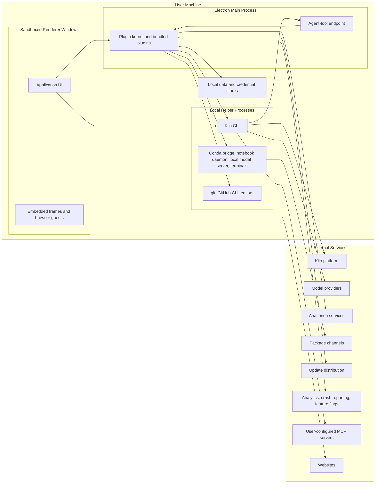
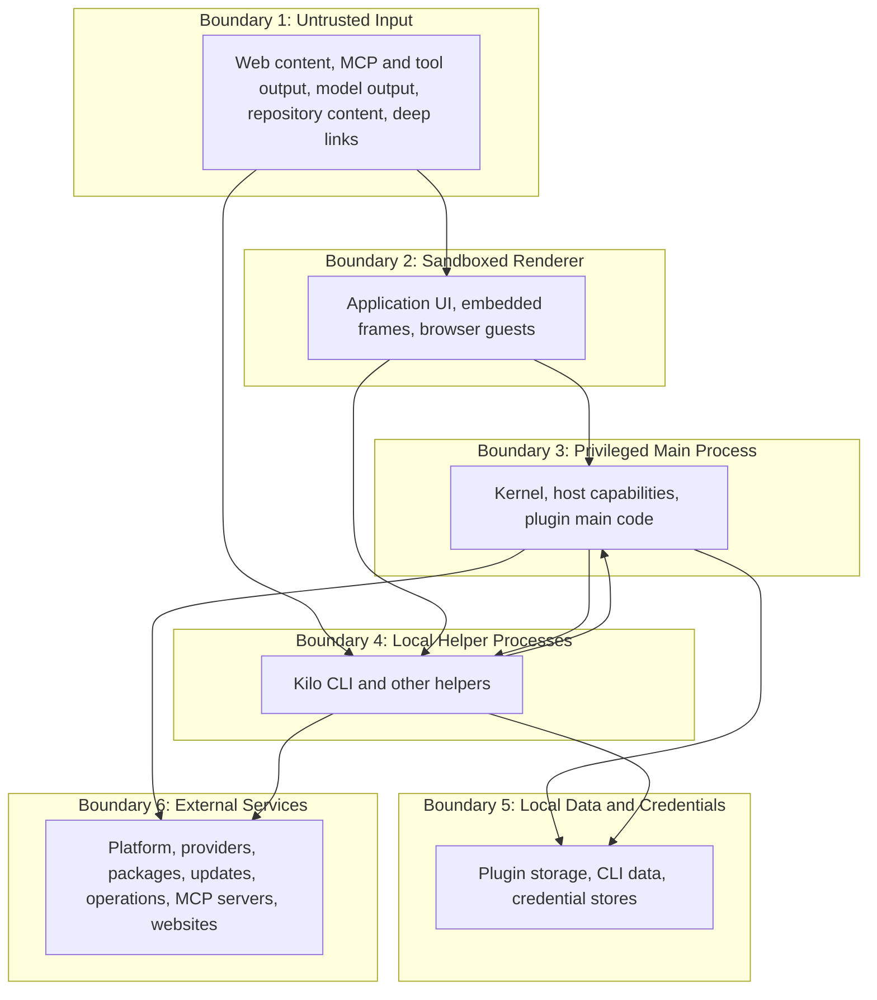
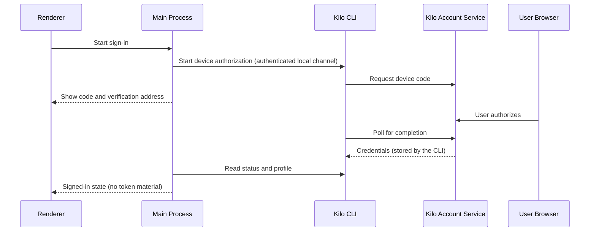
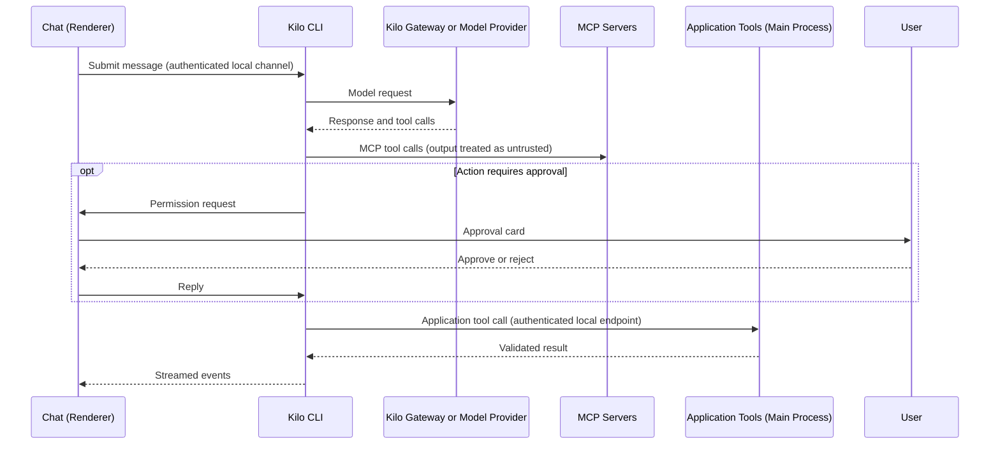
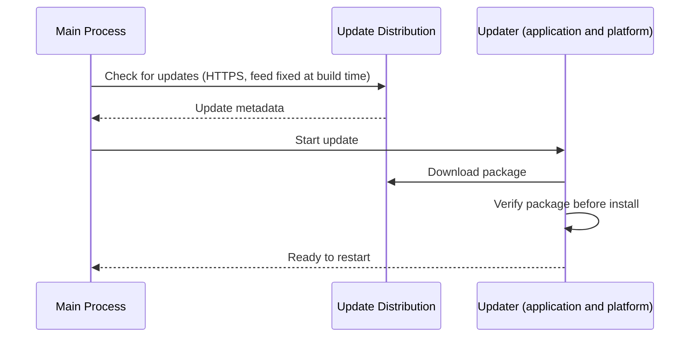
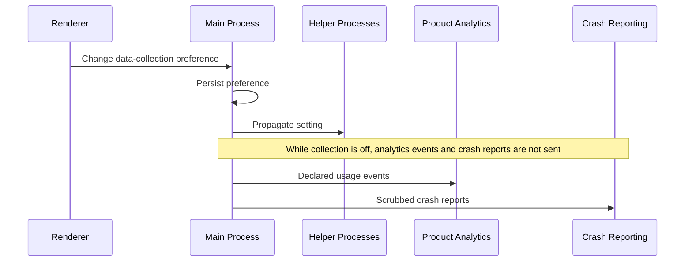
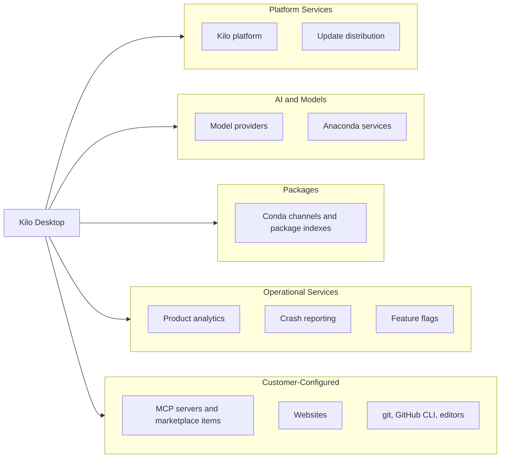

# Kilo Desktop Security Architecture Overview

## Document metadata

| Field            | Value                                                                                               |
| ---------------- | --------------------------------------------------------------------------------------------------- |
| Audience         | Customer security reviewers, technical due-diligence teams, and readers of the source code          |
| Document version | 1.5                                                                                                 |
| Document owner   | Kilo engineering                                                                                    |
| Codebase version | General review: 0195dc5b (2026-11-10); notebook helper update: 2026-11-13; Kilo v2 line: 2026-11-20 |
| Review cadence   | Quarterly, and before material trust-boundary, data-flow, or distribution changes                   |

## Version history

| Version | Date       | Summary                                                                                                                                                                            |
| ------- | ---------- | ---------------------------------------------------------------------------------------------------------------------------------------------------------------------------------- |
| 1.0     | 2026-11-05 | Established the repository-backed security architecture overview: topology, trust boundaries, identity and access model, data flows, controls, and integration inventory.          |
| 1.1     | 2026-11-09 | Agent controls: the application layers approval rules over the user's Kilo permission configuration for shell commands the CLI cannot otherwise constrain.                         |
| 1.2     | 2026-11-09 | Targeted update: frames in application windows have no peer-to-peer (WebRTC) networking or application bridge, and agent-generated pages stay in the frame they were delivered to. |
| 1.3     | 2026-11-10 | Feature flags: a signed-in Anaconda account's identifier and email join feature-flag evaluation as a linked account.                                                               |
| 1.4     | 2026-11-13 | Clarified notebook daemon identity verification while moving the embedded runtime to its stable release channel.                                                                   |
| 1.5     | 2026-11-20 | Kilo Code v2 server line (a build-time option): the application starts its own private v2 CLI tied to its lifetime, with data kept apart from v1 Kilo.                             |

## Maintainer agent update prompt

Use the following prompt when refreshing this document after repository changes. The prompt is intentionally self-contained so an agent can perform a repository-backed review without treating the current document as the sole source of truth.

```text
You are a software security engineer updating docs/security-architecture-overview.md for a customer security review.

Goal:
Refresh the document so it accurately describes the current Kilo Desktop repository's high-level security architecture: application topology, trust boundaries, identity and access model, data categories and local persistence, core data flows, security controls, third-party integrations, privacy handling, and shared responsibility. Keep it customer-facing: enough resolution for clarity and confidence without exposing internal operational detail.

Level of detail:
Kilo Desktop changes quickly, so the document describes boundary classes and control principles rather than individual features. Include a claim only if it would still hold after a typical month of feature work. Describe a new feature through the boundary class it falls under; add a trust-boundary row, data flow, or integration only when a change introduces a new kind of boundary, a new category of data leaving the machine, or a new external service. Leave per-feature mechanisms, tool-by-tool behavior, and feature-flagged or experimental capabilities to the code and plugin documentation.

Required workflow:
1. Read AGENTS.md, CONTEXT.md, docs/plugin-architecture.md (security sections), docs/agent-tools.md, and the current document.
2. Review repository changes since the document's Codebase version commit, then verify every claim in the document against the current implementation rather than trusting the document. Check for new boundary classes by looking at plugin manifests (host permissions, protocols, embedded hosts, agent tools), child processes the app spawns, local listeners and sockets, credential stores, outbound network destinations, and the build, signing, update, and release paths. For a full refresh, research areas in parallel (for example: Electron shell and kernel; agent, chat, and accounts; local helpers; telemetry, update, and release) and mark each existing claim as confirmed, partly true, or false against the code.
3. Distinguish repository-supported facts from live configuration. Do not claim that a provider, region, route, rollout, retention period, encryption setting, or signing configuration is active unless the evidence supports that claim. Use the labels Platform dependency, Feature-dependent, Customer-configured, Runtime-selected, or Production validation required.
4. Keep diagrams and narrative at a logical architecture level. Do not publish internal routes, hostnames, ports, URLs, environment-variable names, secret names, header names, token formats, class names, machine identifiers, retry counts, or file:line references. Vendor and product names are fine.
5. Describe controls as implemented. Never overclaim (for example "all", "every", "never", "only") unless the code enforces it everywhere; when a control has exceptions, state the principle at a scope where it holds. Keep the existing section structure.
6. Re-check customer-sensitive areas explicitly: renderer and embedded-content isolation, local listener authentication, agent tool approval, credential storage, artifact and update integrity, telemetry consent and identity linkage, feature-flag identity, and customer-configured integrations.
7. Update Mermaid diagrams, tables, and the Codebase version field. When the refresh changes the document, add one concise version-history row describing it and bump the Document version; preserve prior history rows.
8. Ensure the integration inventory reflects current repository support while making clear that live configuration requires environment-specific validation.
9. Validate the finished Markdown: run pnpm exec oxfmt docs/security-architecture-overview.md, inspect the diff, statically inspect Mermaid fences and syntax, and grep the file for hostnames, ports, environment-variable names, and file:line references (for example: grep -nE ':[0-9]+\b|https?://|localhost|127\.0\.0\.1|\b[A-Z][A-Z0-9]*_[A-Z0-9_]+\b|\.(com|org|io|ai|net)\b' docs/security-architecture-overview.md), then review every match; the match on this step's own pattern is expected.

Important constraints:
- This is not a penetration-test report, DPA, subprocessor list, or compliance attestation.
- Do not copy stale provider, residency, certification, privacy, or continuity claims from historical documentation without current evidence.
- Do not log, print, or copy credential values while researching.
- Keep legal and contractual claims in the authoritative legal or compliance documents; link or defer to them where appropriate.
- If live configuration is unavailable, state the validation requirement instead of guessing.
- Behavior implemented by bundled third-party components that this repository only configures (Kilo CLI, conda bridge, notebook daemon, local model runtime) belongs in the validation checklist, not stated as fact.
```

## 1. Purpose and scope

This document provides a high-level security architecture overview of Kilo Desktop, an Electron desktop application for agentic coding and data science work. It describes the logical application topology, trust boundaries, identity model, major data flows, local persistence, and external integrations represented by the current repository.

Kilo Desktop is evolving quickly, so the document describes boundary classes and control principles rather than individual features. It does not publish internal routes, ports, resource identifiers, secret names, or low-level runtime settings, and it does not replace a penetration-test report, data processing agreement, subprocessor list, or compliance attestation.

The repository establishes architectural intent and application-level controls. Some properties depend on the build and distribution environment — signing and notarization, the deployed update feed, configured service projects, and live service configuration — and require environment-specific validation (see section 12).

## 2. Executive overview

Kilo Desktop is a local application. Customer work happens on the customer's machine with the user's own operating-system privileges, and reaches external services through the flows summarized in section 6.3.

- **Electron shell.** A privileged main process hosts the application. Application windows run sandboxed, context-isolated renderers without Node.js access, and reach privileged operations through a narrow bridge that the main process verifies and validates.
- **Plugin kernel.** Product features are bundled, first-party plugins on a product-agnostic kernel. Plugins interact through the kernel's declared commands, extension points, and shared objects, and reach host capabilities through permissions declared in their manifests. Application plugins are bundled at build time; marketplace items extend the agent, not the application.
- **Agent runtime.** Agentic work is performed by the bundled Kilo CLI, which runs as a local process. It holds the user's Kilo account and model-provider credentials, talks to the model providers and MCP servers the user configures, and calls tools the application offers through an authenticated local endpoint.
- **Local helper processes.** Bundled helpers manage Python environments, execute notebooks, and optionally serve models on the device; terminals run interactive shells.
- **Embedded content.** Remote web pages, agent-generated pages, MCP-supplied interfaces, and embedded tool interfaces are rendered in isolated guest views or frames on dedicated origins.
- **External services.** The Kilo platform, model providers, Anaconda services, package channels, update distribution, product analytics, crash reporting, feature flags, websites the user opens, and MCP servers the user configures.

The architecture separates untrusted content from privileged operations through process isolation, a verified and validated IPC boundary, authenticated local channels, workspace path authorization, and approval controls on agent actions.

## 3. Logical application topology



### Component summary

| Layer                   | Description                                                                                      | Security relevance                                                                                                                       |
| ----------------------- | ------------------------------------------------------------------------------------------------ | ---------------------------------------------------------------------------------------------------------------------------------------- |
| Renderer windows        | Application UI for the bundled plugins                                                           | Sandboxed and context-isolated, without Node.js; content security policy; reach privileged operations through the kernel bridge          |
| Embedded content        | Browser pane, agent-generated pages, MCP-supplied interfaces, terminal and notebook interfaces   | Isolated guest views or frames on dedicated origins with their own content policies                                                      |
| Main process and kernel | Kernel, host capabilities, plugin main-process code, agent-tool endpoint                         | Privileged; verifies callers, validates calls, enforces declared permissions                                                             |
| Kilo CLI                | Agent runtime: chats, model calls, MCP servers, Kilo credentials                                 | Local process reached over an authenticated loopback channel; runs agent actions with the user's privileges                              |
| Other helper processes  | Environment management, notebook execution, local model serving, terminals, developer tools      | Separate operating-system processes over standard I/O, local sockets, or authenticated loopback channels                                 |
| Local stores            | Per-plugin storage, CLI data, shared Anaconda credentials, browser session, environments, models | Data at rest on the user's machine, protected by operating-system account permissions                                                    |
| External services       | Platform, model, package, update, operational, MCP, and web destinations                         | Explicit outbound trust boundaries; TLS for platform and vendor services, and the configured transport for customer-configured endpoints |

## 4. Trust boundaries



| Boundary                            | What crosses it                                                                            | Primary controls represented in the repository                                                                                                                                                                                                                                                                                                                                                                                                                                                                                                                                                                        |
| ----------------------------------- | ------------------------------------------------------------------------------------------ | --------------------------------------------------------------------------------------------------------------------------------------------------------------------------------------------------------------------------------------------------------------------------------------------------------------------------------------------------------------------------------------------------------------------------------------------------------------------------------------------------------------------------------------------------------------------------------------------------------------------- |
| Renderer to main process            | Calls, commands, state, and events between windows and the kernel                          | Calls accepted only from the application's own windows and origin; the caller's process derived from the transport rather than the request; call inputs and outputs schema-validated; host capabilities gated by manifest permissions; sensitive methods check their caller explicitly; unexpected errors scrubbed before crossing                                                                                                                                                                                                                                                                                    |
| Window and operating-system surface | Navigation, external links, deep links, clipboard, dialogs                                 | Navigation away from the application and new windows handed to the system browser; external links limited to an allowlist of schemes; deep links can only open declared in-app pages; clipboard access is write-only                                                                                                                                                                                                                                                                                                                                                                                                  |
| Embedded and untrusted content      | Remote web pages, agent-generated pages, MCP-supplied interfaces, embedded tool interfaces | Browser pane in a separate browser session with web permissions denied and no access to the application bridge; agent-generated pages and MCP-supplied interfaces in sandboxed frames; frames within application windows get no application bridge and no peer-to-peer (WebRTC) networking, which content security policies cannot restrict; an agent-generated page cannot move its frame to another embedded document to be delivered again; embedded interfaces on dedicated origins with host-specific content security policies; embedded hosts and custom schemes registered only under names a plugin declares |
| Local helper processes              | Requests, credentials, and event streams between the application and its helpers           | Loopback listeners by default, authenticated with credentials generated at launch; standard I/O where no listener is needed; helper processes verified when the application starts or attaches to them over a shared local socket                                                                                                                                                                                                                                                                                                                                                                                     |
| Agent and tools                     | Agent actions, application tool calls, MCP tool calls                                      | Application tools come from main-process plugin code and validate their inputs; in Kilo chats, tools declare an approval policy, and tools that change Python environments ask per action unless the user turns on auto-approve; other agent actions follow the user's Kilo permission configuration; external apps the user pairs reach only the tools offered to them, each with its own revocable credential; MCP and tool output treated as untrusted                                                                                                                                                             |
| Workspace files and developer tools | File browsing and editing, git operations, editor launches, terminals                      | File browsing, editing, and git operations authorized against the folders the user registers as workspaces, except cloning a repository into a new folder the user chooses for a new workspace; git, the GitHub CLI, and editors run with the user's privileges from the user's environment                                                                                                                                                                                                                                                                                                                           |
| Credentials                         | Kilo account, model-provider, and Anaconda credentials; helper credentials                 | Kilo sign-in performed by the CLI, with no Kilo token material used by desktop code; Anaconda credentials released only to permitted main-process callers; helper credentials generated per launch; application logging conventions exclude credentials                                                                                                                                                                                                                                                                                                                                                               |
| Network egress                      | Outbound traffic to external services                                                      | TLS through the platform network stack for application requests, honoring system proxy settings and using the platform's standard certificate validation                                                                                                                                                                                                                                                                                                                                                                                                                                                              |
| Update and release                  | Update metadata and packages; build artifacts                                              | Update feed fixed at build time and served over HTTPS; platform code signing, with packages checked before installation; frozen dependency lockfile and pinned, integrity-checked helper artifacts; publishing refuses unsigned macOS and Windows builds                                                                                                                                                                                                                                                                                                                                                              |

## 5. Identity and access model

### 5.1 Customer authentication

**Kilo account.** Sign-in uses the OAuth 2.0 device authorization grant against the Kilo account service, performed by the bundled Kilo CLI. The user completes authorization in their own browser. The application reads the signed-in state, profile email, and current organization from the CLI over its authenticated local channel and treats the user as signed out when the CLI cannot report a status.

**Anaconda account** (`Feature-dependent`). The user can also sign in to an Anaconda account to use Anaconda services. This uses the OAuth 2.0 authorization code grant with PKCE and a state value in the system browser, returning to a short-lived loopback callback. The resulting access token is exchanged for an Anaconda API key. The Anaconda account is a credential source only; the application's identity remains the Kilo account.

### 5.2 In-application authorization

All plugins are first-party code bundled with the application, and their main-process code runs with the main process's privileges. The kernel's permission model therefore organizes and constrains bundled code rather than sandboxing untrusted extensions. Its principles are:

- **Verified senders.** Only the application's own windows, on the application's own origin, can use the kernel transport.
- **Transport-derived callers.** The calling process is taken from the transport, never from the request, and windows cannot act as the main process.
- **Validated calls.** Calls and their results are schema-validated, and only declared methods are dispatched.
- **Declared permissions.** Host capabilities require a permission in the calling plugin's manifest, and custom schemes and embedded hosts require a declared name.
- **Explicit checks on sensitive methods.** Methods that hand out control of the agent or release credentials check their caller explicitly, and credentials reserved for the main process are not released to windows.

### 5.3 Local service authentication

Local helper channels are authenticated rather than trusted by address. The application's helper and tool listeners bind the loopback interface by default and require credentials generated at launch, or issued when the user pairs an external app, and the application passes launch credentials only to the components that need them. Helpers that need no listener communicate over standard input and output. When the application starts or attaches to a helper over a shared local socket, it verifies the helper process. For the notebook daemon, this means the spawned child identity or a pinned executable digest, with trusted macOS signing identities as an alternative for a shared daemon. Moving the embedded notebook runtime to the stable channel preserves those checks; it does not trust a process merely because it owns the endpoint. Serving the local model server on the local network is an explicit user setting. Builds made for the Kilo Code v2 server line start their own private Kilo CLI rather than attaching to a shared background service: it listens on loopback with launch credentials, accepts cross-site calls only from the application's own window origins, and exits when the application closes its standard input.

### 5.4 Credential storage

| Credential                        | Holder                                                                                                                                                                                                       |
| --------------------------------- | ------------------------------------------------------------------------------------------------------------------------------------------------------------------------------------------------------------ |
| Kilo account credentials          | Held by the Kilo CLI in its own credential store, shared with other Kilo clients                                                                                                                             |
| Model-provider API keys           | Stored through the Kilo CLI; the provider settings page lets the user view or replace a stored key                                                                                                           |
| Anaconda API key                  | Stored in the Anaconda credential store shared with the Anaconda CLI and conda, in a file or the operating-system keychain according to the shared Anaconda configuration (`Production validation required`) |
| Helper and agent-tool credentials | Generated per launch; tokens for paired external apps are stored as hashes until the user revokes them                                                                                                       |

Credentials at rest rely on operating-system account protections, and application logging conventions exclude credentials.

## 6. Data categories and persistence

### 6.1 High-level data categories

| Data category             | Examples                                                                                 | Typical processing context                                   |
| ------------------------- | ---------------------------------------------------------------------------------------- | ------------------------------------------------------------ |
| Identity and account data | Account email, organization, account credentials                                         | Sign-in, account features, authenticated service calls       |
| Workspace content         | Repository files, notebooks, terminal output, git history                                | Agent sessions, notebook execution, file and git views       |
| AI and session content    | Prompts, model responses, tool calls and results, chat history                           | Agent sessions through the CLI and the configured providers  |
| Configuration             | Preferences, plugin settings, workspaces, MCP servers, installed agents and skills       | Application, CLI, and feature configuration                  |
| Provider credentials      | Model-provider and Anaconda API keys                                                     | Authenticating user-selected external services               |
| Browsing data             | Cookies and site storage in the browser pane                                             | Pages opened in the browser pane                             |
| Usage and diagnostic data | Declared usage events, crash reports, installation identifier, account email, local logs | Consent-gated analytics and crash reporting; troubleshooting |
| Downloaded artifacts      | Models, packages, update packages                                                        | Local inference, environment management, updates             |

### 6.2 Persistence surfaces

| Persistence surface       | Primary role                                  | Notes for security review                                                                                                          |
| ------------------------- | --------------------------------------------- | ---------------------------------------------------------------------------------------------------------------------------------- |
| Per-plugin storage        | Preferences and plugin state                  | One directory per plugin in the application data directory                                                                         |
| Kilo CLI data             | Chats, configuration, credentials             | Managed by the CLI in the user's data and configuration directories; the Kilo Code v2 line keeps separate directories from v1 Kilo |
| Anaconda credential store | Anaconda API key                              | Shared with Anaconda tools                                                                                                         |
| Browser pane session      | Cookies and site data                         | Persistent and separate from the application session                                                                               |
| Environments and models   | Python environments, packages, local models   | In the user's home and application data directories                                                                                |
| Workspaces                | Repositories and notebooks the user registers | User-selected folders edited in place                                                                                              |

Local data is protected by operating-system account permissions and the disk encryption the user enables. Local data is retained until the user deletes it or uninstalls the application.

### 6.3 What leaves the machine

The main categories of outbound traffic are:

- **AI traffic.** Prompts, workspace context, and tool results sent by the CLI to the Kilo gateway or the providers the user selects; traffic to MCP servers the user configures; web access by the agent's tools.
- **Account traffic.** Kilo and Anaconda sign-in and account information.
- **Packages and models.** Package downloads from conda channels and package indexes, marketplace items, and local models from the Anaconda catalog.
- **Web content.** Pages opened in the browser pane, with a site-icon lookup that sends each visited site's host name to a third-party icon service, and public CDN resources used by agent-generated pages and embedded interfaces.
- **Developer tooling.** Git and pull-request traffic performed by the user's own git and GitHub CLI.
- **Operations.** Update checks and downloads; consent-gated product analytics and crash reports; feature-flag evaluation, which carries the signed-in account's email and organization, and the identifier and email of a signed-in Anaconda account (section 10.1).

## 7. Core data flows

### 7.1 Kilo sign-in flow



### 7.2 Agent session and tool flow



Agent actions run through the CLI with the user's privileges. Which actions ask first is determined by each tool's approval policy and by the user's Kilo permission configuration, over which the application layers rules that make shell commands with unchecked write destinations, such as archive extraction, ask first; when the user turns on auto-approve, the chat answers permission requests on the user's behalf.

### 7.3 Auto-update flow



Update packages are verified before installation on each platform, and macOS and Windows releases are code-signed. Linux installations update by installing a newer release package. Release notes are validated before display and rendered without raw HTML.

### 7.4 Telemetry flow with consent gating



## 8. Security controls summary

| Control area                  | Architecture-level control                                                                                                                                                                                         |
| ----------------------------- | ------------------------------------------------------------------------------------------------------------------------------------------------------------------------------------------------------------------ |
| Renderer containment          | Sandboxing, context isolation, and no Node.js in application windows; content security policy; developer tools disabled in packaged builds                                                                         |
| Embedded content isolation    | Separate browser session for remote pages; sandboxed frames for agent-generated pages and MCP-supplied interfaces, without peer-to-peer networking; dedicated origins and content policies for embedded interfaces |
| IPC hardening                 | Sender verification, transport-derived callers, schema validation, declared permissions, and explicit caller checks on sensitive methods                                                                           |
| Process hardening             | Single-instance lock; Electron fuses that prevent running as Node.js and enforce application archive integrity; packaged builds refuse debugging flags                                                             |
| Local channel security        | Loopback listeners with per-launch credentials by default; standard I/O where possible; helper identity verification on shared sockets                                                                             |
| Agent controls                | Validated application tools; per-tool approval policies; user-controlled permission configuration and auto-approve; application-supplied approval rules for shell commands the CLI cannot otherwise constrain      |
| Path authorization            | Workspace-folder authorization for file browsing, editing, and git operations (a clone for a new workspace goes only into a folder that does not exist yet); plugin storage confined to each plugin's directory    |
| Secret handling               | Kilo credentials kept in the CLI; caller-restricted release of credentials, with main-process-only credentials withheld from windows; per-launch helper credentials; logging conventions that exclude credentials  |
| Artifact and update integrity | Frozen lockfile with integrity hashes; pinned, digest-verified helper artifacts; catalog model downloads verified before install; signed releases; HTTPS update feed                                               |
| Privacy controls              | One data-collection preference for analytics and crash reporting; declared events only; crash data scrubbing                                                                                                       |
| Supply chain                  | Third-party CI actions pinned by commit; build-script allowlist; automated dependency updates; SBOMs for releases                                                                                                  |

## 9. Third-party integration topology



### 9.1 Integration status legend

| Status                         | Meaning                                                                                                 |
| ------------------------------ | ------------------------------------------------------------------------------------------------------- |
| Platform dependency            | Required for the application to function as distributed                                                 |
| Feature-dependent              | Invoked when the relevant capability is used or enabled; live enablement requires validation            |
| Customer-configured            | Opt-in integration or endpoint selected and configured by the user                                      |
| Runtime-selected               | Supported by the repository, but the active provider or route is determined outside static source code  |
| Production validation required | Referenced by code or configuration, but live details must be confirmed before making an external claim |

### 9.2 Integration inventory

| Provider or service                | Status                                         | Security-relevant role                                                                             |
| ---------------------------------- | ---------------------------------------------- | -------------------------------------------------------------------------------------------------- |
| Kilo account service and gateway   | Platform dependency                            | Sign-in, account and organization data, default model gateway used by the CLI, marketplace catalog |
| Model providers                    | Customer-configured or runtime-selected        | Process prompts, workspace context, and tool data per the user's configuration                     |
| Anaconda services                  | Feature-dependent                              | Account sign-in, API key issuance, and the local model catalog                                     |
| Conda channels and package indexes | Feature-dependent or customer-configured       | Package downloads for environments, notebooks, and the local model runtime                         |
| Public script CDNs                 | Feature-dependent                              | Allowlisted resources for agent-generated pages and embedded interfaces                            |
| PostHog                            | Feature-dependent                              | Product analytics for declared events; consent-gated                                               |
| Sentry                             | Feature-dependent                              | Crash and error reporting; consent-gated and scrubbed                                              |
| LaunchDarkly                       | Feature-dependent (enabled in official builds) | Feature-flag evaluation; receives account identity once signed in                                  |
| Google site-icon service           | Feature-dependent                              | Receives the host names of sites opened in the browser pane                                        |
| Update distribution                | Production validation required                 | Hosts update metadata, packages, and release notes                                                 |
| Build-time package sources         | Platform dependency (build time)               | Supply the pinned CLI and helper artifacts, verified by integrity hashes or digests                |
| MCP servers and marketplace items  | Customer-configured                            | Extend agent capabilities with the user's privileges; output treated as untrusted                  |
| Websites                           | Customer-configured                            | Remote content in the isolated browser pane                                                        |
| git, GitHub CLI, and editors       | Customer-configured                            | Run with the user's privileges and their own sign-in; no GitHub token stored by the application    |

Builds without analytics, crash-reporting, or feature-flag project configuration send nothing to those services and use built-in flag defaults.

## 10. Privacy, logging, and retention considerations

### 10.1 Privacy handling

Content and configuration stay on the user's machine except for the flows in section 6.3. Analytics and crash reporting are governed by one data-collection preference, which is on by default and can be turned off in Privacy settings; changes take effect without restarting the application. Development builds do not send analytics.

Only declared events are sent. Events carry application, platform, and feature-usage properties, not file contents, prompts, or chat content. Before sign-in, events are attributed to an anonymous installation identifier; after sign-in, they are attributed to the account email and linked to that identifier. The installation identifier is also passed to the bundled CLI, which uses it as its anonymous machine identifier.

Feature-flag evaluation is separate from analytics and is not governed by the data-collection preference. It uses an anonymous context before sign-in and, after sign-in, the account email and organization. Whenever the user is signed in to an Anaconda account, with or without a Kilo sign-in, that account's identifier and email are added as a separate context, so flags can target Anaconda users.

### 10.2 Logging safety

Application logging conventions exclude tokens, credentials, and authentication material. Crash reporting scrubs home paths, operating-system user names, and host names before sending, and excludes AI inputs and outputs, request bodies, cookies, and user information. Local logs remain on the user's machine.

### 10.3 Data residency and retention

Local data is retained until the user deletes it or uninstalls the application. Data sent to external services is retained according to the applicable provider's terms and the user's configuration; residency and retention commitments should be stated only in contractual or product documentation after validation against the live service inventory.

## 11. Shared responsibility

Kilo Desktop provides application-level controls for renderer and content isolation, validated IPC, authenticated local channels, workspace path authorization, credential handling, artifact and update integrity, agent approval controls, and consent-gated telemetry. Users remain responsible for decisions that expand their trust boundary, including:

- Which model providers, gateways, and credentials they configure, and those providers' data policies.
- Which MCP servers, marketplace items, and integrations they install or connect, and the trustworthiness of their output.
- Their Kilo permission configuration and whether to enable auto-approve, since agent actions run with the user's privileges.
- Which folders they register as workspaces, and which repositories, notebooks, and packages they let the agent work with.
- Reviewing approval requests and generated changes before applying or merging them.
- Commands they run in terminals, code they run in notebooks, and sites they open in the browser pane.
- Whether to serve the local model server on the local network.
- Securing their own machine, operating-system account, and disk.

## 12. Environment-specific validation checklist

Before external publication or use as contractual evidence, validate the following against the live build and distribution environment:

1. Code-signing and notarization configuration for each shipped platform, and the protection of signing credentials.
2. The deployed update feed for each release track, its transport security and access controls, and update package verification on each platform.
3. Analytics, crash-reporting, and feature-flag project configuration per environment, data dictionaries, and effective consent enforcement in shipped builds.
4. The Anaconda credential store backend in effect per platform and configuration.
5. Live Anaconda service configuration, including the model catalog and the OAuth client.
6. Default conda channel and package index configuration, and any organization-specific overrides.
7. Behavior of bundled third-party components that this repository configures but does not implement — the Kilo CLI, conda bridge, notebook daemon, and local model runtime — including credential storage, permission handling, process environment handling, network behavior, and content isolation; and, for the Kilo Code v2 CLI, which offers no telemetry setting the application could propagate, that it collects no usage data of its own.
8. Current DPA, subprocessor list, and vendor assurance documentation for the services in section 9.
