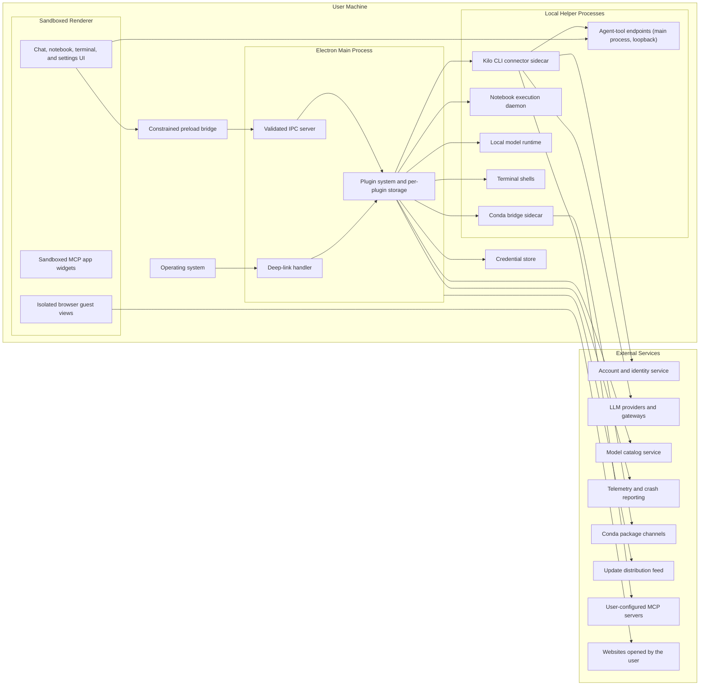
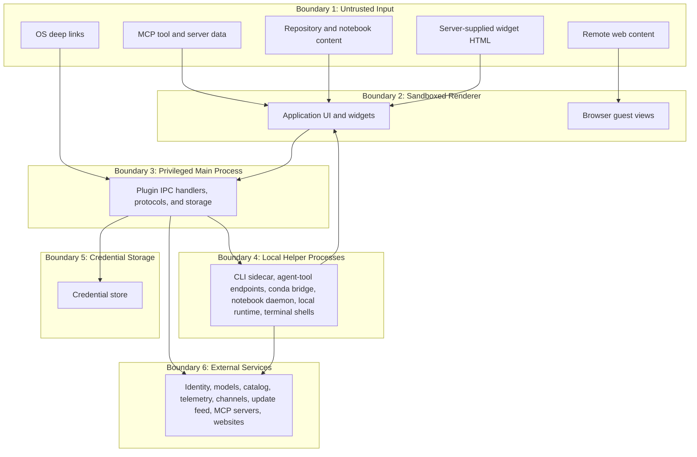
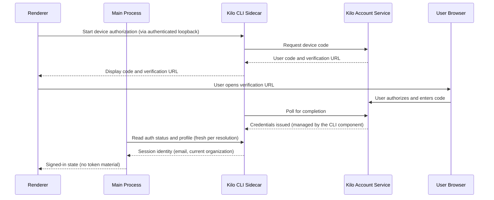
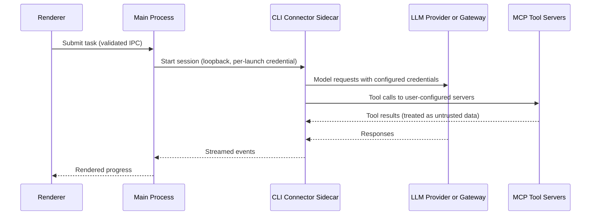
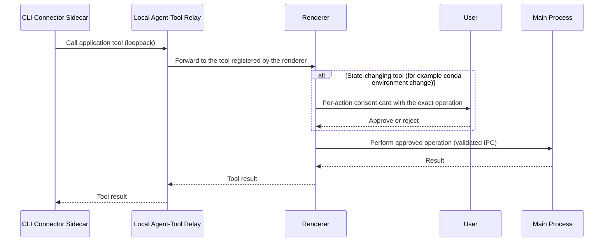
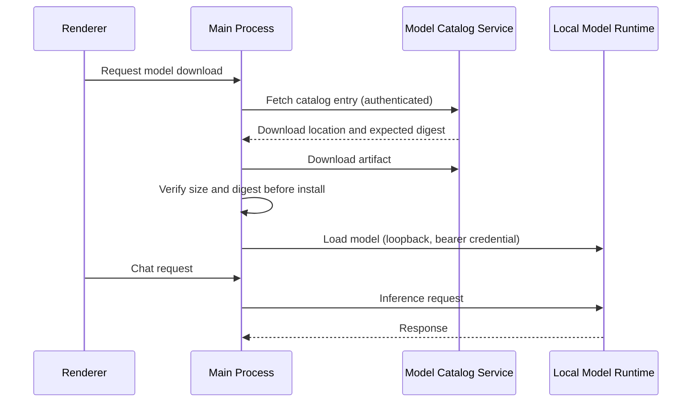
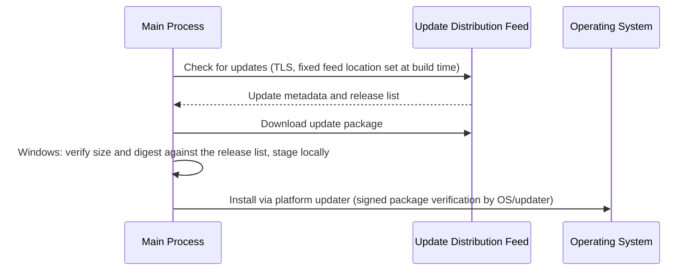
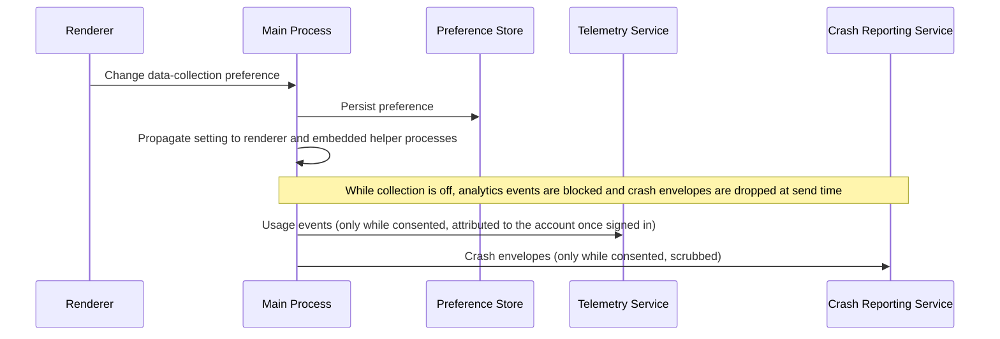

# Kilo Desktop Security Architecture Overview

## Document metadata

| Field            | Value                                                                             |
| ---------------- | --------------------------------------------------------------------------------- |
| Audience         | Customer security reviewers and technical due-diligence teams                     |
| Document owner   | Kilo engineering                                                                  |
| Document version | 1.3                                                                               |
| Last reviewed    | 2026-10-02, commit c167d3e06ab8b29ff87e77b91d24151f86b48204                       |
| Review cadence   | Quarterly, and before material trust-boundary, data-flow, or distribution changes |

## Version history

| Version | Date       | Summary                                                                                                                                                                                                                                                                                                                                                                                                                                                                                                                                           |
| ------- | ---------- | ------------------------------------------------------------------------------------------------------------------------------------------------------------------------------------------------------------------------------------------------------------------------------------------------------------------------------------------------------------------------------------------------------------------------------------------------------------------------------------------------------------------------------------------------- |
| 1.0     | 2026-09-29 | Established the repository-backed security architecture overview: topology, trust boundaries, attacker model, data flows, and integration inventory.                                                                                                                                                                                                                                                                                                                                                                                              |
| 1.1     | 2026-10-02 | Added the embedded browser, interactive terminal, OS deep links, Kilo marketplace, and renderer-provided agent tools (with per-action consent) as boundaries; expanded the boundary table to every register boundary; corrected credential-storage backend selection; documented account-linked telemetry identity, the default-on data-collection setting, feature-flag identity flow (LaunchDarkly), the Windows update mirror, and the favicon lookup service. Register sync removed the retired Anaconda sign-in and Anaconda MCP boundaries. |
| 1.2     | 2026-10-09 | Recorded the nteract notebook frame as accepted design: pinned/verified bundle, origin+CSP isolation (sandbox omitted as a no-op), origin-checked port handshake, and audited host-method surface.                                                                                                                                                                                                                                                                                                                                                |
| 1.3     | 2026-10-28 | Recorded known limits of notebook daemon peer authentication (check is not bound per connection, readiness probe precedes it, no Windows same-user check).                                                                                                                                                                                                                                                                                                                                                                                        |

## Maintainer agent update prompt

Use the following prompt when refreshing this document after repository changes. The prompt is intentionally self-contained so an agent can perform a repository-backed review without treating the current document as the sole source of truth. The `security-architecture` skill (`.agents/skills/security-architecture/SKILL.md`) implements this prompt.

```
You are a software security engineer updating docs/security/security-architecture.md for a customer security review.

Goal:
Refresh the document so it accurately describes the current Kilo Desktop repository's high-level security architecture: application topology, trust boundaries, identity and access model, data categories and persistence, core data flows, security controls, third-party integrations, privacy handling, and shared responsibility. Keep the document customer-facing: enough resolution for clarity and confidence without exposing internal operational detail.

Required workflow:
0. Sync the boundary register first: follow docs/security/register-sync.md against docs/security/boundary-register.md and fix the register itself (it is shared with the threat-model scan).
1. Read CONTEXT.md, AGENTS.md, the current document, and the synced docs/security/boundary-register.md (the boundary seed — never copy it verbatim). Read plugin docs (plugins/*/) for changed areas before editing.
2. Review repository changes since the document's Last-reviewed commit and inspect the current implementation. At minimum, examine the Electron main/renderer/preload split, IPC server and sender verification, webPreferences and content security policy, custom protocol and embedded web hosts, the embedded browser, the terminal, OS deep links, the Kilo CLI connector sidecar, MCP servers and the agent-tool endpoints, renderer-provided agent tools, the marketplace, the conda bridge, the notebook daemon, the local model runtime, auth and keyring backends, telemetry and crash reporting, and the auto-update and release paths.
3. Distinguish repository-supported facts from operational configuration. Do not claim that a provider, region, route, rollout, retention period, encryption setting, or signing configuration is active unless the evidence supports that claim. Use the labels Platform dependency, Feature-dependent, Customer-configured, Runtime-selected, or Production validation required.
4. Keep diagrams and narrative at a logical architecture level. Do not publish internal routes, hostnames, ports, URLs, environment-variable names, secret names, queue or binding names, class names, token formats, header names, machine identifiers, retry counts, or file:line references. Source file paths are acceptable in the Internal evidence baseline section only.
5. Re-check customer-sensitive areas explicitly: renderer and embedded-content isolation, loopback listener authentication, credential storage backend selection, model artifact and update integrity, telemetry consent, identity linkage and opt-out propagation, logging redaction, agent tool consent, and customer-configured integrations.
6. Update Mermaid diagrams, tables, the Last-reviewed field, Document version, and Version history. Add one concise version-history row describing the refresh (including register-sync changes). Preserve prior history rows.
7. Ensure the integration inventory reflects current repository support while making clear that live configuration requires environment-specific validation.
8. Validate the finished Markdown: run the repository formatter, inspect the diff, and statically inspect Mermaid fences and syntax.

Important constraints:
- This is not a penetration-test report, DPA, subprocessor list, or compliance attestation.
- Do not copy stale provider, residency, certification, privacy, or continuity claims from historical documentation without current evidence.
- Do not log, print, or copy credential values while researching.
- Keep legal and contractual claims in the authoritative legal or compliance documents; link or defer to them where appropriate.
```

## 1. Purpose and scope

This document provides a high-level security architecture overview of the Kilo Desktop application. It describes the logical application topology, major data flows, trust boundaries, local persistence, and external integrations represented by the current repository.

The document is intentionally more abstract than an internal engineering runbook. It does not publish internal routes, ports, resource identifiers, secret names, or low-level runtime settings. It also does not replace a penetration-test report, data processing agreement, subprocessor list, or compliance attestation. The companion threat-model scan (a dated, internal, point-in-time STRIDE+Privacy assessment) is produced separately by the `threat-model` skill and is not published.

The repository establishes architectural intent and application-level controls. Some properties depend on the build and distribution environment — signing and notarization configuration, the deployed update feed, and the active model catalog service — and require environment-specific validation (see section 13).

## 2. Executive overview

Kilo Desktop is an Electron application that combines a sandboxed user interface with a privileged main process, a plugin system, and several locally executed helper components:

- Customer work happens in a sandboxed renderer (chat, notebook, file tree, git, terminal, browser, and settings UI) whose only access to privileged operations is a narrow, validated IPC surface and a constrained preload API.
- The Electron main process hosts the feature/plugin system. Plugins contribute IPC handlers, UI, storage, and (for some) helper processes, and are the unit of feature isolation inside the app.
- Locally executed helper components run as separate processes: the Kilo CLI connector sidecar that performs agentic coding work, a bundled conda bridge for Python environment management, a notebook execution daemon, an optional local model runtime for on-device inference, and interactive terminal shells started on the user's request.
- An embedded browser panel renders arbitrary remote web pages in isolated, sandboxed guest views that share no session with the application UI.
- MCP (Model Context Protocol) tool servers, marketplace-installed agents and skills, and user-configured integrations extend the agent's capabilities; their data and outputs are treated as untrusted input. The application UI also offers a small set of its own tools to the agent (for example opening a file or notebook, reading terminal output, managing conda environments), served from the main process over an authenticated loopback MCP endpoint; for the built-in agent, tools that change state on the user's machine require per-action user consent. The user can also pair external AI apps (for example Cursor or Claude Code) with a separate, off-by-default, token-protected endpoint; those apps' own approval settings govern their calls.
- The operating system can launch the app through a registered deep-link scheme; incoming links are strictly validated and can only select a plugin-declared in-app page.
- Outbound network access is limited to services the user interacts with explicitly: the account/identity service, LLM providers and gateways, the model catalog, telemetry and crash reporting (consent-gated), conda package channels, the update feed, web pages the user opens in the embedded browser, and user-configured MCP servers.

The architecture separates untrusted content (web content, MCP tool data, server-supplied HTML, repository content, deep links) from privileged operations through process isolation, a validated IPC boundary, sender-origin verification, per-plugin storage scoping, consent gates on mutating agent tools, and authenticated loopback channels to helper processes.

## 3. Application topology



| Layer                  | Description                                                                                                                | Security relevance                                                                            |
| ---------------------- | -------------------------------------------------------------------------------------------------------------------------- | --------------------------------------------------------------------------------------------- |
| Sandboxed renderer     | All application UI, server-supplied MCP app widget HTML in sandboxed frames, and isolated guest views for remote web pages | Untrusted-content containment; no direct OS or Node access; browser guests have no app bridge |
| Preload bridge         | Minimal exposed API between renderer and main                                                                              | Defines the entire renderer-reachable surface                                                 |
| Electron main process  | Plugin system, IPC server, storage, sidecar management, deep-link handling                                                 | Privileged operations; enforces validation and sender verification                            |
| Local helper processes | CLI connector, agent-tool endpoints, conda bridge, notebook daemon, local model runtime, terminal shells                   | Separate processes; loopback or stdio channels; execution isolated from the UI                |
| Credential store       | Shared Anaconda credential file, OS keychain, or user config, per backend selection (section 6.2)                          | Protection of account and provider tokens at rest                                             |
| External services      | Identity, models, catalog, telemetry, channels, updates, user-configured MCP servers, user-browsed websites                | Explicit outbound trust boundaries over TLS                                                   |

## 4. Trust boundaries



| Boundary                                  | What crosses it                                                                                                 | Primary controls                                                                                                                                                                                                                                                                                                                                                                                                                                                                                                                                           |
| ----------------------------------------- | --------------------------------------------------------------------------------------------------------------- | ---------------------------------------------------------------------------------------------------------------------------------------------------------------------------------------------------------------------------------------------------------------------------------------------------------------------------------------------------------------------------------------------------------------------------------------------------------------------------------------------------------------------------------------------------------- |
| Renderer ↔ main IPC                       | Feature invocations, event subscriptions, message ports                                                         | Sender-origin verification per call, schema validation of payloads in both directions, error scrubbing, sandboxed renderer with context isolation and no Node integration                                                                                                                                                                                                                                                                                                                                                                                  |
| Renderer preload surface                  | The only privileged API visible to the renderer                                                                 | Minimal allowlisted channels exposed through the context bridge                                                                                                                                                                                                                                                                                                                                                                                                                                                                                            |
| Renderer ↔ OS shell                       | Requests to open URLs, reveal files, use the clipboard, show native dialogs                                     | URL scheme allowlist before any OS handoff; no direct renderer access to shell APIs; context-menu link actions go through the same allowlist                                                                                                                                                                                                                                                                                                                                                                                                               |
| OS deep links                             | App-scheme links from browsers, other apps, or the command line                                                 | Strict scheme, host, and single-segment validation; only plugin-declared hosts accepted; links can only select an in-app page and a single bounded parameter, never trigger an action directly                                                                                                                                                                                                                                                                                                                                                             |
| Event bus                                 | Fire-and-forget events between features and renderer windows                                                    | Events originate in privileged code; payloads delivered only to the application's own windows                                                                                                                                                                                                                                                                                                                                                                                                                                                              |
| Shell ↔ plugin SDK sandbox                | Per-plugin storage, configuration, and capability lookups                                                       | Per-plugin storage scoping, filesystem path-escape rejection, configuration namespace validation                                                                                                                                                                                                                                                                                                                                                                                                                                                           |
| Pane windows                              | Additional native windows opened by the renderer for detached panes                                             | Schema-validated window descriptors; same sandbox, context isolation, and preload constraints as the main window                                                                                                                                                                                                                                                                                                                                                                                                                                           |
| Plugin custom protocols                   | Renderer fetches to plugin-owned schemes (for example diff content)                                             | Privileged scheme registration restricted to manifest-declared schemes; path traversal guards; origin checks                                                                                                                                                                                                                                                                                                                                                                                                                                               |
| Embedded web hosts                        | Plugin-served bundles (notebook UI, terminal UI) in frames with a message port                                  | Dedicated content-security profile for active untrusted content; host registration validation; the notebook frame runs a pinned, sha256-verified first-party bundle isolated by dedicated origin and CSP (frame sandbox attribute intentionally omitted as a no-op); origin-checked, versioned port handshake; audited, minimal host-method surface with dangerous methods denied or stubbed                                                                                                                                                               |
| Embedded browser                          | Arbitrary remote web pages chosen by the user or agent                                                          | Separate persistent browser session; every permission request denied; guests forced to sandboxed, context-isolated, no-Node, no-preload settings; only http(s) navigation; pop-ups stay in the guest; leases bound to the trusted app window                                                                                                                                                                                                                                                                                                               |
| MCP app widgets                           | Server-supplied HTML rendered in chat                                                                           | Sandboxed frames without same-origin access; JSON-RPC bridge with scoped tool calls; size clamping                                                                                                                                                                                                                                                                                                                                                                                                                                                         |
| MCP apps fetch                            | UI resources referenced by MCP servers                                                                          | Fetched by main through the application's network stack and rendered only inside sandboxed widget frames                                                                                                                                                                                                                                                                                                                                                                                                                                                   |
| Connector sidecar (Kilo CLI)              | Work requests, credentials, configuration                                                                       | Loopback-only listener with per-launch credentials; scrubbed child-process environment; CLI artifacts resolved from a frozen lockfile with registry checksums                                                                                                                                                                                                                                                                                                                                                                                              |
| MCP tool servers and agent-tool endpoints | Tool calls from the agent and paired external AI apps to MCP servers and to tools offered by the application UI | MCP outputs treated as untrusted; application tools come only from the application renderer over IPC, so no other process can add or rename them; loopback endpoints with bearer tokens that reject browser requests; for the built-in agent, state-changing application tools (for example conda environment changes) require per-action user consent; external apps are off by default, paired per app with revocable tokens, and never receive chat context; remote URLs, local files, and non-named channels refused for agent-driven package installs |
| Kilo marketplace                          | Agents, skills, and MCP servers installed from a catalog                                                        | Catalog, install, and removal delegated to the CLI over its authenticated loopback interface; explicit user action per install; workspace or global scope chosen by the user                                                                                                                                                                                                                                                                                                                                                                               |
| Terminal                                  | Interactive shells started on user request                                                                      | Main-owned shell sessions; starting directory confined to the user's home or a registered workspace; application-internal environment variables removed from the shell environment                                                                                                                                                                                                                                                                                                                                                                         |
| Conda bridge sidecar                      | Environment and package management requests                                                                     | Bundled helper over stdio (no listener); consent-gated agent mutations                                                                                                                                                                                                                                                                                                                                                                                                                                                                                     |
| Notebook daemon                           | Notebook execution requests                                                                                     | Local socket (per-user on macOS/Linux) with peer-credential (process identity) checks, not yet bound to every connection; telemetry permission gated on consent and activity                                                                                                                                                                                                                                                                                                                                                                               |
| Local model serving                       | Model downloads and inference requests                                                                          | Model files verified by size and digest before use; runtime bound to loopback by default with a bearer credential; local-network exposure only by explicit user setting                                                                                                                                                                                                                                                                                                                                                                                    |
| External editor and git processes         | Editor launches and git commands on workspace folders                                                           | Workspace-folder confinement; executables resolved from the user's environment and run with the user's privileges                                                                                                                                                                                                                                                                                                                                                                                                                                          |
| Auth and credentials                      | Account identity and provider tokens                                                                            | Account credentials held by the CLI component, not desktop code; identity read fresh from the sidecar and degraded to anonymous on failure; credential values never logged                                                                                                                                                                                                                                                                                                                                                                                 |
| Network egress                            | Model requests, telemetry, downloads, update checks                                                             | TLS everywhere through the platform network stack (honoring system proxy and certificate stores); certificate validation never disabled                                                                                                                                                                                                                                                                                                                                                                                                                    |
| Telemetry and crash reporting             | Usage events and crash envelopes                                                                                | Single shared consent preference, enforced per event and at send time, propagated to the renderer and helper processes                                                                                                                                                                                                                                                                                                                                                                                                                                     |
| Auto-update                               | Update metadata and packages                                                                                    | Feed location fixed at build time over TLS; size and digest checks against the feed's release list; platform signing and OS updater verification                                                                                                                                                                                                                                                                                                                                                                                                           |
| Release automation                        | Signing and publishing of release artifacts                                                                     | Release track orchestration with version checks; signing credentials confined to publishing jobs; SBOM generation with pinned tooling                                                                                                                                                                                                                                                                                                                                                                                                                      |

## 5. Attacker model and out-of-scope categories

### Attacker model

Remote web content, MCP/tool data, and OS deep links are untrusted. A compromised renderer is in scope — the Electron sandbox, preload constraints, and IPC validation exist to contain it. Agent behavior influenced by untrusted content (prompt injection) is in scope where it can reach application-provided tools or install integrations without user consent. Same-user local processes are in scope only where the app introduces a new local listener (loopback servers, sockets, the agent-tool endpoints) that widens what such a process can reach. The OS user, physical access, and a compromised operating system are out of scope.

### Out of scope

| Category                          | Rationale                                                                                                      |
| --------------------------------- | -------------------------------------------------------------------------------------------------------------- |
| OS user and physical access       | The app runs with the user's own privileges by design                                                          |
| Compromised operating system      | No application-level control can defend against a compromised OS                                               |
| LLM provider data handling        | Data sent to a configured model provider is governed by that provider's policies                               |
| External MCP server behavior      | User-configured MCP servers are outside the app's trust boundary; their outputs are treated as untrusted input |
| User-modified local configuration | Users control their own configuration; modifying one's own config is not an attack vector                      |
| Commands the user runs            | Terminal sessions and notebook code execute as the user by design                                              |

## 6. Identity and access model

### 6.1 Customer authentication

Sign-in uses the OAuth 2.0 device authorization grant against the Kilo account service, driven by the embedded Kilo CLI component. The desktop UI displays a short-lived user code and verification URL; the user completes authorization in their browser, and the CLI polls for completion. The desktop application never handles the user's account credentials or token material directly: the main process derives session state (signed-in status, profile email, current organization) by querying the CLI sidecar over its authenticated loopback interface, reads fresh on each resolution, and degrades to anonymous on any failure rather than serving a stale identity. No local OAuth callback listener is used.

### 6.2 Credential storage

Kilo account credentials are managed by the embedded CLI component (shared with other Kilo clients) and are not inspected by desktop code. Separately, the desktop keeps an API-key store used by catalog and channel-backed requests. Its backend follows the shared Anaconda client configuration:

- an API key set in the user's own configuration file is used directly;
- otherwise the shared Anaconda credential file in the user's home directory is used whenever it is writable, which is the common case;
- the OS keychain is used when the configuration prefers it or the shared file is unavailable.

Entries in the file-based backends are encoded, not encrypted, and rely on OS file permissions. Credentials are never written to logs. (`Production validation required`: which backend is in effect on a given machine depends on that machine's configuration.)

### 6.3 Local service authentication

Loopback helper processes are authenticated rather than assumed safe by address: the CLI connector sidecar uses a per-launch credential, and the application verifies the notebook daemon's peer credentials (process identity) before trusting it with notebook execution. That check is made when the daemon connection is established rather than on every connection, a readiness probe precedes it, and on Windows it does not include a same-user check; these are known limitations tracked for follow-up. The local model runtime requires a bearer credential on requests and binds to the loopback interface by default; a user-facing setting can deliberately expose it on the local network. The conda bridge communicates over stdio and opens no listener. The agent-tool endpoints run inside the main process and bind to loopback: the built-in agent's endpoint uses a random port and a per-launch bearer credential passed only to the CLI sidecar, and the external AI apps endpoint is off by default and accepts only per-app bearer tokens (stored as hashes, revocable) with a matching `Host` and no browser `Origin`. The tool list itself is fed only by the application renderer over IPC.

### 6.4 Renderer-to-main verification

Every IPC invocation, message, and port request is checked against the sender's origin; only the application's own privileged scheme and host are accepted. Payloads are schema-validated in both directions, and the preload bridge exposes only allowlisted channels. Browser guest views carry no preload and cannot reach the IPC surface; their controllers are bound to the specific guest and the trusted window embedding it.

## 7. Data categories and persistence

### 7.1 Data categories

| Data category             | Examples                                                                      | Typical processing context                              |
| ------------------------- | ----------------------------------------------------------------------------- | ------------------------------------------------------- |
| Identity and account data | Account tokens, profile email and organization                                | Sign-in, account features, authenticated service calls  |
| Workspace content         | Repository files, notebooks, chat transcripts, task metadata, terminal output | Agentic coding sessions, notebook execution, UI display |
| Configuration             | User preferences, per-plugin settings, enabled integrations, installed skills | Application and feature configuration                   |
| Provider credentials      | API keys for model providers or tools the user configures                     | Authenticating user-selected external services          |
| Browsing data             | Cookies and site storage in the embedded browser session                      | Pages the user opens in the browser panel               |
| Usage and diagnostic data | Feature usage events, error reports, installation identifier, account email   | Consent-gated telemetry and crash reporting             |
| Downloaded artifacts      | CLI builds, model files, notebook UI bundle, conda packages, update packages  | Feature installation, local execution, and updates      |

### 7.2 Persistence surfaces

| Persistence surface                   | Primary role                                | Notes for security review                                                                                |
| ------------------------------------- | ------------------------------------------- | -------------------------------------------------------------------------------------------------------- |
| Credential store                      | Provider tokens                             | Backend selection described in section 6.2                                                               |
| Local configuration stores            | Preferences and per-plugin state            | Stored in the application data directory under the user's account; per-plugin isolation enforced in code |
| Terminal history                      | Scrollback restored across restarts         | Stored in the terminal plugin's private storage; may contain anything printed in a shell                 |
| Embedded browser session              | Cookies and site data for the browser panel | Persistent and separate from the application UI session                                                  |
| Downloaded model files                | On-device inference                         | Integrity-verified (size and digest) against the authenticated catalog before use                        |
| Conda environments and package caches | Python environment management               | Managed through the bundled conda bridge; packages fetched from configured channels                      |
| Notebook workspaces                   | Notebook content and execution state        | User-selected directories; execution is a feature, performed as the user                                 |
| Update staging (Windows)              | Downloaded update package awaiting install  | Disposable directory; package kept only after size and digest match the feed's release list              |

### 7.3 What leaves the machine

Outbound data flows are limited to: account/identity traffic; feature-flag evaluation, which carries the signed-in account identity; model requests to the providers or gateways the user configures; model catalog queries; consent-gated telemetry and crash reports; conda channel package fetches; marketplace catalog and install traffic (performed by the CLI); update checks and downloads; web pages the user opens in the embedded browser, plus a site-icon lookup for each visited site's host name through a third-party icon service; and any user-configured MCP servers. All outbound traffic uses TLS where the destination supports it; the application does not disable certificate validation anywhere.

## 8. Core data flows

### 8.1 Sign-in flow



### 8.2 Agentic coding session and MCP tool flow



### 8.3 Application-provided agent tool flow



### 8.4 Model download and local inference flow



### 8.5 Auto-update flow



Update authenticity relies on platform code signing and the OS updater's verification of signed packages. The digest check on Windows protects integrity in transit; it comes from the same feed as the package and is not a separate signature. The feed location is fixed at build time and served over TLS. Production signing configuration requires environment-specific validation (section 13).

### 8.6 Telemetry flow with consent gating



## 9. Security controls summary

| Control area          | Architecture-level control                                                                                                                                                                                     |
| --------------------- | -------------------------------------------------------------------------------------------------------------------------------------------------------------------------------------------------------------- |
| Renderer containment  | Sandboxing, context isolation, no Node integration in the renderer, restrictive content security policy, dedicated untrusted-content profile for embedded web content                                          |
| Browser isolation     | Separate browser session for remote pages; all web permissions denied; guest settings forced secure with no preload; http(s)-only navigation; guest controllers bound to the trusted window                    |
| IPC hardening         | Per-call sender-origin verification, schema validation of payloads in both directions, preload channel allowlists                                                                                              |
| Deep-link validation  | Scheme, host, and path validated against plugin-declared entries; links only select an in-app page and never trigger actions                                                                                   |
| Agent tool consent    | State-changing application tools require per-action user approval showing the exact operation; agent-driven package installs refuse remote URLs, local files, and non-named channels                           |
| Secret handling       | Account credentials kept in the CLI component; no credential values in logs; credentials passed to helper processes over authenticated loopback channels with scrubbed environments                            |
| Download integrity    | CLI artifacts resolved from a frozen dependency lockfile with registry checksums; model files verified by size and digest before install; notebook UI bundle pinned and digest-verified                        |
| Execution containment | Helper processes are separate OS processes with loopback-only, authenticated, or stdio interfaces; terminal working directory confined to home or registered workspaces; server-supplied widget HTML sandboxed |
| Update integrity      | Fixed build-time feed location over TLS; Windows packages size- and digest-checked against the release list; platform signing and OS updater verification                                                      |
| Privacy controls      | Shared consent preference with per-event enforcement and propagation to renderer and embedded helper processes; crash envelopes scrubbed and dropped at send time while collection is off                      |
| Browser hardening     | External URL opening restricted to allowed schemes; new-window and navigation attempts from the application UI denied by default and handed to the system browser                                              |

## 10. Third-party integration topology

### Integration status legend

| Status                         | Meaning                                                                                                                 |
| ------------------------------ | ----------------------------------------------------------------------------------------------------------------------- |
| Platform dependency            | Required for the application to function as distributed                                                                 |
| Feature-dependent              | Invoked when the relevant capability is used or enabled                                                                 |
| Customer-configured            | Opt-in integration selected and configured by the user                                                                  |
| Runtime-selected               | Supported by the repository, but the active provider or route is determined by configuration outside static source code |
| Production validation required | Referenced by code or configuration, but live details must be confirmed before making an external claim                 |

### Integration inventory

| Provider or service                         | Status                                   | Security-relevant role                                                                                                                        |
| ------------------------------------------- | ---------------------------------------- | --------------------------------------------------------------------------------------------------------------------------------------------- |
| Kilo account and identity service           | Platform dependency                      | Device-authorization sign-in, profile and organization state, authenticated service calls                                                     |
| LLM providers and gateways                  | Customer-configured or runtime-selected  | Process prompts, workspace context, and tool data per the user's provider configuration; data handling governed by provider policies          |
| Model catalog service                       | Feature-dependent                        | Supplies local-model metadata, download locations, and expected digests over an authenticated channel                                         |
| Kilo marketplace catalog                    | Feature-dependent                        | Lists installable agents, skills, and MCP servers; accessed by the CLI component                                                              |
| PostHog                                     | Feature-dependent                        | Product analytics; consent-gated; events attributed to the account email once signed in                                                       |
| Sentry                                      | Feature-dependent                        | Crash and error reporting; scrubbed and consent-gated at send time                                                                            |
| LaunchDarkly                                | Platform dependency                      | Feature-flag evaluation; receives account identity (email, name, organization) once signed in; not governed by the data-collection preference |
| Site-icon lookup service (Google)           | Feature-dependent                        | Receives the host name of each site opened in the embedded browser to return its icon                                                         |
| Update distribution feed                    | Platform dependency                      | Update metadata and packages over TLS; hosting details are production-validated                                                               |
| Conda package channels                      | Feature-dependent or customer-configured | Package downloads for environment management; default channels with user-configurable additions                                               |
| Notebook UI bundle source                   | Platform dependency                      | Pinned, digest-verified UI artifact fetched at build/staging time                                                                             |
| User-configured MCP servers                 | Customer-configured                      | Extend agent capabilities; outputs treated as untrusted input; behavior outside the app's trust boundary                                      |
| Websites opened in the embedded browser     | Customer-configured                      | Arbitrary remote content rendered in isolated guest views                                                                                     |
| External editors and local tools (e.g. git) | Customer-configured                      | Launched on the user's behalf with user privileges; binaries resolved from the user's environment                                             |

## 11. Privacy, logging, and retention considerations

### Privacy handling

Content and configuration persist locally on the user's machine by default. Data leaves the machine only through the flows listed in section 7.3. Telemetry and crash reporting are governed by a single data-collection preference; changes propagate to the renderer and to embedded helper processes without requiring an application restart. Before sign-in, usage events are attributed to an anonymous installation identifier. After sign-in they are attributed to the account email, and the earlier anonymous identifier is linked to it. The same installation identifier is shared with the embedded CLI and conda bridge so their telemetry correlates with the desktop's. Notebook-runtime telemetry is permitted only while consent is granted and a notebook is active. Data collection is on by default, and the user can turn it off in Privacy settings. Feature-flag evaluation is separate from telemetry: it sends the signed-in account identity to the flag service whatever the data-collection setting.

### Logging safety

Repository policy prohibits logging tokens, credentials, and authentication material, and telemetry diagnostics mask email addresses. Local logs remain on the user's machine and are not automatically redacted. Diagnostic uploads occur only through consent-gated crash reporting, which applies a scrubbing pass before sending.

### Retention

Local data (chats, notebooks, terminal history, browser session data, models, environments, configuration) is retained until the user deletes it or uninstalls the application. Retention on external services is governed by the applicable provider's terms and the user's own configuration, and requires validation against the live service inventory.

## 12. Shared responsibility

Kilo Desktop provides application-level controls for renderer and browser containment, validated IPC, deep-link validation, credential handling, authenticated local helper channels, download integrity, per-action consent for state-changing agent tools, and consent-gated telemetry. Users remain responsible for decisions that expand their own trust boundary, including:

- Which LLM providers, gateways, and API credentials they configure, and those providers' data policies.
- Which MCP servers, marketplace agents and skills, and third-party tools they install or connect, and the trustworthiness of those servers' outputs.
- Which repositories, notebooks, and packages they allow the agent to work with, since agentic task execution runs with the user's own privileges.
- Reviewing the operation shown on each consent card before approving agent-requested changes.
- Commands they run in the terminal and sites they visit in the embedded browser.
- Whether to enable local-network exposure of the local model runtime (off by default).
- Securing their own machine and operating system.
- How they review generated changes before applying or merging them.

## 13. Environment-specific validation checklist

Before external publication or use as contractual evidence, validate the following against the live build and distribution environment:

1. Code-signing and notarization configuration for each shipped platform, and updater signing verification behavior (including signature verification of Windows update packages staged locally).
2. The deployed update feed location, transport security, and release publishing controls.
3. Credential-store backend in effect per platform and configuration (shared credential file vs OS keychain).
4. The active model catalog service and the integrity metadata it returns.
5. Telemetry and crash-reporting endpoint configuration, data dictionaries (including account-linked identity), and effective consent enforcement in shipped builds.
6. Default conda channel configuration and any organization-specific channel overrides.
7. Marketplace catalog source and the CLI's integrity checks on installed items.
8. Current DPA, subprocessor list, and vendor assurance documentation for the external services in section 10.

## 14. Internal evidence baseline

This document was compiled from repository sources, including the following internal references (paths only; the companion threat-model scan holds code-level evidence):

- `AGENTS.md`, `CONTEXT.md`
- `apps/desktop/src/main/platform/` (IPC server, Electron security, window and webview hardening, shell, context menu, protocol, deep links, browser host, updater and Windows update feed, HTTP client, scoped storage, crash-report scrubbing)
- `apps/desktop/src/preload/preload.ts`
- `apps/desktop/src/main/features/auth/` (Kilo-backed session service, keyring backends and selection)
- `apps/desktop/src/main/features/telemetry/` and `apps/desktop/src/main/platform/sentry.ts`
- `apps/desktop/forge.config.ts` and `apps/desktop/config/` (signing, publishers, update feed)
- `apps/web/src/platform/agent-tools/` (renderer tool producer)
- `plugins/kilo-ui/src/web/account/` (device-authorization sign-in UI) and `plugins/kilo-ui/src/web/chat/` (tool consent cards)
- `plugins/kilo-server/` (CLI connector sidecar, CLI distribution, MCP configuration, agent-tool endpoints, external AI apps settings)
- `plugins/kilo-marketplace/` (marketplace delegation to the CLI)
- `plugins/browser/` (embedded browser)
- `plugins/terminal/` (terminal sessions, working-directory confinement, environment scrubbing)
- `plugins/local-inference/` (model catalog, download manager, local runtime, deep link)
- `plugins/notebook/` (daemon manager, peer authentication, telemetry permission, bundle staging)
- `plugins/environments/` (conda bridge, conda agent tools)
- `plugins/files/` and `plugins/git/` (external editors, git execution, worktrees)
- `.github/workflows/` and `.github/actions/` (release, publishing, code signing, SBOM)
- `docs/security/boundary-register.md`, `docs/security/register-sync.md`, and `.agents/skills/threat-model/references/template-questions.md`
